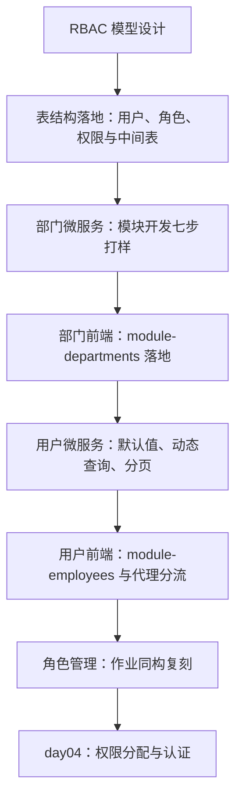
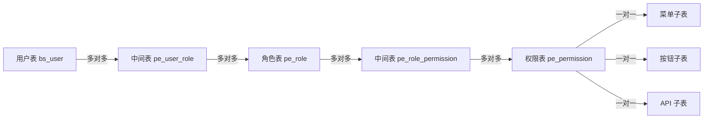

# day03 复习盘：RBAC 模型如何长成两个能跑的微服务

day03 的信息量在最近的课程里排得上号：先设计 RBAC 权限模型，再搭部门微服务走完一遍模块开发全流程，接着照葫芦画瓢做出用户微服务，前后端联调收尾，角色管理留成作业。一次课装了这么多东西，单点都懂但串不起来是复习时的常态。串珠子的那根线其实很清楚：权限系统不是直接写出「谁能干什么」，而是先把人、岗、资源这些元素管理起来，关系的分配与访问的验证才有地基。

## 先给结论

- 主线一句话：RBAC 定模型，建表落库，部门微服务打样，用户微服务复刻，前端模块平移，联调收尾。
- RBAC 三要素是用户、角色、权限，课程在此基础上扩展出资源；权限按粒度分菜单、按钮（页面元素）、API 三种，子表与权限主表一对一。
- 部门微服务是模板工程，实体、Dao、Service、Controller、前端模块、api、页面七步走完一个模块，后续模块都是这七步的复刻。
- 用户微服务在模板之上多了三件事：保存补默认值、Specification 动态条件、PageResult 分页契约。
- 角色管理留作作业，四层代码与用户模块同构，前端挂在公司设置页签下，资料包里实体与前端全齐。

## 一、本章主线：一张图串起七步



图上每一步都有独立的落盘产出：模型变成建表语句，后端四层变成可运行的服务，前端模块变成可点的页面。复习时对着这张图自问「每一步我能不能不看资料写出来」，答不上来的那格就是回头重看的位置。

## 二、RBAC：五张表说清「谁能干什么」

用大白话讲，RBAC（基于角色的访问控制）解决的问题是：不把权限零散地发给每一个人，而是把权限打包成角色，人拿到的是角色，权限跟着角色走。新员工入职配一次角色就齐活，岗位职责调整只动角色不动人，授权对象从「一堆用户」收敛成「几个岗位」。

模型的表结构是三张主表加两张中间表，权限之下再挂子表：



三处结构各有用意。用户与角色的多对多，解决「一个人可以多岗、一个岗位可以多人」；角色与权限的多对多，解决「一个角色管一批权限、一个权限可以进多个角色」；权限拆成一张主表带三张子表，是因为菜单、按钮、API 有共同的骨架（名称、类型、编码、父子层级），又有各自专属的字段，共性放主表、个性放子表，一对一同主键共值。SaaS 场景在模型上做了扩展，权限除了类型还要区分可见范围，平台公共资源与租户私有资源的边界靠字段标记，这一点 day04 会正式展开。

## 三、部门微服务：把七步练成肌肉记忆

部门模块是本章的样板间，从零到页面可点走了七步，每步一个验收标准：

| 步骤 | 产出 | 验收点 |
|---|---|---|
| 1 实体类 | Department 实体 | `@EntityScan` 扫到自己的 domain 包 |
| 2 Dao | 空接口继承 JpaRepository | 启动不报错，代理对象生成 |
| 3 Service | 增删改查方法 | 更新先查再改，冗余字段有人写 |
| 4 Controller | 五个接口统一返回 Result | 类上跨域注解与模块路径 |
| 5 前端模块 | module-departments 注册 | 左侧菜单出现，页面可跳转 |
| 6 api | 请求函数与接口文档对齐 | 路径、方式、参数三对齐 |
| 7 页面 | 取数渲染树形列表 | created 发请求，rows 进表格 |

这七步的价值不在部门本身，而在这是一套可复用的工程节奏。代码量都不大，真正决定进度的是每步的坑：实体扫描包指错、页码忘减一、跨域注解漏挂、代理前缀没抹干净。样板间走通一遍，后面所有模块的难度都从「不会写」降级成「照着写」。

## 四、用户微服务：模板之上多出的三件事

用户模块的骨架与部门完全同构，新增的知识点集中在数据处理的深度上。

**第一，保存时的默认值补齐。** 页面不提供密码和启用状态的输入框，Service 层在保存前补初始密码与启用状态，主键由 IdWorker 雪花算法生成。凡页面不传但业务必填的字段，都要有明确的兜底位置。

**第二，动态查询与分页。** 列表查询带三个可传可不传的条件（企业、部门、是否已分配部门），用 `Specification` 的 `toPredicate` 回调按参数有无动态拼 `Predicate`，条件之间以 AND 合并；分页靠 `findAll(spec, PageRequest.of(page - 1, size))`，页码在服务层统一减一。

**第三，分页返回的公共契约。** JPA 的 `Page` 对象不出接口，拆成 `total` 与 `rows` 装进公共模型 `PageResult`，前端分页组件全站通用。联调阶段还顺手修了一个 `hasDept` 未传时的漏数据问题，可选条件的「未传」语义必须在拼装时显式处理。

企业归属与部门归属两对冗余字段（id 加名称）也是在本模块定型的：列表页高频展示的名称直接存一份，省掉跨服务查询，代价由写入方承担。

## 五、角色管理作业：把套路再走一遍

作业要求参照案例代码完成角色的增删改查，四层代码与用户模块逐层对应，资料包里实体和前端都已备好。实体是理解成本最低的部分，`pe_role` 表对应四个业务字段加两个多对多集合：

```java
@Entity
@Table(name = "pe_role")
@Getter
@Setter
public class Role implements Serializable {
    private static final long serialVersionUID = 594829320797158219L;

    @Id
    private String id;
    // 角色名
    private String name;
    // 说明
    private String description;
    // 企业id
    private String companyId;

    @JsonIgnore
    @ManyToMany(mappedBy = "roles")
    private Set<User> users = new HashSet<>();   // 角色与用户 多对多，User 侧维护

    @JsonIgnore
    @ManyToMany
    @JoinTable(name = "pe_role_permission",
            joinColumns = {@JoinColumn(name = "role_id", referencedColumnName = "id")},
            inverseJoinColumns = {@JoinColumn(name = "permission_id", referencedColumnName = "id")})
    private Set<Permission> permissions = new HashSet<>();   // 角色与权限 多对多
}
```

控制器侧，单条操作与用户模块同款，值得看一眼的是分页接口的分页结果包装，`PageResult` 的用法与用户列表完全一致：

```java
/**
 * 分页查询角色
 */
@RequestMapping(value = "/role", method = RequestMethod.GET)
public Result findPage(int page, int pagesize) throws Exception {
    // 当前企业id，认证接入后自动解析
    String companyId = "1";
    // 1.完成分页查询，条件由公共方法构造
    Page<Role> searchPage = roleService.findSearch(companyId, page, pagesize);
    // 2.构造分页返回结果
    PageResult<Role> pr = new PageResult<>(searchPage.getTotalElements(),
            searchPage.getContent());
    return new Result(ResultCode.SUCCESS, pr);
}
```

前端落在 `module-settings` 模块，公司设置页面用 `el-tabs` 挂出「角色管理」页签，页签内是角色列表组件：表格列只有角色名与描述，操作列提供分配权限、修改、删除，新增与修改共用一个弹出表单。作业做完，RBAC 三要素里「人」与「岗」都管理起来了，只剩「资源」和「关系分配」，这就是 day04 的舞台。

## 常见误区

- **把 RBAC 理解成表越多越安全**：一对一拆子表是为了共性抽取与维护清晰，不是为了堆表。粒度选择要与业务匹配，菜单、按钮、API 三层已经覆盖绝大多数中后台场景。
- **作业只改类名**：复制用户模块后，`@Table` 的表名、Controller 的路径 `/sys/role`、前端 api 的路径与路由 `meta` 都是要语义化替换的点，漏掉任何一处，接口要么落错表要么 404。
- **角色分页漏掉 companyId 条件**：角色是按企业隔离的数据，查询不带企业条件会跨租户串数据，在 SaaS 系统里是事故级 bug。
- **多对多两边都声明维护**：用户侧与角色侧都写 `@JoinTable`，保存时会重复维护中间表，序列化还可能互相递归。维护方一侧声明，另一侧 `mappedBy` 声明只读。

## 面试可能被问到的问题

1. 面试官追问：「RBAC 模型的核心思想是什么，相比直接给用户授权好在哪？」
   答：核心是在用户与权限之间加一层角色。权限打包成角色，用户通过持有角色获得权限。好处是授权对象从大量个体收敛成少量岗位，人员流动只调整角色分配，权限调整只改角色内容，两边的变更互相独立，管理成本随规模增长的斜率远小于直接授权。

2. 面试官追问：「权限为什么拆成一张主表加三张子表？」
   答：菜单、按钮、API 三种粒度有公共属性（名称、类型、编码、父子层级），也有各自的专属字段（菜单的图标路由、按钮的编码、API 的地址方法）。共性放主表统一管理与建树，个性放子表一对一扩展，避免一张大宽表上一半字段永远为空。

3. 面试官追问：「用户与角色的多对多在 JPA 里怎么映射，谁来维护中间表？」
   答：持有多对多的 ownerId 侧用 `@ManyToMany` 加 `@JoinTable` 声明中间表的连接列，被持有侧用 `mappedBy` 声明不维护。维护侧保存时同步写中间表；两侧都加 `@JsonIgnore` 防止双向序列化递归。日常改动尽量落在单侧，避免并发下的中间表覆盖。

4. 面试官追问：「SaaS 多租户下，权限相关的数据怎么隔离？」
   答：按数据归属分两类。租户私有数据（用户、角色分配）每张表带 companyId，所有查询强制带企业条件；平台公共数据（菜单、按钮、API 资源）全平台一套，由平台管理员录入，租户只读，再用可见性字段区分平台级与租户级资源。

5. 面试官追问：「列表页冗余部门名称、企业名称字段，你怎么权衡？」
   答：读多改少的场景下冗余是划算的：列表页免连表或免跨服务调用，响应更快，实现更简单。代价是一致性维护，名称变更时要同步更新冗余列。判断标准是改名频率与读频率的比值，名称类字段改名极少，通常值得冗余；频繁变化的数值类字段则应实时关联查询。

6. 面试官追问：「模块化开发到一个新模块，你的第一步做什么？」
   答：先读接口文档和表结构，把字段分组与归属理清，再建后端四层并保证服务能启动，然后才是前端模块复制注册、api 对齐、页面取数。顺序反了会返工：先写页面会缺契约，先堆代码会漏扫描配置。每步带验收点推进，出问题能在一步之内定位。

## 配套资料

- 角色实体（作业所需，正文代码出处）：`materials/code/02/day03 SaaS-HRM系统用户权限设计概述/SaaS-HRM系统用户权限设计概述/资源/工具代码/实体类/Role.java`（同目录还有 User、Permission 等全部实体）
- 角色 Controller、Service、Dao 成例：`materials/code/02/day13-代码生成器实现/day13-代码生成器实现/资源/测试/生成代码路径/ihrm_company/src/main/java/com/ihrm/system/controller/RoleController.java` 与同包 `service/RoleService.java`、`dao/RoleDao.java`
- 角色前端模块（day04 资料包下发）：`materials/code/02/day04 权限分配与jwt概述/权限分配与jwt概述/资源/前端代码/module-settings/components/role-list.vue`、`pages/index.vue`
- 权限实体（一对一子表与可见性字段参照）：`materials/code/02/day04 权限分配与jwt概述/权限分配与jwt概述/资源/实体类/Permission.java`
- 全量建表脚本（RBAC 各表 DDL）：`materials/code/02/day02 SAAS-HRM数据库设计与前端框架/3-3 SAAS-HRM数据库设计与前端框架/资源/ihrm.sql`
