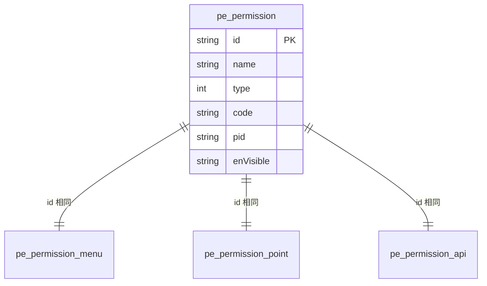
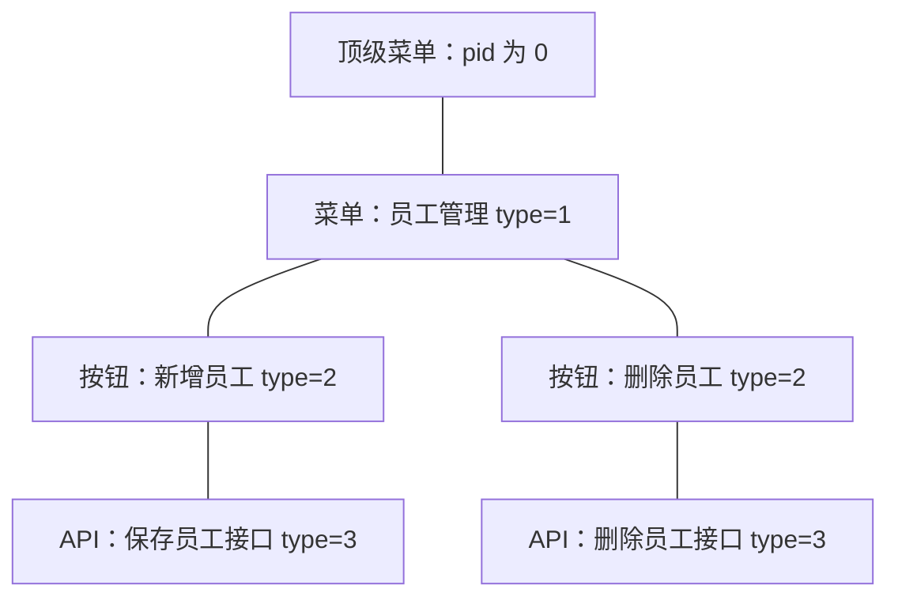

# 权限的实体类与 Dao：一张主表用共享主键带出菜单、按钮、API 三张子表

表结构定下来之后，写代码的第一个问题立刻浮出水面：一条「权限」既可能是菜单，又可能是按钮，还可能是 API 接口，三者的业务字段几乎没有交集，Java 实体该怎么映射？把所有字段塞进一个巨型实体是一种直觉做法，但它把三种互不相干的字段搅在一起，任何一个实体都解释不清自己是谁。课程的答案是一个主实体加三个子实体：四张表、四个实体、四个 Dao，公共字段归主表，差异字段各归各家，两张表之间用共享主键对齐。

## 先给结论

- `pe_permission` 主表放三种权限的公共字段：name、type、code、description、pid、enVisible；菜单、按钮、API 的差异字段分别放进三张子表。
- 子表与主表一对一，关联方式是共享主键：子表的 id 就等于对应权限的 id，不需要额外的外键列。
- `type` 字段区分粒度，1 菜单、2 功能（按钮）、3 API；`code` 是权限编码，后续所有权限校验都拿它做比对。
- `pid` 表达层级：菜单下挂按钮，按钮点击触发 API，父权限 id 存进 pid，顶级权限的 pid 为 0。
- Dao 层是四个空接口，继承 `JpaRepository` 与 `JpaSpecificationExecutor`，能力全部来自父接口。

## 一、公共字段进主表，差异字段进子表

菜单要图标和排序号，按钮要样式和状态，API 要请求地址和请求方式，三张表找不出共同的业务字段。但它们在权限体系里扮演同一个角色：都是「权限」的一种形态，都要参与编码比对、都要挂到树上、都要受可见性控制。

**第一，把共同点抽到主表。** name 这个字段在菜单上是菜单名，在按钮上是按钮名，在 API 上是接口名，抽象之后统一叫「权限名称」；code 是权限编码；pid 是父权限 id；enVisible 是可见状态；type 标记这条记录到底是菜单、按钮还是 API。这六个字段加上主键构成 `pe_permission`。

**第二，把差异点留给子表。** `pe_permission_menu`、`pe_permission_point`、`pe_permission_api` 三张子表分别只存自己的扩展字段，与主表构成一对一关系，而且三个 id 彼此相同：



图中三条一对一关系都没有独立的外键，靠「主键同值」维系。数据库层面三张子表之间没有任何约束，对齐动作完全由保存时的代码完成，这一点在写保存逻辑时必须心里有数。

## 二、Permission：权限主实体

主实体放在公共实体模块的 `domain.system` 包下（包名已改为中性的 `com.example`）：

```java
@Entity
@Table(name = "pe_permission")
@Getter
@Setter
@NoArgsConstructor
@DynamicInsert(true)
@DynamicUpdate(true)
public class Permission implements Serializable {
    private static final long serialVersionUID = -4990810027542971546L;
    /** 主键 */
    @Id
    private String id;
    /** 权限名称：菜单名、按钮名、API 名的统一抽象 */
    private String name;
    /** 权限类型 1为菜单 2为功能 3为API */
    private Integer type;
    /** 权限编码 */
    private String code;
    /** 权限描述 */
    private String description;
    /** 父权限 id */
    private String pid;
    // 可见状态
    private String enVisible;
}
```

字段里最值得多说两句的是 `code`。它是权限编码，整个系统的权限控制都围绕它展开：不管是前端菜单的显隐、后端接口的放行，还是按钮是否可点，判断依据都是「当前用户拥有的权限集合里有没有这个编码」，有就放行，没有就拦截。名称可以随便改，编码一旦被前后端约定使用就不能轻易变动。

`@DynamicInsert` 与 `@DynamicUpdate` 是 Hibernate 提供的两个注解，作用是让生成的 insert、update 语句只包含非空字段。对这套主子表方案尤其有用：子实体通常只有两三个字段有值，动态 SQL 避免了把无关列写成 null 的无谓开销。Lombok 的 `@Getter`、`@Setter` 负责生成访问器，`type` 用 `Integer` 而不是 int，是为了保留「未传值」的表达能力。

## 三、三个子实体：只装差异字段

三个子实体结构同构，都是 id 加两三个扩展字段：

```java
@Entity
@Table(name = "pe_permission_menu")
@Getter
@Setter
public class PermissionMenu implements Serializable {
    @Id
    private String id;
    // 展示图标
    private String menuIcon;
    // 排序号
    private String menuOrder;
}
```

```java
@Entity
@Table(name = "pe_permission_point")
@Getter
@Setter
public class PermissionPoint implements Serializable {
    @Id
    private String id;
    /** 权限代码：按钮样式 class */
    private String pointClass;
    private String pointIcon;
    private String pointStatus;
}
```

```java
@Entity
@Table(name = "pe_permission_api")
@Getter
@Setter
public class PermissionApi implements Serializable {
    @Id
    private String id;
    /** 请求地址 */
    private String apiUrl;
    /** 请求类型：get、post、delete 等 */
    private String apiMethod;
    /** 权限等级，预留字段，暂未使用 */
    private String apiLevel;
}
```

菜单有顺序，所以有排序号；按钮关心样式与状态，所以有 class 与 icon；API 关心地址与方法。每个子实体里都找不到「权限名称」，因为名字已经抽象进主表了。三个 `@Id` 与主表同名同值，这就是共享主键的全部含义。

pid 把四张表的数据串成一棵树。一张图看层级关系：



从任意一个节点顺着 pid 往上走，都能找到它的父权限：按钮属于某个菜单，点击按钮触发的 API 又挂在按钮或菜单之下。菜单下可以对应多个按钮，按钮与菜单之间是明确的从属关系，这棵树就是后续「给角色分配权限」时勾选界面的数据来源。

## 四、Dao：四个空接口

```java
package com.example.system.dao;

import com.example.domain.system.Permission;
import org.springframework.data.jpa.repository.JpaRepository;
import org.springframework.data.jpa.repository.JpaSpecificationExecutor;

public interface PermissionDao extends JpaRepository<Permission, String>,
        JpaSpecificationExecutor<Permission> {
}
```

`PermissionMenuDao`、`PermissionPointDao`、`PermissionApiDao` 与它逐字同构，只是泛型换成各自的实体。接口体一个方法都不用写，save、findById、findAll、deleteById 等能力由 `JpaRepository` 提供，`JpaSpecificationExecutor` 为动态条件查询预留入口（列表查询那一课会用到）。

有人会问：子实体的 Dao 能不能省？不能。权限的保存与更新是双表联动，一次请求要同时写主表和一张子表，四个 Dao 在 Service 里要同时注入，缺一个流程就断一条腿。

## 常见误区

- **给子表再设计一个 permission_id 外键列**：共享主键方案下子表的 id 就是权限 id，多加一列既冗余，又容易出现 id 与 permission_id 不一致的数据事故。
- **去 PermissionMenu 里找菜单名**：名称已抽取进主表，子实体只有图标、排序这类差异字段，要拿完整信息得把主表记录和子表记录按 id 拼起来。
- **type 的取值记混**：1 菜单、2 功能点（页面上的按钮）、3 API。把 type 当成任意整数透传，后面的 switch 分支就会掉进 default。
- **以为两张表的主键会被数据库自动同步**：共享主键靠保存代码显式对齐（给两个对象 setId 同一个值），数据库层面两张表毫无约束关系，代码漏了对齐，关系就断了。

## 面试可能被问到的问题

1. 面试官追问：「一对一的两张表为什么用共享主键，而不是外键加唯一约束？」
   答：共享主键省掉一列，关联关系天然明确，按 id 一次就能把两张表的记录拼齐，也避免了外键约束带来的级联维护成本。代价是数据库层没有完整性保护，子表记录的 id 必须由应用代码显式对齐，保存逻辑要收敛在一个流程里。

2. 面试官追问：「`@DynamicInsert` 和 `@DynamicUpdate` 的作用与代价是什么？」
   答：它们让 Hibernate 按实体非空字段动态拼 insert、update 语句，跳过值为 null 的列。好处是减少无谓的列更新、配合数据库默认值；代价是语句不再固定，无法充分利用 SQL 缓存，字段一多拼句也有开销，属于按需开启的优化。

3. 面试官追问：「权限编码 code 在体系里起什么作用？」
   答：它是权限的唯一业务标识，前端菜单显隐、按钮可点性、后端接口鉴权都以它为比对依据。登录后用户拿到权限编码集合，校验时判断集合中是否存在目标编码。编码要稳定且全局唯一，名称和描述都可以随意修改。

4. 面试官追问：「pid 邻接表方式存树有什么优缺点？」
   答：优点是结构简单，增删节点只改一行数据，每个节点只依赖一个 pid；缺点是查整棵子树需要递归或多次查询，数据库层面没有原生的树操作。本系统按 pid 逐层查子节点配合前端展开，节点总量有限，这个取舍是划算的。

5. 面试官追问：「主表加子表的映射，为什么不用 JPA 的继承映射一次搞定？」
   答：JPA 支持 JOINED 继承策略把父类与子类映射到多张表，但它要求共享主键由框架管理，且查询子类时会自动关联父表。本方案把「权限」与「资源」设计成平行的两个实体、靠业务代码联动，转换用 Map 到实体的工具类完成，比继承映射更直白，也规避了继承体系里多态查询的复杂度。

## 配套资料

- 权限实体类四件：`materials/code/02/day04 权限分配与jwt概述/权限分配与jwt概述/资源/实体类/Permission.java`、`PermissionMenu.java`、`PermissionPoint.java`、`PermissionApi.java`
- 权限 Dao 四件：`materials/code/02/day04 权限分配与jwt概述/权限分配与jwt概述/资源/通用代码/PermissionDao.java`（`PermissionMenuDao.java`、`PermissionPointDao.java`、`PermissionApiDao.java` 同目录）
- day13 代码生成器产出的同款成例可对照：`materials/code/02/day13-代码生成器实现/day13-代码生成器实现/资源/测试/生成代码路径/ihrm_company/src/main/java/com/ihrm/system/pojo/Permission.java`
- 正文实体与 Dao 均出自上述资料，包名统一改为 `com.example`，实体构造器有省略
