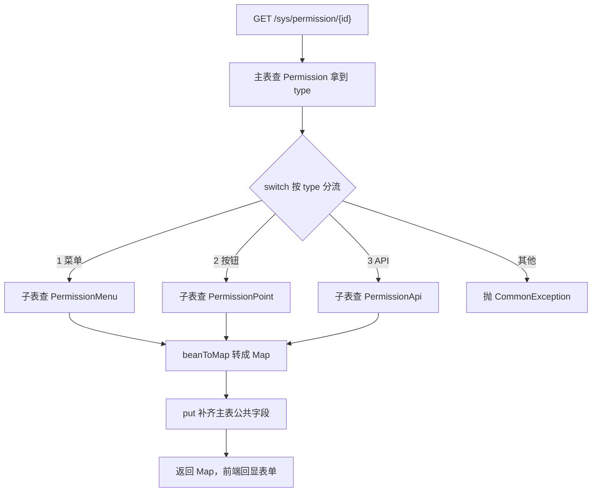

# 权限详情与删除：主子表同 id 联查回显，一次请求清干净两张表

详情接口看着比列表还简单，实现时却撞上权限模型的老问题：一条权限的完整数据散在 `pe_permission` 和一张资源子表里，`Permission` 实体装不下菜单图标、按钮状态、API 地址这些字段。编辑表单等着回显，接口必须一次性把主表公共属性和子表资源属性都交出去，返回 Map 成了最顺手的出路。删除同理：只删主表，子表里的资源记录就成孤儿；只删子表，列表里还挂着一个查不到详情的空壳权限。

## 先给结论

- 详情接口 `GET /sys/permission/{id}`，Service 返回 `Map<String, Object>`：子表资源属性来自 `beanToMap`，主表公共属性逐个 `put` 补齐。
- 主子表主键共享同一个 id，按 id 查资源不用任何关联查询，先查主表拿 type，再按 type 去对应子表查一次即可。
- 删除接口 `DELETE /sys/permission/{id}`：按 type 删对应资源子表，再删主表，两张表的动作包在同一个 `@Transactional` 事务里。
- Spring Data JPA 既支持 `deleteById(id)` 按主键删，也支持 `delete(entity)` 按对象删，前提都是先确认记录存在。
- type 不是 1、2、3 时直接抛 `CommonException`，让统一异常处理器返回明确错误，不做静默半操作。

## 一、详情为什么返回 Map

权限采用「主表加子表」的拆分设计：三种权限的公共字段（名称、类型、编码、描述、父 id、可见性）都在 `pe_permission`，每种权限的专属字段各占一张子表，菜单是 `pe_permission_menu`，按钮是 `pe_permission_point`，API 是 `pe_permission_api`。四张表的主键是同一个 id，保存时靠代码对齐。

这个设计让列表查询格外轻松（只碰主表），代价全压在详情接口上：响应体必须按 type 拼接两个实体的字段。可选方案有三种，把一个 `Permission` 原样返回是做不到的，实体里根本没有 `menuIcon` 这些属性；再造一个聚合 DTO 能解决，但要为一次表单回显专门建类；把实体转成 Map 再补充公共字段，零新增类、前端拿到扁平 JSON 直接填表单，是成本最低的一条路。

接口文档也印证了这个取向：详情响应里，type 为菜单时有菜单属性，为按钮时有按钮属性，公共属性始终存在。前端编辑弹层拿到什么就回显什么，不需要二次请求。



图里的关键点是两次查询共用同一个 id：主表查一次定类型，子表按同 id 查一次拿资源属性，不存在任何 join。字段拼接全在内存里完成。

## 二、findById：两次查询加一次拼装

Controller 的 findById 在这一课要改返回结构：原来返回 `Permission`，现在 Service 给什么就装什么，直接把 Map 交给 `Result` 的 data：

```java
/**
 * 根据 id 查询权限
 */
@RequestMapping(value = "/permission/{id}", method = RequestMethod.GET)
public Result findById(@PathVariable(value = "id") String id) {
    Map map = permissionService.findById(id);
    return new Result(ResultCode.SUCCESS, map);
}
```

Service 按三步走，查询权限、按类型查资源、构造 Map：

```java
/**
 * 根据 id 查询权限（主表公共属性 + 子表资源属性）
 */
public Map<String, Object> findById(String id) throws Exception {
    // 1.根据 id 查询权限，拿到类型
    Permission perm = permissionDao.findById(id).get();
    int type = perm.getType();
    // 2.根据类型查询对应的资源对象（id 共享，主键相同）
    Object object = null;
    switch (type) {
        case PermissionConstants.PY_MENU:
            object = permissionMenuDao.findById(id).get();
            break;
        case PermissionConstants.PY_POINT:
            object = permissionPointDao.findById(id).get();
            break;
        case PermissionConstants.PY_API:
            object = permissionApiDao.findById(id).get();
            break;
        default:
            throw new CommonException(ResultCode.FAIL);
    }
    // 3.资源对象转 Map，再补上主表的公共属性
    Map<String, Object> map = BeanMapUtils.beanToMap(object);
    map.put("id", perm.getId());
    map.put("name", perm.getName());
    map.put("type", perm.getType());
    map.put("code", perm.getCode());
    map.put("description", perm.getDescription());
    map.put("pid", perm.getPid());
    map.put("enVisible", perm.getEnVisible());
    return map;
}
```

**第一，类型判断用 switch 配常量。** `PermissionConstants` 里 `PY_MENU`、`PY_POINT`、`PY_API` 对应 1、2、3，与前文保存、更新用的是同一组常量。type 对不上任何分支说明数据有错或请求伪造，抛 `CommonException` 交给统一异常处理器，返回失败状态码。

**第二，`beanToMap` 与 `mapToBean` 是一对逆操作。** 保存时用 `mapToBean` 把请求体转成实体，详情这里用 `beanToMap` 把实体摊平成 Map，都基于 Spring 内置的 cglib `BeanMap`，按属性名读写。子表实体转出来的 Map 天然带着 `id`、`menuIcon`、`menuOrder` 这类 key，公共属性直接 `put` 进去就是合并，key 冲突时后写的覆盖先写的，所以公共字段只在最后补一次，不会被子表属性污染。

**第三，`findById(id).get()` 的前提是记录一定存在。** 详情入口的前端动作是点「查看」，id 来自列表里现成的行数据，正常流程不会落空。但这个 `.get()` 在 Optional 为空时会抛 `NoSuchElementException`，防御性更好的写法是先 `isPresent()` 判断再取值，或者抛出业务异常，这点在联调排查里还会再提到。

## 三、deleteById：一个事务清两张表

删除的 Controller 与详情对称，`@PathVariable` 收 id，调完 Service 返回成功：

```java
/**
 * 根据 id 删除权限
 */
@RequestMapping(value = "/permission/{id}", method = RequestMethod.DELETE)
public Result delete(@PathVariable(value = "id") String id) {
    permissionService.deleteById(id);
    return new Result(ResultCode.SUCCESS);
}
```

Service 侧的动作与查询共享同一个类型判断骨架：

```java
/**
 * 根据 id 删除权限（子表资源 + 主表记录，同一事务）
 */
@Transactional
public void deleteById(String id) throws Exception {
    // 1.查询权限，拿到类型
    Permission permission = permissionDao.findById(id).get();
    // 2.按类型删除资源子表记录（主键与权限 id 共享）
    int type = permission.getType();
    switch (type) {
        case PermissionConstants.PY_MENU:
            permissionMenuDao.deleteById(id);
            break;
        case PermissionConstants.PY_POINT:
            permissionPointDao.deleteById(id);
            break;
        case PermissionConstants.PY_API:
            permissionApiDao.deleteById(id);
            break;
        default:
            throw new CommonException(ResultCode.FAIL);
    }
    // 3.删除权限主表记录
    permissionDao.delete(permission);
}
```

**第一，方法上必须有 `@Transactional`。** 两张表两次删除，任何一步失败都需要整体回滚：只删了主表，子表资源成孤儿；只删了子表，主表还挂着一条详情报错的记录。前文的保存与更新同样碰两张表，事务注解一并补齐，这是「多表操作必有事务」在这个模块里的落地。

**第二，删除顺序建议先子表后主表。** 课堂上两种顺序都演示过，JPA 实体之间没有配置级联，两种顺序在事务内都能跑通；但数据库层面若建了子表 id 指向主表的外键，先删主表会触发约束冲突，先删子表永远不会踩这颗雷。

**第三，按对象删与按 id 删是等价的两条路。** `permissionDao.delete(permission)` 直接把第一步查出的托管对象交给 JPA，省一次按 id 的定位；`deleteById(id)` 则适合手里只有 id 的场景。课堂代码里主表用的对象删、子表用的 id 删，两种写法同框出现，正好把 API 面铺全。

删除完成后的验证路径也很直接：前端列表刷新，该行消失；再拿旧 id 调详情接口，主表查无记录，`.get()` 抛出的异常被统一处理后返回错误响应。数据删得干不干净，四张表逐个 `select` 一遍最保险，主表与对应子表都空，才算删干净。

## 常见误区

- **只删主表不删子表**：列表不再显示，但 `pe_permission_menu` 等子表里的资源记录还在，重新用相同 id 建权限时会出现旧属性串台。删除逻辑必须覆盖主表加对应的那一张子表。
- **详情接口直接返回 `Permission` 实体**：实体没有资源子表的字段，前端编辑弹层里菜单顺序、按钮样式全部空白。要么返回 Map 拼装，要么定义聚合 DTO，二选一。
- **`findById(id).get()` 不做存在性判断**：id 不存在时抛 `NoSuchElementException`，接口返回 500 而非友好的业务错误。对外暴露的详情接口建议先 `isPresent()`，不存在时抛带 `ResultCode` 的业务异常。
- **多表删除漏写 `@Transactional`**：子表删成功、主表删除报错的瞬间产生脏数据，且无回滚兜底。凡是增删改碰多张表，事务注解先行。

## 面试可能被问到的问题

1. 面试官追问：「详情接口返回 Map 和返回 DTO，怎么选？」
   答：Map 胜在零新增类、字段拼接灵活，适合字段组成随类型变化的场景；DTO 类型安全、字段有文档约束，适合结构稳定、多处复用的响应。本系统详情响应按 type 动态变化且只服务于表单回显，Map 更省事；若响应要进接口文档给第三方，DTO 更规范。

2. 面试官追问：「主子表共享主键有什么优缺点？」
   答：优点是关联天然明确，按 id 一次定位两张表，不需要额外的外键列和关联查询；缺点是主键生成权被主表独占，子表插入必须等主表 id 就绪，且一张子表只服务一种类型，类型多了子表数量随之增长。共享主键适合「一对一分类型扩展」的场景。

3. 面试官追问：「`deleteById` 和 `delete` 方法有什么区别？」
   答：`deleteById` 按主键删除，内部先按 id 查出实体再删，id 不存在时新版本会抛 `EmptyResultDataAccessException`；`delete` 直接接收实体对象，删除的是该对象对应的主键记录。手里已有托管对象用 delete，只有 id 用 deleteById，两者最终都是一条 delete 语句。

4. 面试官追问：「两个 delete 语句不加事务会怎样？」
   答：每条语句各自独立提交，第一条成功、第二条失败时数据库处于半删除状态，业务上无法自愈。加上 `@Transactional` 后两条语句同属一个事务，任一异常触发回滚，两张表要么都删掉要么都保留。这正是事务原子性最典型的应用场景。

5. 面试官追问：「Optional 的 `get()` 有什么风险，正确用法是什么？」
   答：`get()` 在 Optional 为空时抛 `NoSuchElementException`，把编译期想表达的「可能不存在」退化成运行时异常。正确姿势是 `isPresent()` 判断后取值，或者用 `orElseThrow` 挂接业务异常，让「查无此记录」转成携带业务状态码的可控响应，而不是裸 500。

## 配套资料

- 权限主表实体（公共字段与 `pe_permission` 表映射）：`materials/code/02/day04 权限分配与jwt概述/权限分配与jwt概述/资源/实体类/Permission.java`
- 三张资源子表实体：`materials/code/02/day04 权限分配与jwt概述/权限分配与jwt概述/资源/实体类/PermissionMenu.java`、`PermissionPoint.java`、`PermissionApi.java`
- 四个 Dao 与工具类：`materials/code/02/day04 权限分配与jwt概述/权限分配与jwt概述/资源/通用代码/PermissionDao.java` 等三个子表 Dao、`工具类/BeanMapUtils.java`、`工具类/PermissionConstants.java`
- day13 成例的单表版 `findById`、`deleteById` 可对照（无主子表联查，属代码生成器的通用骨架）：`materials/code/02/day13-代码生成器实现/day13-代码生成器实现/资源/测试/生成代码路径/ihrm_company/src/main/java/com/ihrm/system/service/PermissionService.java`
- 正文 findById、deleteById 为按本课视频写法整理并补全的示例（day04 资料包未含 Service 层源文件），包名统一改为 `com.example`
