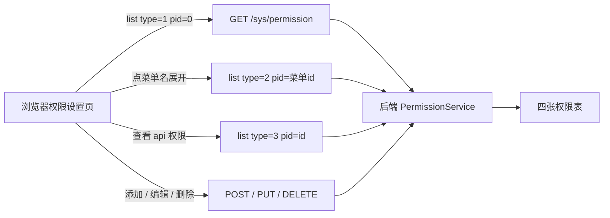

# 权限 CRUD 联调：前端模块注册、逐接口验证与报错定位

后端五个接口全部实现，代码编译通过不等于功能正确。权限模块的验证要跨前后端：前端工程导入权限页面与 api 封装，注册模块后从浏览器一路点下来，列表、展开、弹层、增删改各走一遍；HTTP 工具再对每个接口单独打请求，把「页面点不动」和「接口返回错」两类问题分开定位。这一课就是把整个联调链路走通，顺带认识几类最常见的报错。

## 先给结论

- 前端三件事：导入 `module-permissions` 等模块代码、把权限相关 api 放进 `api/base/`、在入口注册模块，左侧菜单随即出现「权限设置」。
- 页面与后端的对应关系：首屏列表查菜单（type 1）、点菜单名展开按钮（type 2）、弹层查 API（type 3），增删改走同一套 CRUD 接口。
- 联调报错先分三层：前端 toast（如「无子权限」）、HTTP 状态码（404 查路径与请求方式、400 查参数）、500 查后端栈（`.get()` 空指针、类型转换失败最常见）。
- 表单字段的类型约束在前后端各查一半：按钮状态传字母「a」直接报错，数字 1 才能通过，接口文档没写的隐含约束靠联调暴露。
- 后端重启后页面报错，多半是手工删库造成主子表数据残缺，先核对四张表再怀疑代码。

## 一、前端就位：模块、api、注册

课程资料包把这一课要用的前端代码都备齐了：`module-permissions` 是权限管理页，`module-settings` 里有角色列表（后面分配权限要用），员工模块里带了分配角色的组件，员工管理页面用不用都可以。这些代码拷进前端工程的 `src` 后，还差两步。

第一步是把权限相关的请求封装放进 `api/base/`，与既有的用户、角色 api 并排。每个文件按资源封装五个标准动作，权限这份最典型：

```javascript
import {createAPI} from '@/utils/request'

const api = "/sys/permission"
export const list = data => createAPI(`${api}`, 'get', data)
export const add = data => createAPI(`${api}`, 'post', data)
export const update = data => createAPI(`${api}/${data.id}`, 'put', data)
export const remove = data => createAPI(`${api}/${data.id}`, 'delete', data)
export const detail = data => createAPI(`${api}/${data.id}`, 'get', data)
export const saveOrUpdate = data => {return data.id?update(data):add(data)}
```

第二步是在工程入口注册新模块。前端工程按业务拆成了多个模块，入口文件里每个模块一次 import 加一次 `Vue.use`，权限模块照葫芦画瓢补进去：

```javascript
import permissions from '@/module-permissions' // 权限
import settings from '@/module-settings' // 设置

Vue.use(permissions, store)
Vue.use(settings, store)
```

模块的 `install` 方法里把自身路由注册进全局的异步路由表，保存后工程热更新，浏览器访问本地服务，左侧多出「权限设置」菜单，点击进入权限管理页，列表已经带着后端查出的数据了。前端不是重点，但这两步决定页面能不能活起来，路径错了就是一整页空白加控制台一串 404。

## 二、逐接口验证：页面动作与请求的对应关系

权限管理页把后端五个接口全部用上了，每个页面动作都能对应到一次具体请求。先用 HTTP 工具把后端单独验一遍，再回浏览器走页面，问题归属会非常清晰。

```bash
# 列表：查全部（不带参数）
curl "http://localhost:8080/sys/permission"

# 列表：只查顶级菜单
curl "http://localhost:8080/sys/permission?type=1&pid=0"

# 新增菜单
curl -X POST "http://localhost:8080/sys/permission" \
  -H "Content-Type: application/json" \
  -d '{"name":"测试菜单","code":"TEST","type":"1","pid":"0","enVisible":"1","menuOrder":"1"}'

# 详情：按 id 回显
curl "http://localhost:8080/sys/permission/{id}"

# 更新
curl -X PUT "http://localhost:8080/sys/permission/{id}" \
  -H "Content-Type: application/json" \
  -d '{"name":"测试菜单","code":"TEST","type":"1","pid":"0","enVisible":"1"}'

# 删除
curl -X DELETE "http://localhost:8080/sys/permission/{id}"
```

页面上的交互链与此一一对应。列表首屏调 `list({type:1,pid:0})` 拉全部一级菜单；点击菜单名，前端再发一次 `list({type:2,pid:菜单id})`，把查到的按钮行插到当前菜单下方，展开与收起靠前端维护；点「查看api权限」弹层，`list({type:3,pid:id})` 查该菜单绑定的接口权限。整个页面查了三次列表接口，参数不同而已。

写操作走表单弹层。「添加菜单」填名称、编码后提交，列表立即多出一行；点「查看」弹编辑框，勾选企业可见开关保存，提示修改成功；「删除」一次请求清两张表，行从列表消失。这些动作背后就是前面几课实现的 save、update、deleteById，页面只是把接口串成了操作流。



三条查询入线加一组写操作线，全部汇到同一个 Service，落库到四张表。联调时哪条线出问题，从浏览器 Network 面板看请求参数，从后端日志看执行栈，两边一对就能定位。

## 三、报错定位：三类问题的排查路径

联调现场出现的报错可以按来源分成三类。

**第一类是前端主动 toast 的业务提示。** 点开一个没有任何按钮的菜单，页面弹「无子权限」：这是前端判断 `res.data.data.length <= 0` 后给出的提示，请求本身是成功的，只是结果集为空。看到它先确认该菜单下确实没建过按钮，不是接口故障。

**第二类是参数类型不符的报错。** 在菜单下添加权限点，按钮状态一栏填了字母「a」，提交直接报错；换成数字 1 立刻成功。`pointStatus` 的取值约束在接口文档里并不显眼，前端表单也没有强校验，最终由后端落库环节拦下来。教训是：文档没写全的隐含约束，联调就是它们的暴露现场，遇到「明明一样的代码他就是不通」，先逐字段核对类型。

**第三类是后端 500。** 两种高频场景值得记住。其一是详情或删除接口传了不存在的 id，`findById(id).get()` 在空 Optional 上抛 `NoSuchElementException`，栈里搜这个异常名就能锁定；课程演示中途还出现过后端重启后页面异常的情况，原因是有条测试数据被手工删掉，主子表残留不一致，详情查询踩空。其二是 404，优先核对三处：Controller 的类级路径前缀、方法路径与请求方式是否与前端 api 文件一致，以及后端是否真的重启到了最新代码。跨域报错则检查控制器上的 `@CrossOrigin` 是否还在。

排查顺序建议固定下来：先看浏览器 Network 里请求发出去没有、路径对不对；再看响应状态码分清是 4xx 还是 5xx；最后才进后端日志读栈。跳过前两步直接闷头改代码，是联调阶段最大的时间黑洞。

## 常见误区

- **页面空白或菜单不出现就怀疑后端**：模块没注册、api 文件路径放错、import 拼写错，都是纯前端问题。先看控制台有没有模块加载报错，再查 Network 里请求是否发出。
- **把「无子权限」当接口错误**：这是前端对空列表的友好提示，HTTP 状态是 200。要排查的是该菜单下是否真没建权限点，而不是接口。
- **表单字段类型随手填**：`pointStatus` 这类字段约定数字取值，传字符串或字母直接触发后端异常。提交失败时逐字段对照接口文档，别只盯看过的那几个字段。
- **手工删库造出脏数据再调试代码**：测试数据不走了删除接口，而是直接在数据库里删主表，子表残留导致详情与列表行为诡异。测试期删除也请走接口，让业务代码保证两张表一致。

## 面试可能被问到的问题

1. 面试官追问：「前后端联调时，你排查一个接口报错的固定思路是什么？」
   答：先看前端请求是否按预期发出：Network 面板核对路径、方法、参数与请求头；再看响应状态码，4xx 归因于请求本身（路径、参数、鉴权），5xx 进后端日志看异常栈定位代码；最后核对数据层，确认库中数据状态与代码预期一致。顺序固定，避免跳步乱改。

2. 面试官追问：「404 和 400 各自通常意味着什么？」
   答：404 是请求没匹配到任何处理方法，常见于路径拼写、请求方式（GET 写成 POST）、类级前缀遗漏或模块未注册；400 是请求到达了方法但参数绑定失败，典型如请求体不是合法 JSON、Content-Type 不对、必填参数缺失。两者一个在映射层被拒，一个在参数解析层被拒。

3. 面试官追问：「前端一个列表页调了三次同一个列表接口，参数不同，这样设计合理吗？」
   答：合理。一个接口按参数组合服务多个场景，避免接口数量膨胀，也让查询条件的语义集中在服务端一处维护。代价是参数契约必须文档化，前端传错参数不会报结构错误只会拿到意外结果集。参数组合稳定后，也可以按场景封装前端方法，降低调用方心智负担。

4. 面试官追问：「测试数据为什么要走接口删，而不是直接操作数据库？」
   答：业务删除承载了数据一致性的保障逻辑，比如本模块删除主表时要同步清理对应资源子表。绕过接口手工删库，这些保障全部失效，主子表残留不一致，后续查询与统计都被污染，还把问题伪装成了代码缺陷。测试环境的造数与清数也应尽量复用业务入口或统一的测试数据工具。

5. 面试官追问：「跨域报错是什么原因，你们项目里怎么处理的？」
   答：浏览器同源策略拦截了不同协议、域名或端口的 AJAX 请求，前后端分离开发时前端 8080、后端 8081 天然跨域。处理方式是服务端放行：控制器加 `@CrossOrigin`，或全局配置 CORS 过滤器统一设置响应头。生产环境通常由网关统一处理，避免每个控制器重复配置。

## 配套资料

- 权限模块前端 api 封装：`materials/code/02/day04 权限分配与jwt概述/权限分配与jwt概述/资源/前端代码/api/base/permissions.js`（用户、角色同目录 `users.js`、`role.js`）
- 权限管理页（列表展开、弹层、增删改的完整交互代码）：`materials/code/02/day04 权限分配与jwt概述/权限分配与jwt概述/资源/前端代码/module-permissions/pages/index.vue`
- 权限模块路由注册（`install` 方法将页面路由并入全局路由表）：`materials/code/02/day04 权限分配与jwt概述/权限分配与jwt概述/资源/前端代码/module-permissions/index.js`
- 后端五接口的成例对照：`materials/code/02/day13-代码生成器实现/day13-代码生成器实现/资源/测试/生成代码路径/ihrm_company/src/main/java/com/ihrm/system/controller/PermissionController.java`
- 正文入口注册代码为按课程视频写法整理的示例（资料包未含前端工程入口 `main.js`），curl 命令为按接口文档构造的验证示例
