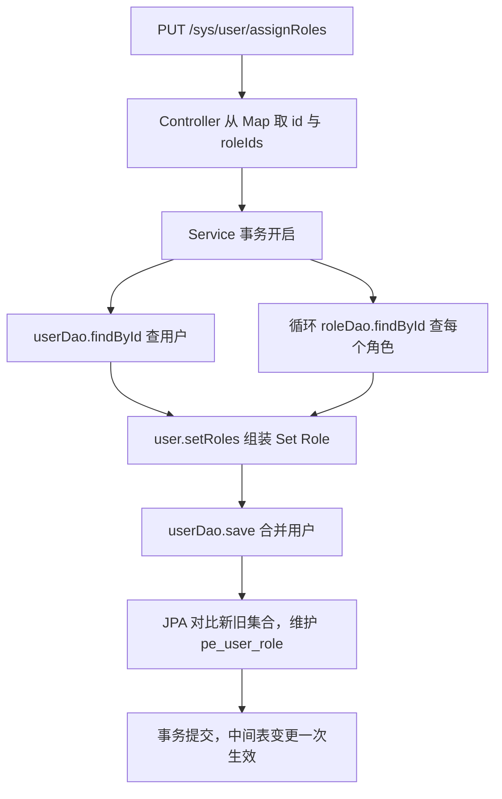

# 分配角色代码实现：交给 JPA 的中间表，一个 set 调用写穿多对多

需求分析定下的契约很小：一个用户 id，一个角色 id 数组，一次 PUT 请求整体覆盖。真正写代码时的疑问全落在中间表上：`pe_user_role` 这张表，代码里自始至终没有出现它的实体和 Dao，几行角色关系是怎么插进去的？答案是借了 JPA 多对多的内部机制：User 实体上声明过的 `@ManyToMany` 集合，set 一下再 save，框架自动把中间表的增删做掉。这堂课的代码极短，短到每一步都值得掰开讲。

## 先给结论

- Controller 用 `Map<String, Object>` 接请求体，取出 `id` 与 `roleIds` 后调 Service，返回成功即可，业务全在 Service。
- Service 四步：查用户、按角色 id 逐个查 Role 实体装进 `HashSet`、`user.setRoles(roles)`、`save(user)`。
- 中间表 `pe_user_role` 的写入由 JPA 依据 `@ManyToMany` 与 `@JoinTable` 注解自动维护，代码不出现任何中间表 SQL。
- 集合整体替换即是整体覆盖语义：新集合里没有的旧角色被删除行，新出现的被插入行，与前端复选框交互天然对齐。
- 方法上加 `@Transactional`，查询、集合替换与保存收在一个事务里，中间表变更随提交一次生效。

## 一、Controller：从 Map 里拆出两个参数

按课程接口路径把方法挂到用户控制器上。请求体是「id 加 roleIds 数组」的并集，没有现成实体能接，延续权限模块的老办法用 Map 收：

```java
/**
 * 分配角色
 */
@RequestMapping(value = "/user/assignRoles", method = RequestMethod.PUT)
public Result assignRoles(@RequestBody Map<String, Object> map) {
    // 1.获取被分配用户的 id
    String userId = (String) map.get("id");
    // 2.获取角色 id 列表
    List<String> roleIds = (List<String>) map.get("roleIds");
    // 3.调用 service 完成角色分配
    userService.assignRoles(userId, roleIds);
    return new Result(ResultCode.SUCCESS);
}
```

两次 `map.get` 都带强制转换，各有一处值得留意的细节。`id` 转 String 没有歧义，前端提交的就是字符串；`roleIds` 转成 `List<String>` 属于泛型擦除下的强转，编译器只会给一个 unchecked 警告，运行是否成功取决于 JSON 里数组的元素类型，前端 `checkedRoles` 存的本来就是字符串 id，类型对得上。假如某个调用方传了数字型 id，这个雷要到 Service 里逐个查 Role 时才爆，严格的做法是转换后逐个校验类型。

还有一个命名一致性问题藏在联调细节里：接口文档示例里写的字段名是 `roleId`，而前端组件实际提交的是 `roleIds`，后端代码按 `roleIds` 取值。两端以真实联通为准，文档与代码不一致时改文档，别让示例牵着代码走。

## 二、Service：查用户、装集合、存回去

Service 方法看着朴素，每一步都踩在 JPA 的机制点上：

```java
/**
 * 分配角色：整体覆盖用户的角色集合
 */
@Transactional
public void assignRoles(String userId, List<String> roleIds) {
    // 1.根据 id 查询用户
    User user = userDao.findById(userId).get();
    // 2.构造角色集合
    Set<Role> roles = new HashSet<>();
    // 3.遍历角色 id，逐个查出 Role 对象
    for (String roleId : roleIds) {
        Role role = roleDao.findById(roleId).get();
        roles.add(role);
    }
    // 4.设置用户与角色的关系并保存，JPA 自动维护中间表
    user.setRoles(roles);
    userDao.save(user);
}
```

**第一，装进集合的必须是 Role 实体，不是 id 字符串。** `user.setRoles` 接收 `Set<Role>`，多对多关系建立在一方实体的引用上；如果只 set 一批 id，JPA 无从知道这些 id 在 `pe_role` 表里对应谁，更不会去写中间表。所以循环里逐个 `roleDao.findById(roleId).get()` 把托管实体捞出来。也正因为是逐个查库，某个 roleId 不存在时 `.get()` 直接抛 `NoSuchElementException`，整个事务回滚，不会出现「分了一半的角色」。

**第二，用 `HashSet` 天然去重。** 前端复选框的勾选结果理论上是唯一的，但防御性编程不需要成本：同一个 Role 实体加两次，Set 只留一份，中间表也不会出现重复行。集合类型选 Set 而不是 List，还有一层匹配：实体声明里 `roles` 本来就是 `Set<Role>`，类型对不上连编译都过不了。

**第三，`save(user)` 之前实体已经改动，save 触发的是合并。** 查出来的 user 是托管对象，`setRoles` 后被事务的脏检查盯上；显式 `save` 走 merge 路径，把新的角色集合合并进持久化上下文。整个流程可以这样看：



图中最关键的一环是最后一格：代码没有一行碰 `pe_user_role`，删除与插入都发生在 JPA 对比新旧集合之后。

## 三、中间表为什么不用手写：先看注解，再看替代方案

这套自动化来自用户实体上的声明，映射关系在设计实体类时就已经定死：

```java
@ManyToMany
@JsonIgnore
@JoinTable(name = "pe_user_role",
        joinColumns = {@JoinColumn(name = "user_id", referencedColumnName = "id")},
        inverseJoinColumns = {@JoinColumn(name = "role_id", referencedColumnName = "id")})
private Set<Role> roles = new HashSet<Role>();
```

`@JoinTable` 把 `pe_user_role` 的两列钉死：`user_id` 来自 User 主键，`role_id` 来自 Role 主键。User 这一方是关系的拥有方（owning side），Role 那一方用 `mappedBy = "roles"` 声明自己不维护中间表，中间表的写入权完全跟着 User 的集合走。`@JsonIgnore` 则挡住序列化时的循环引用：用户带角色、角色又带用户集合，不加注解 JSON 会无限递归，响应体直接爆炸。

对比另一种写法更能看清这套机制的价值。day13 成例的生成代码里，`pe_user_role` 被映射成一个独立实体，两个字段 `roleId`、`userId` 组成联合主键，配套独立的 Dao 和 Service，分配角色的逻辑就变成手工版：先按 userId 删光旧关系，再逐行 insert 新关系，删与插都必须包在同一个事务里，这就是中间表管理的「先删后插」套路。两种写法各有位置：实体关系稳定、以实体导航为主的系统，多对多注解让代码最少；中间表日后要挂额外字段（比如分配人、分配时间），联合主键实体反而更直接。本系统选择了前者，于是分配角色只剩一个 set 调用。

事务边界在这里同样清楚：`@Transactional` 圈住的方法内，四次查询与一次合并同生共死。集合替换触发的中间表变更随提交统一落库，任何一步抛异常整体回滚，不存在旧角色删了、新角色没插上的中间态。

## 常见误区

- **把角色 id 字符串直接塞进集合再 save**：`Set<Role>` 类型不符编译报错；绕过类型硬写也不会生成中间表记录，分配静默失败。集合里必须是查出来的 Role 实体。
- **不给实体集合配 `@JsonIgnore`**：用户序列化角色、角色又反向序列化用户集合，循环引用导致栈溢出或响应体异常膨胀。双向多对多的两侧至少一侧要断开序列化。
- **事务外加集合操作**：`@ManyToMany` 默认懒加载，事务外访问 `user.getRoles()` 抛 `LazyInitializationException`；集合变更也不经提交.flush 就丢失。分配逻辑整体收进 `@Transactional` 方法。
- **文档字段名照抄进代码**：接口文档示例与前端实际提交的字段名可能不一致（本课即发生 `roleId` 与 `roleIds` 之分），后端取值以真实请求为准，取值为空时先核对字段名再看业务。

## 面试可能被问到的问题

1. 面试官追问：「JPA 的 `@ManyToMany` 中间表是何时写入的？」
   答：在拥有方实体被合并且事务提交时。框架对比集合的新旧状态，为移除的关联生成中间表 delete、为新增的关联生成 insert，随事务 flush 一次性执行。代码层面只操作实体集合，从不直接写中间表。

2. 面试官追问：「owning side 和 inverse side 是什么，有什么影响？」
   答：`@JoinTable` 声明在 User 一侧，User 是 owning side，负责维护中间表；Role 一侧 `mappedBy = "roles"` 是 inverse side，改它的集合不影响中间表。这意味着给用户分配角色要改 User 的集合，改 Role 的 users 集合不会写库，这是多对多最常见的翻车点。

3. 面试官追问：「分配角色的整体覆盖，JPA 是先删后插还是增量更新？」
   答：集合用 Set 时 Hibernate 做的是差量同步：旧集合里有而新集合没有的删掉，新集合多出来的插入，两边交集不动。语义上等价于整体覆盖，执行上不必全删全插。若换成手动管理中间表实体，就得自己实现先删后插并保证事务。

4. 面试官追问：「`@ManyToMany` 默认是懒加载还是急加载，有什么坑？」
   答：默认懒加载，关联集合在首次访问时才发查询。坑在事务外：Service 方法返回实体后，Controller 或序列化器再访问集合就抛 `LazyInitializationException`，所以响应里常用 `@JsonIgnore` 断开或用 DTO 显式装填。本系统在 Service 事务内完成所有集合操作，响应只回状态码，规避了这个问题。

5. 面试官追问：「为什么 Service 里逐个 `findById` 查角色，而不直接用 `findAllById`？」
   答：两者都能拿到实体集合，`findAllById` 一条 in 查询更高效。课堂代码逐个查是为了演示集合的组装过程，逻辑直观；生产代码建议换成 `roleDao.findAllById(roleIds)` 一次取回再装入 Set，减少往返。行为差异只在性能，事务语义不变。

6. 面试官追问：「如果中间表需要记录分配时间和操作人，该怎么演进？」
   答：多对多注解撑不住额外字段，要把中间表提升为独立实体（如 UserRole，含 user_id、role_id、时间、操作人），两个多对多降级为两个一对多，分配逻辑改为手工维护中间表记录，先删后插包在事务里。day13 成例正是这个形态，可以对照两种演进方向的代码差异。

## 配套资料

- 用户与角色实体（`@ManyToMany`、`@JoinTable`、`@JsonIgnore` 的真实声明）：`materials/code/02/day03 SaaS-HRM系统用户权限设计概述/SaaS-HRM系统用户权限设计概述/资源/工具代码/实体类/User.java`、`Role.java`
- 分配角色前端组件（提交 `{id, roleIds}` 的真实调用）：`materials/code/02/day04 权限分配与jwt概述/权限分配与jwt概述/资源/前端代码/module-employees/components/addRole.vue`
- 用户 api 封装（`assignRoles` 请求路径）：`materials/code/02/day04 权限分配与jwt概述/权限分配与jwt概述/资源/前端代码/api/base/users.js`
- 手管中间表的成例对照（`pe_user_role` 独立实体的联合主键写法）：`materials/code/02/day13-代码生成器实现/day13-代码生成器实现/资源/测试/生成代码路径/ihrm_company/src/main/java/com/ihrm/system/pojo/UserRole.java`、`dao/UserRoleDao.java`、`service/UserRoleService.java`
- 正文 Controller 与 Service 代码为按本课视频写法整理并补全的示例（day04 资料包未含用户模块 Service 层源文件），包名统一改为 `com.example`
