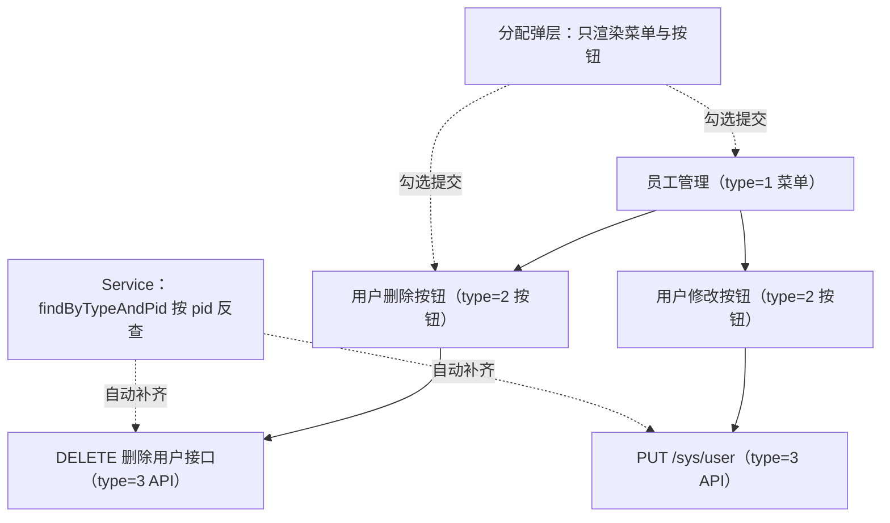
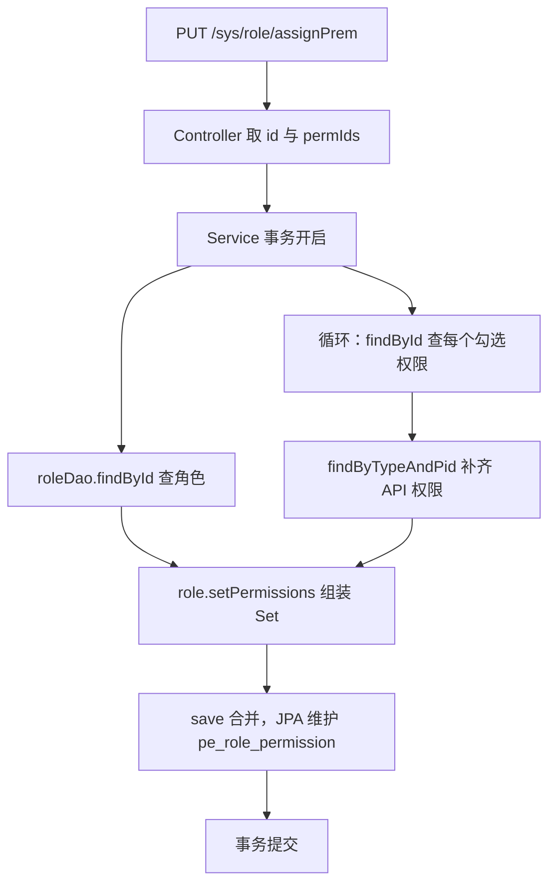

# 分配权限代码实现：勾选菜单和按钮，背后的 API 权限自动到账

分配角色的代码刚收尾，分配权限几乎是它的镜像：同样一个 id、一个 id 数组、一次整体覆盖。真正多出来的东西藏在一层看不见的结构里：前端分配弹层的权限树只有菜单和按钮，API 权限从头到尾不出现在界面上，但按钮背后挂着的接口必须一并授出去。这个「用户没勾、系统自动补」的动作，就是本课代码的核心。

## 先给结论

- Controller 挂在 `RoleController` 上，路径 `PUT /sys/role/assignPrem`，用 `Map` 接收 `id`（角色 id）与 `permIds`（权限 id 数组），业务全部下沉到 Service。
- Service 四步走：查角色对象、按 id 逐个查 Permission 装进 `Set`、`role.setPermissions(perms)`、`save(role)`，中间表 `pe_role_permission` 由 JPA 依据 `@ManyToMany` 自动维护。
- API 权限自动补齐是本课的灵魂：对每个勾选的菜单或按钮，用 `findByTypeAndPid(PY_API, 当前节点 id)` 查出它名下的全部 API 权限，`addAll` 进集合。
- 权限类型常量收敛在 `PermissionConstants`：`PY_MENU = 1` 菜单、`PY_POINT = 2` 按钮、`PY_API = 3` API。
- 勾选集合的行数会比勾选数多，多出来的就是自动带入的 API 权限，这是设计行为而不是数据错了。

## 一、Controller：与分配角色只差两个单词

分配权限的请求结构在设计阶段就定了：角色 id 加权限 id 数组。请求体没有现成实体能接，延续分配角色的做法用 `Map` 收参：

```java
/**
 * 分配权限
 */
@RequestMapping(value = "/role/assignPrem", method = RequestMethod.PUT)
public Result save(@RequestBody Map<String, Object> map) {
    // 1.获取角色 id
    String roleId = (String) map.get("id");
    // 2.获取权限 id 列表
    List<String> permIds = (List<String>) map.get("permIds");
    // 3.调用 service 完成权限分配
    roleService.assignPerms(roleId, permIds);
    return new Result(ResultCode.SUCCESS);
}
```

前端提交侧是现成的：`module-settings` 的角色列表组件在确认按钮里调 `assignPrem({id: this.formData.id, permIds: this.$refs.tree.getCheckedKeys()})`，`getCheckedKeys()` 返回树里所有被勾选节点的 id 数组，正好对上这里的 `permIds`。方法从分配角色复制而来，Controller 层只有两处实质变化：路径换成 `/role/assignPerm`，取的字段从 `roleIds` 换成 `permIds`。

## 二、Service：四步走的 assignPerms

Service 的骨架与分配角色完全同构，只是在第二步多了一段 API 补齐逻辑：

```java
@Autowired
private RoleDao roleDao;
@Autowired
private PermissionDao permissionDao;

/**
 * 分配权限：整体覆盖角色的权限集合
 */
@Transactional
public void assignPerms(String roleId, List<String> permIds) {
    // 1.获取分配的角色对象
    Role role = roleDao.findById(roleId).get();
    // 2.构造角色的权限集合
    Set<Permission> perms = new HashSet<>();
    for (String permId : permIds) {
        Permission permission = permissionDao.findById(permId).get();
        // 根据类型与父 id 查询该节点名下的全部 API 权限，自动赋予
        List<Permission> apiList = permissionDao.findByTypeAndPid(PermissionConstants.PY_API, permission.getId());
        perms.addAll(apiList);
        // 当前菜单或按钮本身也要加入集合
        perms.add(permission);
    }
    // 3.设置角色和权限的关系
    role.setPermissions(perms);
    // 4.更新角色
    roleDao.save(role);
}
```

**第一，集合里装的必须是 Permission 实体。** 与分配角色同一条铁律：`role.setPermissions` 接收 `Set<Permission>`，JPA 建立在实体引用上维护关系，塞一批 id 字符串过去它无从写中间表。所以循环里逐个 `findById(permId).get()` 捞出托管实体，某个 id 不存在时直接抛 `NoSuchElementException`，事务整体回滚。

**第二，`addAll` 与 `add` 各管一件事。** `addAll(apiList)` 装的是自动补齐的 API 权限，`add(permission)` 装的是用户亲手勾选的那个菜单或按钮本身。漏掉后一句，界面上看着分配成功了，实际上角色只拿到了按钮背后的接口，按钮自己反而没权限，菜单渲染时就会被权限过滤器拦下。

**第三，`findByTypeAndPid` 没写一行 SQL。** 这是 Spring Data JPA 的方法名派生查询：`ByTypeAndPid` 按 `And` 拆成两个条件，对应 `where type = ? and pid = ?`。资料包里的 `PermissionDao` 还是个空接口，这个方法按课堂写法在接口上补一行声明即可，框架自动生成实现：

```java
public interface PermissionDao extends JpaRepository<Permission, String>, JpaSpecificationExecutor<Permission> {
    // 按类型与父 id 查询权限列表，方法名即查询语句
    List<Permission> findByTypeAndPid(int type, String pid);
}
```

## 三、API 权限为什么要自动补：看一眼权限树的层级

权限数据是三层结构，勾选发生在上面两层，API 藏在最底层：



图里的勾选虚线只落在菜单和按钮上，API 全靠左边那条反查路径进入集合。能这样设计的前提是父子关系已经建模：`Permission` 实体上的 `pid` 字段记录父节点 id，按钮的 `pid` 指向所属菜单，API 的 `pid` 指向所属按钮。查询条件用「当前勾选节点的 id」去匹配别人的 `pid`，就找到了它名下的全部 API。类型过滤用 `PermissionConstants.PY_API`，常量定义很直白：

```java
public class PermissionConstants {
    /**
     * 权限类型 1为菜单 2为功能 3为API
     */
    public static final int PY_MENU = 1;
    public static final int PY_POINT = 2;
    public static final int PY_API = 3;
}
```

树的数据来自权限列表接口，参数里带 `enVisible: 1`，也就是只取企业可见的权限。平台私有的资源（`enVisible` 为 0）不进企业的分配弹层，API 权限平时也不在树里展示，两类「不出现」原因不同，别混为一谈。

## 四、中间表与事务：复用分配角色的全部机制

角色实体的多对多声明在 day03 就写好了，本课只是往里灌数据：

```java
@JsonIgnore
@ManyToMany
@JoinTable(name = "pe_role_permission",
        joinColumns = {@JoinColumn(name = "role_id", referencedColumnName = "id")},
        inverseJoinColumns = {@JoinColumn(name = "permission_id", referencedColumnName = "id")})
private Set<Permission> permissions = new HashSet<Permission>(0);
```

`Role` 是关系的拥有方，`@JoinTable` 把 `pe_role_permission` 的两列钉死。`assignPerms` 整体包在 `@Transactional` 里，查询、集合替换、合并收在一个事务，中间表的新增与删除随提交一次生效，不存在旧权限删了、新权限没写进去的中间态。



从图上数一遍写入路径：勾了 N 个节点，落进中间表的是 N 行加上这些节点名下的全部 API 行。测试时对不上账，先想想是不是忘了这层自动补齐。

## 常见误区

- **反查 API 时把 `permission.getPid()` 当成查询条件**：传当前节点的 `pid` 查出来的是它的兄弟节点挂的 API，权限凭空多出一批。正确条件是当前节点自己的 id，用它去匹配子节点的 `pid`。
- **只 `addAll` API 忘了 `add` 节点本身**：勾选的菜单或按钮没有进集合，页面菜单渲染不出来，接口反而全通了，现象很反直觉，排查时容易被带偏。
- **用 `List` 装权限集合**：实体声明是 `Set<Permission>`，类型不符直接编译错误；即便绕过去，重复勾选同一节点也会往中间表塞重复行，`HashSet` 天然去重。
- **以为前端会提交 API 权限 id**：树里根本没有 API 节点，`permIds` 里永远不会有 `type = 3` 的 id。后端不补查，角色就永远拿不到接口权限，鉴权时表现为一批 403。

## 面试可能被问到的问题

1. 面试官追问：「`findByTypeAndPid` 没有实现类，为什么能查出数据？」
   答：这是 Spring Data JPA 的方法名派生查询。框架解析方法名里的 `ByTypeAndPid`，生成 `where type = ? and pid = ?` 的实现。条件字段必须在实体上存在，否则启动时就报属性找不到的异常。

2. 面试官追问：「为什么 API 权限不在前端勾选，而是后端自动补？」
   答：权限是父子级联的，按钮背后的 API 由开发时固定挂载，用户勾选按钮就隐含了授予其接口的意图。让前端去勾 API 既暴露实现细节又容易漏勾，后端按 `pid` 反查是唯一可靠的入口。

3. 面试官追问：「`pe_role_permission` 中间表是谁写的？」
   答：Role 实体用 `@ManyToMany` 加 `@JoinTable` 声明了关系并且是拥有方，集合被替换后由 Hibernate 在事务提交时对比新旧集合生成增删语句，业务代码不直接操作中间表。

4. 面试官追问：「同一个按钮被两个角色勾选，中间表会怎样？」
   答：中间表每行是 role_id 加 permission_id 的组合，不同角色的行各自独立；同一角色内部重复提交同一权限，靠 `HashSet` 去重保证只有一行。整体覆盖语义下重复提交是幂等的。

5. 面试官追问：「分配权限的事务边界怎么划？」
   答：整个 `assignPerms` 用 `@Transactional` 圈住。逐个 `findById`、反查 API、set 集合、save 合并全部在一个事务里，任何一步抛异常整体回滚，避免出现角色权限只更新一半的中间态。

6. 面试官追问：「`enVisible` 字段在分配链路里起什么作用？」
   答：它区分平台私有与企业可见。分配弹层拉树时传 `enVisible = 1`，平台级的资源不进入租户的分配范围，这是 SaaS 多租户权限区别于单体应用权限的细节。

## 配套资料

- `Permission` 实体（`pid`、`type`、`enVisible` 字段的真实声明）：`materials/code/02/day04 权限分配与jwt概述/权限分配与jwt概述/资源/实体类/Permission.java`
- 权限类型常量：`materials/code/02/day04 权限分配与jwt概述/权限分配与jwt概述/资源/通用代码/工具类/PermissionConstants.java`
- `PermissionDao` 空接口（`findByTypeAndPid` 按课堂写法补全）：`materials/code/02/day04 权限分配与jwt概述/权限分配与jwt概述/资源/通用代码/PermissionDao.java`
- `Role` 实体（`@JoinTable` 声明 `pe_role_permission`）：`materials/code/02/day03 SaaS-HRM系统用户权限设计概述/SaaS-HRM系统用户权限设计概述/资源/工具代码/实体类/Role.java`
- 分配权限前端调用（`getCheckedKeys` 提交 `permIds`）：`materials/code/02/day04 权限分配与jwt概述/权限分配与jwt概述/资源/前端代码/module-settings/components/role-list.vue`、`materials/code/02/day04 权限分配与jwt概述/权限分配与jwt概述/资源/前端代码/api/base/role.js`
- 正文 Controller 与 Service 代码为按本课视频写法整理并补全的示例（day04 资料包未含系统模块 Service 层源文件），包名统一为 `com.example`
