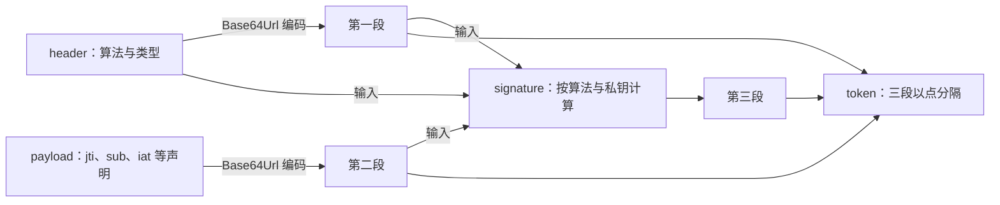
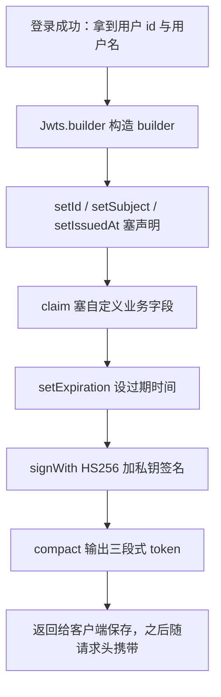

# JWT 第一课：三段式结构拆开看，再用 JJWT 签出第一个 token

> 🔒 安全提示：文中示例的口令/密钥均为课程教学环境演示口径，生产环境的安全要求见《安全与合规须知》。

四种认证机制盘完了，微服务场景的答案落在 Token 路线上，它的标准化实现就是 JWT。HRM 系统的用户认证与授权要从这里起步：先把 JWT 这个规范看透，再在工程里亲手签出第一个 token。本课只做两件事，认识它、创建它，解析与校验留给下一课。

## 先给结论

- JWT 即 JSON Web Token，是一套轻巧的规范，允许客户端与服务端之间传递防篡改的安全声明；Java 世界用开源类库 JJWT 实现它。
- token 字符串固定三段：header（头部）、payload（载荷）、signature（签名），以点分隔；前两段是 Base64Url 编码，第三段是对前两段的签名。
- 签名保证「不被篡改」，不保证「保密」：payload 只是编码不是加密，Base64 一解就是明文，敏感数据不能往里放。
- 创建动作收敛在一行链式调用：`Jwts.builder()` 塞入 `setId`、`setSubject`、`setIssuedAt`，再用 `signWith(SignatureAlgorithm.HS256, 私钥)` 签名，`compact()` 输出字符串。
- HS256 是对称签名 HMAC-SHA256，私钥服务端单独保管；泄露私钥等于任何人都能签发合法 token。

## 一、JWT 是什么：一段自带签名的声明

JWT 是 JSON Web Token 三个单词的缩写。它解决的问题是：客户端和服务端之间传递的数据，怎么保证途中不被篡改。普通 JSON 谁都能改，JWT 在数据后面附上一个签名，接收方重算一次签名对得上，才承认这份数据是签发者发出来的原样内容。

规范把声明分了层。header 声明签名算法与类型，payload 放实际数据（规范里叫 claims），signature 把前两段加私钥再算一遍哈希。三段各自 Base64Url 编码后用点拼接，就是最终那个长字符串：



图里能看到签名的输入包含前两段，这是防篡改的全部原理：payload 改一个字符，第二段编码就变了，服务端拿改过的串重算签名，对不上原始第三段，校验直接失败。payload 里能放什么，规范给了标准字段（registered claims）：`jti` 是唯一标识，`sub` 是主题（放用户名），`iat` 是签发时间，`exp` 是过期时间。课堂示例往里放了用户 id 与用户名，用的是约定俗成的字段位。

要注意这套机制的边界：Base64Url 是编码，人人可解。JWT 防的是中间人改数据，不防人看数据，所以密码、手机号这类敏感信息不该进 payload。

## 二、引入 JJWT：一行坐标的事

JWT 只是规范，Java 里干活要靠实现。主流选择是 JJWT，Maven 坐标一行引入，按课堂做法挂在公共模块里（包名已改为 `com.example`）：

```xml
<dependency>
    <groupId>io.jsonwebtoken</groupId>
    <artifactId>jjwt</artifactId>
    <version>0.6.0</version>
</dependency>
```

依赖放进 `common` 模块有讲究：token 的签发与解析是所有微服务共用的能力，收在一个公共模块里，后续封装成工具类时各服务直接引用，不必每家都写一遍。引入坐标后，在测试包里建一个 `CreateJwtTest`，用 `main` 方法直接跑，先看生成效果。

## 三、创建 token：一条链式调用走完

JJWT 的 API 设计成了建造者模式，从头到尾一路点下去：

```java
package com.example.demo;

import io.jsonwebtoken.JwtBuilder;
import io.jsonwebtoken.Jwts;
import io.jsonwebtoken.SignatureAlgorithm;
import java.util.Date;

public class CreateJwtTest {
    public static void main(String[] args) {
        JwtBuilder jwtBuilder = Jwts.builder()
                .setId("888")                        // jti：用户 id
                .setSubject("小白")                   // sub：用户名
                .setIssuedAt(new Date())             // iat：签发时间
                .signWith(SignatureAlgorithm.HS256, "ihrm");  // 签名算法与私钥
        String token = jwtBuilder.compact();         // 生成最终字符串
        System.out.println(token);
    }
}
```

`setId` 与 `setSubject` 里放什么内容是自由的，课堂里选了 id 和用户名，因为这两个值正是后续鉴权时要用的身份信息，从 token 里解出来就能定位用户。`setId` 不是必填、`setSubject` 也不是必填，按需组合，签名字段则是必配，不签名的 token 谁都能改，规范就失去了意义。

跑 `main` 方法，控制台打印出一段长字符串，两个点把它分成三段。第一段解码出来是固定的算法声明：

```bash
# 第一段解开就是 header
echo "eyJhbGciOiJIUzI1NiJ9" | base64 -d
# {"alg":"HS256"}
```

第二段解开是 payload 的 JSON，`888`、`小白`、签发时间都在里面；第三段是一串不可读的签名值。三段合体，token 就签发完成了。

## 四、签名算法：HS256 在防什么

`SignatureAlgorithm.HS256` 选的是 HMAC-SHA256，一种对称签名算法：签发与校验用同一把私钥。服务端拿到 token 后，用私钥对 header 与 payload 重算一遍哈希，与第三段比对，一致则认定内容未被篡改且确为自己签发。私钥在课堂里随手写了个项目相关的字符串，生产环境必须换成足够长的随机密钥并妥善保管，因为对称体系下私钥一旦泄露，攻击者可以签发任意身份的合法 token。

想用非对称方案也有选择：`SignatureAlgorithm` 枚举里还有 RS256 一族，私钥签名、公钥验签，适合签发方与校验方分离的场景。HS256 的版本坑值得记一笔：0.6.0 允许直接传字符串私钥，0.10 之后的版本签名参数改成了 `Key` 对象，且 HS256 要求密钥长度不少于 256 位，老代码升级时会在这里报 `WeakKeyException`。

## 五、从测试类到工程封装

测试类验证的是最小流程，工程里的封装会再加两层东西：过期时间与自定义业务字段。项目后续会落地这样一个工具类（真实成例来自课程的 common 模块，此处摘录核心方法，包名已改为 `com.example`）：

```java
public String createJwt(String id, String name, Map<String, Object> map) {
    // 失效时间 = 当前时间 + 配置的 ttl
    long now = System.currentTimeMillis();
    long exp = now + ttl;
    JwtBuilder jwtBuilder = Jwts.builder().setId(id).setSubject(name)
            .setIssuedAt(new Date())
            .signWith(SignatureAlgorithm.HS256, key);
    // 自定义 claims：角色、企业 id 等业务信息
    for (Map.Entry<String, Object> entry : map.entrySet()) {
        jwtBuilder.claim(entry.getKey(), entry.getValue());
    }
    jwtBuilder.setExpiration(new Date(exp));   // exp：过期时间
    return jwtBuilder.compact();
}
```

对比测试类，多出的三样都有实际用途：`setExpiration` 让 token 有了寿命，过期后解析直接报错；`claim` 把用户角色、所属企业这些鉴权要用的信息一并装进 payload，避免每次校验都回库查；私钥与 ttl 从配置读取，换环境不用改代码。创建的完整链路如下：



从登录成功到 token 出厂，一步是数据、一步是签名，签名把前面所有步骤产出的内容整体锁死。客户端拿到的是最终字符串，之后每次请求放进请求头，服务端只需要私钥就能验明正身，这正是 Token 认证「服务端无状态」承诺的实现方式。

## 常见误区

- **把 JWT 当加密**：Base64Url 是编码不是加密，payload 任何人可解。机密数据进 payload 等于公开，需要保密的内容要么不传，要么在应用层另行加密。
- **私钥随手硬编码**：示例里写死字符串只为演示，生产环境私钥进配置中心并控制访问权限。HS256 是对称签名，私钥泄露等于签发权易主。
- **忽略 JJWT 版本差异**：0.6.0 的 `signWith(SignatureAlgorithm, String)` 在新版本已废弃，0.10 之后要求 `Key` 对象且 HS256 密钥至少 256 位。照抄旧教程报 `WeakKeyException`，多半是版本对不上。
- **以为 builder 打印出来就是 token**：`Jwts.builder()` 返回的是建造者对象，必须调用 `compact()` 才生成字符串，少这一步拿到的不是可用凭证。
- **claims 里塞大对象**：token 每次请求都要随头传输，payload 塞得越多请求越重，还扩大了泄露面。装 id、用户名、角色这类小字段即可，详细信息按需回库查。

## 面试可能被问到的问题

1. 面试官追问：「JWT 的三段分别是什么，各自放什么？」
   答：header 放签名算法与类型，payload 放声明（标准字段如 jti、sub、iat、exp，以及自定义业务字段），signature 是用 header 与 payload 加私钥按指定算法算出的哈希。前两段 Base64Url 编码后用点拼接，第三段跟在后面。

2. 面试官追问：「JWT 为什么不能被篡改，又为什么不保密？」
   答：签名把前两段的内容锁死了，改动任意字符都会导致服务端重算的哈希与第三段对不上，校验失败。但前两段只是 Base64Url 编码，解密没有门槛，所以防篡改不防窃看，敏感信息不能明文进 payload。

3. 面试官追问：「HS256 和 RS256 怎么选？」
   答：HS256 对称，签发与校验同一把私钥，速度快，适合签发方与校验方是同一信任域的内部服务；RS256 非对称，私钥签名公钥验签，校验方拿不到签发能力，适合对外分发公钥给多个验证方的场景。

4. 面试官追问：「JWT 无状态带来的好处和麻烦？」
   答：好处是服务端不存会话，扩容不需要共享存储，校验只是一次本地计算；麻烦是签发后无法主动撤销，改密码、踢人只能靠短过期时间加黑名单等补偿手段，丢失的 token 在过期前始终有效。

5. 面试官追问：「JJWT 创建 token 的关键 API 有哪些？」
   答：`Jwts.builder()` 得到建造者，`setId`、`setSubject`、`setIssuedAt`、`claim`、`setExpiration` 塞各类声明，`signWith` 指定算法与私钥，`compact()` 生成最终字符串。解析则走 `Jwts.parser().setSigningKey(key).parseClaimsJws(token)`。

6. 面试官追问：「token 应该存在客户端哪里？」
   答：浏览器端常见选择是 localStorage 或 Cookie，localStorage 读取方便但要自己防 XSS，Cookie 配合 HttpOnly 能挡脚本读取但要处理 CSRF；移动端存本地安全存储，随请求放进 Authorization 头即可，这也是 Token 不依赖 Cookie 的价值所在。

## 配套资料

- token 创建的课堂写法（`CreateJwtTest` 按本课视频整理，jjwt 坐标 0.6.0 与课堂一致）：day04 资料包未含该测试类源文件，示例为按本课写法补全，包名改为 `com.example`
- 工程化封装成例（`createJwt` 含 ttl、自定义 claims、`setExpiration` 的真实实现）：`materials/code/02/day14 微服务网关与社保模块开发/day14/03-资料/common模块的工具类/JwtUtils.java`
- 公共模块 pom 参照（依赖统一收敛在 common）：`materials/code/02/day04 权限分配与jwt概述/权限分配与jwt概述/资源/通用代码/`
