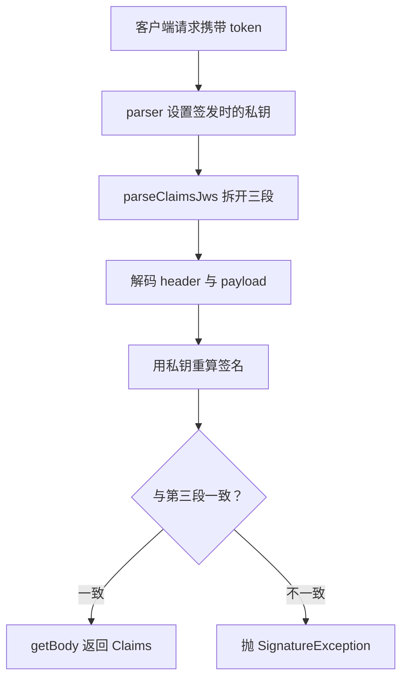

# 把签出去的 token 解析回来：parser、Claims 与验签异常

> 🔒 安全提示：文中示例的口令/密钥均为课程教学环境演示口径，生产环境的安全要求见《安全与合规须知》。

用户登录成功，服务端签出一串 token 交给客户端，这只是故事的前半段。后半段是：客户端之后每次请求都带着这串字符回来，服务端必须把它解开，确认签名对不对、内容有没有被改，再从里面取出用户标识。解不开或验不过的 token，一分数据都不能给。

## 先给结论

- 解析入口是一条固定链：`Jwts.parser().setSigningKey(私钥).parseClaimsJws(token).getBody()`，返回 `Claims` 对象，token 里的全部声明都挂在它身上。
- 解析自带验签：JJWT 用私钥对前两段重算一次签名，与第三段比对，对不上直接抛 `SignatureException`，篡改的 token 一行数据都拿不到。
- `Claims` 近似一个 `Map`：`getId`、`getSubject`、`getIssuedAt` 读标准声明，自定义字段用 `get("key")` 取。
- 解析用的私钥必须与签发时完全一致，差一个字符整串作废。
- 设置过过期时间的 token 到期后解析会抛 `ExpiredJwtException`，失效凭证同样过不了关。

## 一、解析时到底发生了什么

签发是把声明编码、加签名、拼成三段；解析是把这个过程倒过来走一遍，但顺序上多了一道闸门。JJWT 拿到 token 后先拆出三段，解码前两段，用服务端自己保管的私钥对着 header 与 payload 重算一次签名，再和第三段比对。比对通过，才把第二段的内容包装成 `Claims` 返回；比对失败，直接抛异常，根本轮不到你取数据。

这张图在讲解析的完整路径，核心是「重算签名再比对」这一步。



图里最能说明问题的是那条「不一致」的分支：签名校验在取数据之前，任何对 payload 的改动都会让重算结果偏离原始第三段，异常在 `getBody()` 之前就抛出来了。服务端不需要维护一张「已签发 token」的表，一次本地计算就能完成防篡改校验，这正是 Token 方案无状态的底气。

## 二、测试类：把 token 逐字段解开

在测试包里建一个 `ParseJwtTest`，用 `main` 方法验证解析流程（示例按课堂写法补全，私钥用演示值）：

```java
package com.example.demo;

import io.jsonwebtoken.Claims;
import io.jsonwebtoken.Jwts;

public class ParseJwtTest {
    public static void main(String[] args) {
        // 签发端输出的三段式字符串，两个点分隔
        String token = "eyJhbGciOiJIUzI1NiJ9.eyJqdGkiOiI4OCIsInN1YiI6IuWwj+iZjiJ9.xxxx";
        Claims claims = Jwts.parser()
                .setSigningKey("example-secret")   // 必须与签发时一致
                .parseClaimsJws(token)
                .getBody();
        System.out.println(claims.getId());        // 88，对应 jti
        System.out.println(claims.getSubject());   // 小白，对应 sub
        System.out.println(claims.getIssuedAt());  // 签发时间，对应 iat
    }
}
```

`Claims` 接口同时实现了 `Map`，所以标准声明给了语义化的 getter，自定义声明留给下一课的 `get("key")`。控制台把 id、用户名、签发时间原样打出来，说明签进去的内容一个不少地取了回来。

方法名里的字母 s 值得多看一眼：`parseClaimsJws` 的 s 指 signed，先验签再返回声明；不带 s 的 `parseClaimsJwt` 处理的是没有签名的裸 JWT，只解码不校验。业务里要的一定是带 s 的那个，少写一个字母，验签就形同虚设。

## 三、私钥错了、串改了：两类必见的异常

课堂里做了两个破坏性实验，结论很干脆。

**第一，私钥不一致。** 签发时用 `example-secret`，解析时随手改成 `abcd1234`，运行直接报错：

```text
io.jsonwebtoken.SignatureException: JWT signature does not match locally
computed signature. JWT validity cannot be verified.
```

**第二，token 被改动。** 私钥不动，在 token 尾部随手补一个字符，异常一模一样。对验签来说这两件事是等价的：要么签名算不对，要么内容对不上原始签名，统统拦下。

常见的异常可以归成三类：

| 异常 | 触发条件 | 工程处置 |
|---|---|---|
| `SignatureException` | 私钥不一致或 payload 被篡改 | 视为无效凭证，拒绝访问 |
| `ExpiredJwtException` | `setExpiration` 设过的 token 到期 | 返回登录失效，引导重新登录 |
| `MalformedJwtException` | 串结构损坏，段数不对或编码非法 | 视为伪造请求，直接拒绝 |

工程里这套动作收敛在工具类的一个方法里，课程 common 模块的真实成例长这样（包名已改为 `com.example`）：

```java
public Claims parseJwt(String token) {
    Claims claims = Jwts.parser().setSigningKey(key).parseClaimsJws(token).getBody();
    return claims;
}
```

私钥 `key` 来自配置文件，签发与解析共用一个实例，两边天然一致。同一个成例库里还有一版带 try-catch 的写法，捕获异常后返回 `null`，把「这个 token 有效吗」变成一个可判断的返回值，两种风格都可以，关键是全项目统一。

## 常见误区

- **`parseClaimsJws` 写成 `parseClaimsJwt`**：少了 s 的方法不验签，改过的 token 也能解出数据，防线整个漏掉。IDE 自动补全时看清楚方法名。
- **以为解析失败会返回 null**：JJWT 的设计是抛异常而不是安静返回，调用方必须 try-catch 或者在工具类里兜住，不然一次非法 token 就是接口 500。
- **把 `get` 的返回值直接赋给 `String`**：`Claims.get("key")` 返回 `Object`，直接强转在类型不符时会抛 `ClassCastException`，用 `get("key", String.class)` 这类带类型的重载更稳。
- **解析端私钥与签发端各写各的**：环境一多（测试、预发、生产）私钥不同步，就会出现「自己的 token 自己验不过」，密钥统一从配置中心下发。

## 面试可能被问到的问题

1. 面试官追问：「服务端解析一个 JWT 具体做了哪几步？」
   答：拆出三段，Base64Url 解码 header 与 payload，用本地私钥对前两段按 header 声明的算法重算签名，与第三段比对；通过后把 payload 包装成 Claims 返回，失败则抛出对应异常。

2. 面试官追问：「签名不符和 token 过期分别抛什么异常，怎么处理？」
   答：签名不符抛 `SignatureException`，说明私钥不对或内容被改，直接拒绝；过期抛 `ExpiredJwtException`，属于正常失效，通常返回「登录已过期」让用户重新登录。两者都应该在全局或工具类层面统一捕获。

3. 面试官追问：「`parseClaimsJws` 和 `parseClaimsJwt` 有什么区别？」
   答：前者处理带签名的 JWS，解析前先验签；后者处理无签名的 JWT，只解码不校验。业务系统签发的 token 都带签名，必须用前者，否则验签这道防线等于没设。

4. 面试官追问：「解析 JWT 需要查数据库吗？」
   答：不需要。验签和取声明都是本地计算，签名通过即可信任 payload 里的用户 id 等数据；只有需要实时资料或强实时权限时才回库查，这也是它比 Session 方案省去共享存储的原因。

5. 面试官追问：「为什么私钥错一个字符，整个 token 就作废了？」
   答：HS256 是对称签名，签发与校验用同一把私钥，私钥变了重算出的哈希必然与第三段对不上，校验直接失败。这保证了只有掌握私钥的服务端能签出合法 token，也意味着私钥的保管等级等同于系统安全本身。

## 配套资料

- 解析方法工程成例：`materials/code/02/day14 微服务网关与社保模块开发/day14/03-资料/common模块的工具类/JwtUtils.java`
  （`parseJwt` 与文中代码一致；同目录 `JwtUtil.java` 是带 try-catch 返回 null 的容错版，可对照阅读）
- 异常对照中的真实异常文本来自课堂运行实录；解析测试类 `ParseJwtTest` 为按本课视频写法补全的示例，day04 资料包未含该文件，包名已统一改为 `com.example`
