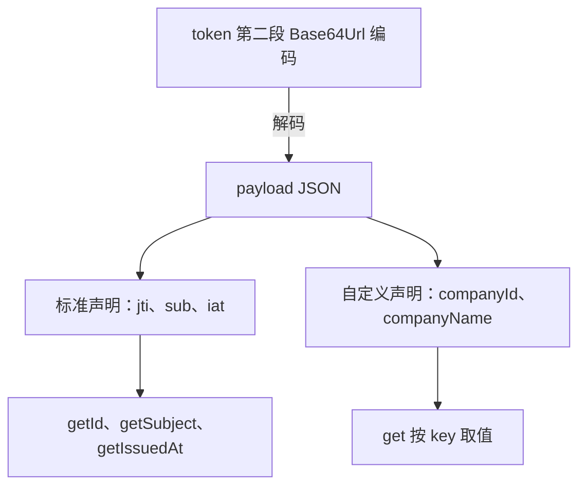

# 往 token 里装自己的数据：自定义 claim 的读写与安全边界

> 🔒 安全提示：文中示例的口令/密钥均为课程教学环境演示口径，生产环境的安全要求见《安全与合规须知》。

签 token 时塞了 id、用户名、签发时间，都是规范预留的标准槽位。真实业务还想让 token 顺手带上所属企业、角色这类鉴权要用的数据，省得每次都回数据库问一遍。JWT 为此留了自定义声明（claims）的口子，这一课把它用顺，顺便划清哪些数据能进、哪些绝对不能进。

## 先给结论

- 自定义数据走 `claim(key, value)` 链式追加，本质是往 payload 的 JSON 里添键值对，key 自己起名。
- 读取用 `claims.get("key")`，返回 `Object`；标准字段另有 `getId`、`getSubject` 这类语义化 getter。
- `setClaims(Map)` 是整体替换，会把已有的 id、subject 一并冲掉；逐个 `claim()` 才是追加，这个差异后面会酿成真 bug。
- payload 只是 Base64Url 编码，自定义数据对任何人可读，密码、手机号这类敏感信息不能进 token。
- token 里适合放「定位身份的最小数据」：用户 id、企业 id、角色编码这类短小稳定的字段。

## 一、claim 就是个键值对槽位

payload 的本体是一段 JSON，规范只规定了 `jti`、`sub`、`iat` 这几个标准字段的名字，JSON 之外的键值对随你加。JJWT 在建造者上开了 `claim` 方法，一次调用塞一个键值对，塞几个都行：

```java
package com.example.demo;

import io.jsonwebtoken.JwtBuilder;
import io.jsonwebtoken.Jwts;
import io.jsonwebtoken.SignatureAlgorithm;
import java.util.Date;

public class CreateJwtTest {
    public static void main(String[] args) {
        JwtBuilder builder = Jwts.builder()
                .setId("88")
                .setSubject("小白")
                .setIssuedAt(new Date())
                .claim("companyId", "123456")           // 自定义：所属企业 id
                .claim("companyName", "示例科技有限公司") // 自定义：企业名称
                .signWith(SignatureAlgorithm.HS256, "example-secret");
        String token = builder.compact();
        System.out.println(token);
    }
}
```

`claim` 前两个参数就是 key 与 value：key 是字符串名字，value 类型不受限，字符串、数字、对象都装得下，装进去后都会成为 payload JSON 里的一个成员。签名与 claim 的先后顺序无所谓，`compact()` 时统一封口。

第二段解码后能直接看到这两个键值对落进了 payload：

```bash
# 取 token 的第二段解 Base64Url
echo "eyJjb21wYW55SWQiOiIxMjM0NTYiLCJjb21wYW55TmFtZSI6IiJ9" | base64 -d
# {"companyId":"123456","companyName":"..."}
```

## 二、从 Claims 里读回来

解析端拿到的 `Claims` 同时是一个 `Map`，标准字段与自定义字段混在同一个容器里，读法分两路：

```java
Claims claims = Jwts.parser()
        .setSigningKey("example-secret")
        .parseClaimsJws(token)
        .getBody();

System.out.println(claims.getId());                 // 标准字段走 getter
Object companyId = claims.get("companyId");          // 自定义字段按 key 取
String companyName = claims.get("companyName", String.class); // 带类型的重载
System.out.println(companyId + " " + companyName);
```

`get("key")` 返回 `Object`，直接赋给 `String` 编译不报错、运行才可能炸；`get("key", String.class)` 这类重载由库内部做类型判断，取错了抛出更明确的异常，比裸强转可控。这张图概括了两种取值的分野：



图的要点在左右两条取值路径：标准字段有语义化 getter 兜着，自定义字段全靠 key 对得上，key 写错一个字母不报错，返回 `null`，这类静默失败比异常更难查。

## 三、敏感信息能不能放：不能

payload 是编码不是加密，Base64Url 谁都能解，「token 看起来是一串乱码」带来的安全感是错觉。判断一个字段能不能进 token，可以从三个维度过一遍：

**第一，可读性。** token 会出现在请求头、浏览器存储、网关与访问日志里，凡是解 Base64 的人都能看到 payload 全文。密码、手机号、身份证、薪资这类字段放进去等于公开。需要这些数据时，token 里只放用户 id，接口层回库查。

**第二，体积。** token 每次请求都要随头传输，payload 塞得越大，每个请求都变重。放几个短小的键值对没问题，塞一个大对象 JSON 就是在给带宽和网关找麻烦。

**第三，失效难度。** token 签出去就收不回，字段跟着 token 存活到过期为止。放进去的是「当下应该稳定不变」的身份定位数据才合适：用户 id、企业 id、角色编码。会频繁变化的业务状态不适合。

所以工程成例里往 token 放的就是这三样，课程 common 模块的工具类把追加逻辑做成了一个循环（真实代码，包名已改为 `com.example`）：

```java
public String createJwt(String id, String name, Map<String, Object> map) {
    long now = System.currentTimeMillis();
    long exp = now + ttl;
    JwtBuilder jwtBuilder = Jwts.builder().setId(id).setSubject(name)
            .setIssuedAt(new Date())
            .signWith(SignatureAlgorithm.HS256, key);
    // 自定义 claims：逐个追加，而不是 setClaims 整体替换
    for (Map.Entry<String, Object> entry : map.entrySet()) {
        jwtBuilder.claim(entry.getKey(), entry.getValue());
    }
    jwtBuilder.setExpiration(new Date(exp));
    return jwtBuilder.compact();
}
```

调用方把要带的数据装进 `Map` 传进来，工具类逐个 `claim` 追加。注意注释里点出的问题：这里不用 `setClaims(map)` 一把塞，原因见下一节的误区。

## 常见误区

- **用 `setClaims(map)` 一次性塞入**：这个方法替换整个 claims 容器，之前 `setId`、`setSubject` 设好的声明会被清空，解出来的用户 id 直接变 `null`。追加用 `claim`，替换才用 `setClaims`。
- **key 前后不一致**：写入时 `companyId`，读取时 `companyid`，`get` 不报错只返回 `null`。key 名建议收敛成常量，签发与解析共用一份。
- **把敏感字段塞进 payload**：Base64 一解就是明文，token 还会流经日志与网关，任何敏感数据进 token 都是泄密，需要的字段回库取。
- **塞大对象或整套权限树**：token 随每个请求传输，payload 膨胀会拖累所有接口；放定位身份的小字段，详细数据按需查询。

## 面试可能被问到的问题

1. 面试官追问：「JWT 的自定义字段放在哪里，读取时和标准字段有区别吗？」
   答：都放在 payload 的 JSON 里，标准字段是规范预定义的键（jti、sub、iat 等），自定义字段是业务自己加的键值对。读取时标准字段有语义化 getter，自定义字段用 `claims.get("key")` 按键名取，返回 `Object` 需要注意类型转换。

2. 面试官追问：「为什么不能把密码这类敏感信息放进 token？」
   答：payload 只是 Base64Url 编码，任何人可解，token 又会流经请求头、浏览器存储和各类日志，放敏感信息等于公开。token 应该只承载定位身份的最小数据，敏感内容凭 id 回库查询。

3. 面试官追问：「`claim` 和 `setClaims` 的区别是什么？」
   答：`claim(key, value)` 向已有声明里追加一个键值对；`setClaims(Map)` 用传入的 Map 整体替换 claims 容器，之前设置的 id、subject 全部丢失。批量装业务数据时逐个 claim，或者一开始就用 setClaims 再补标准字段，两者不能混着错用。

4. 面试官追问：「token 里一般放哪些数据？」
   答：用户 id、用户名、所属企业或租户 id、角色标识这类短小且相对稳定的字段，够服务端完成身份定位和多租户隔离即可。详细资料与实时权限按需回库或走缓存，避免 payload 膨胀和敏感泄露。

5. 面试官追问：「`claims.get` 返回什么类型，怎么安全取值？」
   答：返回 `Object`。安全做法是用 `get(key, String.class)` 这类带类型参数的重载，由库做类型判断；如果裸强转，类型不符时抛 `ClassCastException`。取不到时返回 null 而不是抛异常，空值分支要自己处理。

## 配套资料

- 自定义 claims 的工程成例（`Map` 循环 `claim` 追加的真实实现）：`materials/code/02/day14 微服务网关与社保模块开发/day14/03-资料/common模块的工具类/JwtUtils.java`
- 创建与解析测试类（`CreateJwtTest` 的 claim 扩展、`ParseJwtTest` 的 `get` 取值）按本课视频写法补全，day04 资料包未含这两个测试文件；文中私钥与公司名均为演示值
