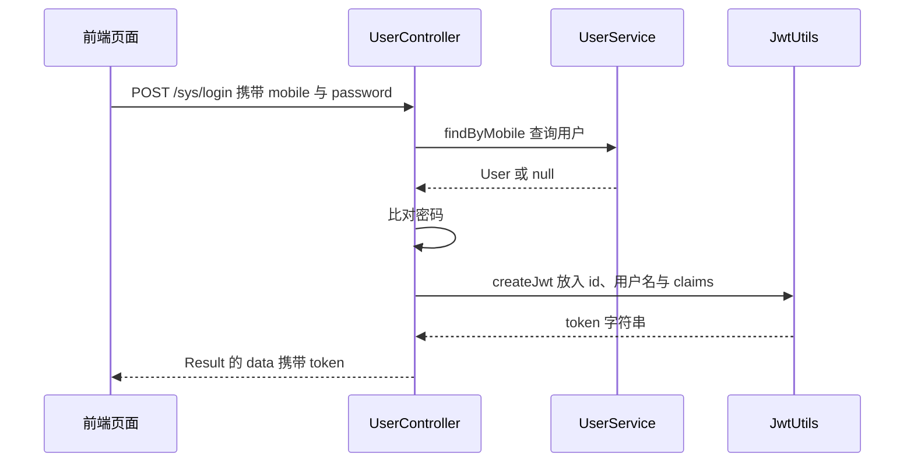

# 把 JWT 装进系统：工具类封装、登录签发 token 与携带 token 取用户

> 🔒 安全提示：文中示例的口令/密钥均为课程教学环境演示口径，生产环境的安全要求见《安全与合规须知》。

前面几课在测试类里把 JJWT 的创建、解析、自定义声明都玩熟了，但测试类跑完就扔，系统里的认证要能长期运转：登录成功签发 token、之后每次请求凭 token 认人。HRM 项目把这套动作分三步落地，先把签发与解析封装成公共工具类，再在登录接口里签出 token，最后在 profile 接口里凭 token 取回用户信息。

## 先给结论

- JWT 的签发与解析收敛进公共模块的 `JwtUtils`：`key`（签名私钥）与 `ttl`（有效期毫秒）两个字段加 `@ConfigurationProperties("jwt.config")`，取值全部来自 yml 配置。
- 工具类对外只开两个方法：`createJwt(id, name, map)` 签发、`parseJwt(token)` 解析；启动类用 `@Bean` 注册，业务代码 `@Autowired` 直接注入。
- 登录四步走：按手机号查用户、比对密码、签发 token、响应数据；token 的 id 放用户 id，subject 放用户名，claims 放 companyId 与 companyName。
- 登录参数在请求体里，Controller 用 `@RequestBody Map<String, String>` 接收再逐个取出。
- profile 接口凭 token 里的用户 id 回查用户，包装成 `ProfileResult` 返回手机号、用户名、企业与菜单、按钮、API 三类权限标识。

## 一、工具类设计：签发与解析收进公共模块

测试类里的代码有两个问题：私钥写死在方法里，签发与解析散落在各个 main 方法中。工程里的做法是抽一个 `JwtUtils`，放进所有微服务都依赖的 common 模块，谁要用谁引。课程资料包里的真实成例就是最终形态（包名已改为 `com.example`）：

```java
package com.example.common.utils;

import io.jsonwebtoken.Claims;
import io.jsonwebtoken.JwtBuilder;
import io.jsonwebtoken.Jwts;
import io.jsonwebtoken.SignatureAlgorithm;
import lombok.Getter;
import lombok.Setter;
import org.springframework.boot.context.properties.ConfigurationProperties;

import java.util.Date;
import java.util.Map;

@Getter
@Setter
@ConfigurationProperties("jwt.config")
public class JwtUtils {
    // 签名私钥
    private String key;
    // 签名的失效时间
    private Long ttl;

    /**
     * 设置认证 token
     * id：登录用户 id
     * subject：登录用户名
     */
    public String createJwt(String id, String name, Map<String, Object> map) {
        // 1.设置失效时间
        long now = System.currentTimeMillis();  // 当前毫秒
        long exp = now + ttl;
        // 2.创建 jwtBuilder
        JwtBuilder jwtBuilder = Jwts.builder().setId(id).setSubject(name)
                .setIssuedAt(new Date())
                .signWith(SignatureAlgorithm.HS256, key);
        // 3.根据 map 设置 claims
        for (Map.Entry<String, Object> entry : map.entrySet()) {
            jwtBuilder.claim(entry.getKey(), entry.getValue());
        }
        jwtBuilder.setExpiration(new Date(exp));
        // 4.创建 token
        String token = jwtBuilder.compact();
        return token;
    }

    /**
     * 解析 token 字符串获取 claims
     */
    public Claims parseJwt(String token) {
        Claims claims = Jwts.parser().setSigningKey(key).parseClaimsJws(token).getBody();
        return claims;
    }
}
```

对比测试类，工程化封装多出来的东西都有明确用途：

**第一，私钥与有效期从配置注入。** 类上的 `@ConfigurationProperties("jwt.config")` 把 yml 里 `jwt.config` 前缀的配置绑到 `key` 与 `ttl` 字段上，换环境只改配置不改代码。配置长这样：

```yaml
jwt:
  config:
    key: example-secret   # 签名私钥，生产环境要换成足够长的随机串并妥善保管
    ttl: 3600000          # 有效期，毫秒，这里是一小时
```

**第二，失效时间真正生效。** 测试类签出的 token 永不过期，工具类里 `now + ttl` 算出过期时间点，`setExpiration` 写进 payload，到期后解析端自动抛 `ExpiredJwtException`。

**第三，自定义声明参数化。** 要带什么业务数据由调用方决定，装进 `Map` 传进来，工具类逐个 `claim` 追加，签发逻辑对所有模块通用。

工具类本身没有业务含义，它只是把 JJWT 的样板动作包了一层。要让 Spring 接管它的生命周期并完成配置绑定，在系统微服务的启动类里注册一个 Bean（真实写法来自课程系统模块）：

```java
@Bean
public JwtUtils jwtUtils() {
    return new JwtUtils();
}
```

注册之后，配置绑定处理器会自动把 yml 值灌进 `key` 与 `ttl`，业务类里 `@Autowired` 拿到的就是配置齐全的实例。

## 二、登录签发：查用户、比密码、发 token

登录的需求一句话说得清：前端输入手机号与密码，服务端验证通过后返回 token。拆开是四个动作：



Controller 层的登录方法按这四步写（按本课视频写法补全，包名与返回码均为课程约定）：

```java
@Autowired
private JwtUtils jwtUtils;

/**
 * 用户登录
 */
@RequestMapping(value = "/login", method = RequestMethod.POST)
public Result login(@RequestBody Map<String, String> loginMap) {
    String mobile = loginMap.get("mobile");
    String password = loginMap.get("password");
    // 1.按手机号查询用户
    User user = userService.findByMobile(mobile);
    // 2.比对密码，查无此人或密码不符都走失败分支
    if (user == null || !user.getPassword().equals(password)) {
        return new Result(ResultCode.MOBILEORPASSWORDERROR);
    } else {
        // 3.登录成功，签发 token
        Map<String, Object> map = new HashMap<>();
        map.put("companyId", user.getCompanyId());
        map.put("companyName", user.getCompanyName());
        String token = jwtUtils.createJwt(user.getId(), user.getUsername(), map);
        // 4.token 放进 data 返回
        return new Result(ResultCode.SUCCESS, token);
    }
}
```

有几个细节值得展开：

**第一，入参用 `Map` 接。** 接口文档约定 mobile 与 password 放在请求体里，所以参数写成 `@RequestBody Map<String, String>`，再从 map 里逐个取字段。字段少的时候这样最省事，字段多了再考虑封装登录对象。

**第二，查询走的是 Spring Data JPA 的方法名规则。** Service 与 Dao 各加一个方法，Dao 层声明即可，不用写 SQL：

```java
public interface UserDao extends JpaRepository<User, String>, JpaSpecificationExecutor<User> {
    public User findByMobile(String mobile);
    List<User> findByCompanyId(String companyId);
}
```

`findByMobile` 会被框架解析成按 `mobile` 属性拼查询语句，`from bs_user where mobile = ?`，参数就是方法入参。

**第三，返回码按业务分段。** 课程在通用枚举 `ResultCode` 里补了一个用户操作的失败码，约定用户相关返回码以 2 开头：`MOBILEORPASSWORDERROR(false, 20001, "用户名或密码错误")`。查无此人与密码错误共用一个提示，不给攻击者试探「这个手机号注册过没有」的线索。

用 Postman 验证：`POST /sys/login`，请求体 `{"mobile": "13800000002", "password": "123456"}`，密码故意输错一次返回 20001，改对后返回 10000，data 字段里就是那串三段式 token。

## 三、携带 token 取用户：profile 与 ProfileResult

登录成功后，前端立刻发第二个请求获取用户信息，用来渲染姓名、企业与权限菜单。这个接口的完整实现要等 token 从请求头进来（下一课），先把流程跑通：用户 id 暂时写死，重点在返回数据的构造。

```java
/**
 * 用户登录成功之后获取用户信息
 */
@RequestMapping(value = "/profile", method = RequestMethod.POST)
public Result profile() {
    // 用户 id 先写死跑通流程，之后换成从 token 解析
    String userId = "1";
    // 1.根据 id 查询用户
    User user = userService.findById(userId);
    // 2.构造返回值对象
    return new Result(ResultCode.SUCCESS, new ProfileResult(user));
}
```

接口文档里 data 的结构比 `User` 实体复杂：既要手机号、用户名、企业名，又要当前用户拥有的菜单、按钮与 API 标识。直接返回实体既漏字段又多字段，标准做法是构造一个专用的返回对象：

```java
@Getter
@Setter
@NoArgsConstructor
public class ProfileResult {
    private String mobile;
    private String username;
    private String company;
    private Map<String, Object> roles = new HashMap<>();

    public ProfileResult(User user) {
        this.mobile = user.getMobile();
        this.username = user.getUsername();
        this.company = user.getCompanyName();
        Set<String> menus = new HashSet<>();
        Set<String> points = new HashSet<>();
        Set<String> apis = new HashSet<>();
        // 对象导航查询：用户带出角色，角色带出权限
        for (Role role : user.getRoles()) {
            for (Permission perm : role.getPermissions()) {
                String code = perm.getCode();
                // 权限类型：1 菜单，2 功能点，3 API
                if (perm.getType() == 1) {
                    menus.add(code);
                } else if (perm.getType() == 2) {
                    points.add(code);
                } else {
                    apis.add(code);
                }
            }
        }
        this.roles.put("menus", menus);
        this.roles.put("points", points);
        this.roles.put("apis", apis);
    }
}
```

这段构造依赖 JPA 的对象导航查询：查出一个 `User` 后，`user.getRoles()` 自动带出关联的角色集合，每个角色的 `getPermissions()` 再带出权限集合，两层循环把权限编码按类型分进三个桶。类型字段的取值来自真实实体 `Permission` 的注释：1 为菜单、2 为功能、3 为 API。用 `Set` 收集是为了去重，多个角色配了同一个菜单编码时只留一份。

前端要控制菜单与按钮，就靠这三个集合里的权限编码比对展示与否。到这里，登录与用户信息获取的主流程全部贯通，只差一件事：profile 里的 userId 还是写死的，下一课让 token 真正参与进来。

## 常见误区

- **绕过容器自己 `new JwtUtils()`**：new 出来的实例不走配置绑定，`key` 与 `ttl` 都是 null，签发时直接空指针或者 token 没有过期时间。必须在启动类 `@Bean` 注册后注入使用。
- **`createJwt` 传了 null 的 map**：工具类里 `map.entrySet()` 循环会对 null 抛空指针，登录分支里务必构造一个 `HashMap`，哪怕暂时没有自定义数据。
- **yml 漏配 ttl**：`Long ttl` 未绑定值时是 null，`now + ttl` 自动拆箱抛 NPE，而且报错位置在签发深处，一眼不容易看出是配置问题。
- **明文密码直接 `equals` 比对**：课堂为了聚焦 JWT 用明文演示，生产环境必须存加盐哈希（如 BCrypt），比对时用哈希校验，同时登录接口要有限流与锁定策略。

## 面试可能被问到的问题

1. 面试官追问：「为什么把 JWT 封装成工具类放在公共模块？」
   答：签发与解析是多个微服务共用的能力，收进公共模块保证私钥、算法、声明格式全局一致，各服务只依赖工具类而不必重复写 JJWT 样板代码；私钥与有效期从配置注入，环境切换不用改代码。

2. 面试官追问：「`@ConfigurationProperties` 在这里怎么生效的？」
   答：工具类上标注 `@ConfigurationProperties("jwt.config")`，启动类用 `@Bean` 注册实例后，Spring Boot 的配置绑定处理器会把 yml 里 jwt.config 前缀下的 key 与 ttl 灌进同名字段，全程不需要手动读取 Environment。

3. 面试官追问：「登录成功后 token 里放了什么，为什么这么放？」
   答：id 放用户 id，subject 放用户名，claims 放 companyId 与 companyName。前两者定位用户，companyId 支撑多租户数据隔离，后续接口凭它过滤数据；都是短小稳定的字段，敏感与易变数据不进 token。

4. 面试官追问：「`findByMobile` 没写 SQL 为什么能查询？」
   答：这是 Spring Data JPA 的方法名推导，框架解析 findBy 后面的属性名 mobile，自动生成按该属性过滤的查询。约束是方法名必须符合规则且属性真实存在，复杂查询再退化到 `@Query` 或 Specification。

5. 面试官追问：「ProfileResult 为什么不直接返回 User 实体？」
   答：接口需要的字段跨越用户、角色、权限三个实体，直接返回实体会缺字段、多字段，还把实体的关联结构暴露给前端。用专用返回对象按接口文档重组数据，实体变更也不会直接冲击接口契约。

6. 面试官追问：「用户信息接口怎么知道当前登录的是谁？」
   答：靠 token。登录时签发的 token 里带了用户 id，前端后续请求把它放进请求头，服务端解析验签后从 claims 取出 id 回查用户。写死 id 只是跑通流程的临时手段，真实校验在下一课补齐。

## 配套资料

- JWT 工具类真实成例（文中 `JwtUtils` 全文即出自此文件，包名改为 `com.example`）：
  `materials/code/02/day14 微服务网关与社保模块开发/day14/03-资料/common模块的工具类/JwtUtils.java`
- 启动类 `@Bean` 注册 `jwtUtils` 的真实写法：
  `materials/code/02/day05 JWT的权限控制与Shiro入门/JWT的权限控制与Shiro入门/资源/通用代码/SystemApplication.java`
- `findByMobile` 所在 Dao 真实文件：
  `materials/code/02/day15 考勤模块开发/day15/工具代码/工具类/考勤模块/dao/UserDao.java`
- 统一响应与返回码：`materials/code/02/day01 SAAS-HRM系统概述与搭建环境/SAAS-HRM系统概述与搭建环境/资源/通用代码/common/Result.java` 与同目录 `ResultCode.java`
- 用户实体（companyId、companyName、roles 关联）与权限实体（type 注释）：
  `materials/code/02/day03 SaaS-HRM系统用户权限设计概述/SaaS-HRM系统用户权限设计概述/资源/工具代码/实体类/User.java`、
  `materials/code/02/day04 权限分配与jwt概述/权限分配与jwt概述/资源/实体类/Permission.java`
- 登录方法与 `ProfileResult` 为按本课视频写法补全，day04 资料包未含 UserController 源文件；`MOBILEORPASSWORDERROR` 返回码为课堂在 `ResultCode` 中新增的枚举项
