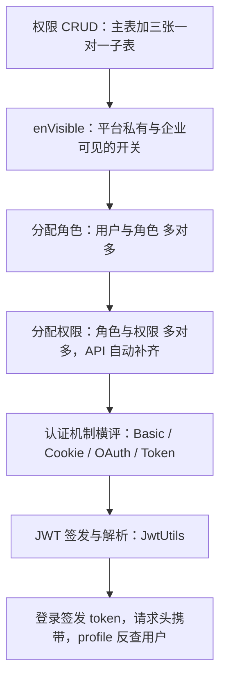
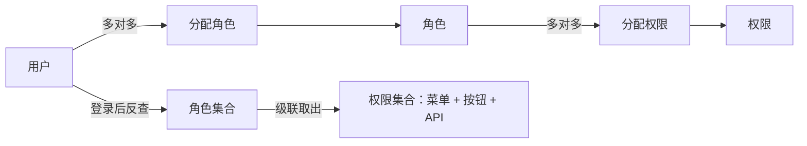
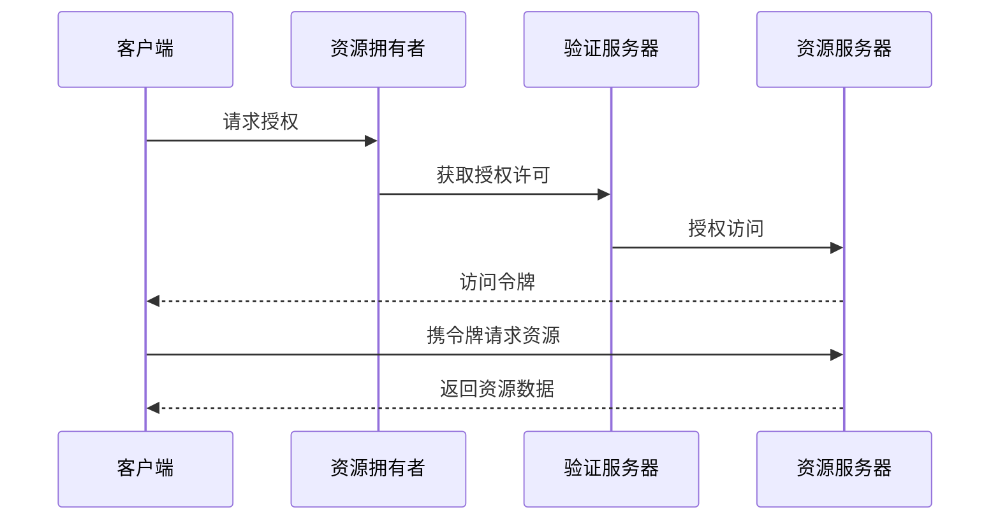

# day04 复习盘：权限 CRUD、两级分配与四种认证机制，收束成一条认证链

> 🔒 安全提示：文中示例的口令/密钥均为课程教学环境演示口径，生产环境的安全要求见《安全与合规须知》。

day04 的内容横跨两座山：前半座是权限的增删改查与两级分配，属于数据建模的功夫；后半座是认证机制横评与 JWT 落地，属于安全架构的功夫。单看每一节都懂，合上资料让他把「权限表设计」和「token 签发」串成一句话，很多复习的人就卡住了。串的那根线其实一直摆在那里：先让系统能描述「谁有什么权限」，再让系统能证明「请求是谁发的」，权限控制才立得起来。

## 先给结论

- 权限模型在 RBAC 之上扩出「资源」：权限主表 `pe_permission` 之外，菜单、按钮、API 三张子表与它一对一，动权限主表时三张子表资源必须同步操作。
- 分配角色与分配权限是权限控制的两级开关：分配角色决定「用户拿到哪些角色」，分配权限决定「角色携带哪些权限」，用户登录后沿这条链反查出全部权限。
- 认证机制四选一：HTTP Basic 裸传用户名密码安全性最低；Cookie 加 Session 适合单体 Web；OAuth 2.0 面向第三方授权；Token（JWT）无服务端存储，是微服务与分布式的主流选择。
- JWT 三段式 self-contained，签发靠 `JwtUtils.createJwt`，校验靠 `parseJwt`，前后端约定 `Authorization: Bearer + 空格 + token`。
- 落地闭环：登录成功签发 token，之后每个请求带 token，profile 接口解析出用户 id 回查用户并返回权限数据。

## 一、全章主线：一张图串起五块内容



图上从上到下是一条依赖链：没有前四格的数据基础，最后三格的认证做完了也无权限可用；没有后三格的身份证明，前四格攒下的权限又不知道该发给谁。复习时按格自问「能不能不看资料写出来」，卡住的那格就是回看的位置。

## 二、权限 CRUD：动主表，别忘了三张子表

权限设计从 RBAC 演化而来：用户、角色、权限三要素之上，把「资源」独立出来控制。具体到表结构，`pe_permission` 主表存公共骨架（名称、类型、编码、父子层级），三张子表一对一挂载各自专属字段：菜单子表管图标与排序，按钮子表管页面元素，API 子表管接口地址与方法。

**第一，一对一的含义是同主键共值。** 子表主键就是主表 id，删主表记录时子表要跟着删，改权限时子表的专属字段也要跟着改。只动主表不动子表，数据就成了半截：菜单删了，图标还挂在子表里；API 改了地址，主表还留着旧描述。

**第二，`enVisible` 是 SaaS 场景的关键开关。** 取值 1 表示企业可见，0 表示平台私有。平台管理员维护的权限资源里，平台自己的管理功能对企业隐藏；企业日常使用的权限 enVisible 为 1。全库查询、分配弹层拉树都要带上这个过滤条件，租户才不会看到平台级的最高权限。

**第三，权限类型用常量收口。** 1 菜单、2 按钮、3 API，定义在 `PermissionConstants` 里，Service 层做类型判断时只认常量，散落的魔法数字是日后维护的地雷：

```java
public class PermissionConstants {
    /**
     * 权限类型 1为菜单 2为功能 3为API
     */
    public static final int PY_MENU = 1;
    public static final int PY_POINT = 2;
    public static final int PY_API = 3;
}
```

CRUD 本身是 JPA 标准动作：Dao 继承 `JpaRepository` 与 `JpaSpecificationExecutor`，列表查询用 Specification 按 pid、type、enVisible 三个可选参数动态拼条件，type 传 0 时翻译成 `in (1, 2)` 一次取回菜单和按钮。

## 三、分配角色与分配权限：两级开关决定权限的流向

分配角色与分配权限，一个管「人」，一个管「岗」：



**分配角色**面向用户：给不同的用户分配不同的角色，用户与角色多对多，中间表 `pe_user_role` 由 JPA 的 `@ManyToMany` 维护，接口用 `Map` 接收用户 id 与角色 id 数组，整体覆盖。

**分配权限**面向角色：给不同的角色分配不同的权限，中间表 `pe_role_permission` 同样由 JPA 维护。它比分配角色多一步看不见的动作：前端权限树只有菜单和按钮，API 权限不出现在界面上，Service 收到勾选的每个节点后，用 `findByTypeAndPid(PY_API, 节点 id)` 反查它名下的全部 API 权限一并塞进集合。勾了 1 个按钮，中间表实际多出来的可能是 2 行、3 行，多出来的就是自动补齐的接口权限。

两级分配走完，权限数据就绪。但「数据就绪」离「权限生效」还差一环：请求进来时，系统得先知道这个请求是谁发的。这就轮到认证机制出场。

## 四、四种认证机制：为什么微服务选 Token

横评四种机制，各自适用场景一目了然：

| 机制 | 携带内容 | 状态存放 | 适用场景 | 短板 |
|---|---|---|---|---|
| HTTP Basic Auth | Base64 的用户名密码 | 无状态 | 简单内网接口 | 每次请求裸传密码，安全性最低 |
| Cookie Auth | Cookie 与 Session 配合 | 服务端 Session | 单体 Web 应用 | 分布式下 Session 共享困难 |
| OAuth 2.0 | 授权码换令牌 | 验证服务器 | 第三方授权登录 | 流程重，面向授权而非登录 |
| Token（JWT） | 签名过的 token | 无服务端存储 | 微服务、分布式 | 签出后载荷无法撤销更新 |

HTTP Basic 把用户名密码 Base64 编码后随每个请求携带，编码不是加密，抓包即得，安全级别垫底。Cookie 与 Session 是单体时代的主力：登录后服务端存一份 Session，浏览器拿 Cookie 里的 sessionId 关联，应用拆成集群后 Session 要么粘性路由、要么集中存储，麻烦随之而来。

OAuth 2.0 解决的是另一个问题：授权而非认证。典型流程以微信联合登录为例：



图上先拿「许可」再换「令牌」，令牌才是访问资源的凭证，用户密码从头到尾不经过第三方。这套流程用在自有系统的日常登录上就太重了。

Token 方式则把状态从服务端挪到前端：登录成功后服务端签发一个签名过的字符串，之后每个请求带着它，服务端只验签名、不解密、不查存储。数据全在前端保存，服务端保持无状态，天然适配微服务的横向扩容。JWT 是 Token 方式里用得最广的实现。

## 五、JWT 落地：签发、校验与登录闭环

课程通用模块里的 `JwtUtils` 只有两个核心方法，签名私钥与失效时长交给配置注入：

```java
@Getter
@Setter
@ConfigurationProperties("jwt.config")
public class JwtUtils {
    // 签名私钥
    private String key;
    // 签名的失效时间
    private Long ttl;

    /**
     * 设置认证 token：id 为登录用户 id，subject 为登录用户名
     */
    public String createJwt(String id, String name, Map<String, Object> map) {
        // 1.设置失效时间
        long now = System.currentTimeMillis();
        long exp = now + ttl;
        // 2.创建 jwtBuilder
        JwtBuilder jwtBuilder = Jwts.builder().setId(id).setSubject(name)
                .setIssuedAt(new Date())
                .signWith(SignatureAlgorithm.HS256, key);
        // 3.根据 map 设置 claims，逐个追加，不用 setClaims 整体替换
        for (Map.Entry<String, Object> entry : map.entrySet()) {
            jwtBuilder.claim(entry.getKey(), entry.getValue());
        }
        jwtBuilder.setExpiration(new Date(exp));
        // 4.创建 token
        return jwtBuilder.compact();
    }

    /**
     * 解析 token 字符串获取 claims
     */
    public Claims parseJwt(String token) {
        Claims claims = Jwts.parser().setSigningKey(key).parseClaimsJws(token).getBody();
        return claims;
    }
}
```

签发侧三件事：设失效时间、逐个追加自定义 claims（`claim` 循环追加而不是 `setClaims` 整体替换，后者会把 id 与 subject 清掉）、HS256 签名。校验侧一行 `parseClaimsJws`，签名不符或过期都在这里抛异常。

脱离工程，一个最小签发示例长这样：

```java
public class CreateJwtTest {
    public static void main(String[] args) {
        JwtBuilder builder = Jwts.builder().setId("888")
                .setSubject("测试用户")
                .setIssuedAt(new Date())
                .signWith(SignatureAlgorithm.HS256, "example-key");
        System.out.println(builder.compact());
    }
}
```

工程内的闭环分两步。登录接口验证用户名密码通过后，取出用户 id 调 `createJwt` 签发 token 放进响应的 data 里返回；之后的请求按前后端约定在请求头 `Authorization` 里携带「Bearer + 空格 + token」，profile 接口取头、去前缀、`parseJwt` 解出 claims，用 `claims.getId()` 反查用户，再把用户名、企业名与三类权限标识打包返回。身份证明与权限数据从此在同一个请求头里流转。

## 常见误区

- **改权限只动主表**：菜单、按钮、API 三张子表与主表一对一，增删改主表记录时子表资源不同步，留下孤儿数据，权限树渲染与接口鉴权都会出诡异结果。
- **以为 Basic Auth 的 Base64 是加密**：Base64 只是编码，任何中间人都能解开还原出密码。公网接口用它等于密码裸奔。
- **把 OAuth 2.0 当登录方案用在自己系统里**：它面向第三方授权场景，流程为「资源拥有者授权」设计；自有系统登录用 JWT 一签一验即可，套 OAuth 徒增五个交互步骤。
- **token 无限有效期**：JWT 签出后载荷改不了、服务端也没存，有效期越长，泄露后的风险窗口越大。ttl 要给明确上限，敏感操作另做二次校验。

## 面试可能被问到的问题

1. 面试官追问：「你们系统为什么选 JWT 而不是 Session？」
   答：服务是无状态部署的，Session 方案在多实例下要么做粘性会话、要么引入集中存储，都会增加复杂度。JWT 把用户数据签进 token 由客户端携带，服务端只验签名，扩容不需要共享任何会话状态，代价是签出后无法主动作废，靠较短的有效期与刷新机制兜底。

2. 面试官追问：「JWT 被签出后用户被禁用，怎么办？」
   答：token 本身改不了，常见的做法有三层：有效期设短，禁用后最多在窗口期内有效；网关或服务侧维护黑名单缓存，禁用即拉黑；重要操作回库确认用户状态。课程项目用的是短有效期加关键接口回查的组合。

3. 面试官追问：「分配权限时 API 权限为什么不让前端勾？」
   答：按钮背后的接口是开发期固定的父子关系，前端权限树只渲染菜单和按钮，API 不出现。后端按权限的 pid 反查自动补齐，既避免用户漏勾，也不向界面暴露接口清单，这是父子级联模型带来的免费能力。

4. 面试官追问：「enVisible 字段解决什么问题？」
   答：SaaS 多租户下权限资源分两类，平台自有的管理功能对企业必须隐藏，企业日常权限全平台通用。enVisible 为 0 的是平台私有资源，为 1 是企业可见资源，查询与分配链路都按它过滤，租户才碰不到平台级权限。

5. 面试官追问：「HTTP Basic、Cookie Session、JWT 的无状态程度怎么排？」
   答：Basic 无状态但每次裸传密码，只适合内网简单场景；Cookie Session 状态在服务端，是有状态方案；JWT 状态在客户端凭证里，服务端无存储。安全强度上 Basic 最弱，JWT 依赖签名与 HTTPS，Session 依赖服务端保管，各有前提。

## 配套资料

- JWT 工具类成例（`createJwt` 与 `parseJwt` 真实代码出处）：`materials/code/02/day14 微服务网关与社保模块开发/day14/03-资料/common模块的工具类/JwtUtils.java`
- 权限实体（type、pid、enVisible 字段真实声明）：`materials/code/02/day04 权限分配与jwt概述/权限分配与jwt概述/资源/实体类/Permission.java`
- 权限类型常量：`materials/code/02/day04 权限分配与jwt概述/权限分配与jwt概述/资源/通用代码/工具类/PermissionConstants.java`
- 权限 Dao（Specification 动态查询能力来自 `JpaSpecificationExecutor`）：`materials/code/02/day04 权限分配与jwt概述/权限分配与jwt概述/资源/通用代码/PermissionDao.java`
- 登录后拦截器放行配置（认证闭环的服务端组织方式）：`materials/code/02/day05 JWT的权限控制与Shiro入门/JWT的权限控制与Shiro入门/资源/通用代码/SystemConfig.java`
- 正文 `CreateJwtTest` 最小示例为按本课视频写法补全的演示代码，登录与 profile 接口代码沿用 day04 各课整理的示例（day04 资料包未含系统模块源文件），包名统一为 `com.example`
