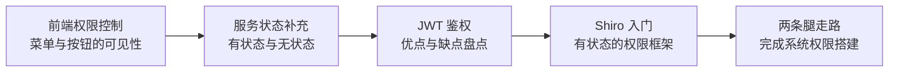
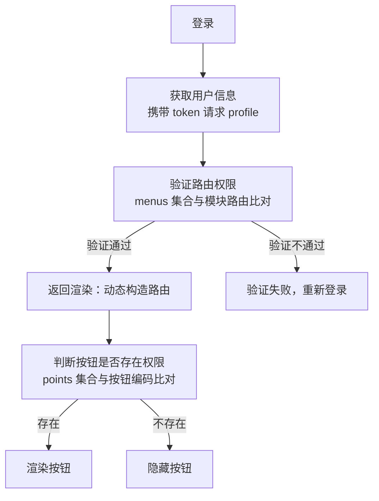

# 登录之后菜单凭什么不一样：前端权限控制的需求与实现思路

同一套系统，SaaS 平台管理员登录后左侧一排菜单全亮，企业管理员少了平台管理那几项，普通员工只看得见自己岗位相关的页面，行内的删除按钮也时有时无。这套「千人千面」的界面不是几个 `v-if` 手写出来的，背后是一条完整的权限数据链。day05 开篇要回答的就是三个问题：前端权限到底控制什么、靠什么数据控制、控制不住的那部分交给谁。

## 先给结论

- 前端权限控制的对象是两层可见性：菜单（路由）的可见性与按钮的可见性，实现思路是「用户信息接口返回权限集合，前端按集合渲染」。
- 前端只能做展示层控制，藏起来的按钮挡不住直接发请求，真正的防线必须落在后端接口上，两层缺一不可。
- 登录只返回 token，权限数据靠第二个请求：携带 token 调用用户信息接口，拿回角色与菜单、按钮权限集合。
- 路由分公共路由与模块路由两类，动态构造发生在模块路由加载时，用返回的菜单权限比对过滤。
- day05 主线四块：前端权限控制、服务状态（有状态与无状态）、JWT 鉴权优缺点、Shiro 框架入门，前一块偏前端，后三块都在为后端权限铺路。

## 一、day05 在整条课程线上的位置

day04 结束时，权限的增删改查与两级分配已经做完，token 的签发与校验也通了。但权限系统还只是「账上有数」：谁能看什么、谁能点什么，记录都在库里，界面却依然全量展示。day05 要做的就是让账面数据生效，分四块推进：



**第一，前端权限控制**是今天的主菜，本课先做需求分析与实现思路，随后三节逐步落到代码。

**第二，服务状态**是补充概念：做 API 权限控制时，服务有状态还是无状态，直接决定校验方案长什么样。JWT 是无状态的代表，校验只需验签，不需要查存储。

**第三，JWT 的优缺点**盘点是承上启下：无状态带来扩容便利，也带来签出后无法撤销、权限变更不实时的问题。

**第四，Shiro 入门**是今天的新框架。它与 JWT 的定位差别一句话能说清：JWT 是无状态方案，凭证自证身份；Shiro 走有状态路子，认证与授权信息由框架统一管理。两条路线各取所长，共同完成整个系统的权限搭建。

## 二、需求分析：三层都要控，两层归前端

前后端分离的架构里，前端基于 Vue 生态搭建，左侧是菜单区，中间是数据列表，列表行尾挂操作按钮。以员工管理页为例，行尾的删除按钮点击后向服务端发请求，对应后端一个接口方法：

```java
/**
 * 删除员工
 */
@RequestMapping(value = "/user/{id}", method = RequestMethod.DELETE)
public Result delete(@PathVariable String id) {
    // 删除逻辑，调用 userService
    userService.deleteById(id);
    return new Result(ResultCode.SUCCESS);
}
```

权限要控的其实是三层：左侧菜单要不要显示、行内按钮要不要渲染、按钮背后的接口要不要放行。三种用户在同一套界面上的预期完全不同：SaaS 平台管理员是平台最大权限，所有菜单都能看，所有按钮都能点，所有接口都对他开放；企业管理员看不到平台级菜单，企业内的菜单、按钮、接口全部可用；普通用户则按分配的角色决定，角色里勾了什么就有什么。前两层归前端管，第三层必须归后端管。

**前端的天花板要先认清。** 浏览器上的一切对用户都是可见的，前端藏掉一个按钮，只是不让它渲染出来；懂行的用户打开开发者工具，照样能拼出删除请求直接发过去。所以前端控制的本质是可见性：有权限就显示，没权限就隐藏，它优化的是体验与迷惑性，防不住恶意直调。接口那一层是安全底线，少了它，前端做得再漂亮也拦不住一个 curl。

## 三、实现思路：一个接口喂出全部权限数据

实现思路可以压缩成四步：用户登录成功，前端拿到 token；紧接着携带 token 请求用户信息接口；接口返回的数据里重点携带权限集合；前端拿着权限集合动态渲染路由与按钮。

用户信息接口的响应结构长这样（企业字段按课程测试数据示意）：

```json
{
  "success": true,
  "code": 10000,
  "data": {
    "roles": {
      "menus": [],
      "points": [],
      "apis": []
    },
    "mobile": "13800000001",
    "company": "某某科技公司",
    "username": "张三"
  }
}
```

`roles` 里三个集合各管一摊：`menus` 是菜单权限标识集合，决定路由渲染；`points` 是按钮权限编码集合，决定按钮显隐；`apis` 是接口权限集合，留给后端鉴权用。前端登录后的完整流程如下：



图上有两个比对动作。路由比对发生在模块路由动态加载的时机：Vue 的路由分成公共路由与模块路由两类，登录页、404 这类公共路由人人可见，业务模块路由则要在加载钩子里逐条核对，路由声明的权限标识在 `menus` 集合里存在才注册，不存在直接跳过，菜单是路由渲染出来的副产品。按钮比对发生在页面渲染时：每个需要控制的按钮起一个权限编码，编码在 `points` 集合里就渲染，不在就隐藏，常见封装是一个自定义判断方法配合 `v-if` 使用（判断方法按本课思路补全）：

```javascript
// 按钮权限判断：points 是 profile 返回的按钮编码集合
methods: {
  checkPoint(code) {
    const points = this.$store.state.user.points
    return points.includes(code)
  }
}
// 模板中：<el-button v-if="checkPoint('USER_DELETE')">删除</el-button>
```

整条思路的落点都压在用户信息接口上：它的返回结构设计对了，前端所有控制都是查表动作。下一节就从改造这个接口开始。

## 常见误区

- **把前端权限当安全屏障**：隐藏按钮、过滤菜单只是展示控制，请求层面完全无防护。任何前端权限都必须配对后端接口鉴权，接口层才是底线。
- **登录接口一次返回 token 加全部权限**：登录响应保持轻量，只给 token；权限数据走独立的用户信息接口，前端拿到 token 后再请求。混在登录响应里，刷新页面重新拉权限的路径就断了。
- **菜单权限写死在前端路由配置里**：把「哪些角色能看哪些菜单」硬编码进前端，后端改一次角色配置前端就得发版。正确姿势是路由只声明权限编码，菜单数据全部来自用户信息接口。
- **按钮编码不进权限管理**：按钮编码若不作为权限点入库分配，前端 `points` 集合就永远是空的，要么全部按钮可见要么全部消失。编码必须与权限管理页的按钮资源一一对应。

## 面试可能被问到的问题

1. 面试官追问：「前端权限控制和后端权限控制各负责什么，能不能只用一个？」
   答：前端管展示，后端管安全。只做前端，请求可以直接绕过界面调接口；只做后端，用户会看到一堆点了报错的死按钮。两层结合才是完整方案：前端按权限集合渲染路由与按钮，后端对每个接口独立鉴权，两层各挡一半。

2. 面试官追问：「动态路由是怎么构造出来的？」
   答：路由表分成公共部分与模块部分，公共部分启动即注册；模块部分在路由守卫或加载钩子里，拿用户信息接口返回的菜单权限集合逐条比对，命中的条目动态 `addRoutes` 注册，未命中跳过。菜单组件由注册后的路由生成，从而实现不同用户不同菜单。

3. 面试官追问：「按钮级权限怎么实现？」
   答：权限管理里为每个按钮维护一个编码，用户信息接口把按钮编码聚成集合返回，前端封装一个判断方法在 `v-if` 里调用，集合包含编码才渲染。同一个方法抽成自定义指令后，全站按钮控制只需一行 `v-permission`。

4. 面试官追问：「JWT 和 Shiro 有什么区别，为什么会一起出现在权限方案里？」
   答：JWT 是无状态的令牌方案，身份信息签在 token 里，服务端验签即信，适合微服务横向扩容；Shiro 是有状态的权限框架，把认证、授权、会话管理收拢成一套编程模型。两者不互斥，常见组合是 JWT 负责身份凭证的签发校验，Shiro 负责授权模型与权限校验的工程化。

5. 面试官追问：「用户信息接口为什么把菜单、按钮、接口权限分三个集合返回？」
   答：三类数据的消费方和粒度不同，菜单权限供路由比对，按钮权限供组件显隐，接口权限供后端鉴权。分开打包，前端不用在混合列表里再按类型拆分，后端拦截时也直接可用，一次请求同时喂饱三层控制。

## 配套资料

- 前端框架自带的登录与用户信息 API 声明（`/frame/login`、`/frame/profile` 路径，改造对象）：`materials/code/02/day04 权限分配与jwt概述/权限分配与jwt概述/资源/前端代码/api/base/frame.js`
- 后端 JWT 拦截器注册与登录放行的真实配置（接口层防线的组织方式）：`materials/code/02/day05 JWT的权限控制与Shiro入门/JWT的权限控制与Shiro入门/资源/通用代码/SystemConfig.java`
- JWT 工具类成例：`materials/code/02/day14 微服务网关与社保模块开发/day14/03-资料/common模块的工具类/JwtUtils.java`
- 正文删除接口与按钮判断为按本课视频写法补全的示例，用户信息响应结构取自本课画面数据（企业与姓名字段按测试数据示意），day05 资料包未含系统模块源文件，包名统一为 `com.example`
