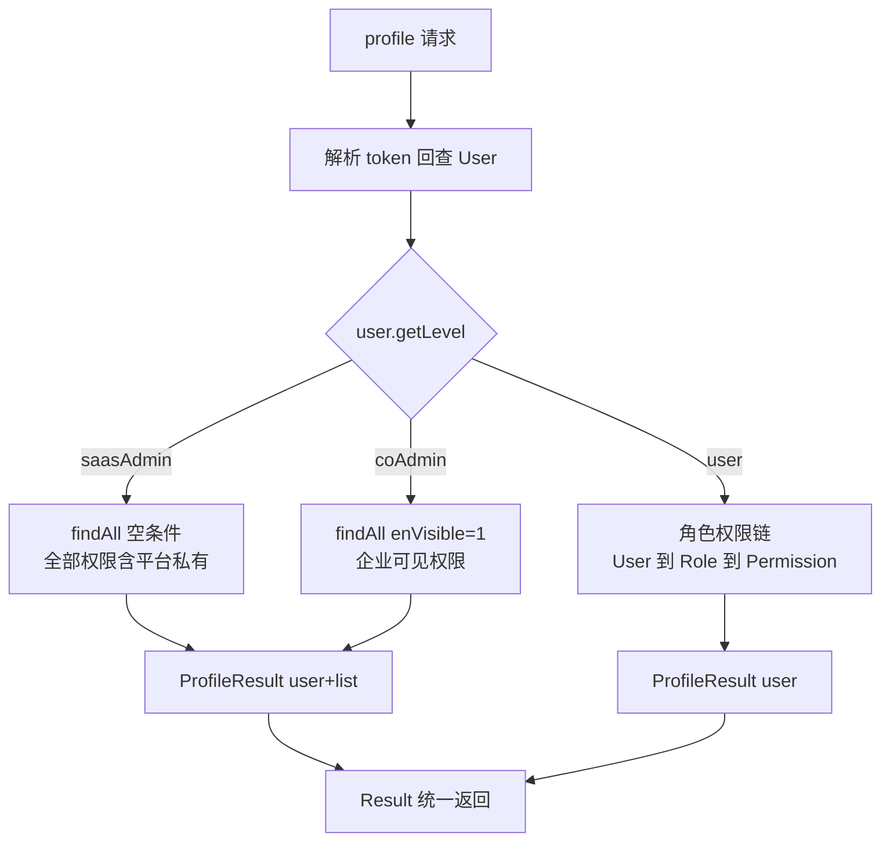

# 一个 profile 接口喂出权限数据：按用户级别三分支构造 ProfileResult

用户信息接口昨天就通了：解析 token、查出用户、包装返回。但返回的权限数据只覆盖了三类用户里的一类，企业管理员与平台管理员拿到的是空权限，登录后界面要么全裸奔要么全空白。本课把 SaaS 平台的三类用户在 profile 接口里分流：不同级别走不同的取数路径，前端要的菜单、按钮、接口权限一次给足。

## 先给结论

- SaaS 平台用户分三级：`saasAdmin` 平台管理员拥有所有权限，`coAdmin` 企业管理员拥有企业全部权限，`user` 普通用户只有当前角色分配到的权限。
- 用户级别落在 `bs_user` 表的 `level` 字段上，取值就是这三个字符串，企业管理员在租户入驻申请时自动挂载。
- profile 接口按 `level` 三分支取权限：平台管理员查全表，企业管理员查 `enVisible = 1` 的企业可见部分，普通用户不查权限表、沿用户角色权限链取。
- `ProfileResult` 拆成两个构造器：`ProfileResult(User)` 走角色链，`ProfileResult(User, List<Permission>)` 走权限列表，菜单、按钮、API 三个集合统一装进 `roles` 的 Map。
- 权限查询复用现成的 `findAll(Map)` 动态条件接口，空 Map 就是全部，带 `enVisible` 就是过滤，不用新开接口。

## 一、level 字段：三类用户的数据基础

SaaS 平台的登录用户按能力分三级，权限边界必须先说死：平台管理员具备所有权限，能看到平台私有的管理菜单（企业管理这类，`enVisible` 为 0 的那批资源）；企业管理员具备所在企业的全部权限，企业可见的权限全归他；普通用户只具备已分配角色的权限，角色没勾的他就看不见。

级别本身需要一个落库的字段。`User` 实体补一个 `level` 属性（真实实体节选，资料包 day13 成例里该字段已存在）：

```java
@Entity
@Table(name = "bs_user")
public class User implements Serializable {
    @Id
    private String id;
    private String mobile;
    private String username;
    private String password;
    // 用户级别：saasAdmin、coAdmin、user
    private String level;
    // 企业id 与企业名称
    private String companyId;
    private String companyName;
    // 省略其余字段
}
```

建表脚本里这一列有明确的注释「用户级别：saasAdmin，coAdmin，user」，三个取值就是接口里分支判断的依据。普通用户的级别是 `user`，权限跟着角色走；两个管理员级别里，平台管理员由平台侧维护，企业管理员则来自租户入驻流程：企业申请租用系统时填写申请，联系人或最大管理人一栏写的就是他，系统自动给这个人挂上 `coAdmin` 级别，不需要手工指派。

测试数据同样按级别预置：手机号 13800000001 是平台管理员，13800000002 是企业管理员，13800000003 是普通用户，三套账号正好把三条分支各走一遍。

## 二、profile 接口改造：三分支取权限

改造前的 profile 只做了身份识别：取 `Authorization` 头、去 `Bearer ` 前缀、解析 claims、按用户 id 回查用户。改造点全部压在查完用户之后：按级别分流取权限，再决定用哪个构造器包装。

```java
/**
 * 用户登录成功之后获取用户信息
 */
@RequestMapping(value = "/profile", method = RequestMethod.POST)
public Result profile(HttpServletRequest request) throws Exception {
    // 1.从请求头获取 Authorization，判空防未登录
    String authorization = request.getHeader("Authorization");
    if (StringUtils.isEmpty(authorization)) {
        throw new CommonException(ResultCode.UNAUTHENTICATED);
    }
    // 2.去掉 Bearer 前缀，解析 token
    String token = authorization.replace("Bearer ", "");
    Claims claims = jwtUtils.parseJwt(token);
    // 3.取出用户 id，回查用户
    String userid = (String) claims.getId();
    User user = userService.findById(userid);

    // 4.根据用户级别获取不同的权限数据
    ProfileResult result = null;
    if ("saasAdmin".equals(user.getLevel())) {
        // 平台管理员：空条件查全部权限，含平台私有资源
        Map<String, Object> map = new HashMap<>();
        List<Permission> list = permissionService.findAll(map);
        result = new ProfileResult(user, list);
    } else if ("coAdmin".equals(user.getLevel())) {
        // 企业管理员：只查企业可见的权限
        Map<String, Object> map = new HashMap<>();
        map.put("enVisible", "1");
        List<Permission> list = permissionService.findAll(map);
        result = new ProfileResult(user, list);
    } else {
        // 普通用户：沿用户角色权限链取，不查权限主表
        result = new ProfileResult(user);
    }
    return new Result(ResultCode.SUCCESS, result);
}
```

**第一，权限查询零新增。** `permissionService.findAll(map)` 是权限模块现成的动态条件查询，`Specification` 按 Map 里的 pid、type、enVisible 拼谓词。平台管理员传空 Map，条件列表为空即无条件全查，平台私有的最高权限也一并到手；企业管理员只放一个 `enVisible` 为 `"1"`，平台私有资源被过滤在外。Map 里的值统一按字符串处理，这是原接口定的契约。

**第二，普通用户不走权限主表。** 他的权限散在角色里，`User` 实体通过 `@ManyToMany` 挂着 `Set<Role>`，角色又挂着 `Set<Permission>`，`ProfileResult(User)` 这个昨天的构造器天然就是为这条链设计的，直接复用。

**第三，分支判断用常量在前的写法。** `"saasAdmin".equals(user.getLevel())` 把字面量放左边，`level` 为 null 时不抛空指针，落到最后的 else 分支按普通用户处理，行为退化是安全的。

三分支的数据流向如下：



## 三、ProfileResult：两个构造器对应两条取数路径

`ProfileResult` 是响应体的门面，字段保持极简：手机号、用户名、企业名，加一个承载权限的 `roles`。两个构造器分别接住两条取数路径（按本课写法整理补全，day05 资料包未含该源文件）：

```java
@Getter
@Setter
@NoArgsConstructor
public class ProfileResult {
    private String mobile;
    private String username;
    private String company;
    private Map<String, Object> roles = new HashMap<>();

    // 路径一：普通用户，沿用户角色权限链聚合
    public ProfileResult(User user) {
        this.mobile = user.getMobile();
        this.username = user.getUsername();
        this.company = user.getCompanyName();
        Set<String> menus = new HashSet<>();
        Set<String> points = new HashSet<>();
        Set<String> apis = new HashSet<>();
        // 遍历角色，再遍历每个角色挂载的权限
        Set<Role> roles = user.getRoles();
        for (Role role : roles) {
            Set<Permission> perms = role.getPermissions();
            for (Permission perm : perms) {
                classify(perm, menus, points, apis);
            }
        }
        this.roles.put("menus", menus);
        this.roles.put("points", points);
        this.roles.put("apis", apis);
    }

    // 路径二：平台或企业管理员，直接遍历权限列表
    public ProfileResult(User user, List<Permission> list) {
        this.mobile = user.getMobile();
        this.username = user.getUsername();
        this.company = user.getCompanyName();
        Set<String> menus = new HashSet<>();
        Set<String> points = new HashSet<>();
        Set<String> apis = new HashSet<>();
        for (Permission perm : list) {
            classify(perm, menus, points, apis);
        }
        this.roles.put("menus", menus);
        this.roles.put("points", points);
        this.roles.put("apis", apis);
    }

    // 按权限类型分类：菜单收菜单集，按钮收按钮集，API 收接口集
    private void classify(Permission perm, Set<String> menus,
                          Set<String> points, Set<String> apis) {
        int type = perm.getType();
        if (type == PermissionConstants.PY_MENU) {
            menus.add(perm.getCode());
        } else if (type == PermissionConstants.PY_POINT) {
            points.add(perm.getCode());
        } else if (type == PermissionConstants.PY_API) {
            apis.add(perm.getCode());
        }
    }
}
```

**分类逻辑只认类型常量。** 权限主表的 `type` 字段区分 1 菜单、2 按钮、3 API，分类方法按 `PermissionConstants` 的三个常量把每条权限的 `code` 放进对应集合，三个集合再以 `menus`、`points`、`apis` 为键装进 `roles`。前端拿到的就是上一课响应结构里那个 `roles` 对象，菜单集合供路由比对，按钮集合供显隐判断，接口集合留给后端鉴权。

**两个构造器是同一逻辑的两个入口。** 路径一从 `User` 的角色集合出发，两层嵌套遍历；路径二拿到的已经是扁平的权限列表，一层遍历。分类动作抽成私有的 `classify` 方法后两边共享，课程原始写法是逐字段复制的，工程里合并成一处更好维护。

## 常见误区

- **把 `enVisible` 过滤条件给错分支**：平台管理员传了 `enVisible` 会丢掉平台私有菜单，企业管理员不传会看到平台管理功能。空 Map 归平台管理员，`enVisible = 1` 归企业管理员，位置不能换。
- **分支判断写成 `user.getLevel().equals("saasAdmin")`**：`level` 字段历史数据可能为 null，对象在前的写法直接空指针。常量在前的 `"saasAdmin".equals(...)` 才稳。
- **普通用户也去查权限主表**：全表权限与他无关，查出来再按角色过滤既浪费又容易误授。角色链上的 `getPermissions()` 才是他的真实权限集合。
- **ProfileResult 里塞实体对象**：`roles` 里放的是编码集合而非 `Permission` 实体，直接序列化实体会把 pid、enVisible 等内部字段全暴露出去，还可能触发懒加载异常。响应面越窄越安全。

## 面试可能被问到的问题

1. 面试官追问：「为什么用字符串 level 区分用户级别，而不是建角色？」
   答：级别是用户的天然属性，决定取数路径而非具体权限内容，一个字段足够；角色表达的是岗位化的权限集合，两者维度不同。级别判断放在接口层做路由，具体权限仍由角色与权限表承载，职责清晰。

2. 面试官追问：「企业管理员的 level 是怎么设置进去的？」
   答：企业入驻申请流程里，申请单上填写的联系人与最大管理人即企业管理员，创建租户时系统自动把该用户的 level 置为 coAdmin。这样每个租户天然有一个企业内的超级账号，权限不必手工配。

3. 面试官追问：「profile 接口每次请求权限都查库，性能上怎么优化？」
   答：权限数据变更频率低，可以按用户 id 加缓存，角色或权限变更时按企业维度失效；或者把权限集合签进 JWT，代价是变更不实时，需要等 token 过期。查询本身走的是主键关联，量级可控时直查也够用。

4. 面试官追问：「三个权限集合用 Set 而不是 List，图什么？」
   答：编码的唯一性由业务语义决定，同一权限不该重复出现，Set 天然去重；前端比对用 contains，Set 的语义也更贴合「有没有」的判断。列表顺序对这个场景没有意义。

5. 面试官追问：「新增一种用户级别，代码怎么改？」
   答：if-else 链要多一节，`level` 取值集合与数据库注释同步扩展。更好的做法是把「级别到取数策略」做成策略 Map，注册新策略即可扩展，接口主体不动；级别再多就该考虑把 profile 拆成组合接口了。

## 配套资料

- `User` 实体成例（`level` 字段真实存在，正文为节选）：`materials/code/02/day13-代码生成器实现/day13-代码生成器实现/资源/测试/生成代码路径/ihrm_company/src/main/java/com/ihrm/system/pojo/User.java`
- `bs_user.level` 的取值注释与预置测试账号：`materials/code/02/day02 SAAS-HRM数据库设计与前端框架/3-3 SAAS-HRM数据库设计与前端框架/资源/ihrm.sql`
- `Permission` 实体（type、code、enVisible 字段真实声明）：`materials/code/02/day04 权限分配与jwt概述/权限分配与jwt概述/资源/实体类/Permission.java`
- 权限类型常量：`materials/code/02/day04 权限分配与jwt概述/权限分配与jwt概述/资源/通用代码/工具类/PermissionConstants.java`
- 正文 profile 方法、`findAll(Map)` 动态查询与 `ProfileResult` 为按本课视频写法整理补全的示例（day05 资料包未含系统模块源文件），动态查询的实现思路见 `findAll` Specification 版（day04 各课整理），包名统一为 `com.example`
