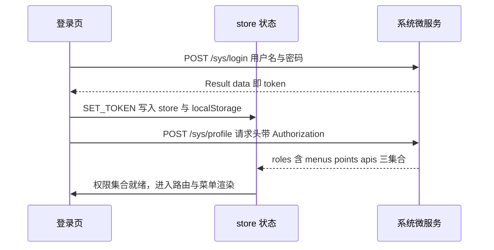

# 菜单跟着权限走：摘掉框架 mock，让前端连上真实后端做动态渲染

上一课 profile 接口把三类用户的权限数据喂了出去，但前端框架是拿现成架构改造的，里面带着自己的一套模拟数据：不登录也什么都有。本课做三件事，摘掉 mock、把前端 API 指到真实的系统微服务、放开框架预留的动态路由代码，让菜单真正跟着权限集合渲染，最后用三个预置账号验证整条链路。

## 先给结论

- 前端 API 路径对齐后端：框架自带的 `/frame/login`、`/frame/profile` 改成 `/sys/login`、`/sys/profile`，与系统微服务的接口一一对应。
- token 取值要适配真实响应：`Result` 的 `data` 直接就是 token 字符串，框架按模拟数据写的多层取值取不到，要改成单层。
- 框架的权限模块预留了「动态构造权限列表」的注释代码，放开注释、停用原静态逻辑，路由才会按 menus 集合过滤，菜单随之按权限渲染。
- 验证用三个预置账号：平台管理员全菜单，企业管理员少了平台管理项，普通用户默认空白，分配角色与权限后重新登录菜单增量出现。
- 后端启动类记得先跑：`SystemApplication` 提供 `/sys/login` 与 `/sys/profile`，拦截器放行登录、拦住其余请求。

## 一、后端先行：启动系统微服务

前端联调前，先把系统微服务跑起来。启动类是 day05 资料包里的成例，包扫描与 JPA 实体扫描都指到公共模块与系统模块（包名已改为 `com.example`）：

```java
// 1.配置 springboot 的包扫描
@SpringBootApplication(scanBasePackages = "com.example")
// 2.配置 jpa 注解的扫描
@EntityScan(value = "com.example.domain.system")
public class SystemApplication {
    /**
     * 启动方法
     */
    public static void main(String[] args) {
        SpringApplication.run(SystemApplication.class, args);
    }

    @Bean
    public IdWorker idWorker() {
        return new IdWorker();
    }

    @Bean
    public JwtUtils jwtUtils() {
        return new JwtUtils();
    }
}
```

启动前顺手核对 profile 里那个查询条件：`findAll` 的 Map 里放的是 `map.put("enVisible", "1")`，值必须是字符串 `"1"`，写成数字虽然编译不报错，但动态查询按字符串等值比较拼 SQL，类型对不上就查不出企业可见权限。微服务起来后，`/sys/login` 与 `/sys/profile` 就绪，JWT 拦截器拦下除登录外的所有请求，后端这半边收工。

## 二、前端三处改造：从模拟数据切到真实接口

**第一处，关掉框架自带的模拟数据。** 这套前端架构为便于开发预置了一套 mock 方案，登录与获取用户信息都走假接口，配置集中在一个 index 文件里维护。真实接口已经就绪，mock 留着只会误导：页面不登录也有数据，排错时真假混在一起。把 mock 的登录与用户信息条目关闭，前端请求从此全部落到后端。

**第二处，API 路径对齐。** 框架自带的基础 API 文件里，登录与用户信息都挂在 `/frame` 前缀下，而系统微服务的真实路径是 `/sys` 前缀。资料包里这个文件原样长这样：

```javascript
import {createAPI, createFormAPI} from '@/utils/request'

export const login = data => createAPI('/frame/login', 'post', data)
export const registerStep1 = data => createAPI('/frame/register/step1', 'post', data)
export const registerStep2 = data => createAPI('/frame/register/step2', 'post', data)
export const regCode = data => createAPI('/frame/register/verification_code', 'post', data)
export const logout = data => createAPI('/frame/logout', 'post', data)
export const passwd = data => createAPI('/frame/passwd', 'post', data)
export const profile = data => createAPI('/frame/profile', 'post', data)
```

要改的只有两条：`login` 的路径改成 `/sys/login`，`profile` 改成 `/sys/profile`，注册相关接口本课程暂不启用。其余模块的 api 文件与后端路径本来就对齐，不用动。

**第三处，token 取值适配真实响应结构。** 状态管理里的登录 action 负责把 token 存进 store 与 localStorage。框架按它自己的模拟数据写的取值路径是多层的（`data.token` 之类），而真实接口的 `Result` 里 `data` 直接就是 token 字符串，多取一层拿到的是 undefined。按真实响应调整（action 代码按本课写法补全）：

```javascript
// store/modules/user.js：登录 action
LoginByUsername({ commit }, userInfo) {
  return new Promise((resolve, reject) => {
    login(userInfo).then(res => {
      // Result 的 data 直接就是 token 字符串，不再往下取 .token
      const token = res.data.data
      commit('SET_TOKEN', token)
      localStorage.setItem('token', token)
      resolve()
    }).catch(err => {
      reject(err)
    })
  })
}
```

取值路径这种错误不会抛异常，只会在后续请求头里静默带上 `Bearer undefined`，被拦截器以未登录打回。改完先在浏览器控制台确认登录响应里 `data` 字段的内容，再对齐取值代码。

## 三、联调验证：三个账号三条分支

前端 `npm run dev` 启动，访问 8080 端口。登录页的默认账号密码先换成课程预置的数据，然后打开浏览器开发者工具的网络面板，一边登录一边看请求：

- `POST /sys/login`：请求头携带用户名与密码，响应的 `data` 是 token 字符串。
- `POST /sys/profile`：请求头自动带上 `Authorization: Bearer + token`，响应的 `roles` 里 `apis`、`points`、`menus` 三个集合齐全。

登录流程至此完整走通：



换账号验证三条分支。13800000001 是平台管理员，登录后左侧菜单全量出现；13800000002 是企业管理员，平台管理相关的菜单消失，企业内功能齐全；13800000003 是普通用户，此时登录菜单却没有任何变化，数据早就按角色返回了，问题出在前端还没启用动态渲染。

## 四、放开动态构造：菜单按权限渲染

框架的权限模块（store 里的 `permission.js`）预留了一段被注释掉的「动态构造权限列表」代码，默认走的是静态逻辑：模块路由全量注册，所以人人菜单一样。改造只需把注释的动态代码放开、把原有的静态注册停用：

```javascript
// 动态构造权限列表：menus 为 profile 返回的菜单权限编码集合
// 公共路由（登录、404）直接放行，模块路由按权限编码过滤
const accessedRoutes = asyncRouterMap.filter(route => {
  if (!route.meta || !route.meta.code) {
    return true
  }
  return menus.includes(route.meta.code)
})
// 过滤结果动态注册，菜单组件由路由生成
router.addRoutes(accessedRoutes)
```

（片段为按框架预留代码的思路补全的示例，模块路由在声明处各自携带权限编码。）过滤发生一次，菜单就是路由的渲染结果：路由没被注册，菜单自然不出现。

最后验证闭环。给 13800000003 分配一个「人事经理」角色，再给这个角色勾选员工管理相关的权限，退出重新登录，左侧多了员工管理菜单，不多不少正好是角色里勾过的那批。换角色、改权限、重登录，菜单跟着变，前端权限控制整条链路闭环。

## 常见误区

- **mock 不关就直接联调**：框架的假接口一直有数据，前端请求到底走了真后端还是 mock 分不清，后端改了参数前端毫无反应。接入真实服务前先把模拟数据的入口关干净。
- **token 取值沿用框架的多层路径**：`Result` 的 `data` 是字符串，多取一层是 undefined，页面不报错但所有鉴权请求都 401。改动前先打印响应确认结构。
- **动态构造代码放开了但忘了重新登录**：store 里的权限集合是登录时写入的，旧会话不会重新拉取，验证效果前先退出重登。
- **分配权限后不重新签发**：菜单数据来自 profile 响应，改的是角色与权限的库表记录，不重新登录（或重新拉取用户信息）前端拿到的还是旧集合。

## 面试可能被问到的问题

1. 面试官追问：「前端动态路由的完整流程是怎样的？」
   答：登录拿到 token 后请求用户信息接口，把菜单权限编码存进 store；路由守卫里判断是否已构造动态路由，未构造则把模块路由按权限编码过滤后 `addRoutes` 注册；菜单组件由注册后的路由生成。刷新页面时重复这个判断，靠 token 重新拉权限补齐。

2. 面试官追问：「为什么菜单不单独出接口，而是从用户信息接口取？」
   答：菜单是权限的展示层投影，它必须与按钮、接口权限同源同版本，拆成两个接口可能出现菜单与按钮权限不一致的窗口。一个 profile 接口一次给全三层权限，前端三个消费点各取所需，一致性问题天然消失。

3. 面试官追问：「权限变更了，用户不重新登录能看到新菜单吗？」
   答：动态路由是登录时构造的，不重新拉权限就看不到。需要实时生效的场景有两条路：权限变更时让旧 token 失效强制重登；或者前端在路由切换的守卫里定期刷新权限集合再增量注册路由。多数后台系统选前者，实现简单且语义清晰。

4. 面试官追问：「用户手输一个没权限的路由地址会怎样？」
   答：那条路由没被注册，匹配不到时落到公共路由的 404 处理。若只做了菜单隐藏而路由仍全量注册，手输地址就能进入页面，所以动态构造必须发生在路由注册环节而不是菜单渲染环节。

5. 面试官追问：「mock 数据在开发阶段的价值和风险是什么？」
   答：价值在后端未就绪时前端可以并行开发，界面与交互先跑起来。风险是联调时真假接口混杂，权限逻辑这类强依赖后端数据的功能在 mock 上验证不出问题。纪律是接口一就绪立即关 mock，联调环境永远打真实后端。

## 配套资料

- 前端基础 API 成例（`/frame/login`、`/frame/profile` 原始路径，本课的改造对象）：`materials/code/02/day04 权限分配与jwt概述/权限分配与jwt概述/资源/前端代码/api/base/frame.js`
- 系统微服务启动类成例（`SystemApplication`，正文代码出处）：`materials/code/02/day05 JWT的权限控制与Shiro入门/JWT的权限控制与Shiro入门/资源/通用代码/SystemApplication.java`
- JWT 拦截器注册与 `/sys/login` 放行配置：`materials/code/02/day05 JWT的权限控制与Shiro入门/JWT的权限控制与Shiro入门/资源/通用代码/SystemConfig.java`
- 菜单管理 API（菜单资源的增删改查，路径 `/base/menus`）：`materials/code/02/day04 权限分配与jwt概述/权限分配与jwt概述/资源/前端代码/api/base/menus.js`
- 正文 store 登录 action 与动态路由过滤为按本课视频写法补全的示例（day05 资料包未含前端框架 store 与路由源文件），包名统一为 `com.example`
