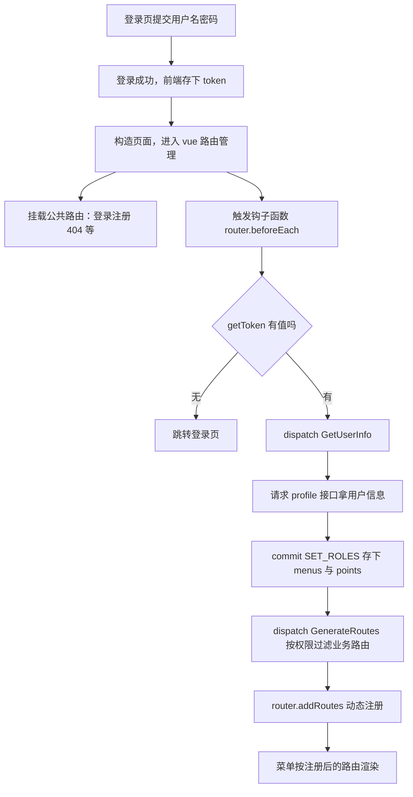

# 菜单、按钮、接口各归谁管：前端权限控制的三层实现思路

换个账号登录，左侧菜单立刻不一样，这个效果已经跑通了。但框架内部这条链是怎么接起来的：路由文件里的 `constantRouterMap` 与 `asyncRouterMap` 为什么要拆成两组，`beforeEach` 到底在什么时机执行，权限数据又是从哪个接口进入前端的。思路不清，就没法给系统新增一个受权限管控的模块。这一课把整条链路摊开，顺带划清三层控制的职责边界。

## 先给结论

- 前端权限控制分三层：菜单层靠路由动态注册，按钮层靠组件条件渲染，接口层靠服务端拦截器；前两层是体验优化，接口层才是安全底线。
- 路由分两组：`constantRouterMap` 是公共路由（登录、注册、404），`asyncRouterMap` 是业务模块路由，后者要等权限数据到位后才动态注册。
- 整条链的发动机是 `router.beforeEach` 前置守卫：凭 token 判定登录态，拉取用户信息，把权限集合写进 Vuex，再按权限过滤并注册路由。
- 权限数据同源：profile 接口一次带回 `menus`（菜单编码）与 `points`（按钮权限点），菜单层与按钮层各取一份，不会出现两套标准。
- 模块路由的 `name` 与权限表里菜单行的 `code` 一一对应，所谓过滤，本质是两个集合求交。

## 一、两组路由：公共的直行，业务的待审

Vue 的两大核心能力在权限控制里各占一摊：vue-router 管「页面给不给你看」，Vuex 管「你手里有什么权限」。框架的主路由文件把声明拆成两组，公共的先注册，业务的攒着待审：

```javascript
// src/router/index.js：公共路由，任何登录态都可访问
export const constantRouterMap = [
  { path: '/login', component: () => import('@/module-dashboard/pages/login'), hidden: true },
  { path: '/reg', component: () => import('@/module-dashboard/pages/reg'), hidden: true },
  { path: '/404', component: () => import('@/module-dashboard/pages/404'), hidden: true },
  { path: '/401', component: () => import('@/module-dashboard/pages/401'), hidden: true }
]
```

（主路由文件不在资料包内，以上按视频画面整理。）业务路由按模块各自成文件，员工模块的成例长这样：

```javascript
// src/module-employees/router/index.js：员工模块的业务路由
import Layout from '@/module-dashboard/pages/layout'
const _import = require('@/router/import_' + process.env.NODE_ENV)

export default [
  {
    root: true,
    path: '/employees',
    component: Layout,
    name: 'employees',            // 与权限表 employees 菜单的 code 对应
    meta: { title: 'employees', icon: 'people' },
    children: [
      { path: 'index', component: _import('employees/pages/index'),
        name: 'employees-index', meta: { title: '员工', icon: 'people', noCache: true } },
      { path: 'details/:id', component: _import('employees/pages/details'),
        name: 'details', meta: { title: '详情' } }
    ]
  }
]
```

模块入口再把这份路由挂进异步路由池：

```javascript
// src/module-employees/index.js：注册本模块路由
import { asyncRouterMap } from '@/router'
import routerMaps from './router'

export default {
  install(module, store) {
    asyncRouterMap.push(routerMaps[0])   // 业务路由先入池，等权限过滤
  }
}
```

关键的一处对齐在数据侧：权限表 `pe_permission` 的种子数据里，菜单行的 `code` 恰好是 `employees`、`departments`、`settings`、`permissions` 这些值，与各模块路由的 `name` 同名。过滤就是拿 roles 里的菜单编码集合去匹配路由名，匹配上的才有资格注册。

## 二、beforeEach：整条链的发动机

路由实例创建时只挂公共路由，动态的那批靠前置守卫现场装配：

```javascript
let router = new Router({
  scrollBehavior: () => ({ y: 0 }),
  routes: constantRouterMap            // 初始只挂公共路由
})

router.beforeEach((to, from, next) => {
  if (getToken()) {
    if (to.path === '/login') {
      next({ path: '/' })              // 已登录还去登录页，送回首页
    } else {
      if (store.getters.roles.length === 0) {
        // 权限未构造：拉用户信息，再按权限生成并追加路由
        store.dispatch('GetUserInfo').then(() => {
          store.dispatch('GenerateRoutes').then(() => {
            router.addRoutes(store.getters.addRouters)  // 动态追加可访问路由
            next({ ...to, replace: true })  // 重新走一次目标地址
          })
        })
      } else {
        next()                           // 权限已就绪，直接放行
      }
    }
  } else {
    next('/login')                       // 未登录一律送去登录页
  }
})
```

**第一，登录态的判断依据是 token。** 登录成功后前端把 token 存进 Vuex 与 localStorage，`getToken()` 有值就视为已登录，没登录的访问被 `next('/login')` 统一收口。

**第二，已登录还去登录页这条分支可有可无。** 它只是体验优化，免得登录过的用户再看到登录表单，删掉不影响权限逻辑。

**第三，roles 为空是「权限是否已构造」的开关。** 会话期间它让 GetUserInfo 与 GenerateRoutes 只执行一次；刷新页面后内存清空，守卫重新走一遍构造流程，这也是动态路由刷新不丢的原因。

整条链路画出来是这样：



图里的关键路径是 E 到 L：守卫把「拿权限」与「注册路由」串成一次性的装配动作，之后的每次跳转都只是在新路由表上做匹配。

## 三、权限数据入仓：SET_ROLES 存了什么

GetUserInfo 这个 action 做的是一次接口调用加一批提交：

```javascript
// store/modules/user.js：拉取用户信息并写入状态
export function getUserInfo({ commit }) {
  return new Promise((resolve, reject) => {
    api.profile().then(response => {
      const data = response.data.data
      commit('SET_ROLES', data.roles)   // roles 含 menus 与 points 两个集合
      commit('SET_NAME', data.username)
      commit('SET_AVATAR', data.avatar)
      resolve(response)
    }).catch(error => {
      reject(error)
    })
  })
}
```

`api.profile` 指向的用户信息接口前一课已经改指真实后端，返回的 `roles` 里装着三类集合：`menus` 是菜单编码，喂给菜单层做路由过滤；`points` 是按钮权限点，留给按钮层，下一课的主角；`apis` 是接口权限编码，服务端校验的依据。SET_ROLES 执行完，前端就掌握了「你能看什么、你能点什么」，后续过滤不再需要任何额外请求。

GenerateRoutes 拿着这份 roles 去筛业务路由：

```javascript
// store/modules/permission.js：按权限过滤异步路由
actions: {
  GenerateRoutes({ commit }, data) {
    return new Promise(resolve => {
      const roles = data
      // 过滤异步路由
      let accessedRouters = filterAsyncRouter(asyncRouterMap, roles)
      commit('SET_ROUTERS', accessedRouters)   // 过滤结果写入路由状态
      resolve()
    })
  }
}
```

过滤的比对逻辑与路由名挂钩：

```javascript
// 菜单级过滤：路由 name 与 menus 编码比对，不区分大小写
function hasPermission(roles, route) {
  if (roles.menus && route.name) {
    return roles.menus.some(name => name.toLowerCase() === route.name.toLowerCase())
  }
  return false
}
```

筛完的数组被 `addRoutes` 注册进路由表，左侧菜单组件读的正是这份注册结果。菜单从来不是被「隐藏」的，而是路由压根没注册，渲染不出这一项。

## 四、第三层在服务端：接口不听前端的

菜单和按钮都控制住了，是不是就安全了。前端把删除按钮藏掉，不代表删除接口打不进去：拿着合法 token 用接口工具直接发 `DELETE /sys/user/{id}`，服务端照样执行。接口层必须由服务端自己设防，day05 资料包里的拦截器注册就是这层防御的骨架（包名已改为 `com.example`）：

```java
package com.example.system;

import com.example.common.interceptor.JwtInterceptor;
import org.springframework.beans.factory.annotation.Autowired;
import org.springframework.context.annotation.Configuration;
import org.springframework.web.servlet.config.annotation.InterceptorRegistry;
import org.springframework.web.servlet.config.annotation.WebMvcConfigurationSupport;

@Configuration
public class SystemConfig extends WebMvcConfigurationSupport {

    @Autowired
    private JwtInterceptor jwtInterceptor;

    /**
     * 添加拦截器的配置
     */
    @Override
    protected void addInterceptors(InterceptorRegistry registry) {
        // 1.添加自定义拦截器
        registry.addInterceptor(jwtInterceptor)
                .addPathPatterns("/**")          // 2.指定拦截器的 url 地址
                .excludePathPatterns("/sys/login", "/frame/register/**"); // 3.放行登录与注册
    }
}
```

拦截器拦下所有请求逐一验 token，登录与注册这类无凭证的入口显式放行。至于某个用户能不能调某个具体接口，还要在这层之上再做 API 权限校验，那正是 `roles.apis` 那份数据的用武之地，对应课程后面展开。三层各管一段：路由注册管菜单，条件渲染管按钮，服务端校验管接口，边界清晰之后，新增受控模块就是三处各加一行的事。

## 常见误区

- **把动态注册放在菜单渲染环节**：只在菜单组件里判断要不要显示，路由本身全量注册，手输 URL 照样进得去。过滤必须发生在 `addRoutes` 之前。
- **addRoutes 之后忘了 `next({ ...to, replace: true })`**：本次跳转在旧路由表上已经匹配失败，不重新走一次就是白屏或 404。
- **退出登录不清 roles**：换账号登录复用了上一个账号的动态路由，权限串号。登出时要把权限状态一并复位。
- **把登录页、404 这类公共页放进 asyncRouterMap**：它们会被权限过滤掉，没登录的用户连登录页都渲染不出来。

## 面试可能被问到的问题

1. 面试官追问：「前端权限控制的完整链路是怎样的？」
   答：登录拿 token 存本地；路由前置守卫发现权限未构造时调用用户信息接口，把 menus 与 points 存进 Vuex；再用菜单编码过滤业务路由并 addRoutes 动态注册；菜单由注册后的路由渲染，按钮用权限点做条件渲染，接口由服务端拦截器校验。

2. 面试官追问：「为什么说前端的权限控制只是体验优化？」
   答：前端代码运行在用户手里，隐藏按钮、过滤路由都挡不住直接构造的请求。前端两层的作用是避免用户看到不可用功能、减少无效操作，真正的安全边界必须由服务端对每个接口做鉴权。

3. 面试官追问：「动态路由刷新页面后会丢吗？」
   答：内存中的路由表会清空，但 token 还在，守卫发现权限状态为空会重新拉用户信息、重新过滤并注册路由，用户无感知。这也是守卫里 roles 为空判断存在的意义。

4. 面试官追问：「业务路由怎么和权限数据关联起来？」
   答：靠约定对齐。模块路由的 name 与权限表菜单行的 code 同名，过滤函数拿 menus 集合与路由名做不区分大小写的匹配。新增模块时把路由名取成权限编码，整条链路自动生效。

5. 面试官追问：「beforeEach 里的 next 调用要注意什么？」
   答：一次守卫执行中 next 必须恰好调用一次，分支写不严谨会出现既放行又重定向的竞争。异步构造路由的分支要先等 GetUserInfo 与 GenerateRoutes 完成，再带 replace 重新进入目标地址，保证新路由表参与匹配。

## 配套资料

- 员工模块业务路由成例（正文模块路由出处）：`materials/code/02/day04 权限分配与jwt概述/权限分配与jwt概述/资源/前端代码/module-employees/router/index.js`
- 模块注册入口成例（asyncRouterMap.push）：`materials/code/02/day04 权限分配与jwt概述/权限分配与jwt概述/资源/前端代码/module-employees/index.js`
- 基础 API 成例（profile 接口声明）：`materials/code/02/day04 权限分配与jwt概述/权限分配与jwt概述/资源/前端代码/api/base/frame.js`
- JWT 拦截器注册成例（接口层骨架）：`materials/code/02/day05 JWT的权限控制与Shiro入门/JWT的权限控制与Shiro入门/资源/通用代码/SystemConfig.java`
- 权限种子数据（菜单 code 与三层权限示例行）：`materials/code/02/day02 SAAS-HRM数据库设计与前端框架/3-3 SAAS-HRM数据库设计与前端框架/资源/ihrm.sql`
- 主路由文件与 Vuex 的 user、permission 模块不在资料包内，相关代码按视频画面整理；Java 包名已统一改为 `com.example`
