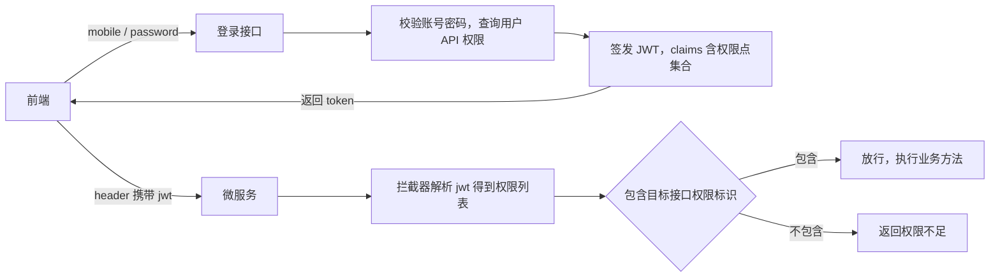
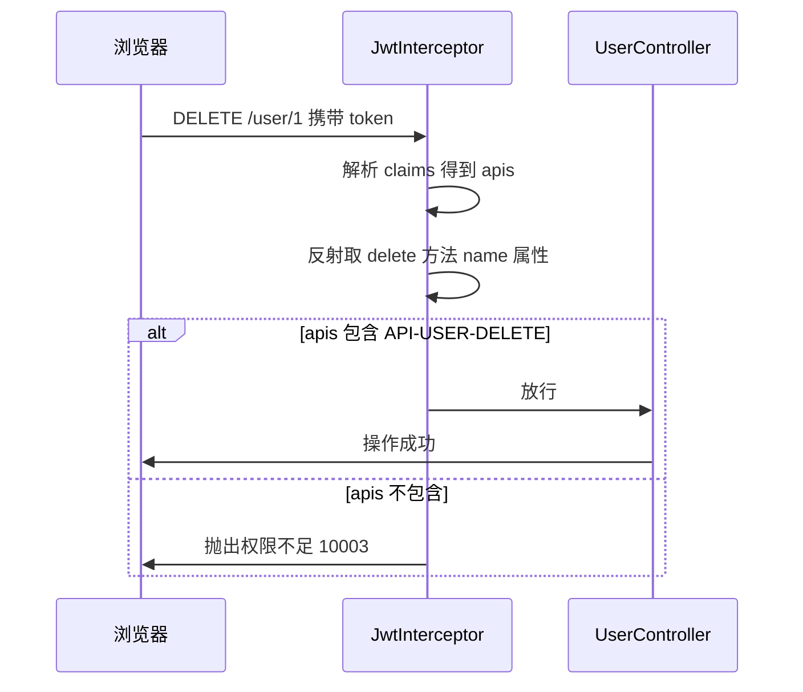

# 基于 JWT 的 API 权限校验完整方案：需求分析与拦截器代码落地

## 先给结论

- 系列定位：菜单权限与按钮权限都做完之后，API 层的权限校验仍是空白，拿着有效 token 可以直接调任何后端接口，本系列用两讲补上这块最后拼图。
- 需求分析讲把方案掰清楚：认证回答「你是谁」，授权回答「你能干什么」，前端控制只是体验层而非安全层，服务端校验不可省略。
- 无状态服务不存会话，权限清单只能跟着 JWT 走：登录成功时把用户可访问的 API 权限点签进 token，请求到达时由拦截器解析比对。
- 接口的权限标识贴着代码声明，与下一阶段的 Shiro 在思想上同源，先手写一遍才能理解框架替我们做了什么。
- 代码实现讲四步落地：登录接口把 API 权限编码拼串签进 token，拦截器强转 HandlerMethod 反射取注解比对，把拦截器挂进工程，测试验证前端绕过与正常路径。
- 两个错误码必须拆开：未登录与权限不足分开返回，前端和排查才能拿到准确信号。
- 一个要想清楚的权衡：权限签进 token 后在有效期内定格，收回权限只能靠短时效加刷新机制对冲窗口期。

## 第1部分：认证不等于授权：基于 JWT 的 API 权限校验需求分析

菜单权限做了，按钮权限也做了，测试时用没权限的账号点页面，该隐藏的都隐藏了。但只要打开 Postman 拿着这个账号的 token 直接调后端接口，删除用户、分配角色这些高危操作照样畅通无阻。前端控制挡住的只是「看不见」，挡不住「绕过去」；而服务端的拦截器目前只校验了 token 有没有、对不对，也就是只做了认证。一个登录成功的账号可以调它有权的任何接口，也可以调它没权的所有接口，API 层的权限校验是缺失的。

这一节先不写代码，把需求和方案掰清楚：无状态服务下，API 权限数据放在哪里，请求到达时在哪里比对，接口的权限标识由谁声明。

### 一、权限控制的三层与被绕过的前端

RBAC 模型下权限点分三种类型：菜单权限决定用户能看到哪些页面，按钮（功能）权限决定页面上哪些操作可点，API 权限决定后端接口允许谁调用。前面两天完成的是前两层，全部实现在前端：路由守卫控制菜单渲染，`hasPermissionPoint` 这类方法控制按钮显隐。

**第一，前端控制是「体验层」而非「安全层」。** 页面上不渲染删除按钮，删除接口本身仍然在线上等着；构造一个 HTTP 请求的成本趋近于零，任何拿到有效 token 的账号都能试探所有接口。

**第二，服务端目前只有认证没有授权。** 拦截器解析出 claims 就放行，至于 claims 的主人能不能调这个接口，方法体里无从得知。要补上这一层，需要回答两个问题：权限数据存哪，以及在哪比对。

权限点数据本身在数据库里已经齐备：权限表维护着每个 API 权限点的编码、类型与可见性，其中 `enVisible` 字段约定 `1` 为企业可见、`0` 为平台私有，管理端分配角色时把这些权限点勾给用户。缺的只是「让后端在接口入口处用上它」。

### 二、无状态服务的答案：把权限清单签进 token

有状态架构下，用户登录后服务端会在 Session 里记住他的权限集，每个请求来了查一眼就行。无状态服务不存任何会话，一个请求从哪一个微服务进来、由谁处理，事先完全未知，所以权限清单必须随请求自证。这正是 JWT 的用武之地：登录时把用户可访问的 API 权限集合签进 token，之后每个请求自带这份清单。

整个执行流程如下：



图中上半段是登录链路：验证通过后查权限点，把集合写进 claims 再签发 token；下半段是访问链路：拦截器解析 token 拿到权限列表，与目标接口的标识比对。以删除用户为例，给这个接口起一个权限标识 `user-delete`，前端要调它，token 里的权限集合必须包含这个字符串，10 条权限也好 100 条也好，不含 `user-delete` 就进不了方法体，返回权限不足。

这样设计还有一个隐性收益：多个微服务各自挂同一个拦截器组件，任何一个服务都能独立完成校验，权限判断跟着 token 走，不依赖某个中心化的会话存储。

### 三、接口的权限标识怎么声明

拦截器要拿「目标接口的权限标识」和 claims 里的清单比对，这个标识得有地方写。硬编码一个「路径加权限点」的映射表是一种做法，但每加一个接口就要改配置，容易漏。更自然的落点是接口方法本身：用自定义注解声明，示例按本课方案补全如下：

```java
/**
 * API 权限校验示意（示例代码，按本课方案补全）
 */
@Target(ElementType.METHOD)
@Retention(RetentionPolicy.RUNTIME)
public @interface RequiresApi {
    String value();
}
```

在需要保护的删除接口上标注：

```java
@RequiresApi("user-delete")
@RequestMapping(value = "/user/{id}", method = RequestMethod.DELETE)
public Result delete(@PathVariable String id) {
    userService.deleteById(id);
    return new Result(ResultCode.SUCCESS);
}
```

拦截器的 `preHandle` 里，`handler` 参数强转成 `HandlerMethod`，读出方法上的 `@RequiresApi`，再判断 claims 中的权限集合是否包含该值。没有标注的接口维持现状（只做登录校验），标注了的接口自动多一层授权检查，权限声明贴着代码走，新接口不会被遗漏。

这套「注解声明、拦截器比对」的方案，和下一阶段要学的 Shiro 在思想上同源：Shiro 把注解、校验、异常这一整套做成了框架能力，本课先手写一遍，理解框架替我们做了什么。需要明确的一个权衡是：权限清单进了 token，token 在有效期内权限就定格了，管理员收回权限后，旧 token 依然带着旧清单跑，只能靠缩短签发时长、配合刷新机制来压缩这个窗口期。

## 第2部分：登录时把权限签进 token，拦截器里做比对：基于 JWT 的 API 权限校验代码落地

方案上一节已经定了：无状态服务里，用户能访问哪些 API 的清单跟着 JWT 走，请求到达时由拦截器解析比对。落到代码上其实只改两个地方，登录接口在签发 token 之前多查一次权限、把结果写进 claims；拦截器的 `preHandle` 里多一段「取出清单、找到目标接口的权限标识、比对」的逻辑。改动不大，但每一行都有讲究，包括比对该用什么方式、错误码该怎么拆。

### 一、登录接口：把 API 权限拼成字符串签进 token

数据库里权限点分三类：1 为菜单、2 为功能、3 为 API，常量类 `PermissionConstants` 里定义了对应的三个值。登录要收集的是第三类，因为这次校验的目标就是接口。改造后的登录方法如下（包名统一改为 `com.example`）：

```java
@RequestMapping(value = "/login", method = RequestMethod.POST)
public Result login(@RequestBody Map<String, String> loginMap) {
    String mobile = loginMap.get("mobile");
    String password = loginMap.get("password");
    User user = userService.findByMobile(mobile);
    //1.登录失败：用户不存在或密码不匹配
    if(user == null || !user.getPassword().equals(password)) {
        return new Result(ResultCode.MOBILEORPASSWORDERROR);
    } else {
        //2.登录成功：收集该用户所有可访问的API权限
        StringBuilder sb = new StringBuilder();
        for (Role role : user.getRoles()) {
            for (Permission perm : role.getPermissions()) {
                //只统计类型为API的权限点
                if(perm.getType() == PermissionConstants.PERMISSION_API) {
                    sb.append(perm.getCode()).append(",");
                }
            }
        }
        Map<String, Object> map = new HashMap<>();
        map.put("company_id", user.getCompanyId());
        map.put("company_name", user.getCompanyName());
        //3.把API权限字符串也放进claims
        map.put("apis", sb.toString());
        String token = jwtUtils.createJwt(user.getId(), user.getUsername(), map);
        return new Result(ResultCode.SUCCESS, token);
    }
}
```

三层嵌套各司其职：外层遍历用户的所有角色，中层遍历角色下的权限点，内层的 `if` 用 `PermissionConstants.PERMISSION_API`（值为 3）把菜单和按钮权限过滤掉，只留下 API 权限。拼串用的是 `StringBuilder`，每个编码后面补一个逗号，形如 `API-USER-DELETE,API-USER-UPDATE,`。尾逗号没有清理，这里做的是简单的包含判断，逗号多一个少一个不影响结果，属于刻意的简化。

`map` 里的自定义键值是怎么进 token 的？看一眼签发工具类的关键代码就明白了：

```java
//根据map设置claims
for(Map.Entry<String,Object> entry : map.entrySet()) {
    jwtBuilder.claim(entry.getKey(),entry.getValue());
}
```

`createJwt` 会遍历传入的 map，逐个调用 `claim(key, value)` 写进 JWT 的负载区，`apis` 也就随之被签名固化。任何微服务拿到这个 token 解析 claims，都能读到同一份权限清单。

### 二、拦截器：反射取注解，比对权限标识

登录侧准备好了，接下来是请求侧。拦截器 `JwtInterceptor` 在原有 token 校验的基础上追加三步：取权限清单、找目标接口的权限标识、比对：

```java
@Override
public boolean preHandle(HttpServletRequest request, HttpServletResponse response, Object handler) throws Exception {
    //1.判断请求头中是否包含Authorization，是否以Bearer开头
    String authorization = request.getHeader("Authorization");
    if(StringUtils.isEmpty(authorization) || !authorization.startsWith("Bearer ")) {
        throw new CommonException(ResultCode.UNAUTHENTICATED);
    }
    //2.解析token获取claims
    String token = authorization.replace("Bearer ", "");
    Claims claims = jwtUtils.parseJwt(token);
    //3.通过claims获取当前用户的可访问API权限
    String apis = (String) claims.get("apis"); //API-USER-DELETE,API-USER-UPDATE
    //4.获取当前请求方法上的RequestMapping注解
    HandlerMethod h = (HandlerMethod) handler;
    RequestMapping annotation = h.getMethodAnnotation(RequestMapping.class);
    String name = annotation.name();
    //5.判断当前用户是否具有该请求的权限
    if(!apis.contains(name)) {
        throw new CommonException(ResultCode.UNAUTHORISE);
    }
    //6.将claims设置到request中，后续Controller可直接获取
    request.setAttribute("user_claims", claims);
    return true;
}
```

第 4 步是整段代码里最值得展开的。`preHandle` 的第三个参数 `handler` 在请求命中 Controller 方法时，实际类型是 Spring MVC 的 `HandlerMethod`，它包装了「即将执行的那个方法」。强转之后调用 `getMethodAnnotation(RequestMapping.class)`，就能在运行期反射读出方法上的注解实例，再通过 `annotation.name()` 把注解里声明的值拿出来。方法上贴了什么注解、注解里写了什么值，写代码的人不需要关心，运行期一查便知。

本课没有为权限校验新造注解，而是复用了 `@RequestMapping` 自带的 `name` 属性，直接把权限标识写在路由注解上：

```java
@RequestMapping(value = "/user/{id}", method = RequestMethod.DELETE, name = "API-USER-DELETE")
public Result delete(@PathVariable(value = "id") String id) {
    userService.deleteById(id);
    return new Result(ResultCode.SUCCESS);
}
```

上一节示意过的自定义注解方案，走的其实是同一条反射路径，只是把 `RequestMapping.class` 换成自定义注解的 class，比如 `@RequirePermission("API-USER-DELETE")`；如果标识声明在类上而不是方法上，就从 `h.getBeanType()` 上取注解，思路完全一致。Shiro 的注解鉴权内部做的也是这件事，先手写一遍，后面见到框架就有底了。

比对用 `apis.contains(name)`，包含则 `return true` 放行，不包含抛出权限不足异常。顺序上有讲究：token 的存在性与合法性检查在前，权限比对在后，授权判断永远建立在认证通过之上，claims 都拿不到就谈不上比对。

### 三、把拦截器挂进工程

拦截器写完还差最后一步注册。资料包里的配置类成例是这样的：

```java
@Configuration
public class SystemConfig extends WebMvcConfigurationSupport {

    @Autowired
    private JwtInterceptor jwtInterceptor;

    /**
     * 添加拦截器的配置
     */
    @Override
    protected void addInterceptors(InterceptorRegistry registry) {
        //1.添加自定义拦截器
        registry.addInterceptor(jwtInterceptor).
                addPathPatterns("/**").//2.指定拦截器的url地址
                excludePathPatterns("/sys/login","/frame/register/**");//3.指定不拦截的url地址
    }
}
```

`/**` 拦截所有请求，`/sys/login` 与注册相关地址放行。登录接口必须排除，否则第一次登录就没有 token，永远过不了自己的拦截器。`jwtUtils` 这个 Bean 已在启动类 `SystemApplication` 里以 `@Bean` 方式注册，拦截器注入即可使用。

### 四、测试：前端绕过与正常路径都要验

代码跑起来后，用两个账号做对照测试。一个完整的校验链路如下：



测试过程分两步走。第一步，企业管理员账号持有全部权限，勾选了「用户删除」按钮对应的权限点后，删除操作成功。第二步，到「权限设置」里把人事经理角色下的「用户删除」按钮权限去掉再分配，人事经理账号登录后页面上删除按钮不再渲染（前端靠 `v-if` 判断按钮权限控制显隐），后端删除接口同样调不动。

这里有个真实发生过的插曲：页面代码里如果忘了写那个 `v-if` 判断，按钮就会暴露出来。点了会怎样？后端照样不放行，因为 token 里的 `apis` 不含 `API-USER-DELETE`，返回「权限不足」。这正是前后端两层控制的分工：前端忘写只是体验降级，服务端这道防线永远兜底。

调试时还顺手做了一次拆分：最初不管未登录还是未授权，抛的都是同一个「未登录」异常，测试时看不出差别，于是把权限比对失败单独改成抛 `CommonException(ResultCode.UNAUTHORISE)`。对照错误码定义，10002 是「您还未登录」，10003 是「权限不足」，语义分家之后，前端提示和日志排查都精确多了。

最后强调一个约定：每个需要保护的接口都要写 `name` 属性，这个值必须与权限管理页面里维护的 API 权限点编码一字不差、全局唯一，它把数据库里的权限点、前端按钮、后端接口三方绑在一起。

## 常见误区

- **把登录校验当成权限校验**：token 有效只说明「这是个注册过的用户」，不代表「他有权删用户」。授权必须在认证之外单独比对权限点。
- **以为前端隐藏了按钮就安全了**：前端控制只影响渲染，接口层面没有任何约束，抓包或看一眼接口文档就能绕过，服务端校验才是底线。
- **权限标识随手起名**：接口上写 `user-delete`，权限表里维护的却是 `删除用户` 或 `user:delete`，比对永远不相等，表现为「明明分配了权限还是提示权限不足」。权限编码需要前后端与数据库统一维护。
- **忽略 token 内权限的时效性**：签进 token 的权限清单在过期前不会更新，调整权限后用户必须重新登录（或走刷新流程）才能生效，业务上要接受这个窗口或用短时效加刷新对冲。
- **权限标识拼写不一致**：接口上写 `API-USER-DELETE`，权限表里维护的却是 `api-user-delete` 或「删除用户」，`contains` 永远返回 false，表现为「明明分配了权限还是提示权限不足」。编码要三方统一维护，复制粘贴比手敲可靠。
- **`contains` 的子串误匹配**：`contains` 做的是子串判断，如果存在 `API-USER-DELETE` 与 `API-USER-DELETE-ALL` 这类互为前缀的编码，理论上会出现误放行。设计编码时避免互相包含，或改成分隔后全等比较更严谨。
- **忘记排除登录接口**：拦截器配上 `/**` 却没排除 `/sys/login`，用户第一次登录就被拦下报未登录，系统谁都进不去。
- **以为权限调整立即生效**：权限清单签进 token 后在有效期内定格，管理员收回权限后，持旧 token 的用户仍能通过校验，重新登录或走刷新流程才会拿到新清单。

## 面试可能被问到的问题

1. 面试官追问：「认证和授权有什么区别？」
   答：认证解决「你是谁」，验证身份的合法性，比如账号密码登录、token 有效性检查；授权解决「你能干什么」，在身份确认之后判断其权限是否覆盖本次操作。两者常在同一个拦截器里先后完成，但属于两个独立的判断。
2. 面试官追问：「无状态服务为什么不能像 Session 那样在服务端存权限？」
   答：无状态下任何实例都可能处理任何一个请求，服务端不保存会话，把权限放内存或集中存储都会引入状态共享问题。JWT 让每个请求自带声明并附签名防篡改，微服务各自解析即可完成校验，天然适配横向扩容。
3. 面试官追问：「把权限清单放进 JWT 有什么缺点？」
   答：一是 token 体积随权限条数膨胀，每次请求都要携带；二是无法即时回收，签发后权限定格，收回权限要等 token 过期或配合黑名单、刷新机制；三是 claims 明文可读，只适合放不敏感的标识数据。
4. 面试官追问：「拦截器里怎么知道请求要访问的是哪个接口？」
   答：preHandle 的 handler 参数在命中 Controller 时是 HandlerMethod，可强转后拿到类和方法对象，进而读取方法上的自定义注解、路径、参数类型等元数据，用它携带的权限标识与 token 里的权限列表比对。
5. 面试官追问：「前端已经做了菜单和按钮控制，后端为什么还要再做一遍？」
   答：前端的任何控制都发生在用户自己的浏览器里，可被任意绕过，它提供的是操作引导和体验；安全约束必须由服务端在数据出口强制执行，两者是互补关系而不是替代关系。
6. 面试官追问：「权限清单为什么签进 token，而不是每次请求查数据库？」
   答：无状态服务不保存会话，任何实例都可能处理请求，把权限放库就意味着每个请求都要多一次查询。签进 token 后校验只依赖解析结果，微服务各自独立完成，代价是权限在 token 有效期内无法即时回收，需要用短时效加刷新机制对冲。
7. 面试官追问：「拦截器里怎么知道当前请求要访问的是哪个方法？」
   答：`preHandle` 的 `handler` 参数在命中 Controller 时是 `HandlerMethod`，强转后可以拿到方法对象和类对象，再调用 `getMethodAnnotation` 反射读取方法上的注解及属性值，本课就是用它取 `@RequestMapping` 的 `name` 属性做权限比对。
8. 面试官追问：「用 `@RequestMapping` 的 `name` 属性和自定义注解有什么区别？」
   答：取值机制完全一样，都是运行期反射读注解属性。`name` 属性零成本但语义通用，自定义注解如 `@RequirePermission` 表达力更强，可以支持多个权限、逻辑或非组合等扩展，工程上接口多了以后更常用自定义注解。
9. 面试官追问：「未登录和权限不足为什么用两个错误码？」
   答：两者语义不同，处理方式也不同。10002 提示用户先去登录，10003 提示账号权限不够。混用一个码会让前端无法给出正确引导，排查问题时也分不清是 token 缺失还是权限没分配。
10. 面试官追问：「这套手写校验和 Shiro 是什么关系？」
   答：思想同源，都是「声明权限标识、统一入口比对」。手写版把反射取注解、比对、异常处理摊开在拦截器里，Shiro 把这套流程框架化，提供注解鉴权、Realm 数据源接入、缓存等能力，理解了手写版，Shiro 的价值就一目了然。

## 配套资料

- JWT 工具类成例（登录签发与请求解析依赖的 `createJwt`、`parseJwt`）：`materials/code/02/day14 微服务网关与社保模块开发/day14/03-资料/common模块的工具类/JwtUtils.java`
- 拦截器注册与 No Session 解决成例：`materials/code/02/day05 JWT的权限控制与Shiro入门/JWT的权限控制与Shiro入门/资源/通用代码/SystemConfig.java`、同目录 `SystemApplication.java`
- 本节为需求分析课，视频未现场编写授权代码，文中 `@RequiresApi` 注解与拦截器比对示例为按本课方案补全的示意代码，包名统一改写为 `com.example`。
- 拦截器注册成例：`materials/code/02/day05 JWT的权限控制与Shiro入门/JWT的权限控制与Shiro入门/资源/通用代码/SystemConfig.java`（同目录 `SystemApplication.java` 注册了 `JwtUtils` 等 Bean）
- JWT 签发与解析工具类：`materials/code/02/day14 微服务网关与社保模块开发/day14/03-资料/common模块的工具类/JwtUtils.java`
- 权限类型常量（1 菜单 2 功能 3 API）：`materials/code/02/day14 微服务网关与社保模块开发/day14/03-资料/common模块的工具类/PermissionConstants.java`
- 权限实体与可见性字段：`materials/code/02/day04 权限分配与jwt概述/权限分配与jwt概述/资源/实体类/Permission.java`
- 错误码定义（10002 未登录、10003 权限不足）：`materials/code/02/day01 SAAS-HRM系统概述与搭建环境/SAAS-HRM系统概述与搭建环境/资源/通用代码/common/ResultCode.java`
- 视频中的 `UserController` 与 `JwtInterceptor` 为课堂现场编写代码，按画面整理成文，包名统一改写为 `com.example`。
