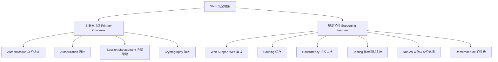

# Apache Shiro：一个不依赖任何容器的 Java 安全框架

> 🔒 安全提示：文中示例的口令/密钥均为课程教学环境演示口径，生产环境的安全要求见《安全与合规须知》。

登录要查库比对密码，权限要拦接口比编码，密码不能明文存储要加密，会话要有人管生命周期。这些事每个系统都要做，上一节手写的拦截器只是其中一角，而且换一个工程还得再抄一遍。安全领域的这些通用需求，早就被沉淀成了框架，Java 世界里用得最多的有两个：Shiro 和 Spring Security。这一节先认识前者：它是什么，能做什么，为什么这套课程在两者之间选了它。

## 先给结论

- Shiro 是 Apache 旗下的开源安全框架，一个框架覆盖身份认证、授权、密码加密、会话管理四件核心的事。
- 它的 API 高度套路化，遵守固定写法就能完成安全控制，学习成本明显低于同类框架。
- 它不绑定任何容器：Java SE 程序能独立用，Web 程序能用，放进 Spring 也能用。
- 与 Spring Security 相比，Shiro 简单轻量；Spring Security 功能更全但必须依托 Spring 体系，属于重量级方案。
- 选型思路很简单：够用且轻量优先，本课程的人资系统选 Shiro，重点用到它的认证与授权。

## 一、Shiro 是什么

一句话定义：Apache Shiro 是一个强大且易用的 Java 安全框架，用于执行身份验证、授权、密码和会话管理。

这个定义里每个词都值得停一下。**强大**，指的是它把安全领域的主要问题都覆盖了；**易用**，是它摆在第一位置的设计目标。处理安全相关的代码向来是件痛苦的事：做登录要考虑密码怎么比对、错误怎么提示，做权限要考虑数据从哪查、在哪里拦，做会话要考虑生命周期、并发访问。Shiro 把这些繁琐操作全部屏蔽在内部，只暴露一组设计好的 API，开发者按它的约定俗成的代码套路写，几行就能把安全控制立起来。

它的官网特性列表里有一条很关键的描述：Shiro 不跟任何容器绑定，可以独立使用，也可以放进任何框架、任何容器。容器在这里指 Spring 这样的 IoC 容器，也包括 Web 服务器。一个纯 Java SE 的桌面程序、一个不需要 Web 环境的批处理任务，都能直接把 Shiro 用起来。这是它和 Spring Security 最本质的分野之一。

## 二、它能做什么：核心功能与辅助功能

Shiro 的功能以插件化、模块化的方式提供，官方把它分成两组：一组是安全领域的主要关注点，一组是支撑特性。



图里上方一排是框架的主业，逐个展开：

**第一，Authentication，身份认证，也就是登录。** Shiro 内部有一套完整的登录逻辑，判断「你是不是你所声称的那个身份」，后续课程会看到它的代码形态。

**第二，Authorization，授权，访问控制。** 回答两个问题：这个用户是否拥有某个角色？是否有操作某个功能的权限？上一节手写的 API 权限校验，正是在手工实现这一块。

**第三，Session Management，会话管理。** Shiro 在任何环境下都能使用 Session，Web 程序、桌面程序、纯 Java SE 程序都有一套由它内部维护的会话体系，不依赖 Servlet 容器的 HttpSession，这正是有状态服务所需要的底座。

**第四，Cryptography，加密。** 密码不能明文落库，MD5 这类散列算法 Shiro 直接提供了封装好的加密 API。

下方一排辅助特性里，Web Support 负责 Web 环境集成，Caching 负责把用户角色、权限这类不常变化的安全数据缓存起来以减少查询，Remember Me 提供「记住我」式的自动登录，几天之内再进系统不用重新认证。这些能力不用一次全学，用到时知道 Shiro 有现成的即可。

## 三、与 Spring Security 怎么选

既然 Spring 生态自带一个安全框架，为什么还要 Shiro？把两者摆在一张表里看：

| 对比项 | Shiro | Spring Security |
|---|---|---|
| 容器依赖 | 无，SE 与 Web 环境都能独立运行 | 必须基于 Spring 体系使用 |
| API 风格 | 套路固定，简单易理解 | 能力强但概念多，上手陡 |
| 功能覆盖 | 认证、授权、会话、加密齐全 | 覆盖更广，内置 OAuth、OpenID 等 |
| 权限粒度 | 支持方法级等细粒度控制 | 粒度更细，控制更精密 |
| 重量程度 | 轻量 | 重量级 |

**第一，Shiro 赢在简单。** 它提供的身份认证机制可以概括为简约而不简单：代码写起来不难，功能却足够强大；认证数据可以从多种来源获取，JDBC、LDAP 等都支持，甚至可以自定义。

**第二，Spring Security 赢在全面。** 它的功能更强大，OAuth、OpenID 这类认证协议开箱即用，而 Shiro 要完成同样的事需要自己实现或引入扩展；它的权限控制粒度也更高。但代价是它脱离 Spring 就没那么好用，整体偏重。

**第三，取舍标准是「哪个简单用哪个」。** 对人资系统这类业务，要的是把登录和权限管理干净利落地做出来，Shiro 的轻量与套路化正好对症。理解了这个取舍逻辑，将来面对必须用 Spring Security 的项目，切换的只是 API，思想并不需要推倒重来。

## 四、第一眼 API

先看依赖，后续两节的环境搭建用的就是这两个坐标：

```xml
<dependency>
    <groupId>org.apache.shiro</groupId>
    <artifactId>shiro-core</artifactId>
    <version>1.3.2</version>
</dependency>
<dependency>
    <groupId>junit</groupId>
    <artifactId>junit</artifactId>
    <version>4.12</version>
    <scope>test</scope>
</dependency>
```

再看它的调用长什么样。下面是认证与授权的典型套路（示例代码，按本课写法补全，细节由后续两节展开）：

```java
Subject subject = SecurityUtils.getSubject();                    //拿到当前「用户」
UsernamePasswordToken token = new UsernamePasswordToken("zhangsan", "123456");
subject.login(token);                                            //认证：登录
boolean hasRole = subject.hasRole("role1");                      //授权：是否有角色
boolean permitted = subject.isPermitted("user:save");            //授权：是否有权限
```

五个方法名就是 Shiro 的日常：拿 Subject、组 token、login、hasRole、isPermitted。至于密码去哪比对、权限数据从哪来，框架内部自有一套流转，这正是下一节要拆开的体系结构。

## 常见误区

- **以为 Shiro 只能用在 Web 项目**：它与 Servlet 容器无关，纯 Java SE 程序同样能跑认证授权，会话也由它自己管理。
- **以为 Shiro 是 Spring 家族的组件**：它是 Apache 顶级项目，与 Spring 没有隶属关系，只是提供了与 Spring 集成的支持。
- **认为引入 Shiro 后前端就不用做权限控制了**：框架解决的是服务端校验，页面菜单与按钮的显隐仍由前端处理，两层各管一段。
- **把「功能少」等同于「能力弱」**：Shiro 没有内置 OAuth、OpenID 这类协议支持，需要时自行实现或扩展，但基础的认证授权加密会话能力是完整的。

## 面试可能被问到的问题

1. 面试官追问：「Shiro 的四大核心功能是什么？」
   答：Authentication 身份认证即登录校验身份合法性；Authorization 授权即判断角色与操作权限；Session Management 会话管理即在任何环境下提供不依赖容器的会话；Cryptography 加密即提供密码散列等加密 API。前两者是日常开发的重点。

2. 面试官追问：「Shiro 和 Spring Security 怎么选型？」
   答：Shiro 简单、轻量、不依赖容器，API 套路化易上手，适合大多数业务系统的认证授权需求；Spring Security 功能更全，内置 OAuth、OpenID 等协议支持，权限粒度更细，但必须依托 Spring 且概念复杂。项目轻量够用选 Shiro，深度绑定 Spring 生态且需要高级认证协议时选 Spring Security。

3. 面试官追问：「不依赖 Servlet 容器，Shiro 的 Session 是怎么工作的？」
   答：Shiro 内部实现了自己的会话体系，由 SessionManager 统一管理，会话数据的存取、销毁都由框架负责，不依赖 Servlet 规范的 HttpSession。因此桌面程序、SE 程序里也能用同一套 API，还能通过 SessionDAO 把会话数据落到任意存储。

4. 面试官追问：「Remember Me 和已认证是一回事吗？」
   答：不是。正常登录是认证身份，用户主动输入凭证后获得；Remember Me 是记住身份，基于持久化的凭证在下次访问时自动恢复登录状态。Shiro 对两者区分得很清楚，isRemembered 与 isAuthenticated 是两个不同的判断，敏感操作要求 isAuthenticated 才能通过。

5. 面试官追问：「Shiro 能做到方法级别的权限控制吗？」
   答：能。它提供注解式授权，在方法上声明权限要求即可实现方法级细粒度控制，编程式调用 isPermitted 也能做到。本课程手写的拦截器加注解方案就是同一思想的简化版。

## 配套资料

- 本课资料包仅有工程通用代码（拦截器注册与启动类）：`materials/code/02/day05 JWT的权限控制与Shiro入门/JWT的权限控制与Shiro入门/资源/通用代码/SystemConfig.java`、同目录 `SystemApplication.java`，本课无 Shiro 源码包。
- 依赖坐标与功能模块图出自本课讲义与课件；文中 Java 调用示例为按本课写法补全。
- 下一课资料包含可运行的 Shiro 案例工程，可对照阅读：`materials/code/02/day06 Shiro高级 及SaaS-HRM的认证授权/Shiro高级 及SaaS-HRM的认证授权/资源/shiro案例代码/shiro_springboot/`
