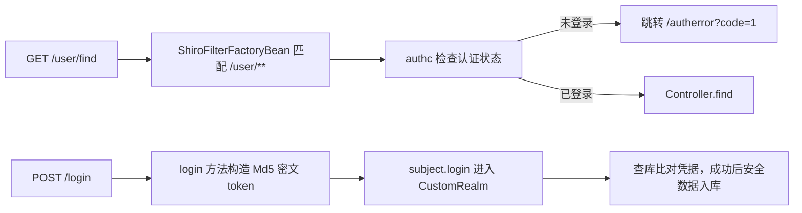

# Shiro 整合 Spring Boot：引依赖、改造登录方法与过滤器配置

> 🔒 安全提示：文中示例的口令/密钥均为课程教学环境演示口径，生产环境的安全要求见《安全与合规须知》。

案例工程已经就位，可它还没有任何防护。给一个 Spring Boot 工程装上 Shiro，拢共四步：引入整合依赖、自定义 Realm 完成认证授权、把传统登录方法改造成 `subject.login`、用配置类把过滤器链搭起来。本课走完前三步外加密码加密，过滤器链给出可直接落地的完整配置，最后工程就能真正跑起来看效果。

## 先给结论

- 整合依赖选 `shiro-spring` 配合 `shiro-core`；本课工程用的是 1.3.2 版本，那个年代还没有官方 starter，SecurityManager 与过滤器都用配置类手动装配。
- Shiro 登录与传统登录的分水岭在于：比对逻辑不再写在业务代码里，Controller 只构造 `UsernamePasswordToken` 并调用 `subject.login(upToken)`，认证下沉到 Realm。
- 登录失败的表达方式是异常：`subject.login` 抛异常即认证失败，catch 住转成失败提示即可。
- 密码不能明文比对，Shiro 内置 `Md5Hash`：`new Md5Hash(password, username, 3).toString()`，第二个参数是盐，第三个参数是散列次数。
- 盐的作用是混淆：同一个明文加上不同盐会得到不同密文，能抵御彩虹表反查；工程里常用用户名当盐。
- Web 环境下不再需要 `SecurityUtils.setSecurityManager`，SecurityManager 由配置类声明为 Bean，过滤器链在 `ShiroFilterFactoryBean` 里按路径逐条登记。

## 一、引入依赖：三组坐标各管一件事

整合的第一步是把 Shiro 的 jar 带进工程。资料包在「基本配置」里给了一份现成的 pom 依赖，直接拷进 `shiro_springboot` 工程即可，核心三组：

```xml
<!--shiro与spring整合 -->
<dependency>
    <groupId>org.apache.shiro</groupId>
    <artifactId>shiro-spring</artifactId>
    <version>1.3.2</version>
</dependency>
<!--shiro核心包 -->
<dependency>
    <groupId>org.apache.shiro</groupId>
    <artifactId>shiro-core</artifactId>
    <version>1.3.2</version>
</dependency>
<!--shiro与redis整合实现sessionDao -->
<dependency>
    <groupId>org.crazycake</groupId>
    <artifactId>shiro-redis</artifactId>
    <version>3.0.0</version>
</dependency>
```

三组依赖的分工很清楚：`shiro-core` 是框架本体，`shiro-spring` 提供 Spring 集成需要的胶水，`shiro-redis` 是第三方插件，把会话与缓存落到 Redis，为后面的会话管理一课做准备，本课先引进来不展开。工程原有的 `spring-boot-starter-web`、`spring-boot-starter-data-jpa`、`mysql-connector-java` 保持不动，Shiro 并不排挤它们。

顺带交代一个版本背景：Shiro 从 1.4 起才提供官方的 `shiro-spring-boot-web-starter`，能靠自动配置省掉部分手写配置类；本工程锁在 1.3.2，走的是手动装配路线，也是企业老项目里最常见、最可控的方式。

## 二、两种登录方式：比对逻辑搬家了

改造之前先看清两种登录方式的分界。传统登录里，前端发来用户名密码，Controller 取出参数，后面的查库、比对、放行全由业务代码一手包办；Shiro 登录里，Controller 只做到「构造令牌、提交登录」为止，真正的认证发生在 Realm 的认证方法里，比对由框架完成。

```mermaid
flowchart TD
    subgraph G1["传统登录"]
    A1["前端提交登录请求"] --> B1["Controller 取出用户名密码"]
    B1 --> C1["业务代码查库并手动比对"]
    C1 --> D1["比对成功即登录成功"]
    end
    subgraph G2["Shiro 登录"]
    A2["前端提交登录请求"] --> B2["构造 UsernamePasswordToken"]
    B2 --> C2["subject.login(upToken)"]
    C2 --> D2["进入自定义 Realm 认证方法"]
    D2 --> E2{"认证通过"}
    E2 -- "通过" --> F2["正常返回，登录成功"]
    E2 -- "抛异常" --> G2["catch 后返回失败提示"]
    end
```

两条链的输入相同，差别全在中间：比对逻辑从 Controller 搬进了 Realm。这一搬家换来的是认证能力可复用、可插拔，也正是 day05 整条执行链在工程里的落点。

## 三、改造登录方法：构造令牌、提交登录、接住异常

`UserController` 里已经有一个传统轮廓的登录接口，现在按 Shiro 的方式重写。完整改造后的方法如下：

```java
//用户登录
@RequestMapping(value = "/login")
public String login(String username, String password) {
    try {
        //1.构造登录令牌
        UsernamePasswordToken upToken =
                new UsernamePasswordToken(username,
                        new Md5Hash(password, username, 3).toString());
        //2.获取 subject
        Subject subject = SecurityUtils.getSubject();
        //3.调用 subject 进行登录
        subject.login(upToken);
        return "登录成功";
    } catch (Exception e) {
        e.printStackTrace();
        return "用户登录失败";
    }
}
```

对照 day05 的 SE 案例，有两处明显变化。其一，不再出现 `IniSecurityManagerFactory`、`SecurityUtils.setSecurityManager` 这些初始化代码，SecurityManager 与过滤器都由 Spring 容器管理，`SecurityUtils.getSubject()` 拿到的是与当前请求绑定的主体。其二，登录结果靠异常表达：认证失败或 Realm 返回 null，`subject.login` 都会抛出 AuthenticationException 体系的异常，`catch` 住转成失败提示，不抛就是登录成功。

课堂示例用 `catch (Exception e)` 一网打尽，工程化代码更推荐先捕获 `AuthenticationException` 及其子类区分「账号不存在」「密码错误」，再兜底其余异常，至少要把异常日志打出来，否则排障时两眼一抹黑。

## 四、密码加密：Md5Hash 的三个参数

用户传来的密码是明文，直接与数据库比对等于把明文存库，这是安全红线。Shiro 内置了 MD5 散列工具 `Md5Hash`，构造方法有三个参数：

- 参数一，要加密的内容，就是登录密码。
- 参数二，盐，一个用于混淆的字符串。
- 参数三，散列次数，把散列结果再反复散列，次数越多密文越难反推，示例取 3。

MD5 本身不可逆，但弱密码能被反查：`111111` 这类明文的 MD5 早已被收录成彩虹表，反查一眼即中。加盐之后，明文变成「密码 + 盐」再散列，密文与公开表完全对不上。盐选什么有讲究，工程里惯用登录用户名：天然唯一、不需额外存储，同一个密码在不同账号下密文也不同。密文要同步存进数据库，Realm 里查出来的、token 里带上的两边都是密文，凭据比对才能对得上。

## 五、配置类：把 SecurityManager 和过滤器链接进容器

依赖与登录方法就位后，还差最后一环：告诉 Spring Boot 有一个 SecurityManager、有一个自定义 Realm、哪些路径要被哪些过滤器拦截。资源包 `基本配置` 里的 `ShiroConfiguration` 给出了完整答案，课程在后续视频里逐段搭建，这里先看全貌中与本课直接相关的三段：

```java
@Configuration
public class ShiroConfiguration {

    //配置自定义的 Realm
    @Bean
    public CustomRealm getRealm() {
        return new CustomRealm();
    }

    //配置安全管理器
    @Bean
    public SecurityManager securityManager(CustomRealm realm) {
        //使用默认的安全管理器
        DefaultWebSecurityManager securityManager = new DefaultWebSecurityManager(realm);
        //将自定义的 realm 交给安全管理器统一调度管理
        securityManager.setRealm(realm);
        return securityManager;
    }

    //Filter 工厂，设置对应的过滤条件和跳转条件
    @Bean
    public ShiroFilterFactoryBean shirFilter(SecurityManager securityManager) {
        //1.创建 shiro 过滤器工厂
        ShiroFilterFactoryBean filterFactory = new ShiroFilterFactoryBean();
        //2.设置安全管理器
        filterFactory.setSecurityManager(securityManager);
        //3.通用配置（登录入口与授权失败去向）
        filterFactory.setLoginUrl("/autherror?code=1");
        filterFactory.setUnauthorizedUrl("/autherror?code=2");
        //4.配置过滤器集合
        //key：访问连接（支持通配符） value：过滤器类型
        //anon：匿名访问    authc：认证后访问
        Map<String, String> filterMap = new LinkedHashMap<>();
        filterMap.put("/user/home", "anon");
        filterMap.put("/user/**", "authc");
        //5.设置过滤器
        filterFactory.setFilterChainDefinitionMap(filterMap);
        return filterFactory;
    }
}
```

三个 Bean 的角色对应 day05 的结构图：`CustomRealm` 是数据源，`DefaultWebSecurityManager` 是心脏，`ShiroFilterFactoryBean` 是 Web 入口的门卫。过滤器链按 key 匹配请求路径，`anon` 放行匿名访问，`authc` 要求先登录；`setLoginUrl` 指定未认证时的跳转，`setUnauthorizedUrl` 指定授权失败时的跳转。这份配置类里还有注解支持、Redis 会话管理相关的方法，分别在后续课程登场。

串起来看，整合后的请求处理链完整了：



到这里，day05 在 ini 里演练的一切都有了工程载体：依赖引入、Realm 注册、登录改造、密码加密、过滤器拦截，五件事一次到位，剩下的授权判断与注解控制交给后续课程。

## 常见误区

- **在 login 里又自己比对了一遍密码**：`subject.login` 之后自己再查库判断等于把传统登录嫁接回来，认证逻辑要收敛到 Realm，Controller 只负责构造令牌与提交。
- **catch 范围过大且不打日志**：`catch (Exception e)` 后直接返回失败文案，真实原因被吞掉。至少打印堆栈，讲究一点按 `UnknownAccountException`、`IncorrectCredentialsException` 分层提示。
- **Md5Hash 忘记调 `toString()`**：`Md5Hash` 对象不是字符串，直接放进 token 类型不匹配，散列结果要显式转成字符串。
- **盐随手用固定字符串**：所有用户共用一个盐，同一密码密文完全相同，字典攻击照样有效。用用户名（或随机盐并单独存储）才能拉开密文差异。
- **过滤器链用 HashMap 存放**：匹配按登记顺序进行，HashMap 无序，通配路径可能抢先吃掉精确路径。必须用 `LinkedHashMap` 保证从精确到模糊的顺序。

## 面试可能被问到的问题

1. 面试官追问：「Spring Boot 整合 Shiro 需要做哪些事？」
   答：引入 `shiro-spring` 与 `shiro-core` 依赖；编写自定义 Realm 继承 `AuthorizingRealm` 实现认证授权；在配置类里把 Realm 与 SecurityManager 声明成 Bean；配置 `ShiroFilterFactoryBean`，设置 SecurityManager、登录跳转与路径过滤器链；最后把登录入口改造成构造 token 并调用 `subject.login`。

2. 面试官追问：「Web 环境下为什么不用 SecurityUtils.setSecurityManager？」
   答：独立应用里运行环境没有安全管理器，必须手动绑定；整合 Spring 后 SecurityManager 是容器里的 Bean，Shiro 的 Spring 集成与过滤器会在请求到来时把它装配进运行环境，绑定动作由框架代劳，业务代码只管 getSubject。

3. 面试官追问：「subject.login 抛异常代表什么，怎么区分失败原因？」
   答：抛异常即认证失败，具体类型由 Realm 的返回决定：返回 null 抛 `UnknownAccountException`，凭据比对不过抛 `IncorrectCredentialsException`。按子类分别 catch 就能区分原因，生产上常统一提示「用户名或密码错误」防止撞库探测。

4. 面试官追问：「MD5 加盐的盐是什么，为什么要加盐？」
   答：盐是拼接在明文之前或之后一起参与散列的混淆字符串。纯 MD5 虽不可逆，但弱口令的散列值可被彩虹表反查；加盐后相同明文在不同盐下得到不同密文，公开的彩虹表失效。盐常用用户名或每用户随机生成，随机盐需要持久化保存以便登录时重算。

5. 面试官追问：「ShiroFilterFactoryBean 的 filterMap 为什么要保证顺序？」
   答：请求路径按 filterMap 的登记顺序与 key 逐条匹配，命中即采用对应过滤器。Map 若是无序的 HashMap，`/user/**` 这样的宽匹配可能排在 `/user/home` 之前，把本该匿名的路径也拦成需要认证。所以必须用 LinkedHashMap，按从精确到通配的顺序登记。

6. 面试官追问：「加密后的密码，数据库和 token 两边应该各存什么？」
   答：数据库存加密时生成的密文（含盐信息或盐字段），token 里装的是同一个算法、同一把盐对用户输入再加密得到的密文，CredentialsMatcher 拿两份密文比对。任何一边存明文都会让比对失配，也让明文泄露风险重新出现。

## 配套资料

- 整合依赖（shiro-spring、shiro-core、shiro-redis 坐标）：`materials/code/02/day06 Shiro高级 及SaaS-HRM的认证授权/Shiro高级 及SaaS-HRM的认证授权/资源/shiro案例代码/shiro_springboot/pom.xml`。
- 改造前的登录接口与工程骨架：同工程 `src/main/java/.../controller/UserController.java`（原包路径已在文中统一改写为 `com.example`）。
- 配置类全貌：`materials/code/02/day06 Shiro高级 及SaaS-HRM的认证授权/Shiro高级 及SaaS-HRM的认证授权/资源/基本配置/ShiroConfiguration.java`（含 Redis 会话管理与注解支持，文中节选其核心三段）。
- 工程配置：同工程 `src/main/resources/application.yml`（端口 8081、MySQL 数据源与 Redis 地址）。
