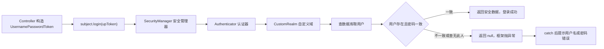
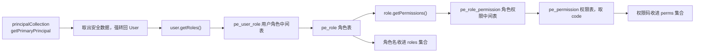

# 自定义 Realm 接数据库：认证要查什么、比什么、返回什么

> 🔒 安全提示：文中示例的口令/密钥均为课程教学环境演示口径，生产环境的安全要求见《安全与合规须知》。

day05 的案例里，认证方法把合法密码写死成 `123456`，流程跑通了，但谁都清楚那不是真登录：用户在数据库里，密码在数据库里，比对必须发生在查询之后。day06 要把工程升级成真连库的版本，动手写代码之前先把两个方法的步骤拆开想清楚：认证方法查用户、比密码，授权方法顺着用户查角色、查权限。步骤想清楚了，写代码只是翻译。

## 先给结论

- 认证链路是固定的：`subject.login(token)` 把用户名密码交给 SecurityManager，SecurityManager 调用 Authenticator 认证器，认证器最终把数据交给自定义 Realm，真正的比对逻辑全部落在 Realm 的认证方法里。
- 自定义 Realm 继承 `AuthorizingRealm`，必须重写两个方法：`doGetAuthenticationInfo` 做认证，`doGetAuthorizationInfo` 做授权。
- 认证方法五步：强转 token 取出用户名密码、根据用户名查库、判断用户存在且密码一致、一致返回安全数据、不一致返回 null。
- 返回 null 不是安静失败：框架会抛出异常，Controller 的 catch 接住后给用户「用户名或密码错误」的提示。
- 密码比对发生在两份密文之间：数据库密码列存加盐 MD5 散列后的密文，token 里带的是用同一算法、同一把盐对输入散列出的密文。
- 授权方法的前提是已认证：从 `getPrimaryPrincipal()` 取出认证时存入的安全数据，再顺着用户查角色、顺着角色查权限。

## 一、认证链路：login 之后数据往哪流

day05 讲义里的认证流程图值得再看一眼，因为 day06 写的每一行代码都在这张图的末端。



这条链从 `subject.login` 出发，token 里装着登录表单传来的用户名和密码，经过 SecurityManager 与认证器层层转发，最终汇聚到自定义 Realm。Realm 是 Shiro 获取安全数据的出入口，所谓安全数据，就是登录之后这个用户的全部身家：用户信息、角色信息、权限信息。之前在 ini 环境里演练的 Realm 用的是写死的数据，现在换成数据库，链路本身一步都不用改，这正是 Shiro 把「数据从哪来」做成扩展点的好处。

## 二、先把骨架立起来：继承 AuthorizingRealm

在工程的 Shiro 包下新建 `com.example.shiro.realm.CustomRealm`，继承 `AuthorizingRealm` 后让 IDE 生成两个待实现方法，再补上登录方法里已经改造好的调用现场，骨架长这样：

```java
package com.example.shiro.realm;

import com.example.shiro.domain.User;
import com.example.shiro.service.UserService;
import org.apache.shiro.authc.AuthenticationException;
import org.apache.shiro.authc.AuthenticationInfo;
import org.apache.shiro.authc.AuthenticationToken;
import org.apache.shiro.authz.AuthorizationInfo;
import org.apache.shiro.realm.AuthorizingRealm;
import org.apache.shiro.subject.PrincipalCollection;
import org.springframework.beans.factory.annotation.Autowired;

/**
 * 自定义的 realm
 */
public class CustomRealm extends AuthorizingRealm {

    @Autowired
    private UserService userService;

    public void setName(String name) {
        super.setName("customRealm");
    }

    /**
     * 授权方法：判断用户是否具有某个角色或权限
     */
    protected AuthorizationInfo doGetAuthorizationInfo(PrincipalCollection principalCollection) {
        return null;
    }

    /**
     * 认证方法：参数就是登录时传递的用户名密码
     */
    protected AuthenticationInfo doGetAuthenticationInfo(AuthenticationToken authenticationToken)
            throws AuthenticationException {
        return null;
    }
}
```

骨架里有三处容易一带而过的地方。**其一，为什么是 `AuthorizingRealm`。** 它一个类同时给了认证与授权两个钩子，两个待重写方法各司其职：上面 `doGetAuthorizationInfo` 做授权，下面 `doGetAuthenticationInfo` 做认证，命名里 get 与 set 的区别要认准。

**其二，setName 在干什么。** Realm 是通过名称来标识自己的，多个 Realm 共存时框架靠名字区分谁的数据，方法体里 `super.setName("customRealm")` 把类名设置进去是课程的习惯写法，后面构造认证信息时 `getName()` 直接取用。

**其三，为什么注入的是 UserService 而不是 UserDao。** 查库属于业务逻辑，分层习惯是 Controller 找 Service、Service 才碰 Dao。工程里的 UserService 就一行转发：

```java
@Service
public class UserService {

    @Autowired
    private UserDao userDao;

    public User findByName(String name) {
        return this.userDao.findByUsername(name);
    }
}
```

Dao 侧是 Spring Data JPA 的接口，方法名 `findByUsername` 按命名约定自动生成查询，一个 SQL 都不用写。

## 三、认证方法五步：查用户、比密文、返回安全数据

认证方法的实现思路，课程直接以注释的形式列在方法体里，五步就是五件事：

```java
//1.获取登录的用户名密码（token）
//2.根据用户名查询数据库
//3.判断用户是否存在或者密码是否一致
//4.如果一致，返回安全数据
//5.不一致，返回 null（抛出异常）
return null;
```

对照这五步，有两个点值得展开。

**第一，比对的是密文不是明文。** 案例库的 `pe_user` 表密码列存放的是加盐 MD5 反复散列若干次之后的密文，登录方法在构造 token 时已经用同样的算法处理过用户输入（`new Md5Hash(password, username, 3).toString()`），所以认证方法里拿到的 token 密码本身已是密文，与库中密文做 `equals` 即可。day05 分析过这套比对的本体：Realm 只负责把数据库那一半凭据装进返回值，真正的比对由框架的 CredentialsMatcher 完成，两边密文一致则认证通过。

**第二，返回 null 的语义是抛异常。** 查无此人或者密码不一致，方法直接返回 null，框架会抛出 AuthenticationException 体系的异常，Controller 里 `subject.login` 外面的 catch 接住它，转成「用户名或密码错误」提示给前端。异常就是 Shiro 表达「认证失败」的语言，业务代码里不需要自己发明错误码。

对照注释，认证方法的完整实现其实只有十几行，下一课逐行落码。

## 四、授权方法要准备什么：顺着安全数据查角色与权限

授权必然发生在认证之后：一个连身份都没确认的人，谈不上判断他有没有权限。认证成功时存下的那份安全数据，正是授权方法的起点。



案例库为这条链准备了五张表：`pe_user`、`pe_role`、`pe_permission`，加上 `pe_user_role`、`pe_role_permission` 两张中间表。实体侧 User 与 Role 多对多、Role 与 Permission 多对多，且关联都声明了立即加载，JPA 的级联查询让 `user.getRoles()`、`role.getPermissions()` 直接可用，授权方法里不需要再写一句 SQL。把角色名收进一个 Set，把权限的 `code` 字段收进另一个 Set，两个集合装进 `SimpleAuthorizationInfo` 返回，这就是授权方法的全部产出，下一课完整实现。

## 常见误区

- **查到用户就算认证通过**：`user != null` 只证明账号存在，密码判断必须同时做，两个条件都成立才能返回安全数据，漏掉密码判断等于所有账号共用任意密码都能登录。
- **以为返回 null 不会出事**：认证方法返回 null 会触发框架抛出账号不存在类异常，如果 Controller 的 catch 范围没盖住或者没给提示，用户看到的就是一整页 500。
- **setName 忘写**：`getName()` 要作为认证信息的第三个参数传出去，Realm 名称缺失会影响框架对域的调度与凭据比对，习惯上把类名字符串设置进去，一次写好全局可用。
- **在授权方法里重新登录一遍**：授权的数据来源是认证时存入的安全数据，`getPrimaryPrincipal()` 取不到说明当前会话根本没认证，正确做法是依赖认证结果，而不是在授权方法里再查一次库做比对。

## 面试可能被问到的问题

1. 面试官追问：「Shiro 认证的完整流程是怎样的？」
   答：Controller 构造 `UsernamePasswordToken` 并调用 `subject.login`，Subject 把 token 交给 SecurityManager，SecurityManager 委托 Authenticator 认证器，认证器调用 Realm 的 `doGetAuthenticationInfo` 获取数据库侧的凭据信息，最后由 CredentialsMatcher 比对 token 与 Realm 两边凭据，一致则认证通过，不一致或 Realm 返回 null 都以异常收场。

2. 面试官追问：「自定义 Realm 为什么继承 AuthorizingRealm 而不是直接实现 Realm 接口？」
   答：`AuthorizingRealm` 已经实现了 Realm 的调度模板，把认证与授权拆成 `doGetAuthenticationInfo`、`doGetAuthorizationInfo` 两个钩子，开发者只提供数据，不用关心缓存、凭据比对、多 Realm 聚合这些框架细节。直接实现接口要把整条调度逻辑自己补齐，成本高且容易出错。

3. 面试官追问：「认证方法返回 null 会发生什么？」
   答：框架按账号不存在处理，抛出 AuthenticationException 体系异常（如 `UnknownAccountException`），`subject.login` 调用方的 catch 接住后转成登录失败提示。返回 null 是 Realm 表达「查无此人或凭据不符」的标准方式。

4. 面试官追问：「密码加盐 MD5 之后，Realm 里怎么比对？」
   答：数据库存的是加盐散列后的密文，登录时用同一算法、同一把盐对用户输入散列，密文装进 token；Realm 查出数据库密文装进 AuthenticationInfo，比对发生在两份密文之间，可以由默认的 CredentialsMatcher 完成，明文从头到尾不参与比对也不落库。

5. 面试官追问：「SimpleAuthenticationInfo 的三个参数分别是什么？」
   答：参数一是 principal，即安全数据，一般放用户对象，授权方法与页面展示都从它取数据；参数二是 credentials，放数据库侧的密码密文，供凭据比对；参数三是 realmName，当前 Realm 的名称，用 `getName()` 获取。

6. 面试官追问：「为什么授权必须先认证？」
   答：授权要回答「这个人能不能做某件事」，前提是知道这个人是谁。认证成功时存入的安全数据就是授权的输入，从 `getPrimaryPrincipal()` 取出用户再查角色权限；没有认证就没有 principal，授权无从谈起，所以执行顺序上先认证再授权。

## 配套资料

- 案例工程 shiro_springboot：`materials/code/02/day06 Shiro高级 及SaaS-HRM的认证授权/Shiro高级 及SaaS-HRM的认证授权/资源/shiro案例代码/shiro_springboot/`（含 `UserService`、`UserDao`、`domain` 三实体与 `application.yml`；`CustomRealm` 未随资料包归档，正文代码按视频实现与工程依赖补全，包名统一改为 `com.example`）。
- 数据库脚本：`materials/code/02/day06 Shiro高级 及SaaS-HRM的认证授权/Shiro高级 及SaaS-HRM的认证授权/资源/shiro_db.sql`（`pe_user`、`pe_role`、`pe_permission` 与两张中间表的建表与初始数据）。
- 配置类参考：`materials/code/02/day06 Shiro高级 及SaaS-HRM的认证授权/Shiro高级 及SaaS-HRM的认证授权/资源/基本配置/ShiroConfiguration.java`（Realm 注册、安全管理器与过滤器工厂的完整装配）。
