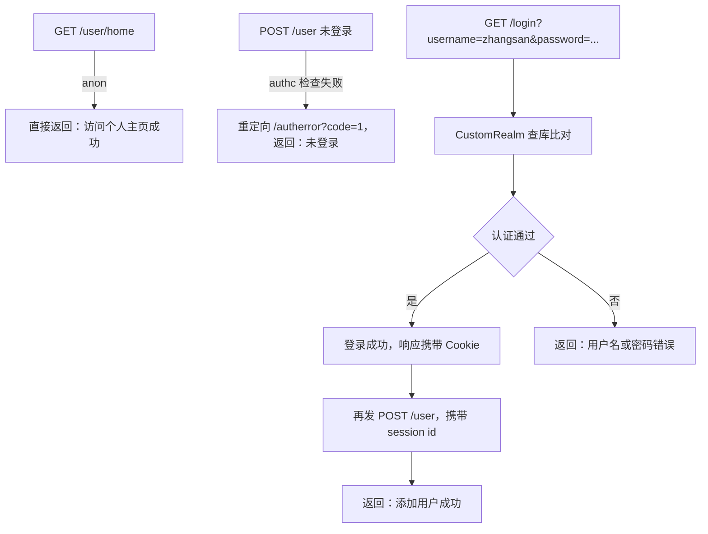

# 整合完必须实测一遍：匿名放行、未登录拦截、登录成功与那个忘写的 return

> 🔒 安全提示：文中示例的口令/密钥均为课程教学环境演示口径，生产环境的安全要求见《安全与合规须知》。

配置类写完不代表能用。Shiro 整合的验证要靠一轮完整的请求测试：匿名路径裸访、受保护路径未登录硬闯、登录、登录后再访问，四步各有一个预期结果。这一课把工程跑起来，用 Postman 逐步验证，中途还撞上了一个「代码看着全对、登录偏偏失败」的真实 bug，排查过程比结论更值钱。

## 先给结论

- `anon` 路径不登录直接可访问；`authc` 路径未登录访问会被重定向到 `setLoginUrl` 指定的 `/autherror?code=1`，返回「未登录」。
- 登录成功后响应携带 Cookie，里面的 session id 就是后续请求被判定为「已认证」的凭据，标准 Web 程序的 session 状态由它维系。
- 密码输入错一位（`12345` 对 `123456`）会得到「用户名或密码错误」，这是正常失败；密码全对还失败，就要进代码里找原因。
- 案例库密码列存的是加盐 MD5 多次散列后的密文，登录方法在构造 token 时做了同样的散列，两边比对的是密文。
- 认证方法里构造了 `SimpleAuthenticationInfo` 却 `return null`，是本课翻车点：info 白装，框架照样按认证失败处理。

## 一、测试现场：启动工程，认清接口分工

启动类就是普通的 Spring Boot 引导类，运行 `main` 方法，控制台看到 `Started ShiroApplication` 即可开测。工程端口是 8081，`application.yml` 里配好的 MySQL 与 Redis 数据源随之生效。

UserController 里为本轮测试准备的接口有四个，分工与过滤器配置一一对应：

| 接口 | 过滤器 | 预期 |
|---|---|---|
| `GET /user/home` | `anon` | 任何人可访问，返回「访问个人主页成功」 |
| `POST /user` | `authc`（`/user/**`） | 未登录跳走，登录后返回「添加用户成功」 |
| `GET /login` | 登录入口 | 构造 token 提交认证 |
| `GET /autherror?code=n` | 匿名 | code=1 返回「未登录」，code=2 返回「未授权」 |

四个接口的请求走向画成一张图：



这张图就是本轮测试的完整剧本，接下来按图索骥。

## 二、第一轮：匿名放行与拦截的边界

**匿名路径先验。** Postman 发 `GET http://localhost:8081/user/home`，不带任何登录状态，响应直接是「访问个人主页成功」。`anon` 过滤器对请求不做任何检查，登录与否与它无关。

**受保护路径再验。** 换成 `POST http://localhost:8081/user`，还是不带 cookie，结果不是 500 也不是进入 Controller，而是被 Shiro 拦下重定向到 `/autherror?code=1`，页面返回「未登录」。这一跳的出处就在配置类里：`/user/**` 登记的是 `authc`，过滤器发现当前请求没有认证状态，于是按 `setLoginUrl("/autherror?code=1")` 的设定跳走。拦截行为完全由 filterMap 驱动，没有一行手写的判断代码。

## 三、第二轮：登录接口与一个真 bug

登录请求 `GET http://localhost:8081/login?username=zhangsan&password=123456`。案例数据里 zhangsan 就是那个被分配了角色的用户，密码表象是 `123456`，库里实际存的是加盐 MD5 反复散列后的密文。

登录方法的代码在整合一课已就位：

```java
//用户登录
@RequestMapping(value = "/login")
public String login(String username, String password) {
    try {
        //1.构造登录令牌（密码先做加盐 MD5 散列）
        UsernamePasswordToken upToken =
                new UsernamePasswordToken(username,
                        new Md5Hash(password, username, 3).toString());
        //2.获取 subject
        Subject subject = SecurityUtils.getSubject();
        //3.提交认证
        subject.login(upToken);
        return "登录成功";
    } catch (Exception e) {
        return "用户名或密码错误";
    }
}
```

先把密码改成 `12345` 发一次，返回「用户名或密码错误」，失败正常，说明 catch 与异常链路是通的。再把密码改回 `123456` 发一次，居然还是「用户名或密码错误」。库里的密文、token 里的密文都对得上，问题只能出在 Realm。翻开认证方法，毛病一眼可见：

```java
if (user != null && user.getPassword().equals(password)) {
    //认证通过，返回安全数据
    SimpleAuthenticationInfo info =
            new SimpleAuthenticationInfo(user, user.getPassword(), this.getName());
    //bug：构造了 info，方法却 return null，info 白装
}
return null;
```

方法把 info 组装好了，末尾却还留着骨架阶段的 `return null`，查库比对全部做对了，最后一步交白卷。框架拿到 null 按认证失败处理，抛异常、进 catch、提示错误，整套流程忠实地执行了错误代码的意图。把 if 分支里补上 `return info` 重启工程，再发一次请求，「登录成功」四个字终于出现。

这个 bug 的教训在于：认证方法的返回值是整条链路的出口，前面每一步的成果都要靠 `return` 交付，框架不会替你从局部变量里捞结果。

## 四、第三轮：带着会话再来一次

登录成功的响应里多了一个 Cookie，其中的 session id 标识着服务器端的会话，这是标准 Web 程序有状态的证明。Shiro 认证通过后把「已认证」的状态记在会话上，后续请求只要带着这个 session id，`authc` 过滤器就能查到认证记录，请求放行。

此时再发 `POST /user`，同一个接口、同样不带用户名密码，响应从「未登录」变成了「添加用户成功」。两次请求唯一的差别是 cookie，`authc` 检查的正是这个。另有两个观察值得记下：每次重新登录，服务端分配的 session id 都会刷新；Postman 的多个标签页共享 cookie，所以在一个标签登录、另一个标签访问受保护接口，效果等同于同一浏览器的连续操作，这一点与真实浏览器的行为一致。

## 常见误区

- **以为过滤器的拦截是 Controller 判断的**：「未登录」的响应没有经过任何 Controller 的 if，是 `authc` 过滤器重定向的结果。受保护接口里不需要再写登录判断，写了反而重复。
- **登录失败就怀疑密码错**：先分清两类失败，输入确实错一位是正常失败；输入全对还失败，重点排查认证方法的返回值是否真的把 info 返回了。
- **拿着明文去库中比对**：案例库存的是加盐 MD5 密文，token 端在登录方法里先散列再提交，若 token 直接装明文，密文与明文永远 equals 不上，怎么改密码都登不进去。
- **验证会话时忽略 cookie**：不带 cookie 的请求对服务端而言永远是陌生新会话，测试工具要开启自动携带 cookie，否则登录成功后访问受保护接口照样「未登录」。

## 面试可能被问到的问题

1. 面试官追问：「Shiro 整合 Spring Boot 后，如何验证认证拦截生效了？」
   答：按过滤器配置逐条验证：对 `anon` 路径匿名访问应放行；对 `authc` 路径不携带登录状态访问应被重定向到 `setLoginUrl` 指定地址；走登录接口成功后，携带会话 cookie 再访问同一受保护路径应放行。三种结果都对上，说明过滤器链、认证、会话三环都正常。

2. 面试官追问：「登录成功后，后续请求凭什么被认为是已登录？」
   答：认证通过后 Shiro 把认证状态写入当前会话，会话由响应下发的 cookie 里的 session id 标识，浏览器后续请求自动携带该 cookie，`authc` 过滤器据此判定已认证。本质是服务端 session 加客户端 session id 的有状态方案。

3. 面试官追问：「subject.login 抛异常和 Realm 返回 null 是什么关系？」
   答：Realm 返回 null 是原因，抛异常是结果。框架拿到 null 的 AuthenticationInfo 按账号不存在处理，抛出 AuthenticationException 体系异常，Controller 的 catch 接住后转成「用户名或密码错误」。所以 catch 里的提示，根源可能在 Realm 的返回值上。

4. 面试官追问：「案例里密码输入正确还是登录失败，你怎么排查？」
   答：先看失败发生在哪一层：token 构造、Realm 查库、密码比对、返回值交付，逐段检查。案例的实际原因是认证方法构造了 `SimpleAuthenticationInfo` 却 `return null`，框架按认证失败处理。教训是比对通过后必须把 info 作为返回值交出去，局部变量不会自动成为方法结果。

5. 面试官追问：「数据库存加盐 MD5 密文后，登录链路上明文出现在哪里？」
   答：明文只出现在用户提交表单与登录方法接收参数的一瞬间，构造 token 前就用同一算法、同一把盐散列成密文，Realm 里比对的两侧都是密文，数据库与日志中都不该再有明文密码。

## 配套资料

- 案例工程 shiro_springboot：`materials/code/02/day06 Shiro高级 及SaaS-HRM的认证授权/Shiro高级 及SaaS-HRM的认证授权/资源/shiro案例代码/shiro_springboot/`（含 `ShiroApplication` 启动类、`UserController`、`application.yml` 端口与数据源配置；`CustomRealm` 的认证方法按视频实现补全，包名统一改为 `com.example`）。
- 数据库脚本：`materials/code/02/day06 Shiro高级 及SaaS-HRM的认证授权/Shiro高级 及SaaS-HRM的认证授权/资源/shiro_db.sql`（资料包内 `pe_user` 初始密码为明文，测试视频现场已将密码列更新为加盐 MD5 密文，正文按视频实测口径描述）。
- 过滤器配置参考：`materials/code/02/day06 Shiro高级 及SaaS-HRM的认证授权/Shiro高级 及SaaS-HRM的认证授权/资源/基本配置/ShiroConfiguration.java`（`setLoginUrl`、`setUnauthorizedUrl` 与 filterMap 的登记写法）。
