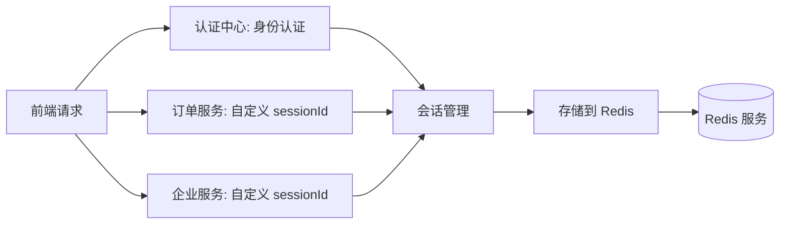

# 集群下登录态为什么会丢：Shiro 会话管理的应用场景分析

单机跑 Shiro 的默认会话没有任何问题，登录后的安全数据安稳地躺在 `HttpSession` 里。可一旦工程部署两个实例做负载均衡，登录请求落在实例 A，下一个请求被分到实例 B，B 的内存里根本没有这份会话，用户莫名其妙就被踢回登录页。问题不在代码写错，而在会话的存放位置：它跟着某台机器的内存走。

Shiro 留了口子。借助 `DefaultWebSessionManager` 自定义会话，登录态可以集中存到 Redis 这样的外部存储里，所有实例和所有服务都从同一处取，集群与微服务的会话难题就从根上解掉了。

## 先给结论

- 默认会话存在各实例自己的内存里，集群下不共享，这是登录态丢失的根源。
- 自定义会话的思路：认证时把安全数据存进 Redis，其他服务凭 sessionId 从 Redis 取回登录信息。
- sessionId 放哪可以自己定：Cookie 或请求头，名字也可以自定义，前后端分离通常放请求头。
- 落地只靠两件事：自定义 `SessionManager` 决定 sessionId 从哪来，`SessionDAO` 决定会话存到哪。
- `SessionDAO` 不用自己写，shiro-redis 这类开源组件已经封装好，引坐标即可。

## 一、把登录态挪出去的完整链路

设想一个典型的微服务架构：一个认证中心负责登录，外加订单服务、企业服务等多个业务服务，每个请求都要验证「这个人是谁、有没有权限」。做法是这样的：

- 登录时，认证中心走自定义 Realm 的认证方法，认证通过后不把数据放本机内存，而是借助自定义的会话管理存到 Redis；
- 访问订单服务查询订单时，服务凭 sessionId 从 Redis 把当前已登录用户的信息取出来，这份信息里带着角色和权限，有权限就放行。

sessionId 也不用担心没地方放：认证通过后 Shiro 会生成一个 sessionId，既可以放进 Cookie，也可以放进请求头，名字自己定。前端拿到之后，后续每个请求都带上它，服务端凭它去 Redis 找会话。整条链路如图：



图里三个服务都指向同一个会话管理，会话管理只对接 Redis 一处存储。认证和授权的代码跟单机写法完全一样，变的只是会话的存放位置，登录放数据、验证取数据，用法和操作普通 session 一模一样。

## 二、自定义会话管理还能干什么

把会话的创建、维护、失效都收进自己手里之后，能做的事不止共享这一件：

| 场景 | 依靠的机制 | 效果 |
|---|---|---|
| 集群会话集中管理 | 会话存 Redis，多实例共读 | 任意实例都能找回登录态 |
| 会话超时踢人 | `SessionManager` 统一设置超时时间 | 长时间不操作统一失效，再访问判未登录 |
| 记住我 | `RememberMeManager` 配合 Cookie | 关浏览器后仍能恢复身份，与会话存储解耦 |

**第一，超时控制。** 会话的过期时间由 `SessionManager` 全局配置，超时的会话被标记失效，拿着旧 sessionId 再来访问会被判定未登录，这就是「踢人」的实现基础。会话集中到 Redis 之后，失效判断对所有实例同时生效，不会出现 A 实例还认、B 实例不认的分裂状态。

**第二，记住我。** 它由 Shiro 里独立的 `RememberMeManager` 负责，把身份信息序列化进 Cookie，与 `SessionManager` 是两个维度。做分布式方案时两者配合使用：会话管在线期间的登录态，记住我管重新打开浏览器后的身份恢复。

## 三、落地前必须想清楚的两件事

**第一，sessionId 怎么来、叫什么。** 默认实现把 sessionId 放进 Cookie，名字是 `JSESSIONID`。前后端分离项目一般约定放在请求头里，比如 `Authorization`，自定义 `SessionManager` 时重写获取逻辑即可，这一步决定服务端从哪里认领「这是哪个会话」。

**第二，会话数据由谁读写。** 会话往 Redis 存、从 Redis 取，这层操作属于 `SessionDAO`。它有现成的开源实现，课程用的是 shiro-redis 组件，坐标引进来就带了完整的 `SessionDAO` 实现，不需要自己造轮子：

```xml
<!--shiro 与 redis 整合，内含 SessionDAO 与缓存实现 -->
<dependency>
    <groupId>org.crazycake</groupId>
    <artifactId>shiro-redis</artifactId>
    <version>3.0.0</version>
</dependency>
```

Redis 服务本身的地址、端口照常写在 `application.yml` 里，后面的配置类会把这两项读出来交给会话组件用：

```yaml
spring:
  redis:
    host: 127.0.0.1
    port: 6379
```

这两件事理顺之后，代码层面只剩三步：写一个自定义 `SessionManager`、声明一个 `SessionDAO`、在配置类里把它们逐层装配到 `SecurityManager` 上。具体怎么写，下一篇拆开讲。

## 常见误区

- **以为加了负载均衡会话自动共享**：默认会话在各实例内存里，除非网关固定把同一用户打向同一实例，否则轮询策略下登录态必然时有时无。
- **只把 sessionId 交给前端就完事**：前端携带只是半个链路，服务端必须重写获取逻辑并配好集中存储，否则带着 id 也找不回会话。
- **以为自定义会话要重写登录和授权**：认证、授权代码一字不动，换的只是会话的存取位置，这正是 `SessionManager` 与 `SessionDAO` 分层的意义。
- **Cookie 与请求头两套方式混用**：一边用 `JSESSIONID` 一边用自定义头，容易出现两个会话并存、行为飘忽的现象，工程里二选一并统一约定。

## 面试可能被问到的问题

1. 面试官追问：「集群下 session 不共享，有哪些解决办法？」
   答：常见三种：会话复制，节点间同步 session，数据量大时开销高；粘性会话，负载均衡把同一用户固定打到同一节点，节点宕机会话就丢；集中存储，把会话放到 Redis 等外部存储，所有节点共读。Shiro 自定义会话管理走的是第三种，也是目前的主流方案。

2. 面试官追问：「为什么选 Redis 做集中存储？」
   答：Redis 是独立的分布式存储，读写基于内存速度快，天然被多实例共享，还能设置过期时间，与会话的失效语义天然吻合。会话放进去之后，应用自身变成无状态，扩容缩容都不影响登录态。

3. 面试官追问：「Shiro 里 sessionId 可以放在哪些位置，怎么自定义？」
   答：默认放在 Cookie 里，名字是 `JSESSIONID`；也可以放请求头，由前端每个请求携带。自定义方式是继承 `DefaultWebSessionManager` 重写 sessionId 的获取方法，从请求头里读出来交给 Shiro，后续会话查找就以它为准。

4. 面试官追问：「SessionManager 和 SessionDAO 各管什么？」
   答：`SessionManager` 管会话的生命周期，创建、维护、删除，以及 sessionId 从哪获取；`SessionDAO` 管会话数据的读写，是会话真正落地的地方。换存储介质只动 `SessionDAO`，想改获取方式只动 `SessionManager`，两层解耦。

5. 面试官追问：「会话超时踢人是怎么实现的？」
   答：`SessionManager` 上可以统一配置会话超时时间，超时的会话被判定失效，之后携带该 sessionId 的请求会被当作未登录处理。会话集中存储后，失效状态对所有服务实例同时可见，不会出现各节点判定不一致的情况。

## 配套资料

- 代码：`materials/code/02/day06 Shiro高级 及SaaS-HRM的认证授权/Shiro高级 及SaaS-HRM的认证授权/资源/shiro案例代码/shiro_springboot/`（含 `pom.xml`、`application.yml`，包名已统一改为 `com.example`）
- 配置类：`materials/code/02/day06 Shiro高级 及SaaS-HRM的认证授权/Shiro高级 及SaaS-HRM的认证授权/资源/基本配置/ShiroConfiguration.java`
