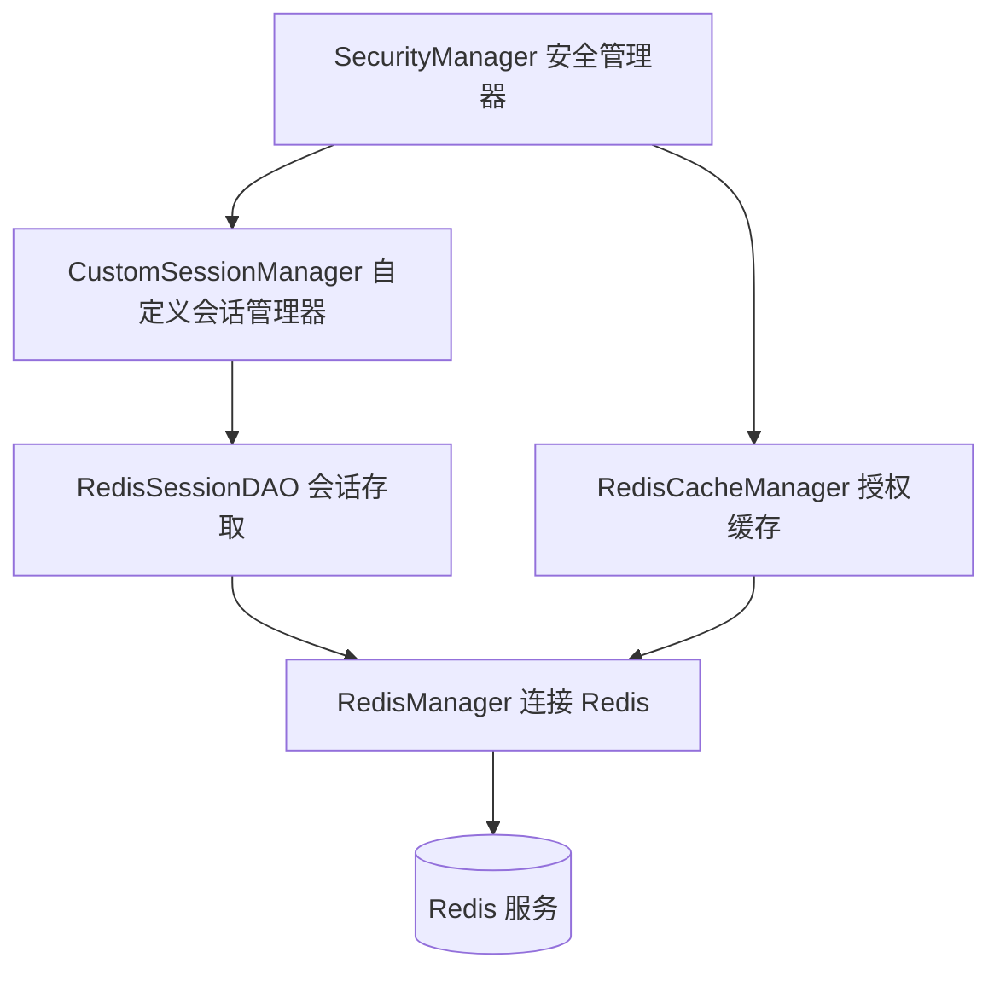
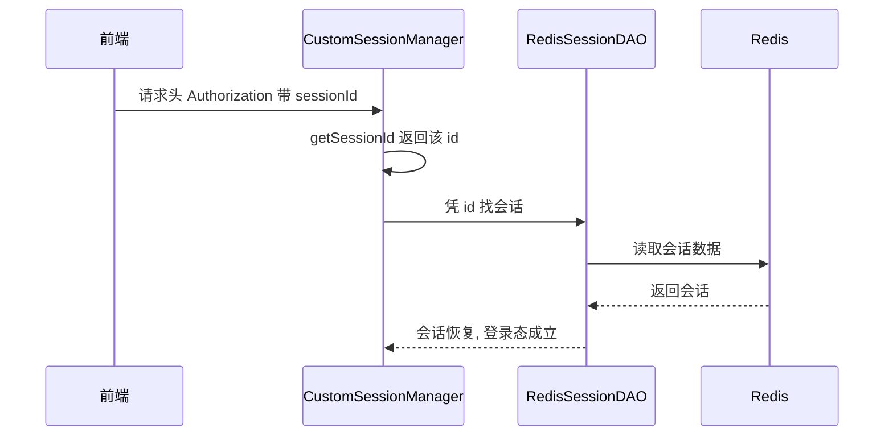

# 自定义会话管理器：把 Shiro 会话搬进 Redis

思路已经理清：登录态集中放 Redis，服务凭 sessionId 从 Redis 找会话。落到代码上其实只有两条线，一条是自定义 `SessionManager`，让 sessionId 改从请求头里取；另一条是 `SessionDAO`，负责会话真正读写 Redis，这一层有现成组件代劳。两条线都指向同一个配置类，写完装配，会话就正式从 `HttpSession` 搬进了 Redis。

这套写法是通用的模板，任何想把 Shiro 会话放 Redis 的工程都可以整段复用，改动量极小。

## 先给结论

- 引入 `org.crazycake:shiro-redis`，会话的 Redis 读写（`SessionDAO`）不用自己写。
- 自定义 `CustomSessionManager` 继承 `DefaultWebSessionManager`，重写 `getSessionId`：请求头 `Authorization` 里有 id 就用，没有就走父类默认逻辑生成。
- 非空分支里有三句固定的 `setAttribute`：标记来源为 header、标记引用的会话 id、标记该 id 有效。
- 配置链固定四层：`RedisManager` → `RedisSessionDAO` → `CustomSessionManager` → `SecurityManager`，逐层 set 进去，少一层就不生效。
- 缓存管理器一并换成 `RedisCacheManager`，授权缓存跟着会话一起进 Redis。

## 一、步骤分析：一条自上而下的管理链

动手前先看清楚谁管谁。`SecurityManager` 管着 `SessionManager`，`SessionManager` 通过 `SessionDAO` 完成对 Redis 的访问；`SessionDAO` 之下还有一个 `RedisManager` 承担与 Redis 服务器的通信，同时缓存管理器 `CacheManager` 也复用它连接 Redis。整条链如图：



图里画出了全部配置点，也解释了为什么配置是「有迹可循」的：每个对象都需要下一层的实例注入进来，所以装配顺序天然就是从最底层的 `RedisManager` 开始，一路向上 new、向上 set，最后注册到 `SecurityManager`。自定义会话不需要实现任何接口，`DefaultWebSessionManager` 已经把会话维护的逻辑写好了，改的只是它取 sessionId 的方式和存会话的 DAO。

## 二、环境准备：Redis 服务、依赖与配置

本地启动 Redis 服务（Windows 下是 `redis-server.exe`），再用桌面客户端新建连接指向 `localhost:6379`，确认当前是空库，方便等下观察数据写入。

工程里引入 shiro-redis 坐标，它封装好了 `SessionDAO` 与 Redis 交互的全部代码：

```xml
<!--shiro 与 redis 整合，内含 SessionDAO、RedisManager 与缓存实现 -->
<dependency>
    <groupId>org.crazycake</groupId>
    <artifactId>shiro-redis</artifactId>
    <version>3.0.0</version>
</dependency>
```

Redis 地址与端口写在 `application.yml` 里，配置类稍后用 `@Value` 把它们读出来：

```yaml
spring:
  application:
    name: ihrm-company #指定服务名
  datasource:
    driver-class-name: com.mysql.jdbc.Driver
    url: jdbc:mysql://localhost:3306/shiro_db?useUnicode=true&characterEncoding=utf8
    username: root
    password: 111111
  jpa:
    database: MySQL
    show-sql: true
    open-in-view: true
  redis:
    host: 127.0.0.1
    port: 6379
```

准备工作就这三样，剩下的代码全部集中在两处：一个自定义会话管理器类，一个配置类。

## 三、自定义 CustomSessionManager：sessionId 改从请求头拿

先明确为什么要改。默认实现把 sessionId 放进 Cookie，名字叫 `JSESSIONID`；前后端分离的项目里，登录成功后服务端返回一个 token 或 sessionId，前端把它放进请求头，请求订单服务、企业服务时都带上同一个头。服务端要认领这个 id，就得改掉「从 Cookie 里找」的默认逻辑。

做法是新建一个类放在 session 包下，继承 `DefaultWebSessionManager`，重写取 sessionId 的方法：

```java
package com.example.shiro.session;

import org.apache.shiro.util.StringUtils;
import org.apache.shiro.web.servlet.ShiroHttpServletRequest;
import org.apache.shiro.web.session.mgt.DefaultWebSessionManager;
import org.apache.shiro.web.util.WebUtils;

import javax.servlet.ServletRequest;
import javax.servlet.ServletResponse;
import java.io.Serializable;

public class CustomSessionManager extends DefaultWebSessionManager {

    //头信息中携带 sessionid：请求头 Authorization 的值就是 sessionid
    //指定 sessionId 的获取方式
    @Override
    protected Serializable getSessionId(ServletRequest request, ServletResponse response) {
        //获取请求头 Authorization 中的值
        String id = WebUtils.toHttp(request).getHeader("Authorization");
        if (StringUtils.isEmpty(id)) {
            //没有携带，按默认方式生成新的 sessionid
            return super.getSessionId(request, response);
        } else {
            //声明 id 的来源是请求头
            request.setAttribute(ShiroHttpServletRequest.REFERENCED_SESSION_ID_SOURCE, "header");
            //声明引用的会话 id
            request.setAttribute(ShiroHttpServletRequest.REFERENCED_SESSION_ID, id);
            //声明该 id 对应的会话有效，跳过容器校验
            request.setAttribute(ShiroHttpServletRequest.REFERENCED_SESSION_ID_IS_VALID, Boolean.TRUE);
            return id;
        }
    }
}
```

方法体不长，四个细节值得逐个说清。

**第一，先做类型转换。** 参数类型是 Shiro 的 `ServletRequest`，它未必是一个 HTTP 请求，所以用工具类 `WebUtils.toHttp(request)` 转成 HTTP 请求再去取请求头，这也是 Shiro 源码里自己的写法。

**第二，空与非空分两条路。** 第一次访问系统时请求头里什么都没有，此时不能自己瞎造 id，直接 `return super.getSessionId(request, response)`，父类会按默认规则生成一个新的 sessionId 并走 Cookie 流程，登录后返回给前端的正是它。

**第三，非空时的三句 `setAttribute` 是固定写法。** `REFERENCED_SESSION_ID_SOURCE` 标记 id 来自请求头，`REFERENCED_SESSION_ID` 把这个 id 声明为当前要引用的会话 id，`REFERENCED_SESSION_ID_IS_VALID` 置为 `Boolean.TRUE` 表示该会话有效。三句照抄即可，缺了任何一句，Shiro 都可能把请求当成无效会话另起新会话。

**第四，返回值就是 id。** Shiro 拿着返回的 id 去 `SessionDAO` 找会话，找到就恢复登录态，找不到就按无会话处理。取 id 的方式从 Cookie 换成了请求头，会话查找的整体机制没有任何变化。

## 四、ShiroConfiguration 装配：四层逐级 set

自定义类写完不会自动生效，要在配置类里把整条链装配起来。先注入 Redis 的连接参数：

```java
@Configuration
public class ShiroConfiguration {

    @Value("${spring.redis.host}")
    private String host;

    @Value("${spring.redis.port}")
    private int port;
}
```

然后按自底向上的顺序声明四个组件，每个都以前一个为参数：

```java
//配置 shiro 的 redisManager，真正连接 Redis 的对象
public RedisManager redisManager() {
    RedisManager redisManager = new RedisManager();
    redisManager.setHost(host);
    redisManager.setPort(port);
    return redisManager;
}

//SessionDAO 的 redis 实现，由 shiro-redis 提供
public RedisSessionDAO redisSessionDAO() {
    RedisSessionDAO redisSessionDAO = new RedisSessionDAO();
    redisSessionDAO.setRedisManager(redisManager());
    return redisSessionDAO;
}

//会话管理器换成自定义实现，挂上 redis 版 SessionDAO
public DefaultWebSessionManager sessionManager() {
    CustomSessionManager sessionManager = new CustomSessionManager();
    sessionManager.setSessionDAO(redisSessionDAO());
    return sessionManager;
}

//缓存管理器同样换成 redis 实现
public RedisCacheManager cacheManager() {
    RedisCacheManager redisCacheManager = new RedisCacheManager();
    redisCacheManager.setRedisManager(redisManager());
    return redisCacheManager;
}
```

最后把这两套组件注册进安全管理器。`DefaultWebSecurityManager` 默认使用的会话管理是 `ServletContainerSessionManager`，也就是 `HttpSession`，不替换的话前面全白写：

```java
//配置安全管理器
@Bean
public SecurityManager securityManager(CustomRealm realm) {
    DefaultWebSecurityManager securityManager = new DefaultWebSecurityManager(realm);
    //注册自定义会话管理器，替换默认的 ServletContainerSessionManager
    securityManager.setSessionManager(sessionManager());
    //注册 redis 缓存管理器
    securityManager.setCacheManager(cacheManager());
    securityManager.setRealm(realm);
    return securityManager;
}
```

`securityManager.setSessionManager(...)` 这一行是整个方案的「开关」，它把默认会话实现换成自定义的 `CustomSessionManager`；`setCacheManager(...)` 把授权信息的缓存也交给 Redis，角色权限比对时不必每次都查库。

工程资料里还有一处可选的小定制：拿到会话管理器默认的 Cookie 之后调 `cookie.setName("my_sid")` 再设回去，把 `JSESSIONID` 换成自定义名字。如果前端继续用 Cookie 传 id，这一步能把 Cookie 名统一成工程自己的约定。

## 五、链路复盘：一次带 id 的请求是怎么走的

装配完成之后，把一次请求的完整旅程串起来：



图里最关键的一步是 `getSessionId` 返回请求头里的 id：它决定了后续所有查找的钥匙。会话数据则由 `RedisSessionDAO` 经 `RedisManager` 读写 Redis，应用本机内存里不再保存任何登录态。这一套配置全是固定套路，写完即可整体复用到其他工程。

## 常见误区

- **重写错方法**：父类里取 sessionId 的方法有两个重载，要重写的是带 `ServletRequest`、`ServletResponse` 两个参数的 `getSessionId`，签名选错等于没重写。
- **漏掉三句 `setAttribute`**：只返回 id 不标记来源和有效性，Shiro 无法认领这个会话，表现就是每次请求都生成新会话、登录态时有时无。
- **只写自定义类，忘了注册到 SecurityManager**：`securityManager.setSessionManager(sessionManager())` 不写，默认的 `ServletContainerSessionManager` 继续工作，会话依然在 `HttpSession` 里。
- **`RedisManager` 忘了 set 主机和端口**：组件能创建成功但连不上 Redis，读写会话时报连接异常，值要从 `application.yml` 注入而不是写死。
- **把会话对象和缓存管理器混为一谈**：`RedisSessionDAO` 管会话存取，`RedisCacheManager` 管授权缓存，两者都依赖 `RedisManager`，但各司其职，都要装配。

## 面试可能被问到的问题

1. 面试官追问：「为什么重写 getSessionId 就能改变会话的认领方式？」
   答：`DefaultWebSessionManager` 每次处理请求时都会调 `getSessionId` 决定用哪个 id 去找会话，默认实现从 Cookie 里读 `JSESSIONID`。重写它之后，从请求头里取 id 并返回，Shiro 后续的会话查找就全部以这个 id 为准，其余机制不变。

2. 面试官追问：「REFERENCED_SESSION_ID 相关的三个属性分别起什么作用？」
   答：`REFERENCED_SESSION_ID_SOURCE` 声明 id 来源是请求头，`REFERENCED_SESSION_ID` 设置当前请求引用的会话 id，`REFERENCED_SESSION_ID_IS_VALID` 置为 true 表示该会话有效、无需再走容器校验。三者合起来告诉 Shiro：这个请求已经在引用一个明确的、有效的会话。

3. 面试官追问：「SessionManager 和 SessionDAO 的分工是什么？」
   答：`SessionManager` 管会话生命周期，创建、维护、删除，以及 sessionId 的获取方式；`SessionDAO` 管会话数据的落地读写。本课的组合是 `CustomSessionManager` 加 `RedisSessionDAO`，取 id 的逻辑和存数据的介质各自独立、互不影响。

4. 面试官追问：「整条配置链背一下，为什么必须逐层装配？」
   答：`RedisManager` 连接 Redis；`RedisSessionDAO` 持有 `RedisManager` 完成会话读写；`CustomSessionManager` 持有 `SessionDAO` 管理会话；最后 `SecurityManager` 通过 `setSessionManager` 持有会话管理器，`setCacheManager` 挂上缓存。上层都依赖下一层的实例，所以必须自底向上逐层 new 再逐层 set。

5. 面试官追问：「CacheManager 为什么也要换成 Redis 实现？」
   答：Shiro 的授权数据有缓存机制，`CacheManager` 决定缓存放哪。留在默认实现里，缓存仍在各实例内存中，多实例间不一致且重启即失；换成 `RedisCacheManager` 后角色权限缓存与会话同源，都在 Redis 里，共享且持久。

## 配套资料

- 代码：`materials/code/02/day06 Shiro高级 及SaaS-HRM的认证授权/Shiro高级 及SaaS-HRM的认证授权/资源/shiro案例代码/shiro_springboot/`（含 `pom.xml`、`application.yml`，包名已统一改为 `com.example`；文中 `CustomSessionManager` 为按课程讲解补全的实现类）
- 配置类：`materials/code/02/day06 Shiro高级 及SaaS-HRM的认证授权/Shiro高级 及SaaS-HRM的认证授权/资源/基本配置/ShiroConfiguration.java`（资料里的 `sessionManager()` 用默认 `DefaultWebSessionManager` 并演示了 Cookie 改名 `my_sid` 的写法，正文按课程讲解换成了 `CustomSessionManager` 版本）
