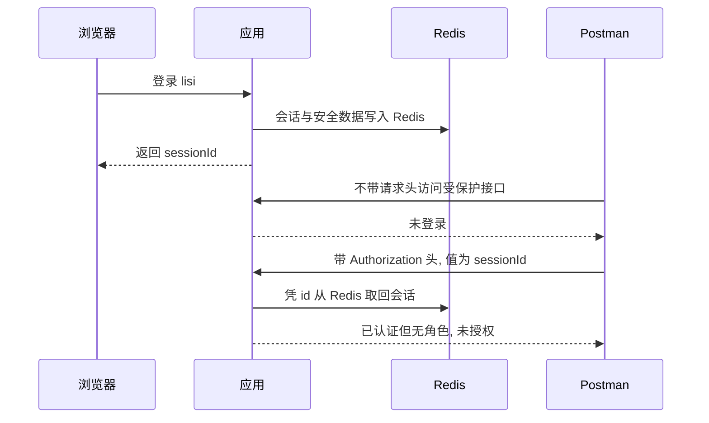
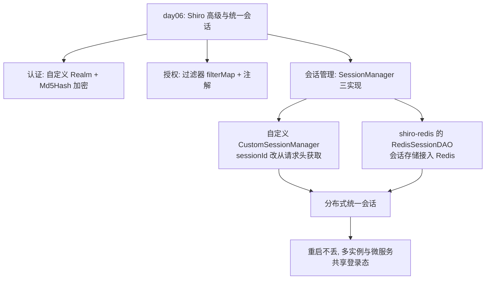

# 会话进 Redis 之后：跨客户端共享登录态的验证与 day06 收束

> 🔒 安全提示：文中示例的口令/密钥均为课程教学环境演示口径，生产环境的安全要求见《安全与合规须知》。

配置全部就位，剩下的就是验证。最硬的一条标准是：两个互不相干的客户端，各自没有任何共享状态，靠一个 sessionId 就能共用同一份登录态。浏览器和 Postman 正好是这样一对工具，一个登录，一个带着 id 借用登录态，测通即宣告会话真的分布式化了。

测完这轮，day06 的 Shiro 主线也就闭环了，认证、授权、加密、会话管理四件事可以串成一张图收起来。

## 先给结论

- 存进 Redis 的安全数据要实现 shiro-redis 提供的 `AuthCachePrincipal` 接口，`getAuthCacheKey` 返回 null 即可用默认缓存键。
- 会话改由 Shiro 自己管理后，取 sessionId 用 `subject.getSession().getId()`，登录接口把它返回给前端。
- 浏览器登录后 Redis 客户端里能看到一条会话数据；Postman 不带头访问受保护接口提示未登录，带上 `Authorization` 头后能通过认证，角色不匹配则提示未授权。
- 会话数据在 Redis 而不在 JVM 内存里，应用重启登录态不丢，多实例部署天然共享。
- day06 收束：Spring Boot 下 Shiro 的认证、授权、加密、会话管理成一条完整主线。

## 一、测试前的两个小改造

**第一，user 对象要能进 Redis。** 认证方法里交给 Shiro 的安全数据是 user 对象，现在它要随会话一起序列化进 Redis。shiro-redis 对此有要求：作为 principal 的实体必须实现它提供的 `AuthCachePrincipal` 接口。在 `User` 实体上补上实现：

```java
/**
 * 用户实体类
 */
@Entity
@Table(name = "pe_user")
@Getter
@Setter
public class User implements Serializable, AuthCachePrincipal {
    private static final long serialVersionUID = 4297464181093070302L;

    @Id
    private String id;
    private String username;
    private String password;

    //用户与角色 多对多
    @ManyToMany(fetch = FetchType.EAGER)
    @JoinTable(name = "pe_user_role", joinColumns = {@JoinColumn(name = "user_id", referencedColumnName = "id")},
            inverseJoinColumns = {@JoinColumn(name = "role_id", referencedColumnName = "id")})
    private Set<Role> roles = new HashSet<>();

    @Override
    public String getAuthCacheKey() {
        return null;
    }
}
```

这个接口只有一个方法，作用是往 Redis 存数据时指定缓存键，返回 null 就走组件的默认规则，通常不用操心。

**第二，登录接口把 sessionId 交出来。** 会话已经归 Shiro 管，不能再想当然地拿 `HttpSession` 去取，改用 Subject 的会话：

```java
@RequestMapping(value = "/login")
public String login(String username, String password) {
    try {
        password = new Md5Hash(password, username, 3).toString();
        UsernamePasswordToken upToken = new UsernamePasswordToken(username, password);
        Subject subject = SecurityUtils.getSubject();
        subject.login(upToken);
        //会话由自定义 SessionManager 管理, 通过 subject 取会话 id
        String sid = (String) subject.getSession().getId();
        return "登录成功, sessionId: " + sid;
    } catch (Exception e) {
        e.printStackTrace();
        return "用户名或密码错误";
    }
}
```

前端拿到这个 id，后续每个请求放进 `Authorization` 请求头，正好接上自定义会话管理器里约定的取法。

## 二、验证会话真的写进了 Redis

先打开桌面客户端确认 Redis 当前是空库，然后在浏览器里登录一次。响应里已经带回了 sessionId，刷新 Redis 客户端，库里多了一条数据。客户端把它显示成一串二进制，观感不友好，这是序列化后的会话内容，不影响判断：认证数据确实落进了 Redis，而不是停留在应用的内存里。

这一步同时验证了 `User` 实现的接口生效了，user 对象作为 principal 随会话一起进了缓存。

## 三、两个互不相干的客户端共享登录态

浏览器登录后，换 Postman 来访问受保护接口。Postman 没有登录过，它和浏览器之间没有任何 Cookie 或状态的关联。整轮测试的时序如下：



实测结果与图完全对应。Postman 什么都不带，直接请求受保护的地址，返回「未登录」；把浏览器登录拿到的 sessionId 填进 `Authorization` 请求头再发，请求通过了认证过滤器，走到了权限比对这一步。登录用户 lisi 没有任何角色，所以最终返回「未授权」。

「未授权」这个结果反而是最有说服力的：它能走到授权环节，说明凭请求头里的 sessionId 已经从 Redis 找回了完整会话。会话不在这台 Postman 手上，也不在应用进程内存里，只在 Redis 里，这正是分布式会话的判定标准。

由此还有两条可以直接推出的结论：

- **重启不丢。** 会话数据在 Redis 里有持久化，应用重启后内存虽被清空，客户端带着同一个 sessionId 来，依然能从 Redis 取回登录态。
- **多实例共享。** 再部署一个实例，它没有任何本地会话，照样凭 sessionId 从 Redis 恢复登录态，负载均衡把请求打到哪台都不影响。

## 四、day06 收束：Shiro 主线串成一张图

到这里，day06 围绕 Shiro 的内容全部走完，把整条主线画出来：



图的左侧三支是能力建设：认证解决「你是谁」，授权解决「你能干什么」，会话管理解决「登录态放哪」。右侧两支是本阶段的落点：把 sessionId 的获取改成请求头，把存储改成 Redis，两者合起来把单机应用变成了无状态的分布式应用。后面 SaaS-HRM 的认证授权方案，正是踩着这条链路搭起来的。

## 常见误区

- **不实现 `AuthCachePrincipal` 直接登录**：principal 无法按 shiro-redis 的规则写进 Redis，登录环节就会报序列化或类型相关的异常，实体补上接口即可。
- **用 `request.getSession().getId()` 取 id**：取到的是容器会话的 id，与 Shiro 会话对不上，前端带着它请求照样被判未登录，必须用 `subject.getSession().getId()`。
- **把「未登录」和「未授权」混为一谈**：不带 id 或会话失效返回「未登录」，带了 id 但角色权限不符返回「未授权」。排查问题时先分清卡在哪一关，再决定查会话还是查角色配置。
- **看到 Redis 里是二进制就以为存失败了**：shiro-redis 对会话做了序列化，客户端显示为字节内容是正常现象，能凭 id 找回登录态就说明数据完好。

## 面试可能被问到的问题

1. 面试官追问：「怎么证明会话真的进了 Redis 而不是应用内存？」
   答：两个手段：清空 Redis 后登录，Redis 客户端里立刻出现一条会话数据；再用一个从未登录过的客户端，只带 sessionId 请求受保护接口，能通过认证。后者说明登录态不依赖本机内存，只依赖集中存储。

2. 面试官追问：「AuthCachePrincipal 这个接口是干什么用的？」
   答：它是 shiro-redis 对 principal 的约束，实体实现它才允许随会话存进 Redis。接口里的 `getAuthCacheKey` 用于指定认证缓存的键，返回 null 时组件使用默认键规则，一般不需要自定义。

3. 面试官追问：「应用重启之后用户的登录态为什么还在？」
   答：会话数据由 `RedisSessionDAO` 写进了 Redis，有持久化，不随应用进程消失。重启后客户端携带同一 sessionId，服务端从 Redis 取回会话即可恢复登录态。会话超时依然生效，超过设定时间的会话仍会被判失效。

4. 面试官追问：「前后端分离下登录态是怎么传递的？」
   答：登录接口认证成功后用 `subject.getSession().getId()` 取出 sessionId 返回给前端；前端把它放进约定的请求头，比如 `Authorization`；服务端自定义 `SessionManager` 重写获取逻辑，从请求头认领 id，再经 `SessionDAO` 从 Redis 恢复会话。

5. 面试官追问：「测试里两种失败提示，含义差在哪？」
   答：「未登录」表示请求没有关联到有效会话，可能是没带 id、会话失效或从未登录；「未授权」表示认证已通过、会话已恢复，但主体缺少访问所需的角色或权限。前者查会话链路，后者查 RBAC 配置，处理方向完全不同。

## 配套资料

- 代码：`materials/code/02/day06 Shiro高级 及SaaS-HRM的认证授权/Shiro高级 及SaaS-HRM的认证授权/资源/shiro案例代码/shiro_springboot/`（含 `User.java`、`UserController.java`、`pom.xml`、`application.yml`，包名已统一改为 `com.example`；`AuthCachePrincipal` 实现与登录返回 sessionId 的改造按课程讲解补全）
- 配置类：`materials/code/02/day06 Shiro高级 及SaaS-HRM的认证授权/Shiro高级 及SaaS-HRM的认证授权/资源/基本配置/ShiroConfiguration.java`
- 数据库：`materials/code/02/day06 Shiro高级 及SaaS-HRM的认证授权/Shiro高级 及SaaS-HRM的认证授权/资源/shiro_db.sql`
