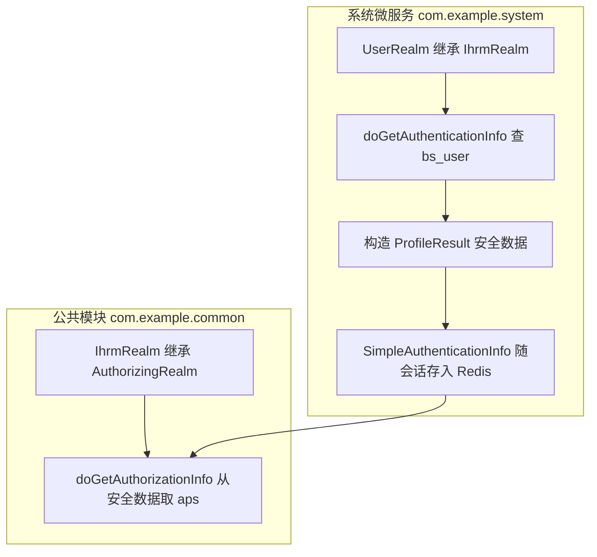
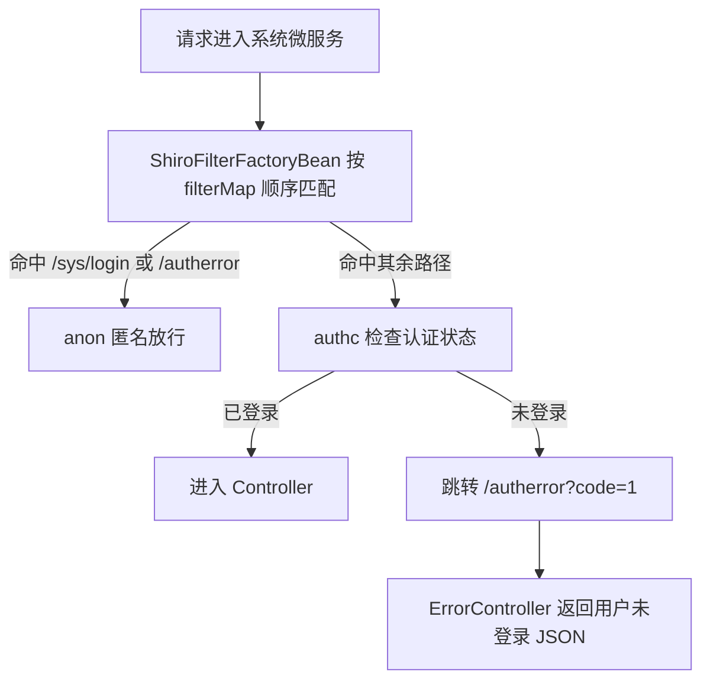
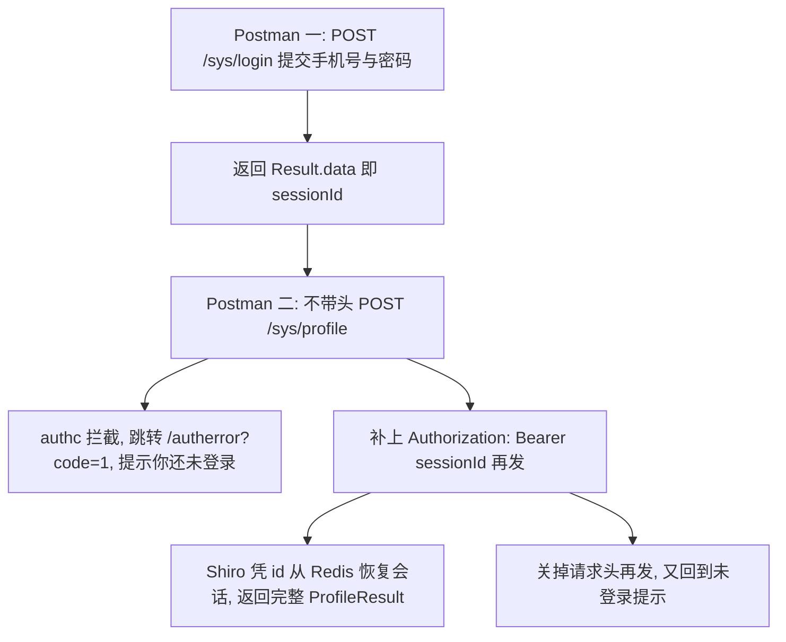
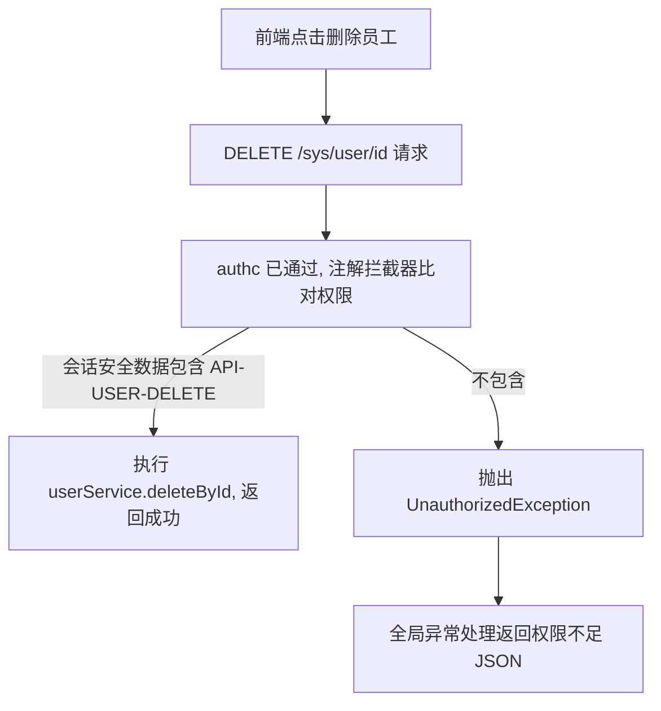

# SaaS-HRM 中基于 Shiro 的认证授权改造：从 JWT 换轨到会话式认证

> 🔒 安全提示：文中示例的口令/密钥均为课程教学环境演示口径，生产环境的安全要求见《安全与合规须知》。

## 先给结论

- 改造全景：前端零改动，登录接口照样返回一个字符串，只是值从 JWT 串换成 sessionId；服务端从无状态变有状态，安全数据存进 Redis，sessionId 是取数据的钥匙。
- Realm 拆两个：公共 Realm 只做授权不碰用户库，挂在公共模块给所有微服务用；系统微服务的 `UserRealm` 继承它补上认证逻辑，认证查 `bs_user`，授权零查库直接读会话里的权限集合。
- 安全数据用裁剪过的 `ProfileResult` 而不是 User 实体：手机号、用户名、企业信息加权限 map，随会话进 Redis 必须实现 `Serializable`。
- 装配四件事：Realm Bean 换成 `UserRealm`，会话管理器用公共 `CustomSessionManager` 并可禁用 Cookie 与 URL 重写，过滤器链只留 `/sys/login` 与 `/autherror` 匿名加其余 `authc`，停用旧 JWT 拦截器。
- 登录收敛成五步：加密密码、构造 `UsernamePasswordToken`、`subject.login` 进入 Realm、取 sessionId、返回结果，比对逻辑全部下沉到 Realm。
- 测试口径：登录拿 sessionId、不带头被拦、带 `Authorization: Bearer sessionId` 恢复登录态；企业微服务只拷配置挂公共 Realm，靠共享 Redis 认领登录态。
- API 授权四件套：权限点录入、分配给角色、方法上 `@RequiresPermissions`、注解支持 Bean 与全局异常处理兜底，`UnauthorizedException` 单独翻译成业务码。

## 第1部分：SasSHRM中基于shiro的认证授权_需求分析

系统微服务现在跑的是 JWT 方案：登录签发 token，前端把 token 放进请求头，每个微服务自己解析、自己校验权限。day06 要做的事是把这套无状态方案换成 Shiro 会话方案。动手之前最容易犯迷糊的三个问题：前端要不要跟着改？认证和授权的代码往哪个微服务里放？密码比对从 Controller 挪走之后，登录接口还剩什么？这一课把需求、环境与登录改造一次讲透。

### 一、需求分析：两套认证授权方式的对照
把现有方案和目标方案画在一张图里，差异一目了然：

```mermaid
flowchart TD
    subgraph JWTW["JWT 无状态方案"]
        A1["前端发起登录"] --> B1["系统微服务校验用户名密码"]
        B1 --> C1["生成 token 返回前端"]
        C1 --> D1["前端保存 token"]
        D1 --> E1["请求头携带 token 访问企业微服务"]
        E1 --> F1["解析 token 并比对权限串"]
    end
    subgraph SHW["Shiro 会话方案"]
        A2["前端发起登录"] --> B2["系统微服务 subject.login 进入 Realm"]
        B2 --> C2["Realm 认证通过后构造安全数据"]
        C2 --> D2["Shiro 会话管理把数据以 sessionId 为 key 存入 Redis"]
        D2 --> E2["前端请求头携带 sessionId"]
        E2 --> F2["凭 sessionId 从 Redis 取安全数据校验权限"]
    end
```



**第一，JWT 方案不记任何用户数据。** 生成 token 时把用户 ID、权限标识串全部塞进 token 本体，服务端只做解析和比对，请求之间互不关联，这是典型的无状态服务。代价是权限一变就得重新签发，服务端想主动踢人也做不到。

**第二，Shiro 方案把用户状态搬进了 Redis。** 登录成功后，Realm 构造的安全数据经 Shiro 会话管理写入 Redis，key 就是 sessionId。之后每个请求只要在头信息里带上 sessionId，服务端就能取回完整的安全数据，权限判断用的都是服务端保存的实时数据。

**第三，前端可以完全无感。** 两种方案下前端做的事一模一样：登录时拿一个字符串，访问接口时放进请求头。变的只是字符串的内容和长度，前端代码一行不用动。

一句话概括改造目标：**把「token 自解释」换成「sessionId 指路，Redis 存真相」，系统从此变成有状态服务。**

### 二、环境搭建：依赖、公共会话管理器与 Realm 布局
改造从工程结构开始。SaaS-HRM 是多模块微服务工程，系统微服务负责登录，企业微服务等部门接口要校验权限，公共模块被两边共享。搭建环境分三件事。

**第一件事，引入 Shiro 依赖。** 打开系统微服务的 `pom.xml`，把案例工程里那段依赖整体拷贝过来即可，核心是三组坐标：

```xml
<!--shiro 与 spring 整合 -->
<dependency>
    <groupId>org.apache.shiro</groupId>
    <artifactId>shiro-spring</artifactId>
    <version>1.3.2</version>
</dependency>
<dependency>
    <groupId>org.apache.shiro</groupId>
    <artifactId>shiro-core</artifactId>
    <version>1.3.2</version>
</dependency>
<!--shiro 与 redis 整合，提供 SessionDAO 与缓存实现 -->
<dependency>
    <groupId>org.crazycake</groupId>
    <artifactId>shiro-redis</artifactId>
    <version>3.0.0</version>
</dependency>
```

**第二件事，会话管理器放进公共模块。** 每个微服务都要从请求头里认领 sessionId、都要和 Redis 打交道，所以 `CustomSessionManager` 不能私有，得放到公共模块的 `com.example.common.shiro.session` 包下。类可以直接从案例工程拷来，但有一处必须改：SaaS-HRM 前端放在请求头里的值是 `Bearer sessionId` 的格式，`Bearer` 加空格是前缀，真正的 id 在后面。取值时要先把前缀替换掉：

```java
@Override
protected Serializable getSessionId(ServletRequest request, ServletResponse response) {
    //获取请求头 Authorization 中的值
    String id = WebUtils.toHttp(request).getHeader("Authorization");
    if (StringUtils.isEmpty(id)) {
        //请求头里没有，按默认方式生成新的 sessionid
        return super.getSessionId(request, response);
    } else {
        //去掉 Bearer 前缀，得到真正的 sessionId
        id = id.replaceAll("Bearer ", "");
        //声明 id 的来源与有效性，固定写法
        request.setAttribute(ShiroHttpServletRequest.REFERENCED_SESSION_ID_SOURCE, "header");
        request.setAttribute(ShiroHttpServletRequest.REFERENCED_SESSION_ID, id);
        request.setAttribute(ShiroHttpServletRequest.REFERENCED_SESSION_ID_IS_VALID, Boolean.TRUE);
        return id;
    }
}
```

`replaceAll` 匹配的是大写 `B` 开头的 `Bearer`，前端传什么就按什么写，大小写对不上替换不掉，带着前缀去 Redis 找会话必然落空。

**第三件事，规划 Realm 的布局。** 全系统只需要两个 Realm 类：

```java
//公共 Realm，放在公共模块：只做授权，从安全数据里取权限做校验
public class IhrmRealm extends AuthorizingRealm {

    //授权方法：不查数据库，权限信息都来自会话中的安全数据
    protected AuthorizationInfo doGetAuthorizationInfo(PrincipalCollection principalCollection) {
        return null;
    }

    //认证方法：需要用户库的支撑，公共模块里不实现
    protected AuthenticationInfo doGetAuthenticationInfo(AuthenticationToken authenticationToken) {
        return null;
    }
}
```

```java
//系统微服务专用 Realm：继承公共 Realm，只补认证逻辑
public class UserRealm extends IhrmRealm {

    //认证方法：查用户表、比对密码、构造安全数据
    protected AuthenticationInfo doGetAuthenticationInfo(AuthenticationToken authenticationToken) throws AuthenticationException {
        return null;
    }
}
```

为什么不写一个公共的完事？因为认证要连接用户 Service、用户 DAO 查库比对，企业微服务里根本没有这些 Bean，公共 Realm 一旦实现认证逻辑，企业微服务挂上它就跑不起来。授权则不一样，权限数据全部在安全数据里，直接从 Redis 取，不跟任何数据库产生交道，天然适合公共化。`UserRealm` 继承公共 Realm 后只重写认证方法，授权沿用父类，也不再单独设置 Realm 名，认证与授权两侧共用同一套命名，数据来源始终一致。

### 三、登录改造：把比对逻辑交还给 subject.login
环境就位后，登录方法 `UserController#login` 面目一新。原来的写法是查库取出用户、手工比对密码、拼接权限串、签发 JWT，现在全部换成五步：

```java
@RequestMapping(value = "/login", method = RequestMethod.POST)
public Result login(@RequestBody Map<String, String> loginMap) {
    String mobile = loginMap.get("mobile");
    String password = loginMap.get("password");
    try {
        //1.构造登录令牌，密码先用 Md5Hash 加密：参数依次为密码、盐、散列次数
        password = new Md5Hash(password, mobile, 3).toString();
        UsernamePasswordToken upToken = new UsernamePasswordToken(mobile, password);
        //2.获取 subject 操作主体
        Subject subject = SecurityUtils.getSubject();
        //3.调用 login 进入自定义 Realm 完成认证
        subject.login(upToken);
        //4.获取 sessionId
        String sessionId = (String) subject.getSession().getId();
        //5.构造返回结果
        return new Result(ResultCode.SUCCESS, sessionId);
    } catch (Exception e) {
        //认证过程中抛出异常，说明用户名或密码错误
        return new Result(ResultCode.MOBILEORPASSWORDERROR);
    }
}
```

有三个细节值得停一下。

**第一，盐用手机号。** `Md5Hash` 的第二个参数是盐，盐不能今天写一明天写二，否则每次加密结果都和数据库对不上。手机号天然唯一、登录时又在手上，用它当盐，加密的实质是「密码 + 手机号」这个组合体，同一密码在不同账号下密文也不同。

**第二，Controller 不再碰查库比对。** `subject.login(upToken)` 一执行，认证流程就下沉到 `UserRealm` 的认证方法里去了，比对由框架驱动，Controller 只管提交令牌和接结果。这正是第 0205 篇讲过的「比对逻辑搬家」在真实业务系统里的落点。

**第三，返回值从 token 变成 sessionId。** `subject.getSession().getId()` 拿到的就是本次会话的 id，此时 Redis 里已经多了一条以它为 key 的会话数据。前端拿到的字段和以前一样，只是值换了。

### 四、数据同步：新用户加密入库，存量用户手动补齐
代码改完直接测会翻车，因为数据库里老用户的密码还是明文 `123456`，而登录时提交的密码会先加密成密文再去比对，明文永远匹配不上。两件事要一起做。

**新用户入库时同步加密。** 在 `UserService#save` 里补上加密与默认级别：

```java
public void save(User user) {
    //设置分布式主键
    user.setId(idWorker.nextId() + "");
    //初始密码 123456，用手机号作盐加密后入库
    String password = new Md5Hash("123456", user.getMobile(), 3).toString();
    user.setPassword(password);
    //系统里新增的用户全部是普通用户
    user.setLevel("user");
    //默认启用
    user.setEnableState(1);
    userDao.save(user);
}
```

加密逻辑与登录验证完全一致：同一算法、同一把盐、同一散列次数，将来登录时两边的密文才对得上。超级管理员和企业管理员不是靠保存用户接口造出来的，这里统一按普通用户处理。

**存量用户手动补齐。** 已有的测试账号只能批量算一遍密文再回填数据库，工程里写个 `main` 方法即可：

```java
public static void main(String[] args) {
    String password = new Md5Hash("123456", "13800000001", 3).toString();
    System.out.println(password);
}
```

把 `13800000001`、`13800000002`、`13800000003` 三个手机号各跑一遍，把打印出的密文逐个更新到 `bs_user` 表对应记录的密码列。数据与代码同步到位后，整个登录链路才具备联调条件，下一课就进入自定义 Realm 的认证与授权实现。
## 第2部分：SasSHRM中基于shiro的认证授权_自定义realm-认证

上一课把 Realm 骨架搭好了：公共模块放 `IhrmRealm`，系统微服务放 `UserRealm` 继承它，两个方法都还空着。现在要往里面填真东西。案例工程里那个查 `shiro_db` 的 Realm 代码不能直接抄过来，用户表不一样（业务库是 `bs_user`），安全数据的形态也不一样（不能再把级联着角色权限的 `User` 实体整个塞进会话）。这一课把认证、授权两个方法按业务库的姿势写完整。

### 一、认证方法：四步逻辑按业务库重写
`UserRealm` 的认证方法要覆盖这样一条链：用户在登录接口提交手机号密码，密码已加密成密文装进 `UsernamePasswordToken`，Realm 拿到 token 后查库、比对、构造安全数据。

```java
@Autowired
private UserService userService;

@Autowired
private PermissionService permissionService;

//认证方法
protected AuthenticationInfo doGetAuthenticationInfo(AuthenticationToken authenticationToken) throws AuthenticationException {
    //1.从令牌里取手机号与密码
    UsernamePasswordToken upToken = (UsernamePasswordToken) authenticationToken;
    String mobile = upToken.getUsername();
    String password = new String(upToken.getPassword());
    //2.根据手机号查询用户
    User user = userService.findByMobile(mobile);
    //3.用户存在且密码一致，才构造安全数据
    if (user != null && user.getPassword().equals(password)) {
        ProfileResult result = null;
        if ("user".equals(user.getLevel())) {
            //普通用户：从用户级联的角色权限里取
            result = new ProfileResult(user);
        } else {
            //管理员：直接查询权限表，企业管理员附加可见性条件
            Map map = new HashMap();
            if ("coAdmin".equals(user.getLevel())) {
                map.put("enVisible", "1");
            }
            List<Permission> list = permissionService.findAll(map);
            result = new ProfileResult(user, list);
        }
        //4.构造返回值：安全数据、数据库中的密码、Realm 名称
        SimpleAuthenticationInfo info = new SimpleAuthenticationInfo(result, user.getPassword(), this.getName());
        return info;
    }
    //返回 null 会抛出异常，表示用户名或密码不匹配
    return null;
}
```

四个细节值得抠一下。

**第一，`upToken.getUsername()` 里装的是手机号。** 登录令牌的「用户名」位置放的就是 mobile，构造 token 时第一个参数传什么，这里就取到什么。`getPassword()` 返回的是 `char[]`，要用 `new String(...)` 转成字符串再比对。

**第二，密码比对是两份密文的比对。** 登录方法里已经用手机号作盐把提交的密码加密过，这里查出的 `user.getPassword()` 也是入库时的密文，字符串相等即认证通过。任何一边变了明文或盐不一致，比对必挂。

**第三，权限按用户级别分流。** 普通用户（`level` 为 `user`）的角色权限已经在查询用户时级联带出来了，直接构造；管理员（`saasAdmin`、`coAdmin`）不走级联，而是查权限表全量数据，企业管理员还要带上 `enVisible` 条件过滤。这与系统里用户详情接口的构造逻辑保持一致。

**第四，`return null` 不是偷懒。** 用户不存在、密码不对两种情况都落到方法末尾返回 null，Shiro 会据此抛出认证异常，登录方法的 catch 统一翻译成「用户名或密码错误」，Realm 自己不需要抛。

### 二、安全数据选型：ProfileResult 而不是 User 实体
认证通过后，`SimpleAuthenticationInfo` 的第一个参数就是 principal，也就是要随会话存进 Redis 的安全数据。直接放 `User` 行不行？行，但不划算：`User` 里级联着角色集合，角色又级联着权限集合，序列化进 Redis 的是一大坨对象，而授权真正要用的只有权限标识，用户资料接口真正要用的只有手机号、用户名、企业 ID 这几个字段。

所以系统里定义了专用的安全数据类 `ProfileResult`：

```java
@Setter
@Getter
public class ProfileResult implements Serializable {
    private String mobile;
    private String username;
    private String company;
    private String companyId;
    //key 为 menus 与 aps 的权限集合
    private Map<String, Object> roles = new HashMap<>();

    public ProfileResult(User user, List<Permission> list) {
        this.mobile = user.getMobile();
        this.username = user.getUsername();
        this.company = user.getCompanyName();
        this.companyId = user.getCompanyId();
        Set<String> menus = new HashSet<>();
        Set<String> aps = new HashSet<>();
        for (Permission perm : list) {
            if (PermissionConstants.PERMISSION_MENU.equals(perm.getType())) {
                menus.add(perm.getCode());
            } else if (PermissionConstants.PERMISSION_API.equals(perm.getType())) {
                aps.add(perm.getCode());
            }
        }
        this.roles.put("menus", menus);
        this.roles.put("aps", aps);
    }
}
```

`roles` 这个 map 装了三样东西的容器：菜单权限 `menus`、按钮与 API 权限 `aps`，授权时用的就是里面的 `aps`。类要实现 `Serializable`，因为 shiro-redis 序列化会话时要求属性可序列化，缺了它写 Redis 直接报错。构造方法配套两个：传 `User` 的版本供普通用户从级联对象里提取，传 `User` 加 `List<Permission>` 的版本供管理员现查现构造，认证方法里按级别二选一。

### 三、授权方法：不查库，直接读会话里的权限
公共 `IhrmRealm` 的授权方法比认证还要简单，因为权限已经在认证时打包进安全数据了：

```java
//授权方法
protected AuthorizationInfo doGetAuthorizationInfo(PrincipalCollection principalCollection) {
    //取出认证时存入的安全数据
    ProfileResult result = (ProfileResult) principalCollection.getPrimaryPrincipal();
    SimpleAuthorizationInfo info = new SimpleAuthorizationInfo();
    //roles 是 map，aps 对应全部 API 权限标识
    Set<String> aps = (Set<String>) result.getRoles().get("aps");
    info.addStringPermissions(aps);
    return info;
}
```

`getPrimaryPrincipal()` 取出来的就是认证方法放进 `SimpleAuthenticationInfo` 第一个参数的 `ProfileResult`，强转、取 map、塞进授权信息，三行搞定。正因为不查库，它才能被企业微服务等所有微服务安全地共享。对比案例工程的单体版 Realm，差异一目了然：

```java
//案例版：principal 是 User 实体，授权要遍历级联对象
protected AuthorizationInfo doGetAuthorizationInfo(PrincipalCollection principalCollection) {
    User user = (User) principalCollection.getPrimaryPrincipal();
    SimpleAuthorizationInfo info = new SimpleAuthorizationInfo();
    Set<String> roles = new HashSet<>();
    Set<String> perms = new HashSet<>();
    for (Role role : user.getRoles()) {
        roles.add(role.getName());
        for (Permission perm : role.getPermissions()) {
            perms.add(perm.getPermCode());
        }
    }
    info.setRoles(roles);
    info.setStringPermissions(perms);
    return info;
}
```

| 对比点 | 案例版单体 Realm | 业务库版双 Realm |
|---|---|---|
| principal 类型 | `User` 实体全量 | `ProfileResult` 裁剪数据 |
| 授权数据来源 | 遍历 `user.getRoles()` 级联 | 直接读安全数据的 `aps` 集合 |
| 认证查询 | 按用户名查案例库 | 按手机号查 `bs_user`，按级别分流权限 |
| 类的摆放 | 单体工程一个类 | 公共授权 Realm 加系统认证 Realm |

两个 Realm 的协作关系如图：



认证发生在登录那一刻，授权发生在之后每一次带 sessionId 的请求里，两者的衔接点就是 Redis 里那份 `ProfileResult`：左边查库构造一次，右边无限次读取，这就是业务库版 Realm 的全部骨架。
## 第3部分：SasSHRM中基于shiro的认证授权_系统微服务配置shiro(需修改)

Realm 写好了，登录方法也改成了 `subject.login`，但此刻系统微服务还不知道 Shiro 的存在：没有安全管理器、没有过滤器链，请求进来照样直通 Controller。装配的活儿集中在系统微服务里，做法是把案例工程的 `ShiroConfiguration` 整体拷贝过来，再针对微服务场景动四处刀。这一课就把这四处讲清楚。

### 一、动手前的两处准备
**第一处，Redis 连接配置。** 会话要进 Redis，`application.yml` 里必须补上地址与端口，直接从案例工程拷贝：

```yaml
spring:
  application:
    name: ihrm-system #系统微服务
  redis:
    host: 127.0.0.1
    port: 6379
```

**第二处，配置类底稿。** 把案例工程的 `ShiroConfiguration` 整类拷进系统微服务，它已经包含 Realm 注册、安全管理器、过滤器工厂、注解支持和 Redis 会话全套骨架，接下来只做替换与裁剪，不重写。

### 二、四处改造：Realm、会话管理器、跳转动作与过滤器链
**改造一，Realm 换成本工程的子类。** 案例里 `@Bean` 创建的是 `CustomRealm`，系统微服务要的是带认证逻辑的 `UserRealm`：

```java
//配置自定义的 Realm
@Bean
public UserRealm getRealm() {
    return new UserRealm();
}
```

`UserRealm` 继承公共 `IhrmRealm`，授权逻辑沿用父类，认证方法查 `bs_user`，安全管理器与注解支持都拿这个 Bean 当数据源。

**改造二，会话管理器换公共版并关掉两项默认行为。** 案例里 `sessionManager()` 直接 `new DefaultWebSessionManager`，系统里换成公共模块的 `CustomSessionManager`，并加上两个可选开关：

```java
public DefaultWebSessionManager sessionManager() {
    CustomSessionManager sessionManager = new CustomSessionManager();
    sessionManager.setSessionDAO(redisSessionDAO());
    //前端通过请求头传 sessionId，Cookie 用不上，直接禁用
    sessionManager.setSessionIdCookieEnabled(false);
    //禁用 URL 重写，避免地址后面拼接 jsessionid
    sessionManager.setSessionIdUrlRewritingEnabled(false);
    return sessionManager;
}
```

Shiro 默认把 sessionId 写进 Cookie，响应头会多出 `Set-Cookie: JSESSIONID=...`；URL 重写则会在跳转地址后面追加 `;jsessionid=xxx`，地址难看还会造成会话泄漏。前后端分离加请求头传 id 的方案里，这两项都关掉更干净，不关也能跑。

**改造三，未登录与未授权的跳转落到一个公共动作上。** 配置类里这两行是「跳转目的地」：

```java
filterFactory.setLoginUrl("/autherror?code=1"); //未登录时跳转
filterFactory.setUnauthorizedUrl("/autherror?code=2"); //授权失败跳转
```

`/autherror` 不是页面，而是一个公共 Controller 里的请求动作，负责把跳转翻译成前端能吃的 JSON。它放在公共包下，系统微服务、企业微服务每个工程都挂一份：

```java
@RestController
public class ErrorController {

    //未认证或未授权时 Shiro 的统一跳转地址
    @RequestMapping(value = "/autherror")
    public Result autherror(String code) {
        if ("1".equals(code)) {
            //未登录
            return new Result(ResultCode.UNAUTHENTICATED);
        }
        //权限不足
        return new Result(ResultCode.UNAUTHORIZED);
    }
}
```

未授权路径本课用注解加全局异常处理来做，这里的 `code=2` 属于兜底保障，两条路最终都给前端返回明确的错误码。

**改造四，过滤器链大幅收敛。** 案例里的 `anon`、`authc`、`perms` 示例都删掉，按系统微服务的真实规则重写：

```java
Map<String, String> filterMap = new LinkedHashMap<>();
//匿名可访问：登录接口与未认证跳转动作
filterMap.put("/sys/login", "anon");
filterMap.put("/autherror", "anon");
//其余路径一律先认证，权限控制交给注解
filterMap.put("/**", "authc");
filterFactory.setFilterChainDefinitionMap(filterMap);
```

排序有讲究：匿名的精确路径写在上面，`/**` 通配写在下面，请求按登记顺序匹配，先命中先用。如果注册、验证码这类接口也要放开，继续往上加 `anon` 即可。整条链的行为如图：



注解支持 `AuthorizationAttributeSourceAdvisor` 这个 Bean 原样保留，下一课给删除接口加 `@RequiresPermissions` 时靠它驱动。

### 三、停用旧的 JWT 拦截器
系统微服务里还躺着一份 `SystemConfig`，它注册的 `JwtInterceptor` 拦截 `/**` 只放行 `/sys/login`。留着它，Shiro 放过的请求会被 JWT 拦截器二次拦截报「用户未登录」，改造期没法测。停用方式不是删类，而是把 `@Configuration` 注释掉：

```java
//@Configuration   //改造期停用，避免与 Shiro 过滤链叠加拦截
public class SystemConfig extends WebMvcConfigurationSupport {
    //拦截器注册代码保持原样
}
```

配置类不生效，拦截器就不会被注册，想回退 JWT 方案时把注释打开即可，两套方案可以随时切换。
## 第4部分：SasSHRM中基于shiro的认证授权_测试认证

配置类、Realm、登录方法全部就位，接下来是两场验证。第一场验认证：登录拿到 sessionId，带头访问能取到数据，不带头就被拦。第二场验授权：给接口加上 `@RequiresPermissions`，没权限的用户点了删除要收到「权限不足」。中间还有两处收尾改造：用户资料接口与 `BaseController` 不再解析 JWT，改从会话里取安全数据。

### 一、取安全数据：profile 接口与 BaseController 的改造
原来的 `/sys/profile` 是这么工作的：从 JWT 的 claims 里拿用户 ID，查库得到用户，再按级别构造 `ProfileResult` 返回。现在这些数据在认证时就已经存进 Redis 会话了，接口只剩一件事，把安全数据原样交出去：

```java
@RequestMapping(value = "/profile", method = RequestMethod.POST)
public Result profile(HttpServletRequest request) throws Exception {
    //获取当前请求的主体
    Subject subject = SecurityUtils.getSubject();
    //1.获取全部安全数据集合
    PrincipalCollection principals = subject.getPrincipals();
    //2.取出主要安全数据，直接作为返回体
    ProfileResult result = (ProfileResult) principals.getPrimaryPrincipal();
    return new Result(ResultCode.SUCCESS, result);
}
```

`PrincipalCollection` 是一个集合，因为理论上一个主体可以经过多个 Realm 认证；本系统只有一个 Realm 体系，`getPrimaryPrincipal()` 取出的就是认证方法放进 `SimpleAuthenticationInfo` 的那份 `ProfileResult`。查库、按级别分流权限的代码全部消失，响应速度只剩一次 Redis 读取。

另一处高频复用点是 `BaseController`。所有业务 Controller 都继承它拿企业 ID 与企业名称，原来的取法是 `@ModelAttribute` 里解析 JWT 拦截器放进 request 的 claims：

```java
//使用 shiro 获取
@ModelAttribute
public void setReqAnReq(HttpServletRequest request, HttpServletResponse response) {
    this.request = request;
    this.response = response;
    //1.获取主体与全部安全数据集合
    Subject subject = SecurityUtils.getSubject();
    PrincipalCollection principals = subject.getPrincipals();
    //2.集合非空时取主要安全数据，填充企业信息
    if (principals != null && !principals.isEmpty()) {
        ProfileResult result = (ProfileResult) principals.getPrimaryPrincipal();
        this.companyId = result.getCompanyId();
        this.companyName = result.getCompany();
    }
}
```

`@ModelAttribute` 在每个请求进入业务方法前执行，取到企业信息后赋给受保护的字段，子类 `this.companyId` 照常使用，几十个 Controller 一行业务代码都不用动。判空条件是 `principals != null && !principals.isEmpty()`，两个条件都必须有。

### 二、测试认证：两个 Postman 走完三条路径
启动系统微服务（端口 9002），Redis 桌面客户端先确认是空库。测试用两个 Postman 窗口，互不污染会话：



三步分别对应三种状态。**第一步，登录。** `POST http://localhost:9002/sys/login`，body 传 JSON：

```json
{"mobile": "13800000001", "password": "123456"}
```

返回 `10000` 成功，`data` 字段就是 sessionId。前端视角这个字段还叫 token，值从一长串 JWT 变成了 sessionId，前端代码零改动。

**第二步，裸访。** 第二个 Postman 直接请求 `/sys/profile`，不带任何头。`authc` 发现没有认证信息，跳转到 `/autherror?code=1`，前端拿到「你还未登录」的 JSON。此时看 Redis，只有登录那次写入的一条会话数据，裸请求没有生成任何新会话痕迹。

**第三步，带会话访问。** 加一个请求头，key 是 `Authorization`，value 是 `Bearer ` 加登录返回的 sessionId，再发请求，完整的用户资料 JSON 原样返回：手机号、用户名、企业信息、menus 与 aps 权限集合都在，数据来源正是认证时存进 Redis 的那份 `ProfileResult`。把头关掉再发，又变回未登录。三个状态来回切换，证明整条「登录换钥匙、钥匙开 Redis」的链路是通的。

### 三、企业微服务：只配不认证
企业微服务（端口 9001）没有登录接口，改造更简单：拷一份 Redis 配置，拷一份 `ShiroConfiguration`，Realm Bean 用公共的 `IhrmRealm` 即可，认证逻辑一行都不写。两个微服务连的是同一个 Redis，企业微服务拿请求头里的 sessionId 去查会话，查到就是已登录。

验证路径与系统微服务一致：裸访 `/company/department` 提示未登录；去系统微服务登录拿到 sessionId，带上 `Authorization` 头再访企业微服务，部门列表正常返回。注意登录发生在 9002，会话却被 9001 认领，这正是把会话集中放 Redis 的意义。

后端通了以后与前端联调：登录页三个账号 `13800000001`、`13800000002`、`13800000003`（第二个是企业超级管理员），登录、组织架构查询、员工查询一切如常；新增员工 LL，手机号随便填一个，提交后到数据库看 `bs_user`，密码列已是 MD5 密文、`level` 为 `user`，上一课的数据同步改造在真实链路里生效了。

### 四、API 授权：注解一出场，异常处理就得跟上
前端已经控制了菜单和按钮，但 API 层还是裸的：拿到合法 sessionId 的用户，理论上可以绕过页面直接调删除接口。补上这层。

**第一步，权限点要真的存在。** 权限管理里必须把 API 录入成权限点，比如用户删除按钮下挂 API 权限，标识为 `API-USER-DELETE`，再把它分配给对应角色。只加注解不录权限，等于给一道没人有钥匙的门上锁。

**第二步，方法上贴注解。** 用户删除接口在 `UserController` 里：

```java
//快捷删除：必须持有 API-USER-DELETE 权限
@RequiresPermissions("API-USER-DELETE")
@RequestMapping(value = "/user/{id}", method = RequestMethod.DELETE, name = "API-USER-DELETE")
public Result delete(@PathVariable(value = "id") String id) {
    userService.deleteById(id);
    return new Result(ResultCode.SUCCESS);
}
```

注解能生效，靠的是配置类里那个 `AuthorizationAttributeSourceAdvisor` Bean，它在方法调用前把会话里的权限集合与注解声明的标识做比对。

**第三步，异常处理兜底。** 权限不足时注解会抛出 `UnauthorizedException`，不接住就是 500。公共模块的全局异常处理里补两个分支：

```java
@RestControllerAdvice
public class BaseExceptionHandler {

    //认证异常：用户未登录
    @ExceptionHandler(value = AuthenticationException.class)
    public Result authenticationException(AuthenticationException e) {
        return new Result(ResultCode.UNAUTHENTICATED);
    }

    //授权异常：权限不足
    @ExceptionHandler(value = UnauthorizedException.class)
    public Result unauthorizedException(UnauthorizedException e) {
        return new Result(ResultCode.UNAUTHORIZED);
    }
}
```

授权拦截的完整链路如图：



**第四步，两个账号对照验证。** 超级管理员登录点删除，接口正常执行；换账号 `jbz` 登录，他的角色是人事经理，权限里已经把用户删除按钮对应的 API 去掉了。前端特意不做按钮控制，直接点删除，弹回的正是「权限不足」。前端菜单按钮控制挡的是正常操作路径，注解挡的是绕过页面的直接请求，两层各管一段。
## 常见误区

- **以为换 Shiro 前端要大改**：前端逻辑不变，还是「登录拿字符串、请求带头信息」，值从 JWT 串换成 sessionId 而已。真要前端跟着改，多半是把 `Bearer ` 前缀拼错了地方。
- **盐两边不一致**：登录时用手机号加盐加密，保存用户时却用别的字符串或散列次数，密文永远对不上。算法、盐、次数三要素必须完全一致。
- **忘记去 `Bearer ` 前缀**：会话管理器拿 `Bearer xxx` 整串当 sessionId 去 Redis 查，查不到就当未登录处理，表现为「登录成功但永远提示未登录」。
- **把认证逻辑写进公共 Realm**：企业微服务挂载公共 Realm 后，认证方法里的 `UserService` 注入不到，启动或调用时直接报错。认证留在系统微服务的子类里。
- **改完代码就测存量账号**：数据库里还是明文密码，登录必然失败。先加密新数据，再手动修复存量数据。
- **principal 直接放 `User` 实体**：级联角色权限整坨序列化进 Redis，体积大、还带着部门等无关字段。安全数据用裁剪过的 `ProfileResult`，要什么放什么。
- **忘记把 `char[]` 转字符串**：`upToken.getPassword()` 是字符数组，直接和 String 比对永远不等，表现为所有账号都登录失败。
- **`SimpleAuthenticationInfo` 三个参数乱放**：第一个参数必须是将来授权时要取的安全数据，第二个参数是数据库密文供凭据匹配器比对，第三个参数是 Realm 名称，顺序和内容都不能错。
- **`ProfileResult` 少实现 `Serializable`**：会话写 Redis 时序列化失败，登录看起来成功了，下一次请求取会话直接报错。
- **filterMap 用 HashMap 或顺序颠倒**：匹配按登记顺序进行，`/**` 排在前面会把 `/sys/login` 也拦成需要认证，登录接口本身都进不去。必须 `LinkedHashMap` 且精确路径在前。
- **忘记放行 `/autherror`**：未登录跳转的目标也要匿名可访问，否则 Shiro 跳转过去又被 `authc` 拦截，前端拿不到错误 JSON，只见一串重定向。
- **新旧两套防护一起开**：JWT 拦截器不停用，请求过了 Shiro 这关又死在拦截器上，表现为「明明登录了还是提示未登录」。改造期先注释 `@Configuration`。
- **yml 里没有 redis 配置**：配置类 `@Value("${spring.redis.host}")` 解析不到占位符，应用启动直接失败，这是装配 Shiro 报错的第一排查点。
- **判空条件写反**：写成 `principals != null && principals.isEmpty()`，未登录时集合为空反而进入取值分支，`getPrimaryPrincipal()` 直接空指针。正确写法是 `!principals.isEmpty()`，空集合时跳过赋值。
- **加了注解却没开注解支持**：`AuthorizationAttributeSourceAdvisor` 这个 Bean 不在，`@RequiresPermissions` 形同虚设，任何登录用户都能调接口。注解不生效先查它。
- **权限点没录入、没分配角色**：只贴注解不录权限，连管理员也会收到权限不足，因为会话的 `aps` 集合里根本没有这个标识。
- **`UnauthorizedException` 没有全局处理**：权限不足直接抛成 500 页面，前端没法引导用户。异常处理器里要给认证、授权两类异常分别返回明确错误码。
- **以为登录一次全系统互通**：sessionId 能跨微服务认领的前提是各微服务共享同一个 Redis 且都装配了 Shiro。企业微服务没拷配置，带头的请求照样被当未登录。

## 面试可能被问到的问题

1. 面试官追问：「JWT 方案和 Shiro 会话方案最本质的区别是什么？」
   答：JWT 是无状态认证，用户数据全部编码在 token 里随请求传输，服务端不保存任何会话；Shiro 方案把安全数据存在服务端 Redis 里，请求只携带 sessionId 这把钥匙。前者天然利于横向扩展但难以主动失效，后者能实时修改权限、随时踢人，但要承担会话存储与共享的成本。

2. 面试官追问：「为什么 Realm 要拆成公共授权 Realm 和系统认证 Realm 两个？」
   答：认证需要查用户表，依赖用户模块的 Service 和 DAO，这些 Bean 只在系统微服务里存在，公共模块一旦实现认证，企业微服务等挂载方会因依赖缺失而启动失败。授权所需的数据全部在会话安全数据里，不依赖任何业务库，可以公共化。子类继承公共 Realm 只重写认证方法，两全其美。

3. 面试官追问：「改造后的登录方法里，Controller 还负责什么？」
   答：只负责四件事：取请求参数、用盐加密密码并构造 `UsernamePasswordToken`、调用 `subject.login` 提交认证、取 sessionId 组装返回值。查库与密码比对全部下沉到 Realm，Controller 里不再出现任何手工比对逻辑，登录失败统一由异常表达。

4. 面试官追问：「sessionId 放在哪个请求头？会话管理器如何适配？」
   答：放在 `Authorization` 头，格式为 `Bearer sessionId`。自定义会话管理器继承 `DefaultWebSessionManager` 重写 `getSessionId`，取到头信息后先 `replaceAll` 掉 `Bearer ` 前缀，再通过三个 `setAttribute` 声明来源为 header、会话 id 及其有效性，最后把 id 交给 Shiro 去 Redis 认领会话。

5. 面试官追问：「切换方案后数据库要不要动？」
   答：要。原来存的是明文密码的话，必须把存量数据加密回填，新用户在保存时用同一套 Md5Hash 算法加盐入库，否则 Realm 里查出的密码和 token 里的密文比对永远失败。盐选择手机号，同一明文在不同账号下密文不同，可以抵御彩虹表反查。

6. 面试官追问：「doGetAuthenticationInfo 返回 null 会发生什么？」
   答：Shiro 视为认证失败，用户不存在抛 `UnknownAccountException`，凭据比对不过抛 `IncorrectCredentialsException`，都是 `AuthenticationException` 的子类。登录方法里 catch 住统一提示「用户名或密码错误」，Realm 里不需要自己抛异常。

7. 面试官追问：「SimpleAuthenticationInfo 的三个参数分别是什么？」
   答：第一个是 principal，也就是安全数据，业务版里是裁剪过的 `ProfileResult`；第二个是数据库中存储的密码密文，交给 CredentialsMatcher 与 token 中的密文比对；第三个是 Realm 名称，用于标识认证数据来自哪个 Realm，授权时取 principal 也以此对应。

8. 面试官追问：「安全数据为什么自定义 ProfileResult 而不用 User 实体？」
   答：`User` 级联了角色和权限，整个序列化进 Redis 体积大、字段冗余；授权只需要 API 权限标识集合，用户资料只需要手机号、用户名、企业信息几个字段。`ProfileResult` 把这两类数据裁剪成一个可序列化的小对象，存取效率高，也不会把敏感字段带进会话。

9. 面试官追问：「授权方法里不查数据库，用户权限变了怎么办？」
   答：授权读的是会话里的安全数据快照，权限变更后要等重新登录刷新，或者由管理端主动删除 Redis 里该用户的授权缓存与会话。好处是授权校验零查库、性能稳定，配合 Redis 的过期时间可以控制权限延迟的上限，这是空间换时间的典型取舍。

10. 面试官追问：「认证和授权拆在两个类里，运行时怎么协作？」
   答：`UserRealm` 继承公共 `IhrmRealm`，认证方法由子类重写、授权方法由父类提供，两者本质上是同一个 Realm 体系。登录时走子类认证并把安全数据存进 Redis 会话，后续请求凭 sessionId 恢复会话，`getPrimaryPrincipal` 取出的正是认证时放进去的对象，父类授权方法直接消费，全程无需再查库。

11. 面试官追问：「ShiroFilterFactoryBean 的 filterMap 为什么要用 LinkedHashMap 并控制顺序？」
   答：请求路径按登记顺序逐条匹配，命中即停。`/**` 这种通配规则一旦排在前面，会把本该匿名的登录接口也拦截成需要认证。用 LinkedHashMap 保证插入序，并按「精确匿名路径在前、通配认证路径在后」的顺序登记。

12. 面试官追问：「anon、authc、perms 三种过滤器分别是什么含义，项目里为什么只用前两种？」
   答：`anon` 匿名访问，任何人可进；`authc` 要求登录后访问；`perms[xxx]` 要求持有指定权限。项目里把「是否登录」交给过滤器链，「有什么权限」统一交给 `@RequiresPermissions` 注解，粒度到方法级，比在配置里穷举路径过滤器更好维护。

13. 面试官追问：「setLoginUrl 指向的 /autherror 是页面吗？」
   答：不是，是一个公共 Controller 里的请求动作，参数 code 为 1 返回「用户未登录」、为 2 返回「权限不足」的 JSON。前后端分离项目里跳转页面没有意义，统一返回结构化错误码，前端据此引导用户重新登录。

14. 面试官追问：「为什么要禁用 Cookie 和 URL 重写？」
   答：本系统 sessionId 由前端放在 `Authorization` 请求头传递，Cookie 与 URL 重写是两套冗余的 id 载体。禁用 Cookie 避免响应里出现 `Set-Cookie: JSESSIONID`，禁用 URL 重写避免跳转地址被追加 `;jsessionid=xxx`，既防会话 id 泄漏进地址栏，也避免多实例下 id 载体混乱。

15. 面试官追问：「旧的 JWT 拦截器为什么注释 @Configuration 而不是直接删掉？」
   答：改造期需要保留随时回退的能力。配置类注解一注释，Spring 不再加载它，拦截器就不会注册；打开注释即恢复 JWT 方案。这种「停用不删除」的开关式改法在灰度切换认证方案时很常用。

16. 面试官追问：「subject.getPrincipals() 和 getPrimaryPrincipal() 有什么区别？」
   答：`getPrincipals()` 返回 `PrincipalCollection` 集合，收集了本次会话经过的所有 Realm 存入的 principal；`getPrimaryPrincipal()` 取其中最主要的那个。系统只有一个 Realm 体系时两者取到的就是同一个对象，多 Realm 场景下 primary 由认证顺序与 Realm 配置决定。

17. 面试官追问：「@RequiresPermissions 生效需要哪些条件？」
   答：配置类里注册 `AuthorizationAttributeSourceAdvisor` 开启注解支持；当前会话能取到 `SimpleAuthorizationInfo`，也就是授权方法塞进去的权限集合包含注解声明的标识；调用方已经登录，否则先在过滤器层被拦。三个条件缺一不可。

18. 面试官追问：「权限不足时框架抛什么异常，工程上怎么优雅处理？」
   答：注解校验失败抛 `UnauthorizedException`，属于 `AuthorizationException` 体系。全局异常处理器用 `@ExceptionHandler` 单独接住，翻译成「权限不足」的业务码返回前端；认证类异常 `AuthenticationException` 同样单独一个分支返回「用户未登录」，两类错误码分开，前端才能分别引导重新登录或提示无权限。

19. 面试官追问：「企业微服务没有认证 Realm，为什么能判断用户登录态？」
   答：会话数据集中存在共享的 Redis 里，认证只在系统微服务发生，登录后 Redis 里有以 sessionId 为 key 的会话。企业微服务装配了同样的会话管理器与公共授权 Realm，凭请求头里的 sessionId 就能查到会话并取回安全数据，登录态的互认靠共享存储而不是靠本地认证。

20. 面试官追问：「profile 接口不再查库，这种设计有什么取舍？」
   答：好处是响应只剩一次 Redis 读取，不再触发用户表与权限表的级联查询，高并发下数据库压力显著下降。代价是安全数据是登录时刻的快照，权限或企业信息变更后要重新登录或主动刷新会话才可见，同时 Redis 多承担一份用户资料存储，属于用一致性换取读性能与架构简洁的典型决策。

21. 面试官追问：「前端已经控制了菜单和按钮，后端注解鉴权是否多余？」
   答：不多余。前端控制只是体验层的软约束，构造请求绕过页面就能直调接口。后端注解在服务端比对会话中的权限集合，是真正的安全边界。两层并存时前端负责隐藏不可用入口，后端负责拒绝非法调用，缺任何一层都有越权风险。

## 配套资料

- Shiro 依赖坐标与工程配置：`materials/code/02/day06 Shiro高级 及SaaS-HRM的认证授权/Shiro高级 及SaaS-HRM的认证授权/资源/shiro案例代码/shiro_springboot/pom.xml`、`同工程 src/main/resources/application.yml`
- 会话管理器与配置类底稿：`materials/code/02/day06 Shiro高级 及SaaS-HRM的认证授权/Shiro高级 及SaaS-HRM的认证授权/资源/基本配置/ShiroConfiguration.java`
- 系统微服务成例：`materials/code/02/day05 JWT的权限控制与Shiro入门/JWT的权限控制与Shiro入门/资源/通用代码/SystemApplication.java`、`SystemConfig.java`（登录所在系统微服务的启动类与 JWT 拦截器配置）
- SaaS-HRM 工程本身无源码包，正文中的 `CustomSessionManager` 改造版、两个 Realm 骨架、登录与保存用户代码均为按课程讲解补全的示例
- 案例版 Realm 的对照写法与工程骨架：`materials/code/02/day06 Shiro高级 及SaaS-HRM的认证授权/Shiro高级 及SaaS-HRM的认证授权/资源/shiro案例代码/shiro_springboot/`（`src/main/java/...` 下的 `controller/UserController.java`、`service/UserService.java`、`domain/` 包中 `User.java`、`Role.java`、`Permission.java`，正文包名已统一改为 `com.example`）
- 案例库表结构与权限标识数据：`materials/code/02/day06 Shiro高级 及SaaS-HRM的认证授权/Shiro高级 及SaaS-HRM的认证授权/资源/shiro_db.sql`（`pe_permission`、`pe_role` 等表及 `user-add`、`user-delete` 等权限 code）
- 配置类：`materials/code/02/day06 Shiro高级 及SaaS-HRM的认证授权/Shiro高级 及SaaS-HRM的认证授权/资源/基本配置/ShiroConfiguration.java`
- SaaS-HRM 工程本身无源码包，正文中的 `UserRealm` 认证方法、`IhrmRealm` 授权方法、`ProfileResult` 均为按课程讲解补全的示例
- 配置类底稿（Realm 注册、安全管理器、过滤器工厂、注解支持、Redis 会话全套）：`materials/code/02/day06 Shiro高级 及SaaS-HRM的认证授权/Shiro高级 及SaaS-HRM的认证授权/资源/基本配置/ShiroConfiguration.java`
- Redis 连接配置来源：`materials/code/02/day06 Shiro高级 及SaaS-HRM的认证授权/Shiro高级 及SaaS-HRM的认证授权/资源/shiro案例代码/shiro_springboot/src/main/resources/application.yml`
- 被停用的 JWT 拦截器配置：`materials/code/02/day05 JWT的权限控制与Shiro入门/JWT的权限控制与Shiro入门/资源/通用代码/SystemConfig.java`、系统微服务启动类 `SystemApplication.java`
- SaaS-HRM 工程本身无源码包，正文中的 `UserRealm` Bean 改造、`CustomSessionManager` 开关配置、`ErrorController` 均为按课程讲解补全的示例
- 注解用法对照与工程骨架：`materials/code/02/day06 Shiro高级 及SaaS-HRM的认证授权/Shiro高级 及SaaS-HRM的认证授权/资源/shiro案例代码/shiro_springboot/`（`src/main/java/.../controller/UserController.java`，正文包名已统一改为 `com.example`）
- 配置类（含 `AuthorizationAttributeSourceAdvisor` 注解支持 Bean）：`materials/code/02/day06 Shiro高级 及SaaS-HRM的认证授权/Shiro高级 及SaaS-HRM的认证授权/资源/基本配置/ShiroConfiguration.java`
- 案例库权限标识数据（`user-add`、`user-delete` 等 code）：`materials/code/02/day06 Shiro高级 及SaaS-HRM的认证授权/Shiro高级 及SaaS-HRM的认证授权/资源/shiro_db.sql`
- SaaS-HRM 工程本身无源码包，正文中的 profile 与 `BaseController` 改造、`@RequiresPermissions` 标注、全局异常处理分支均为按课程讲解补全的示例
