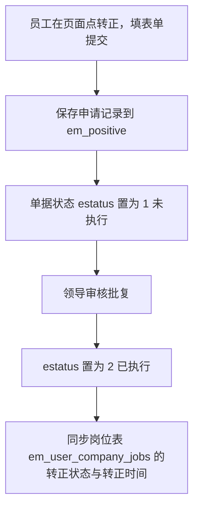
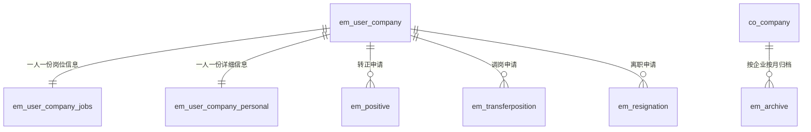

# SaaS-HRM 员工管理：转正、调岗、离职背后的七张表

权限体系做完之后，HRM 系统进入第一个业务模块：员工管理。打开员工列表页，操作区比之前多了好几个按钮：转正、调岗、离职；再点进某个员工的详情，还有个人详情、账号信息、教育信息、从业信息一整排表单。界面都不复杂，真正要想清楚的是：每一次点击背后，数据落在哪张表、状态怎么流转。把这两件事想透了，后面写代码就是照表填空。

## 先给结论

- 员工管理的主线是四个动作：入职登记、转正、调岗、离职，外加一份随时可以补充完善的员工详细信息。
- 申请类操作不直接改员工数据：先往申请表插一条记录，领导批复后把单据状态从未执行改成已执行，再同步岗位信息表。
- 岗位信息表 `em_user_company_jobs` 与详细信息表 `em_user_company_personal` 都是「一人一条」，主键直接用员工 ID `user_id`，天然防止重复建档。
- 月度归档表 `em_archive` 每月存一份统计快照，当月明细序列化后放进 `data` 长文本字段，让历史有迹可查。
- 所有员工相关的表都用 `user_id` 串联，它同时是系统用户表的主键，员工账号与员工档案共用同一个 ID。

## 一、页面上多了哪些动作

员工列表页本身就是一张查询视图：工号、姓名、部门、入职时间、在职状态。真正的新东西在操作列和详情页里，拆开看是四类。

**转正。** 员工入职满一个月或几个月后可以发起转正申请，页面是一个表单：转正日期、转正评价、附件。提交的本质是往数据库保存一条记录，等领导批复之后，再把这条记录的状态从「申请中」改成「转正成功」。

**调岗。** 初级工程师调成高级工程师、架构师，走的是同一套逻辑。这里有一个关键设计：调岗**不是**直接修改岗位表。你点提交，只是把调岗申请保存成一条记录；领导批复之后，系统才把你的岗位信息同步刷新。先申请、后生效，中间隔着一次审批。

**离职。** 离职表单的字段比想象中多：离职类型、离职时间、申请原因、补偿金、代通知金。离职不只是把人标记掉，还牵扯社保、公积金的减员办理，所以表里专门留了减员月份字段。

**详细信息。** 一个员工刚入职时只有最基础的数据，人事专员随后要在详情页里补充：学历情况、通讯录、社保账号、公积金账号、银行账号、开户行、教育经历、从业经历。这些内容同样落到数据库表里，查询为空就填，填了就可以改。

## 二、申请单据的统一套路

把转正、调岗、离职放在一起看，会发现它们是同一个模板的三次实例化。以转正为例：



图里的关键路径是「先插记录、后改状态」：申请和审批被拆成两次写操作，中间任何时刻查表都能看到这张单据停在哪个环节。调岗比转正多最后一步，批复通过后还要把申请表里的岗位、职级、汇报对象同步进岗位信息表；离职则是批复后更新在职状态。三个功能共用一套「申请表 + 状态字段 + 回写」的结构，代码写法自然也一模一样。

## 三、七张表各管一段

数据库层面，员工管理一共涉及七张表，分工非常清晰：

| 表名 | 说明 | 主键 |
|---|---|---|
| `em_user_company` | 员工在职基础信息：工号、部门、入职时间、聘用形式、在职状态 | `user_id` |
| `em_user_company_jobs` | 岗位信息：岗位、职级、汇报对象、HRBP、合同起止、司龄 | `user_id` |
| `em_user_company_personal` | 详细信息：学历、户籍、通讯、社保、公积金、银行卡、教育、从业 | `user_id` |
| `em_positive` | 转正申请 | `user_id` |
| `em_resignation` | 离职申请 | `user_id` |
| `em_transferposition` | 调岗申请 | `user_id` |
| `em_archive` | 月度归档：总人数、在职数、离职数、明细快照 | `id` |

申请表的字段可以直接从表结构读出来，以转正表为例，课程资料里的建表语句是：

```sql
CREATE TABLE `em_positive` (
  `user_id` varchar(40) NOT NULL COMMENT '员工ID',
  `date_of_correction` datetime DEFAULT NULL COMMENT '转正日期',
  `correction_evaluation` text COMMENT '转正评价',
  `enclosure` text COMMENT '附件',
  `estatus` int(2) NOT NULL COMMENT '单据状态 1是未执行，2是已执行',
  `create_time` datetime NOT NULL COMMENT '创建时间',
  PRIMARY KEY (`user_id`)
) ENGINE=InnoDB DEFAULT CHARSET=utf8mb4;
```

表与表之间的挂接关系只有一种：所有表都靠 `user_id` 指向员工。岗位信息和详细信息是员工的一部分，做成一对一；三张申请表是一个员工一生中可能发起多次的单据，做成一对多；归档表挂在企业维度，按月生成。



「一人一条」的表拿 `user_id` 当主键是最省事的设计：插入第二次直接主键冲突，天然挡住重复建档；更新语义也明确，永远覆盖同一行。

## 四、归档表：给历史留底

人力资源系统有一个绕不开的需求：每个月的员工流入、流出要留档。一月份入职了多少人、叫什么名字，离职了多少人、叫什么名字，每月固定日期（比如 3 号）把上个月的员工信息统计一遍，写进归档表，日后随时可查。

`em_archive` 的结构就是为此服务的：`totals` 存总人数，`payrolls` 存在职人数，`departures` 存离职人数，而 `data` 长文本字段直接把当月明细序列化后整块存进去。统计数字用于报表和对比，明细快照用于回溯，一个月一条记录，一年也就十二行。

为什么不直接从员工表现查历史？因为员工表是「当前态」，员工离职后记录会被更新，一个月前的状态早就被覆盖了。归档表用空间换时间，把「过去每个月的当前态」固化下来，这是报表类需求最常见的做法。

## 常见误区

- **调岗直接 UPDATE 岗位表。** 岗位立刻被改掉，没有审批环节，也没有任何痕迹可查。正确做法是先写调岗申请表，批复通过后再同步岗位表，每一步都有据可查。
- **给一人一条的表用自增 ID 做主键。** `em_user_company_jobs` 这类表的主键就是 `user_id`，换来自增 ID 后必须自己处理重复插入，同一个员工可能被插出两份岗位信息。
- **把详细信息表的宽字段当成设计缺陷。** 这张表一百多个 `varchar(255)` 字段看起来违反三范式，实际是把「个人档案」这个整体拍平存储，读写都简单；它记录的是档案快照，不承担跨表拆分查询的职责。
- **期望归档表的 `data` 字段能参与关联查询。** 里面是序列化后的明细文本，只适合整体读取和导出，要做结构化查询就得在生成归档时把统计口径算好存成独立字段。

## 面试可能被问到的问题

1. 面试官追问：「员工转正功能，数据库层面怎么实现？」
   答：往转正申请表插一条记录，状态置为未执行；领导批复后把状态改成已执行，并同步更新岗位信息表里的转正状态和转正时间。核心是「申请」与「生效」分离，两次写操作之间可以插入审批环节。

2. 面试官追问：「为什么岗位信息表用 user_id 做主键，而不是自增 id？」
   答：岗位信息与员工是一对一关系，一人最多一条。用 user_id 当主键，数据库层面就挡住了重复建档，更新时直接按主键覆盖，不需要额外的唯一索引。

3. 面试官追问：「调岗为什么不直接更新岗位表？」
   答：调岗涉及审批流，需要留痕和追溯。先保存调岗申请单，批复通过后由系统同步岗位信息，过程数据完整保留，出问题时可以还原每一步。

4. 面试官追问：「员工信息按月归档怎么设计？」
   答：单独建归档表，每月一条记录，存总人数、在职数、离职数三个统计字段，再把当月明细序列化进长文本字段作为快照。员工表只保存当前态，历史状态靠归档表回溯。

5. 面试官追问：「离职表里为什么会有社保减员月和公积金减员月两个字段？」
   答：离职不仅是改员工状态，还要去社保和公积金账户办理减员，这两个业务有各自的办理周期。表单里让 HR 明确填写减员月份，后续对接社保模块时才有依据。

## 配套资料

- 建表与初始化数据：`materials/code/02/day07 员工管理及POI入门/员工管理及POI入门/资源/Sql/员工管理.sql`（含 em_archive、em_positive、em_resignation、em_transferposition、em_user_company_jobs、em_user_company_personal 六张表的完整 DDL）
- 全库建表脚本（含员工基础表 `em_user_company`、企业表 `co_company`）：`materials/code/02/day02 SAAS-HRM数据库设计与前端框架/3-3 SAAS-HRM数据库设计与前端框架/资源/ihrm.sql`
