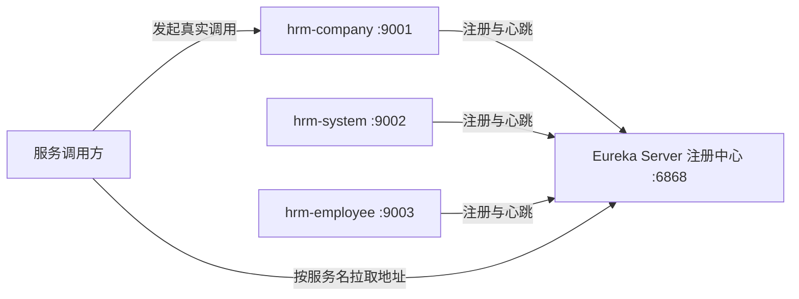
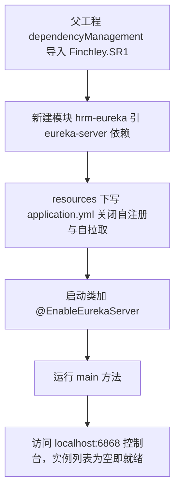

# 微服务多了谁来管：亲手搭一个 Eureka 注册中心

到目前为止项目里已经跑着三个微服务：企业服务、系统服务、员工服务。服务一多，新问题立刻出现：员工服务想调企业服务，它怎么知道企业服务在哪台机器哪个端口？把 IP 和端口写死在配置里，换台机器、加个实例、迁移环境，所有调用方都得跟着改。注册中心就是为了终结这种写死，本课用 Spring Cloud 的服务发现组件 Eureka 把三个服务统一注册、统一管理、统一监控。

## 先给结论

- Eureka 分两端：`Eureka Server` 是注册中心，`Eureka Client` 是每个微服务；和多数 RPC 框架不同，注册中心本身要自己写一个 Spring Boot 模块搭出来。
- 服务端搭建三步走：父工程锁定 Spring Cloud 版本、新建模块引入 `spring-cloud-starter-netflix-eureka-server`、启动类加 `@EnableEurekaServer`。
- 服务端配置里 `registerWithEureka` 和 `fetchRegistry` 都设为 `false`：注册中心自己不必注册自己，也不必拉取注册表。
- 交互地址 `defaultZone` 用占位符 `${server.port}` 拼接，端口只写一处，改起来不会漏。
- 启动后访问 `http://localhost:6868` 能看到管理控制台，实例列表为空说明服务端就绪，就等客户端来注册。

## 一、注册中心解决什么问题

服务发现这个词听起来抽象，类比通讯录就好懂了。没有通讯录时，找人只能靠背诵对方的地址；有了通讯录，每个人到岗先登记「我叫什么、住哪里」，找人时按名字查一下就行，搬家了更新登记，别人照样找得到。

Eureka 就是这份通讯录。每个微服务启动时把自己「服务名 + 地址 + 端口」登记上去，这叫服务注册；调用方按服务名从注册中心拉取可用地址列表再发起调用，这叫服务发现。注册中心还顺带做监控：服务挂了不再续约，注册表会把它剔除。

Eureka 是 Spring Cloud 全家桶的一员，Spring Cloud 本身不重造轮子，它把 Netflix 开源的 Eureka 封装成开箱即用的组件，同一家族里还有服务调用、熔断、网关等组件，本课先用最基础的注册与发现。三个服务注册进来的整体结构是这样：



图里所有箭头都指向注册中心的只有注册与心跳，真实业务流量走的是「先查注册表、再直连服务」这条路，注册中心本身不是流量转发者。

## 二、父工程锁版本，子模块引依赖

搭服务端之前有一件容易被忽略的事：Spring Cloud 与 Spring Boot 的版本必须匹配，各组件之间也要同代。锁版本的惯用做法是在父工程 `pom.xml` 的 `dependencyManagement` 里导入 Spring Cloud 的依赖清单：

```xml
<dependencyManagement>
    <dependencies>
        <dependency>
            <groupId>org.springframework.cloud</groupId>
            <artifactId>spring-cloud-dependencies</artifactId>
            <version>Finchley.SR1</version>
            <type>pom</type>
            <scope>import</scope>
        </dependency>
    </dependencies>
</dependencyManagement>
```

`scope` 为 `import`、`type` 为 `pom` 的导入方式相当于把整份版本清单抄进父工程的仲裁表。之后任何子模块引 Spring Cloud 组件都不用再写版本号，写错了反而会和清单打架。

然后右键父工程新建模块 `hrm-eureka`，pom 里只放一个依赖：

```xml
<dependencies>
    <dependency>
        <groupId>org.springframework.cloud</groupId>
        <artifactId>spring-cloud-starter-netflix-eureka-server</artifactId>
    </dependency>
</dependencies>
```

注意区分两个起步依赖：`netflix-eureka-server` 是注册中心本体的依赖，`netflix-eureka-client` 是普通微服务用的客户端依赖。这里建的是服务端，引的是 server。资料里给的是 client 端的依赖片段，动手时把 artifactId 里的 client 换成 server 即可，版本号不用填，父工程已经管了。

## 三、配置文件逐行拆解

在 `hrm-eureka` 的 `src/main/resources` 下新建 `application.yml`，内容出自课程资料：

```yaml
server:
  port: 6868 #服务端口
eureka:
  client:
    registerWithEureka: false #是否将自己注册到Eureka服务中，本身就是注册中心，无需注册
    fetchRegistry: false #是否从Eureka中获取注册信息
    serviceUrl: #Eureka客户端与Eureka服务端进行交互的地址
      defaultZone: http://127.0.0.1:${server.port}/eureka/
```

这份配置的精髓在于一个反直觉的事实：**Eureka Server 自己也是 Eureka Client。** 服务端引入的依赖里带着客户端代码，默认行为就是往注册中心注册自己、拉取注册表。注册中心给自己注册没有意义，所以前两个开关都关掉：

**`registerWithEureka: false`** 表示「我不把我自己注册进注册中心」。单机部署时注册中心只有一个，注册自己纯属自娱自乐。

**`fetchRegistry: false`** 表示「我不从注册中心拉取注册表」。它自己就是注册表的唯一权威，拉取没有意义。注册中心做集群时这两个开关才打开，让多台注册中心互相同步。

**`defaultZone`** 是客户端与服务端交互的地址，也是所有微服务注册进来要填的地址。`${server.port}` 是 Spring 配置的占位符，引用上文定义的 `6868`，端口改动时这一行自动跟着变。写的时候注意是美元符号加花括号，写成圆括号 `$(server.port)` 不会被解析，地址就错了。

## 四、启动类与验证

Eureka Server 说的再高端，本质也是一个 Spring Boot 应用，写一个启动类跑起来就算搭建完成。课程资料工程里的启动类叫 `EureApplication`，名字随意，注解才是关键：

```java
package com.example.eureka;

import org.springframework.boot.SpringApplication;
import org.springframework.boot.autoconfigure.SpringBootApplication;
import org.springframework.cloud.netflix.eureka.server.EnableEurekaServer;

@SpringBootApplication
@EnableEurekaServer
public class EureApplication {

    public static void main(String[] args) {
        SpringApplication.run(EureApplication.class, args);
    }
}
```

两个注解分工明确：`@SpringBootApplication` 把它变成一个标准的 Spring Boot 引导类，`@EnableEurekaServer` 激活注册中心的能力，没有后者它就只是个空壳 Web 应用。

执行 `main` 方法启动，浏览器访问 `http://localhost:6868`，出现 Eureka 的管理控制台就说明搭建成功。页面上最值得关注的是实例列表：

```bash
curl -s http://localhost:6868/eureka/apps
# 注册表还是空的，返回 <applications/>，等待客户端注册
```



图里每一步失败都有对应症状：依赖没引入是启动类找不到 `EnableEurekaServer` 注解，配置没写是端口启动到 8080 去了，注解没加是控制台页面出不来。按链条排查，十有八九能当场定位。

## 常见误区

- **把 Eureka Server 当成独立安装的软件。** 它不像某些注册中心需要单独下载部署，就是一个普通的 Spring Boot 模块，自己写、自己启动，代码量小到只有一个类加一份配置。
- **漏掉 `registerWithEureka: false`。** 注册中心把自己注册进去，控制台会多出一个 `UNKNOWN` 实例，看起来像是有个陌生服务在线，排查时平白多一层干扰。
- **占位符写成圆括号。** `$(server.port)` 不会被 Spring 解析，`defaultZone` 拿到的是字面字符串，客户端按这个地址注册必然失败。花括号 `${server.port}` 才是正确写法。
- **忘了在父工程锁 Spring Cloud 版本。** 子模块自己写版本号，很容易和 Spring Boot 版本不匹配，出现各种 `ClassNotFoundException`。版本统一交给 `spring-cloud-dependencies` 清单管理。

## 面试可能被问到的问题

1. 面试官追问：「Eureka Server 和 Eureka Client 各自的职责是什么？」
   答：Server 是注册中心，维护服务注册表，接收注册、心跳、剔除，对外提供注册表查询；Client 集成在每个微服务里，启动时把自身信息注册到 Server，定时续约心跳，并从 Server 拉取注册表缓存到本地，供服务间调用使用。

2. 面试官追问：「为什么注册中心要把 registerWithEureka 和 fetchRegistry 设为 false？」
   答：因为 Eureka Server 内部也是 Client 角色，默认会注册自己、拉取注册表。单机部署时这没有意义，还会在控制台制造假实例。做 Eureka 集群时这两个开关要打开，让各节点互为客户端互相注册同步。

3. 面试官追问：「defaultZone 是什么，为什么叫这个名字？」
   答：它是客户端与注册中心交互的基地址，注册、续约、拉注册表都发到这个 URL。名字来自 AWS 区域概念，zone 是可用区，default 表示默认区域；配置里支持逗号分隔多个地址，实现注册中心的容灾。

4. 面试官追问：「Spring Cloud 的版本冲突一般怎么管？」
   答：在父工程 dependencyManagement 里导入 spring-cloud-dependencies，scope 用 import、type 用 pom，让官方清单统一仲裁所有 Spring Cloud 组件的版本；子模块引依赖不写版本号。Spring Cloud 版本还要与 Spring Boot 版本匹配，两者按官方兼容表选。

5. 面试官追问：「Eureka 控制台上你能看到哪些信息？」
   答：核心是 Instances currently registered with Eureka 实例列表，每个服务一行，显示应用名和 UP 状态及实例地址；旁边 General Info 区有内存、CPU、运行时长等环境信息，还能看到注册中心进入自我保护模式的红色警告。

## 配套资料

- Eureka 服务端工程：`materials/code/02/day07 员工管理及POI入门/员工管理及POI入门/资源/后端/ihrm_eureka/`（含 `pom.xml`、`EureApplication.java`、`application.yml`，文中包名已统一改为 `com.example`）
- 服务端配置文件副本：`materials/code/02/day07 员工管理及POI入门/员工管理及POI入门/资源/eureka-application.yml`
