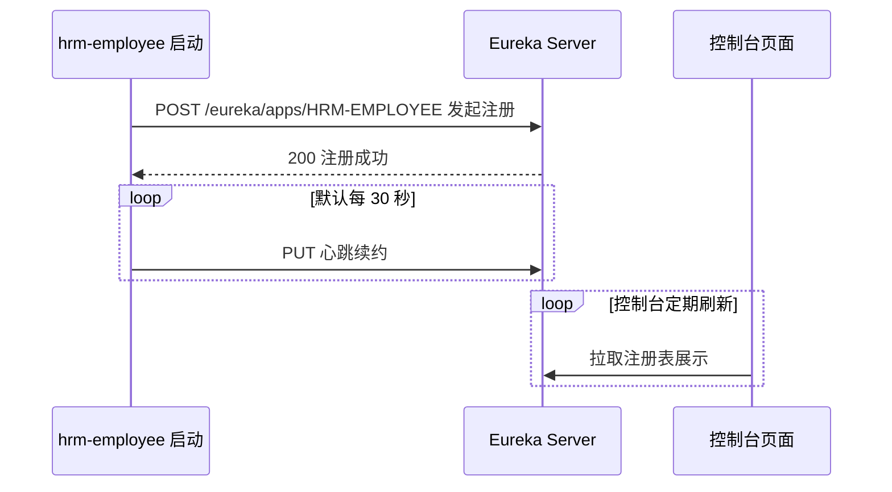

# 把三个微服务注册进 Eureka：三步配置与一次重启

注册中心已经在 6868 端口跑起来了，控制台的实例列表却还是空的。现在轮到把企业、系统、员工三个微服务挨个挂上去。这件事没有任何难点，难在认清它是一套机械动作：每个微服务重复同样的三步，改一处 pom、加一段配置、贴一个注解，然后重启。做一遍要理解，做三遍要看出「所有服务都一样」这个规律，后面再加服务就直接套模板。

## 先给结论

- 微服务注册三步走：pom 加 `spring-cloud-starter-netflix-eureka-client` 依赖，配置文件写 `eureka.client.service-url.defaultZone`，启动类加 `@EnableEurekaClient`。
- `defaultZone` 必须与服务端配置的交互地址一致，本项目是 `http://localhost:6868/eureka/`。
- `spring.application.name` 必须配：控制台显示的应用名是它的大写形式，后续服务间调用也按这个名字找实例。
- 注册成功的标志是控制台出现 `HRM-COMPANY`、`HRM-SYSTEM`、`HRM-EMPLOYEE` 三个 UP 状态的实例。
- 客户端默认每 30 秒续约一次心跳，服务上线、下线在控制台上都有延迟，看不到立刻刷新没必要慌。

## 一、客户端注册的固定三步

每个要注册的微服务都执行同一套动作。以企业微服务为例：

**第一，加客户端依赖。** 在微服务模块的 pom 里加一个起步依赖：

```xml
<dependency>
    <groupId>org.springframework.cloud</groupId>
    <artifactId>spring-cloud-starter-netflix-eureka-client</artifactId>
</dependency>
```

版本号照旧不用写，父工程锁定的 `spring-cloud-dependencies` 清单统一仲裁。这里引的是 client，别顺手把服务端的 server 依赖也引进来，一个普通微服务不需要注册中心的能力。

**第二，加注册配置。** 打开微服务的 `application.yml`，把注册地址写进去。下面是课程资料里员工微服务的完整配置：

```yaml
eureka:
  client:
    service-url:
      defaultZone: http://localhost:6868/eureka/
server:
  port: 9003
spring:
  application:
    name: hrm-employee #指定服务名
  datasource:
    driver-class-name: com.mysql.jdbc.Driver
    url: jdbc:mysql://localhost:3306/ihrm?useUnicode=true&characterEncoding=utf8
    username: root
    password: 111111
  jpa:
    database: MySQL
    show-sql: true
    open-in-view: true
  redis:
    host: 127.0.0.1
    port: 6379
```

`defaultZone` 和服务端 `application.yml` 里那份交互地址完全对应，写错端口或者漏掉 `/eureka/` 后缀，注册请求就发到了一个不存在的地方。`spring.application.name` 是这次新增配置里真正有分量的一个：它定义服务名，注册中心按这个名字归组实例，控制台把大写形式展示出来，之后服务间调用也靠它来寻址。

**第三，启动类加注解。** 找到微服务的引导类，贴上 `@EnableEurekaClient`。员工微服务的启动类加完之后长这样：

```java
package com.example.employee;

import org.springframework.boot.SpringApplication;
import org.springframework.boot.autoconfigure.SpringBootApplication;
import org.springframework.boot.autoconfigure.domain.EntityScan;
import org.springframework.cloud.netflix.eureka.EnableEurekaClient;

@EnableEurekaClient
@SpringBootApplication(scanBasePackages = "com.example")
@EntityScan("com.example.domain.employee")
public class EmployeeApplication {

    public static void main(String[] args) {
        SpringApplication.run(EmployeeApplication.class, args);
    }
}
```

三步做完，重启这个微服务，它就会带着自己的服务名、地址、端口向 6868 发出注册请求。

## 二、三个服务批量套模板

企业服务和系统服务执行一模一样的三件事。课程的实操顺序是：先改 `hrm-company` 的 pom 和配置文件，在启动类 `CompanyApplication` 上加 `@EnableEurekaClient` 并重启；再对 `hrm-system` 复制同样的动作；员工微服务是当天新建的，依赖在搭工程时就带上了，只需要补配置和注解。三个服务的差异只有两处：端口（9001、9002、9003）和服务名。

把注册这件事画成时序，能看到客户端和服务端各自在后台持续做什么：



注册不是一锤子买卖，续约才是常态。服务停止续约超过默认 90 秒，注册中心才把它标为失效，加上控制台本身有缓存刷新周期，所以「服务刚重启但列表还没变」属于正常现象，等半分钟再看。

## 三、控制台上确认注册结果

三个服务都重启完成后，回到 6868 的控制台刷新页面，实例列表里应该出现三行：

| Application | Status |
|---|---|
| HRM-COMPANY | UP (1) - localhost:hrm-company:9001 |
| HRM-EMPLOYEE | UP (1) - localhost:hrm-employee:9003 |
| HRM-SYSTEM | UP (1) - localhost:hrm-system:9002 |

每一行的读法：应用名是 `spring.application.name` 的大写；UP 表示实例健康；括号里的 1 是该服务名下的实例数；后面是实例的具体地址。三个 UP 挂在列表里，说明注册中心的统一管理已经就位，也为后续服务之间的相互调用铺平了道路：调用方不再需要知道任何 IP，按服务名查注册表就能拿到可用地址。

## 常见误区

- **服务名里用下划线。** `spring.application.name` 写成 `hrm_employee` 这种带下划线的形式，注册能成功，但后续用服务名做负载均衡调用时会因为命名规范校验直接报错。服务名统一用中划线小写，如 `hrm-employee`。
- **不配 `spring.application.name`。** 服务照样能注册，但应用名是 `UNKNOWN`，调用方无从按名查找，等于白注册。服务名是注册的身份证，不是可选项。
- **`defaultZone` 与服务端配置对不上。** 端口写成服务端自己的 9001、或者少了 `/eureka/` 路径，客户端注册失败，控制台永远空着。两边地址必须逐字符一致。
- **以为停掉服务立刻从列表消失。** 客户端停止后续约还要等心跳超时（默认 90 秒）才会被剔除，期间控制台可能显示实例下线或者进入自我保护模式，这是设计行为而不是故障。

## 面试可能被问到的问题

1. 面试官追问：「微服务接入 Eureka 需要哪几步？」
   答：引入 eureka client 起步依赖；在配置文件里写 eureka.client.service-url.defaultZone 指向注册中心地址，并设置 spring.application.name 服务名；启动类加 @EnableEurekaClient；重启服务后到控制台确认实例 UP。

2. 面试官追问：「为什么服务名不能带下划线？」
   答：注册本身不报错，但做服务间调用时，负载均衡组件按服务名从注册表取实例，下划线不符合它的主机名规范校验，会抛出找不到实例的异常。惯例是用小写字母加中划线。

3. 面试官追问：「注册中心挂了，已注册的服务之间还能互相调用吗？」
   答：能。客户端会缓存拉取到的注册表，调用时按本地缓存的地址直连目标服务，不经过注册中心。代价是这段期间新服务上线、下线感知不到，注册中心恢复后重新同步。

4. 面试官追问：「@EnableEurekaClient 这个注解是必须的吗？」
   答：在较新版本的 Spring Cloud 中，classpath 里存在 Eureka Client 依赖时注册会自动生效，注解不是硬性要求。课程里显式写上是为了语义清晰，代码读者一眼看出这是一个 Eureka 客户端服务。

5. 面试官追问：「服务正常关闭和进程被杀，在注册中心表现有什么不同？」
   答：正常关闭时客户端会主动发送下线请求，注册中心立刻剔除实例；进程被杀则没有下线请求，要等心跳超时由注册中心的定时任务剔除，期间调用方可能拿到已失效的地址。

## 配套资料

- 员工微服务工程：`materials/code/02/day07 员工管理及POI入门/员工管理及POI入门/资源/后端/ihrm_employee/`（含带 eureka-client 依赖的 `pom.xml`、`EmployeeApplication.java`、客户端注册配置 `application.yml`，文中服务名与包名已改为 `hrm-employee` 与 `com.example`）
- Eureka 服务端工程与配置：`materials/code/02/day07 员工管理及POI入门/员工管理及POI入门/资源/后端/ihrm_eureka/`、`materials/code/02/day07 员工管理及POI入门/员工管理及POI入门/资源/eureka-application.yml`
