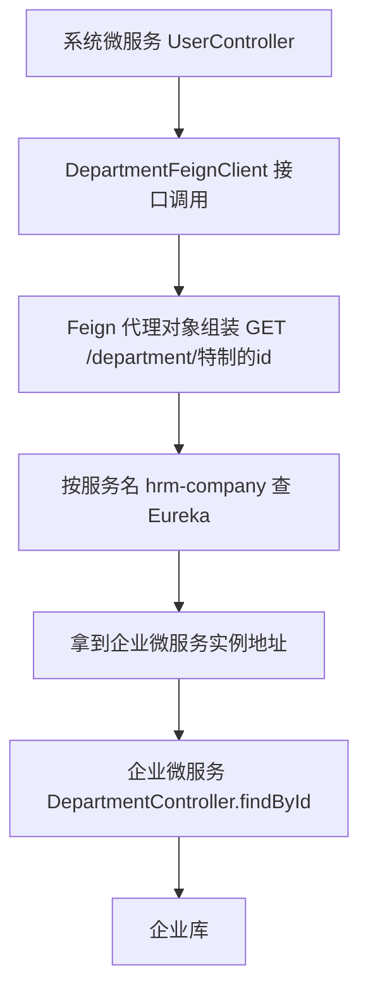

# 用 Feign 把远程调用写成一行代码：系统微服务调用企业微服务的环境搭建

注册中心已经就位，控制台里企业、系统、员工三个微服务都是 UP 状态。现在来了第一个真实的跨服务需求：系统微服务要拿企业微服务里的部门数据，也就是调用企业微服务的「根据 ID 查询部门」这个 HTTP 接口。两个服务各自连着自己的数据库，数据在对方手里，唯一的通道就是 HTTP。

自己动手发 HTTP 请求当然可行：拼 URL、发请求、把 JSON 转回对象，代码量不小而且每个调用方都要重复一遍。Spring Cloud 为这件事准备了专门的组件 Feign，把「发一次 HTTP 请求」简化成「调用一个接口方法」。

## 先给结论

- Feign 是一个声明式的 HTTP 客户端工具：声明一个接口、打上注解描述请求，剩下的拼参数、发请求、解析响应全部由它代劳。
- 接入只有三步：加 `spring-cloud-starter-openfeign` 依赖，启动类加 `@EnableDiscoveryClient` 和 `@EnableFeignClients` 两个注解，写一个 `@FeignClient` 接口。
- 所有配置都遵循一条铁律：谁发起调用，就配置在谁身上。系统微服务是调用方，三步全做在系统微服务里。
- 接口里的方法要与提供方 Controller 的方法长得一模一样：同样的 `@RequestMapping` 路径与请求方式，同样的 `@PathVariable` 参数注解。
- `@FeignClient("hrm-company")` 里的字符串是被调服务的 `spring.application.name`，Feign 靠这个名字去注册中心找实例。

## 一、Feign 到底省掉了什么

场景先摆清楚。企业微服务里有一个接口，浏览器访问 `GET /department/{id}` 就能拿到部门对象：

```java
// 企业微服务 DepartmentController（节选自课程工程）
@RestController
@RequestMapping(value = "/department")
public class DepartmentController {

    //根据id查询
    @RequestMapping(value = "/{id}", method = RequestMethod.GET)
    public Result findById(@PathVariable(value = "id") String id) {
        Department department = departmentService.findById(id);
        return new Result(ResultCode.SUCCESS, department);
    }
}
```

它本质上就是一个 HTTP 接口。系统微服务想拿这份数据，等价于向企业微服务发一个 `GET /department/{id}` 请求。不用任何组件也能做，但每调一个接口就要手写一段 HTTP 客户端代码，URL 写死、参数手工拼接、返回值自己反序列化。

Feign 的思路是把这套动作「声明」出来。它是一种简化 Java HTTP 客户端开发的工具，写法上借鉴了 Retrofit、JAXRS-2.0 这类声明式设计：开发者只负责定义接口和注解，运行期由 Feign 生成代理对象，真正发请求的是它。调用方看到的是 `departmentFeignClient.findById(id)` 这样一次普通的方法调用，背后是一次完整的远程 HTTP 请求。

整条调用链是这样的：



图里最关键的一环是「按服务名查 Eureka」：调用方全程不知道对方部署在哪台机器、哪个端口，只认服务名，地址由注册中心给出。这也是为什么 Feign 天然和 Eureka 是一套组合。

## 二、第一步：给调用方加依赖

Feign 是个组件，用它的第一步永远是加依赖。加在哪？发起调用的那一端。本项目里是系统微服务的 pom：

```xml
<dependency>
    <groupId>org.springframework.cloud</groupId>
    <artifactId>spring-cloud-starter-openfeign</artifactId>
</dependency>
```

版本号不用写，父工程引入的 `spring-cloud-dependencies` 依赖清单统一仲裁。从坐标名也能看出它现在的身份：`openfeign`，Spring Cloud 接手维护后的 Feign 组件。

## 三、第二步：启动类加两个注解

依赖到位后，在系统微服务的启动类上补两个注解：

```java
package com.example.system;

import org.springframework.boot.SpringApplication;
import org.springframework.boot.autoconfigure.SpringBootApplication;
import org.springframework.cloud.client.discovery.EnableDiscoveryClient;
import org.springframework.cloud.openfeign.EnableFeignClients;
import org.springframework.context.annotation.ComponentScan;

@SpringBootApplication
@EnableDiscoveryClient
@EnableFeignClients
@ComponentScan(basePackages = "com.example")
public class SystemApplication {

    public static void main(String[] args) {
        SpringApplication.run(SystemApplication.class, args);
    }
}
```

两个注解各有分工。`@EnableDiscoveryClient` 开启服务发现能力，调用别的微服务之前总得先能找到它，这一步把系统微服务接入注册体系；`@EnableFeignClients` 则开启 Feign 客户端扫描，让框架去扫描并注册那些带 `@FeignClient` 的接口。`@ComponentScan(basePackages = "com.example")` 是本项目的既有配置，多个模块的公共代码都在 `com.example` 之下，扫描范围要罩住它们。

## 四、第三步：写一个 FeignClient 接口

这是三步里最核心的一步，也是最能体现「声明式」三个字的一步。在系统微服务里新建一个包 `com.example.system.client`，放一个纯接口：

```java
package com.example.system.client;

import org.springframework.cloud.openfeign.FeignClient;
import org.springframework.web.bind.annotation.PathVariable;
import org.springframework.web.bind.annotation.RequestMapping;
import org.springframework.web.bind.annotation.RequestMethod;

@FeignClient("hrm-company")
public interface DepartmentFeignClient {

    @RequestMapping(value = "/department/{id}", method = RequestMethod.GET)
    public Result findById(@PathVariable(value = "id") String id);
}
```

这个接口没有任何实现类，三个细节决定了它能通：

**第一，`@FeignClient("hrm-company")` 声明目标服务。** 企业微服务注册时的服务名是 `hrm-company`，这里就写这个名字。Feign 收到调用后按这个名字去注册中心查可用实例。

**第二，方法上的 `@RequestMapping` 从提供方原样拷贝。** 提供方的 `DepartmentController` 上，类级映射是 `/department`，方法级是 `/{id}`，请求方式 GET。Feign 接口这边合并后的完整路径必须与其一致，请求方式也必须一致。

**第三，方法签名照抄提供方。** 方法名可以一致，参数也要用同样的注解标注：路径变量用 `@PathVariable("id")`，返回值类型对齐提供方的 `Result`。

这套写法不是本项目独有，课程后面每个微服务都在重复。例如社保模块调用员工微服务的客户端：

```java
/**
 * 声明接口，通过feign调用其他微服务
 */
//声明调用的微服务名称
@FeignClient("ihrm-employee")
public interface EmployeeFeignClient {

    /**
     * 获取个人信息
     * @param uid 用户id
     * @return 个人信息
     */
    @RequestMapping(value = "/employees/{id}/personalInfo", method = RequestMethod.GET)
    Result findPersonalInfo(@PathVariable(name = "id") String uid);
}
```

结构完全同构：`@FeignClient` 点名服务，方法注解复刻提供方接口。看懂一个，所有服务间调用都是同一个模板。

## 常见误区

- **把注解和依赖加到被调用方。** 企业微服务是被调端，给它加 `@EnableFeignClients` 不会让任何调用变通。依赖、注解、接口三件套只属于发起调用的那一端。
- **漏加 `@EnableFeignClients`。** 依赖在、接口也在，注入 `DepartmentFeignClient` 时却报找不到 Bean。没有这个注解，Feign 不会去扫描和注册客户端接口。
- **服务名对不上。** `@FeignClient` 里写的名字与提供方 `spring.application.name` 不一致，调用时直接抛出找不到实例的异常。名字要逐字符核对。
- **路径只抄方法级映射。** 接口方法上只写 `/{id}` 而丢了提供方类上的 `/department` 前缀，请求打到一个不存在的地址上，得到 404。

## 面试可能被问到的问题

1. 面试官追问：「Feign 是什么，它解决了什么问题？」
   答：Feign 是声明式的 HTTP 客户端工具。服务间调用本质是发 HTTP 请求，手写客户端要处理拼 URL、传参、反序列化等重复劳动；Feign 让开发者只声明接口和注解，请求的组装、发送、结果解析都由框架在运行期通过动态代理完成。

2. 面试官追问：「Feign 和 RestTemplate 的区别是什么？」
   答：RestTemplate 是编程式调用，每次都要手工构造 URL 和请求对象；Feign 是声明式，把请求信息固化在接口注解里，调用远程接口与调用本地方法写法一致。Feign 还与注册中心、负载均衡天然集成，按服务名调用即可。

3. 面试官追问：「`@FeignClient` 注解里的值代表什么？」
   答：被调用服务在注册中心的服务名，即它的 spring.application.name。Feign 拿这个名字到注册中心查询实例列表，再由负载均衡策略选出一个实例发起请求，调用方无需感知具体 IP 和端口。

4. 面试官追问：「`@EnableFeignClients` 做了什么？」
   答：开启 Feign 客户端扫描。启动时它会扫描标注了 @FeignClient 的接口，为每个接口生成动态代理对象并注册进 Spring 容器，调用方才能通过 @Autowired 注入并使用。

5. 面试官追问：「Feign 接口里为什么要复刻提供方的路径和参数注解？」
   答：因为 Feign 就是按这些注解组装 HTTP 请求的。路径决定请求地址，请求方式决定 method，参数注解决定参数放在路径、请求体还是查询串里。任何一处与提供方不一致，请求就打不到目标接口。

## 配套资料

- 社保模块的 Feign 客户端（同款声明式写法）：`materials/code/02/day14 微服务网关与社保模块开发/day14/03-资料/社保模块相关资料/ihrm_social_securitys/src/main/java/com/ihrm/social/client/EmployeeFeignClient.java`、同目录 `SystemFeignClient.java`
- 被调用方接口原样（企业微服务部门接口）：`materials/code/02/day13-代码生成器实现/day13-代码生成器实现/资源/测试/生成代码路径/ihrm_company/src/main/java/com/ihrm/system/controller/DepartmentController.java`
- 注册中心工程与配置：`materials/code/02/day07 员工管理及POI入门/员工管理及POI入门/资源/后端/ihrm_eureka/`、`materials/code/02/day07 员工管理及POI入门/员工管理及POI入门/资源/eureka-application.yml`
- 本课的 `DepartmentFeignClient` 与启动类改动在资料包中没有独立源码目录，文中代码按课程视频画面还原，包名与服务名已统一改为 `com.example` 与 `hrm-company`
