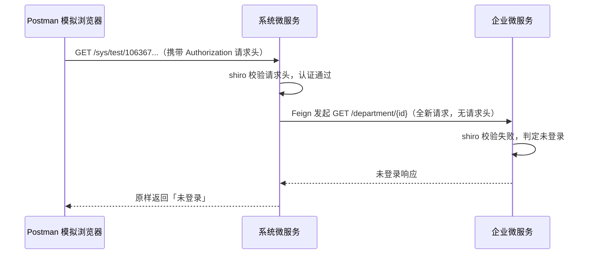

# Feign 调用第一枪卡在「未登录」：请求头丢失的排查与拦截器补齐

Feign 的三步搭建完成，是骡子是马得拉出来遛遛。写一个五行的测试接口，用系统微服务调用企业微服务的部门查询接口，结果第一次测试就翻车：登录明明是成功的，请求一发出去，回来的却是「未登录」。这次翻车非常有价值，它暴露了服务间调用最经典的一个问题：HTTP 请求头不会自己跨服务传递。

## 先给结论

- 测试入口很简单：`UserController` 里写一个 `/test/{id}` 接口，注入 `DepartmentFeignClient`，一行 `findById(id)` 拿到结果。
- 第一次调用失败，企业微服务返回「未登录」。根因：Feign 发出的是一次全新的 HTTP 请求，浏览器带来的认证请求头不会自动复制过去。
- 解决方案是给 Feign 配一个 `RequestInterceptor` 拦截器，借助 `RequestContextHolder` 拿到当前请求，把它的请求头逐个复制进 Feign 的 `RequestTemplate`。
- 拦截器放公共模块 `hrm_common` 里，多个微服务都要调别人，一份配置全体复用。
- Feign 接口方法上的路径必须写完整，包括提供方类上的前缀 `/department`，少一段就是 404。

## 一、把调用写进 Controller

测试代码写在系统微服务的 `UserController` 里，注入上一篇声明好的 `DepartmentFeignClient`，然后像调本地方法一样调它：

```java
@Autowired
private DepartmentFeignClient departmentFeignClient;

/**
 * 测试Feign组件
 */
@RequestMapping(value = "/test/{id}", method = RequestMethod.GET)
public Result testFeign(@PathVariable(value = "id") String id) {
    //通过feign调用企业微服务，获取部门信息
    Result result = departmentFeignClient.findById(id);
    return result;
}
```

整个接口没有一行 HTTP 相关的代码。重启系统微服务，用 Postman 来验证。本系统所有接口都要先认证：先调登录接口拿到 token，之后每个请求都在请求头里带上 `Authorization: Bearer <token>`，由后端的 shiro 认证体系校验身份。

## 二、第一次测试：被「未登录」挡了回来

Postman 里的操作顺序：登录成功拿到 token，填进请求头，然后请求 `GET localhost:9002/sys/test/{部门id}`，部门 ID 从数据库里随便取一个。发出去，回来的是「未登录」。

奇怪的点在于：同一个请求头，请求 `/sys/profile` 这类系统微服务自己的接口时认证是通过的，说明 token 本身有效。为什么一走到 `/test/{id}` 就「未登录」？

把整条调用链画出来，问题立刻清楚：



关键在第三步。系统微服务调企业微服务这一段，是 Feign 另外发起的一次 HTTP 请求，它是一个凭空出生的新请求：浏览器给系统微服务的请求头，它一个都没有带。企业微服务同样配置了 shiro 认证，一看请求头里什么都没有，直接按未登录处理，把这个结果原路退回。系统微服务自己的认证是过了的，卡住的是第二跳。

## 三、解决：Feign 拦截器把请求头带过去

思路很直接：既然第二跳缺请求头，那就在 Feign 发请求之前把第一跳的请求头复制上去。Feign 为此提供了扩展点 `RequestInterceptor`：每个请求发出前，它都会拿到描述这次请求的 `RequestTemplate`，允许调用方对请求做统一加工。

拦截器类放到公共模块 `hrm_common` 下，命名为 `FeignConfiguration`，因为员工、社保这些模块日后也要调别的服务，公共模块里放一份，大家共用。模块本身还需要引入 openfeign 的依赖才能编译这些类。

```java
@Configuration
public class FeignConfiguration {

    @Bean
    public RequestInterceptor requestInterceptor() {
        //将浏览器请求头复制到feign调用的请求上
        return new RequestInterceptor() {
            @Override
            public void apply(RequestTemplate requestTemplate) {
                //获取当前线程绑定的原始请求属性
                ServletRequestAttributes attributes =
                        (ServletRequestAttributes) RequestContextHolder.getRequestAttributes();
                if (attributes != null) {
                    HttpServletRequest request = attributes.getRequest();
                    //枚举原始请求的所有请求头，逐个复制
                    Enumeration<String> headerNames = request.getHeaderNames();
                    if (headerNames != null) {
                        while (headerNames.hasMoreElements()) {
                            String name = headerNames.nextElement();
                            String value = request.getHeader(name);
                            requestTemplate.header(name, value);
                        }
                    }
                }
            }
        };
    }
}
```

逐段拆开看。`RequestContextHolder.getRequestAttributes()` 从当前线程上取回浏览器那次请求的属性对象，Spring MVC 在处理请求时会把它绑定到线程上，实际拿到的是实现类 `ServletRequestAttributes`，所以要做一次强转；它的 `getRequest()` 返回原始的 `HttpServletRequest`。接着用 `getHeaderNames()` 拿到全部请求头名称的枚举，循环里 `hasMoreElements()` 判断还有没有、`nextElement()` 取出名称、`getHeader(name)` 按名称取值。最后一步 `requestTemplate.header(name, value)` 把这个头写进 Feign 即将发出的请求。

两层判空都不是多余的：请求属性可能为空（比如代码运行在不由 HTTP 请求触发的线程里），请求头枚举也可能为空，不判就是空指针。

## 四、补全路径，重测通过

重启之前还有一处要修：检查 Feign 接口时发现方法上的请求地址写得不完整。提供方 `DepartmentController` 的完整路径是类级的 `/department` 加方法级的 `/{id}`，Feign 接口这边必须合并成完整路径，缺一段就打不到接口：

```java
@FeignClient("hrm-company")
public interface DepartmentFeignClient {

    @RequestMapping(value = "/department/{id}", method = RequestMethod.GET)
    public Result findById(@PathVariable(value = "id") String id);
}
```

重启系统微服务，重新登录获取新 token，同样的请求再发一次：部门数据原样返回，系统微服务到企业微服务的调用链彻底打通。整个修复只做了一件事，就是让第二跳的请求头和第一跳保持一致。

## 常见误区

- **以为重新登录就能解决。** 根因是 Feign 的第二次请求不带请求头，跟 token 新旧无关。不配拦截器，登录一百次结果也一样。
- **拦截器里不判空直接取请求。** 在异步任务、定时任务这类没有 HTTP 上下文的线程里，`getRequestAttributes()` 返回 null，直接强转取值会抛空指针。先判空再处理。
- **Feign 接口路径漏掉类级前缀。** 只写方法上的 `/{id}` 不写 `/department`，请求打不到目标接口，报 404。以提供方 Controller 的完整映射为准。
- **改完代码还用旧 token 测试。** 服务重启、配置变更后可能要求重新认证，测试前重新登录拿新 token，排除干扰项。

## 面试可能被问到的问题

1. 面试官追问：「Feign 调用时如何把原始请求头传递到下游服务？」
   答：注册一个 RequestInterceptor，在 apply 方法里通过 RequestContextHolder 拿到当前请求，遍历它的请求头逐个写入 RequestTemplate。这样 Feign 发出的每个请求都会自动携带原始请求头，认证信息就能跨服务传递。

2. 面试官追问：「RequestContextHolder 为什么能拿到当前请求？」
   答：Spring MVC 处理请求时会把请求属性绑定到当前线程的 ThreadLocal 上。同一个请求的处理线程里调用 getRequestAttributes() 就能取回，实现类是 ServletRequestAttributes，强转后即可拿到 HttpServletRequest。线程切换时取不到，需要判空处理。

3. 面试官追问：「Feign 的拦截器是全局生效还是可以针对单个客户端？」
   答：把 RequestInterceptor 声明为普通的 @Bean 时对所有 Feign 客户端全局生效；也可以在 @FeignClient 的 configuration 属性里指定配置类，让拦截器只作用于某一个客户端。本项目所有服务间调用都需要带认证头，用的是全局配置。

4. 面试官追问：「调用一个没有实现类的接口，方法是怎么发出 HTTP 请求的？」
   答：启动时 @EnableFeignClients 扫描到 @FeignClient 接口，Feign 为接口生成动态代理对象注册进容器。调用方法时代理对象读取方法上的注解，组装出请求地址、参数和请求头，再交给底层 HTTP 客户端发送，所以看起来像调本地方法。

5. 面试官追问：「服务间调用的认证，除了透传请求头还有什么方案？」
   答：常见做法有三种：透传原始 token（本课方案，实现简单，链路上每层都要能解析）；网关统一认证，内部服务之间信任内网流量、不再校验；为服务间调用单独签发内部凭证。方案取舍主要看安全要求与改造范围。

## 配套资料

- 课程中同款 Feign 客户端声明（系统微服务调用接口）：`materials/code/02/day17 审批中心/day17/03-资料/02搭建环境代码/client/SystemFeignClient.java`、同目录 `FeignClientService.java`
- 被调用方部门接口（路径与请求方式对齐的依据）：`materials/code/02/day13-代码生成器实现/day13-代码生成器实现/资源/测试/生成代码路径/ihrm_company/src/main/java/com/ihrm/system/controller/DepartmentController.java`
- `FeignConfiguration` 拦截器在资料包中没有独立源码目录，文中代码按课程讲解的调用逻辑还原，包名已改为 `com.example`
