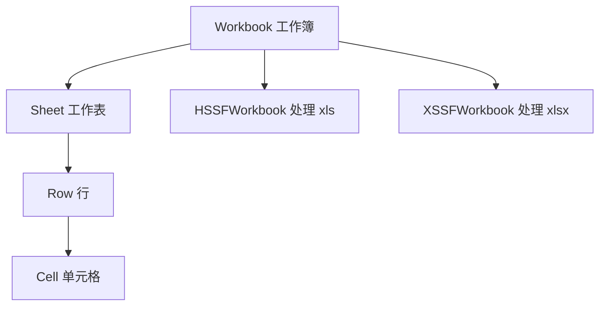

# Java 操作 Excel 选谁：Apache POI 的工作簿模型与读写基本概念

上一篇把报表需求拆成了导入和导出两个方向，方向说完就得回答工具问题：Java 代码凭什么读写 Excel 文件。可选的工具其实只有两个，JXL 和 Apache POI，而且这道选型题的答案相当一边倒。这一篇把 POI 是什么、它怎么看 Excel 文件、读写的基本套路讲清楚，为后面的实战打底。

## 先给结论

- Java 操作 Excel 有两个主流工具：JXL 和 Apache POI。JXL 只能操作 Excel、只支持到 2003 格式、早已停止更新维护；POI 是事实上的标准选择。
- POI 是 Apache 软件基金会的开源项目，能操作 Microsoft Office 全家桶：Excel、Word、PPT 都在射程内，2003 与 2007 两代格式同时支持，并且一直在更新。
- POI 把 Excel 抽象成四层对象模型：工作簿 Workbook、工作表 Sheet、行 Row、单元格 Cell，读写都围绕这四层展开。
- 两代格式对应两套实现：HSSF 处理 `.xls`，XSSF 处理 `.xlsx`，`org.apache.poi.ss` 包提供两者通用的接口。
- 三大典型应用场景：数据报表生成、数据备份导出、数据批量上传。

## 一、选型题：JXL 与 POI 只有一个答案

JXL 是一个老框架，特点三句话能说完：只能操作 Excel，格式上只支持到 2003，对 2007 的支持很弱，并且早就停止了更新和维护。项目一旦要用它处理 `.xlsx`，路就走不通了，更谈不上跟新版本的 Excel 生态兼容。

POI 的处境完全不同。它是 Apache 的开源项目，功能覆盖 Excel、Word、PPT 等一整个 Office 家族；格式上 2003 和 2007 全都支持；社区一直活跃，课程录制时官网 Project News 上挂着的最新版本是 POI 4.0.1，配套的 XMLBeans 3.0.2 同期发布，说明维护从未间断。

| | JXL | Apache POI |
|---|---|---|
| 支持范围 | 仅 Excel | Excel、Word、PPT 等 Office 系列文档 |
| 格式支持 | 仅 2003（xls） | 2003（xls）与 2007（xlsx） |
| 维护状态 | 停止更新维护 | Apache 项目持续发布新版本 |
| 结论 | 不建议新项目使用 | 操作 Excel 的首选 |

想操作 Excel，不用纠结，就是 POI。

## 二、POI 眼里的 Excel：四层对象模型

POI 并不把 Excel 当成一个黑盒文件，而是把它映射成一棵对象树。打开任何一个 Excel 文件，它的物理结构天然就是「一个文件里有多个工作表，每个工作表是由行组成的表格，每行由单元格组成」，POI 的模型与此一一对应：



**第一，Workbook 是入口。** 一个 Excel 文件对应一个 Workbook，读文件就是把文件流变成 Workbook 对象，写文件就是构建 Workbook 后输出。HSSF 和 XSSF 是它的两套实现：HSSF 背后是 2003 的二进制复合文档格式，XSSF 背后是 2007 的 XML 格式，两个类名分别对应 Horrible Spreadsheet Format 和 XML Spreadsheet Format 这两组缩写。

**第二，ss 包是通用层。** `org.apache.poi.ss.usermodel` 里定义了 Workbook、Sheet、Row、Cell 这些通用接口。代码里面向接口操作，具体用哪套实现取决于文件后缀，两代格式的差异被 POI 在这一层吸收掉了。课程后续的导出工具类同时引入了 `hssf.usermodel` 与 `xssf.usermodel` 两个包，两种实现都在真实代码里服役。

**第三，Cell 是数据的最小单元。** 一个单元格存一个值，POI 会区分它的类型：字符串、数字、日期、布尔、公式各有对应的取值方法。行列都从 0 开始计数，第一行是 `row 0`，第一列是 `cell 0`，这个约定贯穿所有读写代码。

## 三、依赖怎么引

课程工程里引入 POI 用的是三个坐标，本项目的写法直接来自资料包里的真实 pom：

```xml
<dependency>
    <groupId>org.apache.poi</groupId>
    <artifactId>poi</artifactId>
    <version>4.0.1</version>
</dependency>
<dependency>
    <groupId>org.apache.poi</groupId>
    <artifactId>poi-ooxml</artifactId>
    <version>4.0.1</version>
</dependency>
<dependency>
    <groupId>org.apache.poi</groupId>
    <artifactId>poi-ooxml-schemas</artifactId>
    <version>4.0.1</version>
</dependency>
```

`poi` 是核心包，HSSF 在这里；`poi-ooxml` 提供 2007 格式的 XSSF 实现，内部依赖 OOXML 的解析；`poi-ooxml-schemas` 是 XML 结构定义。版本对齐三件套要一起引，混用不同版本容易出现类找不到的运行期错误。

## 四、读与写的最小骨架

概念落成代码，写和读各有一个最小套路。下面的示例按本课的写法补全（完整工具类在下一篇起实战展开），先看生成一个 `.xlsx` 文件：

```java
import org.apache.poi.ss.usermodel.Cell;
import org.apache.poi.ss.usermodel.Row;
import org.apache.poi.ss.usermodel.Sheet;
import org.apache.poi.xssf.usermodel.XSSFWorkbook;

import java.io.FileOutputStream;

public class PoiWriteDemo {
    public static void main(String[] args) throws Exception {
        //1.创建工作簿（xlsx 用 XSSFWorkbook，xls 用 HSSFWorkbook）
        XSSFWorkbook workbook = new XSSFWorkbook();
        //2.创建工作表
        Sheet sheet = workbook.createSheet("员工信息");
        //3.创建第 0 行，再创建单元格写入数据
        Row row = sheet.createRow(0);
        Cell cell0 = row.createCell(0);
        cell0.setCellValue("姓名");
        Cell cell1 = row.createCell(1);
        cell1.setCellValue("部门");
        //4.工作簿写出到文件流
        try (FileOutputStream out = new FileOutputStream("员工信息.xlsx")) {
            workbook.write(out);
        }
        workbook.close();
    }
}
```

四步走完，一个合法的 xlsx 文件就生成了。读文件是同一个模型的反向操作：

```java
import org.apache.poi.ss.usermodel.Cell;
import org.apache.poi.ss.usermodel.Row;
import org.apache.poi.ss.usermodel.Sheet;
import org.apache.poi.ss.usermodel.Workbook;
import org.apache.poi.ss.usermodel.WorkbookFactory;

import java.io.FileInputStream;

public class PoiReadDemo {
    public static void main(String[] args) throws Exception {
        //1.由工厂按文件实际格式创建 Workbook，xls 与 xlsx 都能打开
        Workbook workbook = WorkbookFactory.create(new FileInputStream("员工信息.xlsx"));
        //2.取第 0 个工作表，遍历行与单元格
        Sheet sheet = workbook.getSheetAt(0);
        for (Row row : sheet) {
            for (Cell cell : row) {
                System.out.print(cell + "\t");
            }
            System.out.println();
        }
        workbook.close();
    }
}
```

读的方向建议面向 `ss` 包的通用接口：`WorkbookFactory.create` 会按文件的真实格式自动选择 HSSF 或 XSSF 实现，调用方不关心后缀，代码在两种格式间通用。这套四层模型就是后面批量导入、报表导出全部实战代码的地基。

## 常见误区

- **用 HSSFWorkbook 操作 `.xlsx`。** HSSF 只认 2003 的二进制格式，拿它打开 xlsx 直接抛异常。先看后缀再选实现，或者统一走 `WorkbookFactory` 与 `ss` 包通用接口。
- **新项目继续选 JXL。** JXL 停止维护且不支持 2007 格式，等于把 xlsx 这个主流格式排除在外。选型直接定 POI。
- **对单元格取值不分类型。** 数字单元格调用 `getStringCellValue()` 会抛异常，字符串单元格用 `getNumericCellValue()` 同样出问题。先通过 `getCellType()` 判断类型，再调对应的取值方法。
- **大数据量一次性加载。** 用户上传几十万行的 Excel，一口气读进内存很容易溢出。大文件要分批读取或使用流式模型，这是后续实战要专门处理的问题。

## 面试可能被问到的问题

1. 面试官追问：「JXL 和 POI 有什么区别，为什么选 POI？」
   答：JXL 只能操作 Excel 且只支持 2003 格式，已经停止更新维护；POI 是 Apache 开源项目，覆盖 Excel、Word、PPT 等 Office 文档，2003 与 2007 格式都支持并持续发布新版本。功能、格式覆盖和维护状态三方面 POI 都占优，所以操作 Excel 首选 POI。

2. 面试官追问：「POI 里 HSSF、XSSF、SXSSF 分别是什么？」
   答：HSSF 是处理 xls（2003 二进制格式）的实现；XSSF 是处理 xlsx（2007 XML 格式）的实现，全量加载进内存；SXSSF 是 XSSF 的流式扩展，只在内存保留固定窗口的行，写完即刷盘，专门用于大数据量导出避免内存溢出。

3. 面试官追问：「POI 除了 Excel 还能操作什么？」
   答：POI 是 Apache 的开源项目，目标是让 Java 操作 Microsoft Office 系列文档，除了 Excel 还能操作 Word（HWPF、XWPF）和 PPT（HSLF、XSLF），也能读写 Outlook 的消息文件等格式。

4. 面试官追问：「读取一个很大的 Excel 发生内存溢出，怎么办？」
   答：写场景换 SXSSF 流式写出；读场景可以分批处理，或改用基于 SAX 的事件模型按行解析，避免整本工作簿驻留内存；业务上再配合分 sheet、限制单次导入行数等手段控制单次数据规模。

5. 面试官追问：「POI 在业务系统里有哪些典型应用场景？」
   答：三类最典型：数据报表生成，把系统数据导出成 Excel 供下载存档；数据备份，把数据库数据定期导出归档；数据批量上传，用户按模板填好 Excel 上传，后台解析后批量入库，例如一次性导入上百名员工的信息。

## 配套资料

- POI 实战工具类（同时使用 HSSF 与 XSSF 的真实代码）：`materials/code/02/day08 POI高级/POI高级/资源/代码/工具类/ExcelExportUtil.java`、同目录 `ExcelImportUtil.java`、`ExcelAttribute.java`
- 课程工程引入 POI 的真实依赖坐标：`materials/code/02/day10-用户档案PDF报表/day10-用户档案PDF报表/代码/jasper-springboot/pom.xml`
- 报表导出数据载体：`materials/code/02/day07 员工管理及POI入门/员工管理及POI入门/资源/后端/实体类/employee/response/EmployeeReportResult.java`
- 本课为概述内容，无独立源码工程，读写示例为按本课写法补全的最小可运行示例
