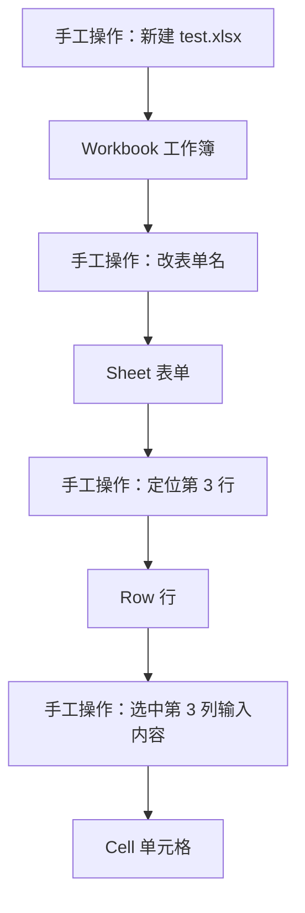
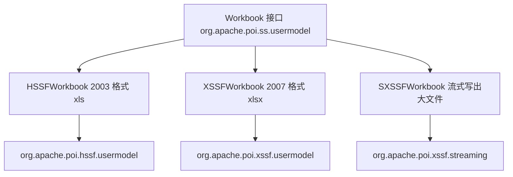

# 用 POI 生成第一个 Excel 文件：工作簿对象与文件输出流怎么接

概念篇说清了 POI 是什么，真正动手时会撞上两类新困惑：一是 `Workbook`、`Sheet`、`Row`、`Cell`、`Font`、`CellStyle` 这串名字背下来容易，写代码时不知道先建谁后建谁；二是工作簿在内存里建好了，怎么变成磁盘上的 `.xlsx` 文件。这一篇把第一段可运行的 POI 代码完整走一遍，重点回答「对象怎么建」和「流怎么接」两个问题。

## 先给结论

- 用 POI 操作 Excel，就是把手工操作 Excel 的每个动作翻译成对象：建文档对应 `Workbook`，建表单对应 `Sheet`，选行对应 `Row`，选格子对应 `Cell`。
- `Workbook` 是接口，HSSF 处理 2003 的 `.xls`，XSSF 处理 2007 的 `.xlsx`，课程案例统一用 XSSF。
- 依赖要引三件套：`poi`、`poi-ooxml`、`poi-ooxml-schemas`，版本必须对齐。
- 工作簿是内存对象，落盘靠 `FileOutputStream` 加 `wb.write(out)`，写完必须关流。
- 业务代码面向 `org.apache.poi.ss.usermodel` 下的通用接口写，实现类只出现在 `new` 的那一行。

## 一、手工建 Excel 的每一步，都对应一个 API

先做一遍手工操作：右键新建一个 `test.xlsx`，打开后把默认的表单改个名字，找到第 3 行第 3 列的格子，输入一句示例文本。这套动作拆开看是四个层次：文件、表单、行、格子。

POI 的 API 与这四个层次严格一一对应，PPT 上的基本操作清单如下：

| API 名称 | 含义 |
|---|---|
| `Workbook` | Excel 的文档对象，2003 用 `HSSFWorkbook`，2007 用 `XSSFWorkbook` |
| `Sheet` | Excel 的表单，也就是打开文件后看到的那一页 |
| `Row` | Excel 的行 |
| `Cell` | Excel 的格子单元 |
| `Font` | Excel 字体 |
| `CellStyle` | 格子单元样式 |



这张图讲的是手工动作与 API 的映射关系。顺着这条链走，`Font` 与 `CellStyle` 挂在 `Cell` 上，负责格子的字体与样式；后续所有的写操作，都是把这条链按代码再走一遍。

## 二、搭环境：一个空工程、一个模块、三个坐标

课程的做法是新建一个空工程 `poi-test`，在里面单独建一个模块 `poi-demo` 专门练 POI，包名统一为 `com.example.poi.test`。依赖用讲义里给出的三个坐标，版本 4.0.1：

```xml
<dependencies>
    <!-- POI 核心包，含 2003 格式的 HSSF 实现 -->
    <dependency>
        <groupId>org.apache.poi</groupId>
        <artifactId>poi</artifactId>
        <version>4.0.1</version>
    </dependency>
    <!-- 2007 格式的 XSSF 实现，2007 底层是 XML 结构 -->
    <dependency>
        <groupId>org.apache.poi</groupId>
        <artifactId>poi-ooxml</artifactId>
        <version>4.0.1</version>
    </dependency>
    <!-- 2007 格式对应的 XML 结构定义 -->
    <dependency>
        <groupId>org.apache.poi</groupId>
        <artifactId>poi-ooxml-schemas</artifactId>
        <version>4.0.1</version>
    </dependency>
</dependencies>
```

为什么要三个？`poi` 是核心坐标，基础 API 和 HSSF 都在这里；现在主流的 2007 格式基于 XML 组织，XSSF 实现及其依赖的 XML 结构分别放在 `poi-ooxml` 与 `poi-ooxml-schemas` 里。课程案例全部按 2007 格式来写，所以三件套一起引，并且版本必须完全一致，混用版本是运行期 `ClassNotFoundException` 的常见来源。

## 三、Workbook 是接口：HSSF、XSSF、SXSSF 怎么选

点进 POI 源码能看到 `Workbook` 的真实定义：

```java
package org.apache.poi.ss.usermodel;

public interface Workbook extends Closeable, Iterable<Sheet> {
    int PICTURE_TYPE_JPEG = 5;
    int PICTURE_TYPE_PNG = 7;
    // 省略大量 sheet 与图片相关的方法声明
    int getActiveSheetIndex();
    void setActiveSheet(int var1);
    void setSheetName(int var1, String var2);
}
```

它是个接口，继承自 `Closeable`，所以工作簿本身就可以被关闭；接口里还预定义了 `PICTURE_TYPE_JPEG`、`PICTURE_TYPE_PNG` 这类图片类型常量，后面往 Excel 里插图片时会用到。`Workbook` 的实现类主要有三个：



这张图讲的是接口与三套实现的对应关系，选型口诀是看文件格式：`.xls` 找 HSSF，`.xlsx` 找 XSSF，数据量大到怕内存溢出时再考虑流式的 SXSSF。命名规律也有讲究，凡是以 `HSSF` 开头的都在 `hssf.usermodel` 包里处理老格式，以 `XSSF` 开头的在 `xssf.usermodel` 包里处理新格式。课程案例统一 `new XSSFWorkbook()`，业务代码里的变量类型则写接口 `Workbook`，这样格式切换时只改一个词。

## 四、最小可运行例子：四步生成一个 xlsx

思路与手工操作完全同构：创建工作簿，创建表单，接上文件流，写出去。完整代码如下：

```java
package com.example.poi.test;

import org.apache.poi.ss.usermodel.Sheet;
import org.apache.poi.ss.usermodel.Workbook;
import org.apache.poi.xssf.usermodel.XSSFWorkbook;

import java.io.FileOutputStream;

/**
 * 使用 POI 创建 Excel
 */
public class PoiTest01 {
    public static void main(String[] args) throws Exception {
        //1.创建工作簿
        Workbook wb = new XSSFWorkbook(); //2007 版本
        //2.创建表单 sheet
        Sheet sheet = wb.createSheet("test");
        //3.文件流
        FileOutputStream fos = new FileOutputStream("E:\\excel\\poi\\test.xlsx");
        //4.写入文件
        wb.write(fos);
        //5.关闭流
        fos.close();
    }
}
```


这张图讲的是从内存对象到磁盘文件的完整链路。有两处值得展开：

**第一，写文件必须用输出流。** 现场写这段代码时特意演示了一个反例：把第 3 步写成 `FileInputStream`，程序要么直接抛 `FileNotFoundException`，要么生成一个空文件。方向反了，`FileInputStream` 是「读」的流，把内存里的工作簿写到磁盘，必须接 `FileOutputStream`。变量名也别照抄 `fis` 这种输入流习惯命名，用 `fos` 更不容易误导自己。

**第二，`close` 不能省。** `wb.write` 把数据交给流之后，缓冲区里可能还有没刷出去的内容，不关流有可能拿到一个 0 字节或者打不开的残缺文件。跑完这段代码，磁盘上会多出一个 4 KB 左右的 `test.xlsx`，打开后能看到一个名为 `test` 的空白工作表，第一步就算打通了。

## 常见误区

- **写文件用成 `FileInputStream`。** 输入流用来读，输出流用来写，方向接反会直接抛 `FileNotFoundException`，或者产出空文件。写 Excel 认准 `FileOutputStream`。
- **只 `write` 不 `close`。** 数据可能还留在缓冲区里没落盘，得到 0 字节或损坏的文件。`write` 之后立刻关流，或者用 try-with-resources 托管。
- **实现类与后缀不匹配。** 用 `HSSFWorkbook` 生成 `.xlsx`，或者用 `XSSFWorkbook` 生成 `.xls`，文件打开时格式告警甚至打不开。选实现的唯一依据是目标文件的真实格式。
- **只引了 `poi` 核心包就 `new XSSFWorkbook()`。** XSSF 的实现在 `poi-ooxml` 里，缺依赖编译期或运行期直接找不到类。三件套一起引、版本对齐。

## 面试可能被问到的问题

1. 面试官追问：「Workbook、Sheet、Row、Cell 分别对应 Excel 的什么？」
   答：`Workbook` 是整个 Excel 文档对象，一个文件对应一个工作簿；`Sheet` 是文件里的表单页；`Row` 是表单里的一行；`Cell` 是行里的一个单元格。四层是从文件到格子的包含关系，读写操作都按这个层次逐级往下定位。

2. 面试官追问：「HSSF 和 XSSF 有什么区别？」
   答：HSSF 是处理 2003 版 `.xls` 二进制格式的实现，全称 Horrible Spreadsheet Format；XSSF 是处理 2007 版 `.xlsx` 格式的实现，2007 底层是一组 XML 结构。两者都实现了 `ss.usermodel` 包下的通用 `Workbook` 接口，业务代码面向接口写，换格式只换 `new` 的实现类。

3. 面试官追问：「POI 生成的 Excel 怎么保存到磁盘？」
   答：构建好 `Workbook` 后创建一个指向目标路径的 `FileOutputStream`，调用 `wb.write(outputStream)` 把工作簿内容序列化写出，最后关闭流释放资源。注意必须是输出流，用输入流会报文件找不到。

4. 面试官追问：「引入 POI 依赖要注意什么？」
   答：核心包 `poi` 提供 API 与 HSSF，`poi-ooxml` 与 `poi-ooxml-schemas` 提供 2007 格式的 XSSF 支持及其 XML 结构定义，操作 xlsx 必须三件套一起引入，且版本号保持一致，混用版本容易出现类缺失或方法签名不兼容的运行期错误。

5. 面试官追问：「Workbook 接口为什么继承 Closeable？实际开发里怎么用？」
   答：说明工作簿是持有资源的对象，用完应当关闭。读取场景下关闭工作簿会释放文件句柄与内存，写出场景下要确保输出流被关闭刷盘。生产代码推荐 try-with-resources 管理流和工作簿的生命周期，避免异常路径上泄漏句柄。

## 配套资料

- 依赖三件套坐标来自课程讲义配置，完整坐标已在上面的正文给出；示例工程 `poi-demo` 无独立源码包，示例为按本课写法补全
- 真实工程中 `XSSFWorkbook` 的使用（模板导出）：`materials/code/02/day08 POI高级/POI高级/资源/代码/工具类/ExcelExportUtil.java`
- 真实工程同时引入 HSSF 与 XSSF 的 import 列表：`materials/code/02/day07 员工管理及POI入门/员工管理及POI入门/资源/后端/ihrm_employee/src/main/java/com/ihrm/employee/controller/EmployeeController.java`
- 工作簿写出到响应流的真实写法：`materials/code/02/day08 POI高级/POI高级/资源/工具类/DownloadUtils.java`
