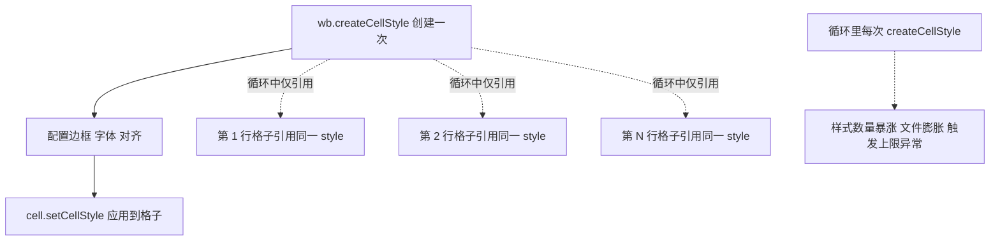

# 让导出的 Excel 像张报表：POI 单元格样式的设置门道

数据能写进格子之后，交付给业务的报表还有一道门槛：边框、字体、列宽、行高、居中，这些在 Excel 里点几下鼠标的事，到了代码里每一样都要显式设置，而且各自挂在不同的对象上。这一篇把单元格样式的完整设置走一遍，顺带说清一个生产级问题：为什么样式对象必须复用，不能在循环里新建。

## 先给结论

- 样式和字体的创建入口都是工作簿：`wb.createCellStyle()`、`wb.createFont()`，POI 的规律是需要什么对象就找工作簿创建。
- 边框用 `BorderStyle` 枚举，上下左右四个方向各设置一次；字体先建 `Font` 对象再挂到样式上。
- 行高挂在 `Row` 上，列宽挂在 `Sheet` 上，列宽的单位是 1/256 个字符宽度，设 31 个字符要传 `31 * 256`。
- 样式建好后必须调用 `cell.setCellStyle(style)` 应用到格子，少这一步文件里不会有任何样式。
- 样式对象是工作簿级资源，必须创建一次反复引用；xlsx 格式对样式总数有上限，循环里新建会撑爆样式表。

## 一、样式对象从哪来：都由工作簿创建

目标效果是一张带格式的报表：目标格子有四边细边框，字体是华文行楷 28 号，行高 50、列宽约 31 个字符，内容水平垂直居中。拆成代码前先明确归属：边框、对齐属于样式，字体是独立对象，行高属于行，列宽属于表单。

```java
//创建样式对象，由工作簿创建
CellStyle style = wb.createCellStyle();
//创建字体对象，同样由工作簿创建
Font font = wb.createFont();
```

这里有个贯穿 POI 的规律：**需要什么对象，就找工作簿 create**。工作簿是整个文档的「总装车间」，样式、字体、表单都从它这里生产出来，因为它们最终都要登记进文档的内部结构里。样式先拿到手，边框、字体、对齐都在它身上配置。

## 二、边框与字体：枚举选型加一个挂载动作

边框是样式的一部分，POI 把线的粗细样式做成了 `BorderStyle` 枚举，源码里能看到全部选项：

```java
package org.apache.poi.ss.usermodel;

public enum BorderStyle {
    NONE(0), THIN(1), MEDIUM(2), DASHED(3), DOTTED(4),
    THICK(5), DOUBLE(6), HAIR(7), MEDIUM_DASHED(8),
    DASH_DOT(9), MEDIUM_DASH_DOT(10), DASH_DOT_DOT(11),
    MEDIUM_DASH_DOT_DOT(12), SLANTED_DASH_DOT(13);
    // 省略 code 字段与取值方法
}
```

`THIN` 是细线，报表里最常用；想要虚线、双线、粗线各自有对应的枚举值，逐个换着试就行。四个方向各调一个方法：

```java
//设置四边边框，统一用细线
style.setBorderTop(BorderStyle.THIN);    //上边框
style.setBorderBottom(BorderStyle.THIN); //下边框
style.setBorderLeft(BorderStyle.THIN);   //左边框
style.setBorderRight(BorderStyle.THIN);  //右边框
```

字体的套路是「先建对象、配置属性、挂回样式」三步：

```java
//创建并配置字体
Font font = wb.createFont();
font.setFontName("华文行楷");            //字体名称
font.setFontHeightInPoints((short)28);   //字号，参数是 short 类型
//字体挂到样式上
style.setFont(font);
```

注意 `setFontHeightInPoints` 收的是 `short`，传字面量时要显式转型，这是编译器会直接提醒的小坑。字体对象配置完必须 `style.setFont(font)`，只建字体不挂载，样式里不会有它。

## 三、行高、列宽与对齐：三个属性挂三个对象

这三样最容易搞混归属，因为它们不在同一个层级上：

```java
//行高：挂在行对象上，单位是磅
row.setHeightInPoints(50);
//列宽：挂在表单上，单位是 1/256 个字符宽度
sheet.setColumnWidth(2, 31 * 256);
//对齐：属于样式
style.setAlignment(HorizontalAlignment.CENTER);         //水平居中
style.setVerticalAlignment(VerticalAlignment.CENTER);   //垂直居中
```

**列宽为什么乘 256？** 点进 `setColumnWidth` 的源码能看到，方法内部会把传入值除以 256，也就是 POI 以「1/256 个字符宽度」为最小刻度存储列宽。想得到 31 个字符的宽度，就传 `31 * 256`，一乘一除正好还原。直接传 31，实际列宽只有约 0.12 个字符，屏幕上就是一条缝。

还有一个课堂现场验证过的细节：代码设 31 个字符，打开文件后 Excel 状态栏显示的列宽却是 30.38。原因是 Excel 界面按像素换算显示，POI 按字符宽度存储，两套刻度基准不同，数值对不上但差异稳定，不是 bug。

**对齐是样式属性**，`setAlignment` 管水平方向、`setVerticalAlignment` 管垂直方向，参数都是枚举：`CENTER` 居中，还有 `LEFT`、`RIGHT` 等可选值。

把前面的步骤串起来，完整的样式处理代码如下：

```java
package com.example.poi.test;

import org.apache.poi.ss.usermodel.*;
import org.apache.poi.xssf.usermodel.XSSFWorkbook;

import java.io.FileOutputStream;

/**
 * 单元格样式处理
 */
public class PoiTest03 {
    public static void main(String[] args) throws Exception {
        //1.创建工作簿与表单
        Workbook wb = new XSSFWorkbook(); //2007 版本
        Sheet sheet = wb.createSheet("test");
        //2.创建行与单元格并写入内容
        Row row = sheet.createRow(2);          //第 3 行
        Cell cell = row.createCell(2);         //第 3 列
        cell.setCellValue("Hello POI");
        //3.创建样式对象并设置边框
        CellStyle style = wb.createCellStyle();
        style.setBorderTop(BorderStyle.THIN);
        style.setBorderBottom(BorderStyle.THIN);
        style.setBorderLeft(BorderStyle.THIN);
        style.setBorderRight(BorderStyle.THIN);
        //4.创建字体并挂到样式
        Font font = wb.createFont();
        font.setFontName("华文行楷");
        font.setFontHeightInPoints((short)28);
        style.setFont(font);
        //5.设置对齐
        style.setAlignment(HorizontalAlignment.CENTER);
        style.setVerticalAlignment(VerticalAlignment.CENTER);
        //6.行高与列宽
        row.setHeightInPoints(50);
        sheet.setColumnWidth(2, 31 * 256);
        //7.把样式应用到单元格
        cell.setCellStyle(style);
        //8.写出文件
        FileOutputStream fos = new FileOutputStream("E:\\excel\\poi\\test2.xlsx");
        wb.write(fos);
        fos.close();
    }
}
```

## 四、样式必须应用到格子，而且要省着用

课堂演示时正好踩出了一个经典疏漏：样式对象配置得整整齐齐，生成的文件却只有行高和列宽变了，边框和字体毫无踪影。原因就是漏了 `cell.setCellStyle(style)` 这一步。样式配置完后只是躺在工作簿里的一份「方案」，不主动应用到格子，它就什么都没发生。

应用这一步解决「有没有」，复用解决「好不好」：



这张图对比的是正确姿势与错误姿势的分野：样式应该在循环外创建一次，循环体内每个格子只做引用。原因有两层。第一，样式属于工作簿级资源，xlsx 格式对单个工作簿的样式总数有硬上限（六万多个），导几万行数据每格新建一个样式，会直接抛出超过样式上限的异常，文件体积也会暴涨。第二，相同的视觉效果用同一个对象表达，读取和维护都更清晰。

课程资料包里的真实导出工具类就是标准做法：先把模板行每一列的样式取出来放进数组，循环写数据时按列号直接引用：

```java
//真实代码：把模板行的样式一次性取出，循环里复用
public CellStyle[] getTemplateStyles(Row row) {
    CellStyle[] styles = new CellStyle[row.getLastCellNum()];
    for (int i = 0; i < row.getLastCellNum(); i++) {
        styles[i] = row.getCell(i).getCellStyle();
    }
    return styles;
}

//写数据行时按列复用样式
for (int i = 0; i < styles.length; i++) {
    Cell cell = row.createCell(i);
    cell.setCellStyle(styles[i]);
    //省略：按注解匹配字段并写入值
}
```

样式数组在进入循环前构建完毕，一万个数据行共享这组 `CellStyle` 对象，样式数量恒定，这就是「创建一次、处处引用」的落地形态。

## 常见误区

- **建了样式忘了 `setCellStyle`。** 配置再完整也不会生效，文件里只有行高列宽这类不依赖样式的设置。样式配置完必须逐格应用。
- **在循环里 `createCellStyle`。** 每个格子一个样式对象，几万行数据直接触发 xlsx 样式上限异常，文件也异常膨胀。样式循环外建一次，循环内只引用。
- **列宽直接传界面上的数值。** `setColumnWidth(2, 31)` 得到一条缝，因为内部单位是 1/256 字符宽度，要传 `31 * 256`。
- **行高列宽挂错对象。** 行高是 `Row` 的 `setHeightInPoints`，列宽是 `Sheet` 的 `setColumnWidth`，`Cell` 上没有这两样，因为它们分别描述一行和一列，不是单个格子的属性。

## 面试可能被问到的问题

1. 面试官追问：「POI 的 CellStyle 由谁创建，为什么？」
   答：由 `Workbook` 的 `createCellStyle` 创建。样式是文档级资源，最终要登记进工作簿的样式表里，所以不能脱离工作簿单独构造，字体、表单等对象同理，都从工作簿生产。

2. 面试官追问：「setColumnWidth 传 31 为什么得不到 31 个字符的列宽？」
   答：该方法内部把传入值除以 256，存储单位是 1/256 个字符宽度，所以要传 `31 * 256`。另外 Excel 界面按像素换算显示，与代码设置的字符宽度存在稳定的数值差异，属正常现象。

3. 面试官追问：「循环导出大量数据时样式应该怎么处理？」
   答：在循环外创建少量 CellStyle 对象，循环内通过 `cell.setCellStyle` 复用引用，或者像模板导出那样先把模板行样式取成数组再按列引用。xlsx 对工作簿样式总数有上限，逐格新建会抛超过上限的异常并使文件膨胀。

4. 面试官追问：「边框、字体、对齐、行高、列宽分别设置在什么对象上？」
   答：边框和对齐属于 `CellStyle`；字体是独立的 `Font` 对象，配置后挂到样式上；行高属于 `Row`，用 `setHeightInPoints`；列宽属于 `Sheet`，用 `setColumnWidth`。按属性描述的范围决定归属对象。

5. 面试官追问：「生成的 Excel 只有部分样式生效，怎么排查？」
   答：先检查是否调用了 `cell.setCellStyle`，这是最常见的漏项；再确认字体对象是否 `style.setFont` 挂载；然后核对行高列宽的调用对象是否正确；最后看是否存在重复 `createRow` 覆盖了已设置样式的行。

## 配套资料

- 样式复用的真实实现（`getTemplateStyles` 取模板行样式、循环内引用）：`materials/code/02/day08 POI高级/POI高级/资源/代码/工具类/ExcelExportUtil.java`
- 样式注解与实体结合的数据载体：`materials/code/02/day08 POI高级/POI高级/资源/代码/工具类/ExcelAttribute.java`
- 本课示例工程无独立源码包，完整样式示例为按本课写法补全
