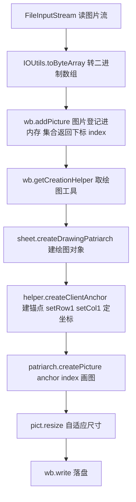
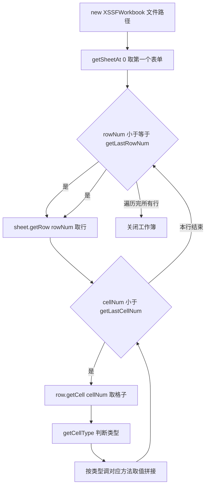

# 往表里画图、把表读回来：POI 图形绘制与 Excel 解析的完整闭环

写入方向的最后一块拼图是图形：把公司的 logo 贴到报表左上角，这类需求 POI 一样能做。而读方向是导入功能的起点：用户上传一份填好的 Excel，代码要把它逐行逐格解析成业务数据。这一篇把「画图形」与「读 Excel」合在一起讲，读方向占了更大的篇幅，因为它的坑比写方向多得多，尤其是行尾列尾两个 API 的不对称和单元格类型判断。

## 先给结论

- 插图五步接力：读图片流转字节数组、`addPicture` 入库拿到下标、建绘图对象、建锚点定坐标、`createPicture` 画图后 `resize` 自适应。
- POI 把图片集中登记在内存里，`addPicture` 返回的下标就是后续画图时的钥匙。
- 读 Excel 三步：按文件格式创建工作簿、`getSheetAt(0)` 取表单、双层循环遍历行与格子。
- 取值前必须用 `getCellType()` 判断类型再调对应方法；日期在 Excel 里就是数字，要靠 `DateUtil.isCellDateFormatted` 识别。
- `getLastRowNum()` 返回最后一行的索引，`getLastCellNum()` 返回格子的数量，前者配 `<=` 后者配 `<`，弄反必丢数据。

## 一、把图片画进 Excel：五个对象接力

插图与写数据不同：数据写在格子里，图片浮在表格之上，需要坐标定位。整条链路是五个对象接力完成：

```java
package com.example.poi.test;

import org.apache.poi.ss.usermodel.*;
import org.apache.poi.util.IOUtils;
import org.apache.poi.xssf.usermodel.XSSFWorkbook;

import java.io.FileInputStream;
import java.io.FileOutputStream;

/**
 * 使用 POI 向 Excel 插入图片
 */
public class PoiTest04 {
    public static void main(String[] args) throws Exception {
        //1.创建工作簿与表单
        Workbook wb = new XSSFWorkbook();
        Sheet sheet = wb.createSheet("test");
        //2.读取图片流
        FileInputStream stream = new FileInputStream("E:\\excel\\poi\\logo.jpg");
        //3.转化为二进制数组
        byte[] bytes = IOUtils.toByteArray(stream);
        //4.向 POI 内存中添加图片，返回图片在图片集合中的下标
        int index = wb.addPicture(bytes, Workbook.PICTURE_TYPE_JPEG);
        //5.获取绘图工具类
        CreationHelper helper = wb.getCreationHelper();
        //6.创建绘图对象
        Drawing<?> patriarch = sheet.createDrawingPatriarch();
        //7.创建锚点，设置图片坐标，从第 0 行第 0 列开始
        ClientAnchor anchor = helper.createClientAnchor();
        anchor.setRow1(0);
        anchor.setCol1(0);
        //8.绘制图片并自适应渲染
        Picture pict = patriarch.createPicture(anchor, index);
        pict.resize();
        //9.写出文件
        FileOutputStream fos = new FileOutputStream("E:\\excel\\poi\\test3.xlsx");
        wb.write(fos);
        fos.close();
        stream.close();
    }
}
```



这张图讲的是从磁盘图片到 Excel 内嵌图片的完整路径。几个关键点展开：

**图片库与下标。** POI 把所有图片集中管理在一个内存集合里，`addPicture` 负责登记：参数一是图片的二进制数组，参数二是图片类型常量（`PICTURE_TYPE_JPEG`、`PICTURE_TYPE_PNG` 等，就定义在 `Workbook` 接口上）。登记成功返回这张图片在集合中的下标。哪怕后面要画十张图，也是先全部登记、拿十个下标，画的时候按下标取用，图片的二进制内容只存一份。

**锚点是图片的坐标。** `ClientAnchor` 描述图片挂在表格的哪个位置，`setRow1`、`setCol1` 设定左上角落在第几行第几列，同样从 0 起；课程里设的是 0、0，图片就从 A1 单元格开始绘制。锚点还有对角点等更细的属性可以控制拉伸范围，入门阶段设左上角就够用。

**绘图对象是画画的画布。** `createDrawingPatriarch` 在表单上建立绘图层，`createPicture(anchor, index)` 才是真正落笔：位置由锚点决定，内容由下标对应的图片决定。画完后 `resize()` 让图片按原始尺寸自适应渲染，不调用的话尺寸可能塌陷。顺带一提，绘图对象这个家族还能创建批注，套路同样是锚点定位，这里不再展开。

**现场翻过的车。** 跑这段代码时抛过一次 `FileNotFoundException`，提示「另一个程序正在使用此文件，进程无法访问」。原因是上一个生成出来的 `test` 文件还开着 Excel，文件句柄被占用，POI 无法覆盖写出。写代码前把相关 Excel 窗口关掉即可。

## 二、加载与解析：把一份现成的 Excel 读回内存

读的方向与写完全对称：写是创建对象再落盘，读是从文件反推出对象树。以一份 `demo.xlsx` 为例，内容是序号、姓名、年龄、家庭住址、出生日期几列的人员数据。解析分三步：

```java
//1.根据 excel 文件创建工作簿，2007 格式用 XSSF，2003 格式换 HSSF
Workbook wb = new XSSFWorkbook("E:\\excel\\poi\\demo.xlsx");
//2.获取第一个 Sheet，参数是索引，从 0 开始
Sheet sheet = wb.getSheetAt(0);
//3.获取 sheet 中的每一行和每一个单元格
for (int rowNum = 0; rowNum < sheet.getLastRowNum(); rowNum++) {
    Row row = sheet.getRow(rowNum); //根据索引获取某一行
    StringBuilder sb = new StringBuilder();
    for (int cellNum = 0; cellNum < row.getLastCellNum(); cellNum++) {
        Cell cell = row.getCell(cellNum); //根据索引获取单元格
        Object value = getCellValue(cell); //按类型取值，见下一节
        sb.append(value).append(" ");
    }
    System.out.println(sb.toString());
}
```

创建工作簿的构造方法直接收文件路径，也可以收输入流；用哪种实现只取决于文件的真实格式，测试文件是 2007 就用 `XSSFWorkbook`，是 2003 就换 `HSSFWorkbook`，代码结构不变。`getSheetAt(0)` 取第一个表单，一个工作簿可能有很多页，页的索引从 0 起。外层循环按行取 `Row`，内层循环按列取 `Cell`，取到格子后统一走一个「按类型取值」的方法，把结果拼成一行打印。



这张图讲的是双层循环与取值的控制流。行是外层、列是内层，每个格子都要经过类型判断才能取值。图里行循环的条件特意写成了「小于等于」，原因正是下一节的主角。

## 三、按类型取值：CellType 分支与日期的伪装

写入时一个 `setCellValue` 通吃，读取时却必须分类型，这是读方向最麻烦的地方。Excel 格子里的数据类型由 `CellType` 枚举描述，常见值有 `STRING`、`NUMERIC`、`BOOLEAN`、`FORMULA`、`BLANK`、`ERROR` 等。不同类型的取值方法完全不同，字符串用 `getRichStringCellValue`，布尔用 `getBooleanCellValue`，数字用 `getNumericCellValue`，调错了直接抛异常。

`getCellValue` 方法的完整实现：

```java
/**
 * 按单元格类型取值
 */
public static Object getCellValue(Cell cell) {
    Object value = null;
    CellType cellType = cell.getCellType(); //先拿类型
    switch (cellType) {
        case STRING:
            value = cell.getRichStringCellValue().getString(); //字符串
            break;
        case BOOLEAN:
            value = cell.getBooleanCellValue(); //布尔
            break;
        case NUMERIC:
            //数字类型里藏着日期，先用工具类判断格式
            if (DateUtil.isCellDateFormatted(cell)) {
                value = cell.getDateCellValue();    //是日期格式，取 Date
            } else {
                value = cell.getNumericCellValue(); //纯数字，取 double
            }
            break;
        case FORMULA:
            value = cell.getCellFormula(); //公式单元格，取公式本身
            break;
        default:
            break; //空格子与其他类型不处理
    }
    return value;
}
```

**日期的伪装是这段代码的核心知识点。** Excel 里没有独立的日期类型，日期一律以数字存储，再由单元格格式标记它是日期。所以 `NUMERIC` 分支里必须先调 `DateUtil.isCellDateFormatted(cell)` 问一句「这个数字是不是按日期格式化的」：是就走 `getDateCellValue` 拿到 `Date` 对象，不是就是真数字，走 `getNumericCellValue`。跳过这一步，所有日期都会变成一串奇怪的数字。

**数字拿回来永远是 double。** 格子里写的是 1，`getNumericCellValue` 返回的是 `1.0`，课堂演示打印出的第一列正是 `1.0`。真实工具类里的处理办法值得照抄：

```java
//真实代码：处理数字，防止科学计数法并去掉 .0
Double num = cell.getNumericCellValue();
BigDecimal bd = new BigDecimal(num.toString());
String strCell = bd.toPlainString();      //按普通数字字符串输出
if (strCell.endsWith(".0")) {             //整数被 double 带出的 .0 截掉
    strCell = strCell.substring(0, strCell.indexOf("."));
}
return strCell;
```

`BigDecimal.toPlainString` 保证不出现科学计数法，再手动截掉尾部 `.0`，`1.0` 就还原成了 `1`。日期场景则用 `DateUtil.getJavaDate` 把数字直接转成 `Date` 后格式化输出。这一段就是课程工具类 `getValue` 方法的主体，生产代码可以直接参考。

## 四、getLastRowNum 与 getLastCellNum：一对名字像、行为反的 API

课堂演示时出现了最经典的事故：`demo.xlsx` 里有表头加四条数据，程序却只打印出三条，最后一条「赵六」凭空消失。排查的结论是两个 API 的语义不对称：

| API | 返回值含义 | 循环写法 |
|---|---|---|
| `sheet.getLastRowNum()` | 最后一行的**索引**（从 0 起） | `rowNum <= sheet.getLastRowNum()` |
| `row.getLastCellNum()` | 单元格的**数量**（等于列数） | `cellNum < row.getLastCellNum()` |

五个数据行的索引是 0 到 4，`getLastRowNum()` 返回 4；循环条件写成 `rowNum < 4` 就只遍历 0、1、2、3，最后一行被跳过，这正是三条数据的原因，改成 `<=` 即可补全。列的方向恰好相反：`getLastCellNum()` 返回的不是索引而是数量，五个格子返回 5，用 `<` 正好遍历 0 到 4，多写 `<=` 反而会越界。两个方法都叫 last，一个是「最后一行的编号」，一个是「一共有几个格子」，记忆口诀是：行给索引配 `<=`，列给数量配 `<`。

课程资料包里的真实导入工具类，循环条件就是按这个规则写的，可以直接当范本：

```java
//真实代码：行的循环用 <=，列的循环用 <
for (int rowNum = rowIndex; rowNum <= sheet.getLastRowNum(); rowNum++) {
    Row row = sheet.getRow(rowNum);
    for (int j = cellIndex; j < row.getLastCellNum(); j++) {
        Cell cell = row.getCell(j);
        //按注解匹配字段并做类型转换后写入实体
    }
}
```

## 常见误区

- **目标文件被 Excel 打开着还要写。** 抛「另一个程序正在使用此文件」的 `FileNotFoundException`，句柄被占用时 POI 无法覆盖。写出前关闭占用该文件的 Excel 窗口。
- **行循环写成 `rowNum < getLastRowNum()`。** 最后一行永远读不到，导入少一条数据的 bug 通常就出在这里。行的终点是索引，用 `<=`。
- **对数字格子直接当字符串取。** `NUMERIC` 类型调用字符串取值方法抛异常；正确做法是先 `getCellType` 判断，再分派到对应方法。数字结果的 `1.0` 与科学计数法问题用 `BigDecimal.toPlainString` 处理。
- **忘了日期藏在数字类型里。** 不做 `DateUtil.isCellDateFormatted` 判断，出生日期这类字段会输出成一串数字。数字分支内必须先判断日期格式。
- **读 2003 文件用 XSSF。** 工作簿实现必须匹配文件真实格式，`.xls` 用 `HSSFWorkbook`，`.xlsx` 用 `XSSFWorkbook`，或者统一交给 `WorkbookFactory` 自动识别。

## 面试可能被问到的问题

1. 面试官追问：「往 Excel 插图片时 addPicture 为什么返回一个下标？」
   答：POI 把图片集中管理在工作簿的图片集合里，二进制内容只登记一份，返回值是它在集合中的下标。后续绘制通过绘图对象加锚点引用这个下标，多张图片复用同一段数据也不会重复存储。

2. 面试官追问：「ClientAnchor 锚点是什么，怎么用？」
   答：锚点描述绘图元素在表单上的位置，`setRow1`、`setCol1` 设定左上角落在的行列，索引从 0 开始。插入图片时把锚点和图片下标一起交给 `createPicture`；同一个锚点机制也用于批注等绘图元素。

3. 面试官追问：「getLastRowNum 和 getLastCellNum 有什么区别？」
   答：`getLastRowNum()` 返回最后一行的索引，从 0 起，所以行循环要用 `<=` 才能覆盖末行；`getLastCellNum()` 返回的是单元格数量，等于列数，列循环用 `<`。两者一个给索引一个给数量，语义相反，混用必然丢行或越界。

4. 面试官追问：「Excel 的日期为什么读出来是数字？」
   答：Excel 内部没有独立日期类型，日期以数字（距基准日期的天数偏移）存储，靠单元格格式标记为日期。POI 读取时先调 `DateUtil.isCellDateFormatted` 判断格式，是日期就 `getDateCellValue` 转成 `Date`，否则按数字取 `getNumericCellValue`。

5. 面试官追问：「解析 Excel 时数字列出现 1.0 或科学计数法，怎么处理？」
   答：`getNumericCellValue` 统一返回 double，整数会带 `.0`，大数会走科学计数法。常规做法是用 `new BigDecimal(num.toString()).toPlainString()` 得到普通数字字符串，再判断结尾 `.0` 截掉，还原成用户录入的原始形态。

6. 面试官追问：「解析用户上传的 Excel，如何做到 xls 和 xlsx 都支持？」
   答：可以按后缀分别 `new HSSFWorkbook` 与 `new XSSFWorkbook`，更稳妥的是用 `WorkbookFactory.create(inputStream)`，它按文件实际格式自动选择实现，上层代码全部面向 `ss.usermodel` 通用接口，两种格式一套逻辑。

## 配套资料

- 解析与类型转换的真实实现（`readExcel` 循环边界、`getValue` 类型分支、日期与 `BigDecimal` 处理）：`materials/code/02/day08 POI高级/POI高级/资源/代码/工具类/ExcelImportUtil.java`
- 类型转换依赖的列注解：`materials/code/02/day08 POI高级/POI高级/资源/代码/工具类/ExcelAttribute.java`
- 导入功能的业务入口（员工导入接口）：`materials/code/02/day07 员工管理及POI入门/员工管理及POI入门/资源/后端/ihrm_employee/src/main/java/com/ihrm/employee/controller/EmployeeController.java`
- 本课插图示例无独立源码包，插入图片示例为按本课写法补全
