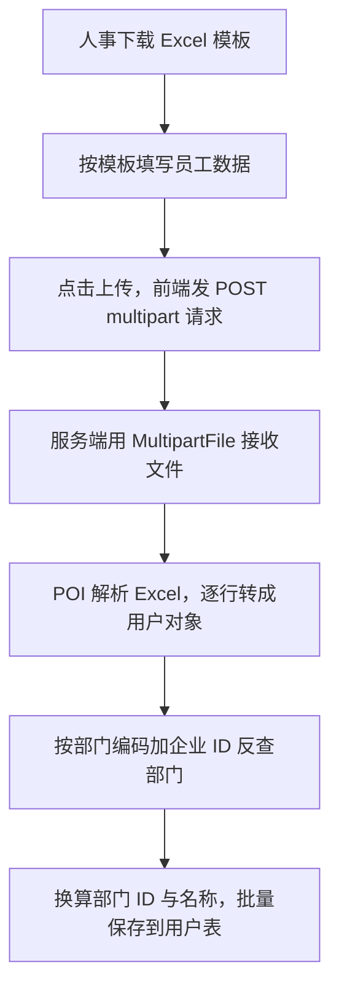

# 员工批量导入的需求拆解：Excel 模板怎么定、上传接口怎么接

人事要在系统里录入员工信息，一条一条填表单没问题，可公司动辄上百人，页面上一项一项点保存就是不现实的事。POI 生成与解析 Excel 的基本功练完之后，现在把它用到系统里：做一个批量导入，人事下载模板、填好数据、整份上传，服务端解析后把员工批量写进数据库。

先把需求和接口约定说清楚：模板长什么样、上传请求里到底有什么、服务端用什么对象接文件。把这三件事定下来，后面的解析和入库才有章可循。

## 先给结论

- 批量导入的前提是模板约束：用户名、手机号、工号、聘用形式、入职时间、部门编码六列，列位置固定，代码按列索引取数，用户必须按模板填。
- 部门编码既不是部门 ID 也不是部门名称，它是一串简单易记的字符。导入后要按编码加企业 ID 反查完整部门信息，换算成部门 ID 和部门名称再入库。
- 上传走 `POST` 请求，编码方式是 `multipart/form-data`；Spring Boot 用 `MultipartFile` 对象接文件，`@RequestParam(name = "file")` 里的名字必须和前端表单字段名一致。
- POI 依赖三件套 `poi`、`poi-ooxml`、`poi-ooxml-schemas` 加到父模块 pom，版本统一 4.0.1。
- 功能落在系统微服务的 `UserController`：导入本质是批量注册用户，写的是用户表 `bs_user`。

## 一、需求拆解：一次上传背后发生什么

页面端已经有一个「导入」按钮，点开是下载模板和上传文件两个动作。把整条链路拆开：



这张图讲的是从模板到数据库的完整数据流。关键的一环在 F 到 G：Excel 里填的是部门编码，真正入库的却是部门 ID 和部门名称，中间隔着一次服务端的换算，这也是导入功能里唯一需要跨服务取数据的地方。

对照课程讲义的原文：实现批量导入员工功能，页面端上传 Excel 表格，服务端解析表格获取数据，批量新增用户。三句话对应图里的 C、E、G 三段，需求本身并不复杂，复杂的是细节约定。

## 二、模板即契约：六列各管什么

模板在课程资料里已经提供，六列的示例数据是 test001、13800000001、2001、1、2018/1/1、DEPT-DEV：

| 列名 | 示例值 | 说明 |
|---|---|---|
| 用户名 | test001 | 登录账号 |
| 手机号 | 13800000001 | 同时充当密码加密的盐 |
| 工号 | 2001 | 数字，POI 读出来是 double |
| 聘用形式 | 1 | 数字编码，1 正式、2 非正式 |
| 入职时间 | 2018/1/1 | Excel 日期类型 |
| 部门编码 | DEPT-DEV | 需要服务端换算成部门 ID 与名称 |

**第一，模板就是接口契约的一半。** 页面上传的是文件，文件里的内容结构全靠模板约束。用户必须按模板的列填数据，列顺序也不能乱动，因为服务端解析时按列索引取值，第三列拿工号、第六列拿部门编码，顺序一变数据就整体错位。

**第二，部门编码是特意选的折中方案。** 让人事填部门 ID？没人记得住一长串数字。填部门名称？「开发部」「研发部」这类名称在不同企业之间大量重名，甚至同一个企业内部都可能不唯一。部门编码是一串简单易记的字符，对企业内来说唯一且好填，服务端再拿它换算出真正的部门 ID 和名称。这个换算需要调用企业微服务的接口，属于后面单独要处理的跨服务环节。

**第三，有几列的类型天生有坑。** 工号 2001 在 Excel 里是数值格子，POI 读出来是 double，会变成 2001.0；手机号 13800000001 是 11 位数字，转字符串时可能遇到科学计数法；入职时间是 Excel 的日期类型，读出来能直接按 `Date` 处理；聘用形式 1 或 2 也是数值，需要转成整数。这些坑在写解析代码时都要逐一落地，这里先标记出来。

## 三、上传接口：前端发什么，服务端接什么

打开页面按 F12 看网络面板，点一次上传，请求的形态一目了然：请求路径是 `/sys/user/import`，请求方式 `POST`，请求头里的 `Content-Type` 是 `multipart/form-data`，表单数据里有一个字段 `name = "file"`，值就是整份文件的内容。这就是标准的文件上传请求。

服务端用 Spring Boot 接这个请求，核心问题只有一个：方法参数怎么描述「这是一个文件」。Spring 提供了 `MultipartFile` 类型，它是上传文件内容的封装，里面既有原始文件名，也有读出文件内容的输入流。Controller 的骨架如下：

```java
package com.example.system.controller;

import com.example.common.entity.Result;
import com.example.common.entity.ResultCode;
import org.springframework.web.bind.annotation.RequestMapping;
import org.springframework.web.bind.annotation.RequestMethod;
import org.springframework.web.bind.annotation.RequestParam;
import org.springframework.web.multipart.MultipartFile;

@RestController
public class UserController {

    /**
     * 导入 Excel，批量添加用户
     */
    @RequestMapping(value = "/user/import", method = RequestMethod.POST)
    public Result importUser(@RequestParam(name = "file") MultipartFile file) {
        // 解析 Excel 与批量保存，后续补全
        return new Result(ResultCode.SUCCESS);
    }
}
```

`@RequestParam(name = "file")` 里的名字不是随便起的，它对应请求表单里的字段名 `file`。名字对不上，Spring 找不到上传的那个 part，直接报参数缺失。`MultipartFile` 拿到手里，文件名、文件流全都在，下一步解析 Excel 就从它的 `getInputStream()` 进去。

课程资料包里员工模块的控制器有一个同款写法的接口，可以对照着看：

```java
/**
 * 导入员工
 */
@RequestMapping(value = "/import", method = RequestMethod.POST)
public Result importDatas(@RequestParam(name = "file") MultipartFile attachment) throws Exception {
    return new Result(ResultCode.SUCCESS);
}
```

参数名一个叫 `file`，一个叫 `attachment`，没有本质区别，关键都是 `name` 属性与前端字段对齐、类型声明为 `MultipartFile`。

## 四、动手前的两件准备

**第一，把 POI 依赖加进父模块 pom。** 之前写解析 demo 时引过的三件套原样搬过来，版本保持一致：

```xml
<dependency>
    <groupId>org.apache.poi</groupId>
    <artifactId>poi</artifactId>
    <version>4.0.1</version>
</dependency>
<dependency>
    <groupId>org.apache.poi</groupId>
    <artifactId>poi-ooxml</artifactId>
    <version>4.0.1</version>
</dependency>
<dependency>
    <groupId>org.apache.poi</groupId>
    <artifactId>poi-ooxml-schemas</artifactId>
    <version>4.0.1</version>
</dependency>
```

模板是 `.xlsx` 格式，解析靠 `XSSFWorkbook`，所以 `poi-ooxml` 不能少。

**第二，确定代码落在哪个模块。** 系统里微服务不少，导入这个功能放哪儿？看它写的表：批量导入的员工要注册成用户，数据落在用户表 `bs_user`，用户注册属于用户域的功能，所以写进系统微服务的 `UserController`。模块归属跟着数据走，这是多模块工程里划分功能归属的一条朴素原则。

到这里需求和接口约定都齐了：前端发 `multipart/form-data`，服务端 `MultipartFile` 接收，模板六列固定，部门编码待换算。接下来两篇进入正题，先解析 Excel 构造用户列表，再批量保存。

## 常见误区

- **把部门编码直接当部门 ID 存库。** 编码只是给人填表用的记号，数据库里存了编码，后续按部门 ID 关联的查询全部落空。必须先换算再保存。
- **上传接口用普通 JSON 表单。** 文件是二进制内容，`application/json` 装不下，必须 `multipart/form-data`；前端也要用 `FormData` 或上传组件构造请求，而不是把文件转成 JSON 字符串。
- **`@RequestParam` 的 name 与前端字段不一致。** 前端传 `file`，接口写 `@RequestParam(name = "excelFile")`，请求直接 400。名字要对着网络面板逐字符核对。
- **依赖只引了 `poi` 一个。** 处理 `.xlsx` 还需要 `poi-ooxml`，缺了它在创建 `XSSFWorkbook` 时抛类找不到的异常。

## 面试可能被问到的问题

1. 面试官追问：「Spring Boot 里处理文件上传用什么类型？它有哪些常用方法？」
   答：用 `MultipartFile` 接口作为方法参数，框架自动把请求里的文件 part 封装进来。常用方法有 `getOriginalFilename()` 拿原始文件名、`getInputStream()` 拿文件输入流、`transferTo(File)` 直接落盘、`getSize()` 拿大小。

2. 面试官追问：「批量导入为什么要提供模板？怎么防止用户乱填？」
   答：模板固定了列结构，服务端按列索引解析，这是数据能对上号的前提。防乱填要在服务端做校验：文件后缀与内容校验、必填列非空、手机号格式与唯一性、部门编码能否查到对应部门，校验不过的行给出明确提示或整批拒绝。

3. 面试官追问：「为什么模板里填部门编码而不是部门 ID 或部门名称？」
   答：ID 是长串数字，人事记不住也容易抄错；名称会重名，无法唯一定位一个部门。编码简单易记且企业内唯一，兼顾了可填写性和可解析性，服务端再用编码换算出 ID 与名称。

4. 面试官追问：「`multipart/form-data` 和 `application/json` 有什么区别？」
   答：前者是复合表单编码，请求体被分隔符切成多个 part，每个 part 有自己的名字与内容，适合传文件或混合表单；后者是单一 JSON 文本，适合结构化数据。文件上传必须用前者，Spring 侧对应 `MultipartFile` 参数。

5. 面试官追问：「大文件上传需要额外注意什么？」
   答：Spring Boot 默认限制单文件 1 MB、整请求 10 MB，超了要配 `spring.servlet.multipart.max-file-size` 与 `max-request-size`；超大文件不建议整份读入内存，可以配 `file-size-threshold` 让框架落盘成临时文件，或改用分片上传。

## 配套资料

- 员工模块导入接口的真实写法：`materials/code/02/day07 员工管理及POI入门/员工管理及POI入门/资源/后端/ihrm_employee/src/main/java/com/ihrm/employee/controller/EmployeeController.java`（`importDatas` 方法，`@RequestParam(name = "file") MultipartFile` 同款签名）
- 员工域表结构：`materials/code/02/day07 员工管理及POI入门/员工管理及POI入门/资源/Sql/员工管理.sql`
- 注册中心工程与配置：`materials/code/02/day07 员工管理及POI入门/员工管理及POI入门/资源/后端/ihrm_eureka/`、`materials/code/02/day07 员工管理及POI入门/员工管理及POI入门/资源/eureka-application.yml`
- 系统微服务的 `UserController.importUser` 与 Excel 模板在资料包中没有独立源码目录，文中代码按课程视频画面还原，包名已改为 `com.example`
