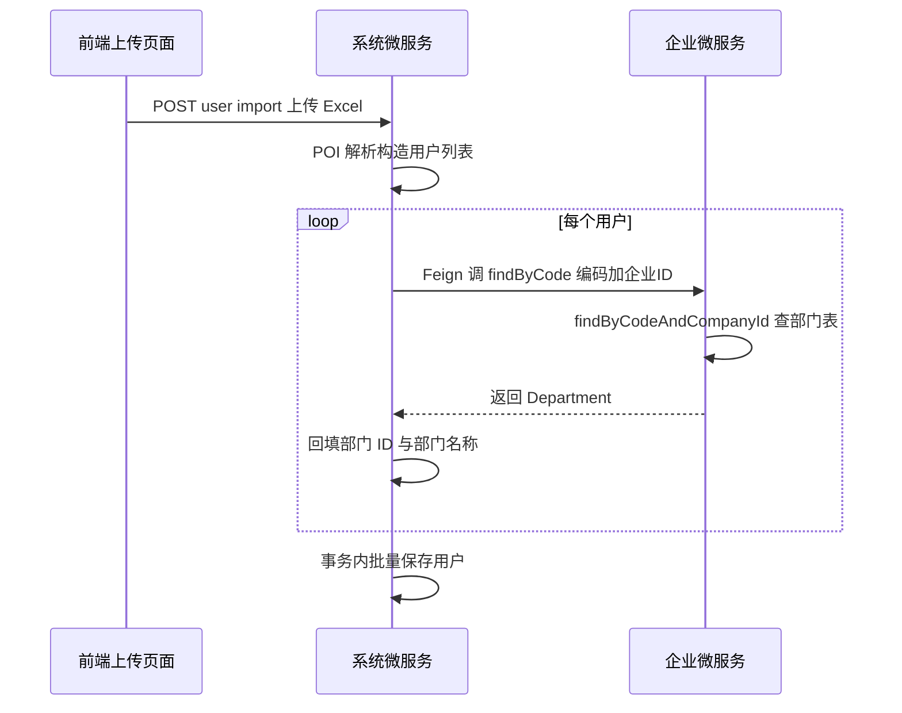

# 导入时把部门编码换成部门：Feign 跨服务查询与回填

> 🔒 安全提示：文中示例的口令/密钥均为课程教学环境演示口径，生产环境的安全要求见《安全与合规须知》。

导入功能还差最后一环：Excel 里填的是 DEPT-DEV 这样的部门编码，数据库里要存的却是部门 ID 和部门名称。部门数据在企业微服务手里，系统微服务的库里根本没有这张表，编码到部门的换算只能跨服务去查。把被调接口、Feign 客户端、回填逻辑三件事做完，整个导入链路才算闭环。

## 先给结论

- 编码换部门发生在服务端：企业微服务新增一个「按编码加企业 ID 查部门」的内部接口，系统微服务在保存前逐个调用。
- 查询条件必须是编码与 `companyId` 两个参数：编码简单易记，不同企业之间完全可能重码，只按编码查会查错企业。
- 系统微服务用 Feign 声明这个接口：在既有的 `DepartmentFeignClient` 里加一个方法，路径与参数注解照抄提供方。
- 查到部门后回填两个字段：`user.setDepartmentId(dpt.getId())` 与 `user.setDepartmentName(dpt.getName())`，再入库。
- 服务间内部接口可以直接返回 `Department` 实体，不必套面向前端的 `Result` 包装，保持内部协议简单。

## 一、整条链路长什么样

先把跨服务换算的位置放回全流程里看：



这张时序图讲的是保存前的换算环节：解析在系统微服务本地完成，唯独「编码到部门」这步要出网络。循环里每一次远程调用换回一个部门对象，回填之后这批用户才具备入库条件。

## 二、先补被调方：企业微服务的查询接口

按 Feign 的套路，先有提供方接口，调用方才有得声明。回到企业微服务的 `DepartmentController`，控制器统一挂在 `/company` 前缀之下，补一个按编码查部门的方法：

```java
/**
 * 根据部门编码和企业ID查询部门
 * 服务间内部接口，供其他微服务通过 Feign 调用
 */
@RequestMapping(value = "/department/search", method = RequestMethod.POST)
public Department findByCode(@RequestParam(value = "code") String code,
                             @RequestParam(value = "companyId") String companyId) {
    return departmentService.findByCode(code, companyId);
}
```

这个方法与同控制器里给前端用的接口有两点刻意的不同：

**第一，返回值直接是 `Department` 而不是 `Result`。** 面向前端的接口要统一响应包装、带状态码；服务间接口的双方都是自己人，调用方要的就是实体对象，再剥一层 `Result` 反而多余。内部协议从简，是微服务接口设计的一条实用原则。

**第二，两个参数缺一不可。** 编码这东西在指标设计时就选了「简单易记」，代价是企业间重码的可能性大增，所以查询必须同时带上 `companyId`，把范围锁死在本企业之内。

Service 与 Dao 是标准的 JPA 三层传递，值得看的是 Dao 里那行名称查询：

```java
public interface DepartmentDao extends JpaRepository<Department, String>, JpaSpecificationExecutor<Department> {

    //根据部门编码和企业ID查询部门
    Department findByCodeAndCompanyId(String code, String companyId);
}
```

不写 SQL、不写 `@Query`，方法名本身就描述了查询语义：按 `code` 与 `companyId` 两个属性等值查询，返回单个 `Department`。Spring Data JPA 解析方法名自动生成实现，这也是之前部门模块一直在用的方式。

提供方写完，先用 Postman 单独验证。登录拿到令牌，把 `Authorization` 挂到请求头，再发请求：`POST` 到企业微服务的 `/company/department/search`，带上 `code = DEPT-DEV` 与 `companyId = 1` 两个参数，响应里完整返回了开发部的部门对象，ID、名称、编码俱全。被调方就绪，才轮到调用方动手。

## 三、再写调用方：Feign 客户端加一个方法

系统微服务里早就有 `DepartmentFeignClient`，里面已经有一个按 ID 查部门的方法。往同一个接口里再声明一个方法即可：

```java
package com.example.system.client;

import com.example.common.entity.Result;
import com.example.domain.company.Department;
import org.springframework.cloud.openfeign.FeignClient;
import org.springframework.web.bind.annotation.PathVariable;
import org.springframework.web.bind.annotation.RequestMapping;
import org.springframework.web.bind.annotation.RequestMethod;
import org.springframework.web.bind.annotation.RequestParam;

@FeignClient("hrm-company")
public interface DepartmentFeignClient {

    @RequestMapping(value = "/company/department/{id}", method = RequestMethod.GET)
    Result findById(@PathVariable(value = "id") String id);

    /**
     * 根据部门编码和企业ID查询部门
     */
    @RequestMapping(value = "/company/department/search", method = RequestMethod.POST)
    Department findByCode(@RequestParam(value = "code") String code,
                          @RequestParam(value = "companyId") String companyId);
}
```

声明式的规则在这几行里全部兑现：`@FeignClient("hrm-company")` 点名目标服务，Feign 按这个名字去注册中心找企业微服务的实例；方法上的路径、请求方式、参数注解与提供方逐字对齐，路径 `@RequestParam` 标注的两个参数会作为表单或查询参数发给对方，返回类型直接映射成 `Department`。方法名可以和提供方不同，路径与参数必须一模一样。

## 四、在保存循环里换算并回填

调用方的一切就绪，回到 `UserService.saveAll`。注入 Feign 客户端，在补默认属性的那段代码里加一步换算：

```java
@Autowired
private DepartmentFeignClient departmentFeignClient;

@Transactional
public void saveAll(List<User> list, String companyId, String companyName) {
    for (User user : list) {
        user.setPassword(new Md5Hash("123456", user.getMobile(), 3).toString());
        user.setId(idWorker.nextId() + "");
        user.setCompanyId(companyId);
        user.setCompanyName(companyName);
        user.setInServiceStatus(1);
        user.setEnableState(1);
        user.setLevel("user");
        //根据部门编码换算部门 ID 与名称
        //解析阶段编码临时存在 departmentId 字段里，此处取出来做查询条件
        Department dpt = departmentFeignClient.findByCode(user.getDepartmentId(), user.getCompanyId());
        if (dpt != null) {
            user.setDepartmentId(dpt.getId());
            user.setDepartmentName(dpt.getName());
        }
        userDao.save(user);
    }
}
```

有两个细节值得停一下：

**第一，`user.getDepartmentId()` 此刻拿到的其实是编码。** 上一篇说过，解析 Excel 时部门编码被临时存进了 `departmentId` 字段，正好在这里取出来当查询条件，查到真身后立刻覆盖它。占位与回填用同一个字段，循环体保持干净。

**第二，判空不能省。** 模板里填了企业里不存在的编码时，查询返回空，这时直接调 `dpt.getId()` 就是空指针。课程实现里查到才回填，生产上更严谨的做法是把查不到部门当作一条导入失败记录下来，反馈给上传者修正模板，而不是静默放行。

改完重启系统微服务，删掉之前几批测试数据，重新上传模板。页面提示导入成功，数据库刷新：三条记录，部门 ID 已经是真 ID，部门名称齐刷刷显示开发部，Excel 六列的每一条信息都在库里找到了归宿。至此，从下载模板到批量入库的整条导入链路全部打通。

回头再看性能：循环里每个用户一次远程调用，几十人没感觉，几百上千人时网络往返就成了大头。优化方向也明确，先把本批编码去重后一次性查回所有部门，在内存里做编码到对象的映射，远程调用从 N 次降到 1 次；或者给企业微服务提供一个批量查询接口。规模决定方案，思路先留着。

## 常见误区

- **把部门编码当主键存库。** 编码是给人看的，ID 是给系统关联用的，两者混用会让部门改名或重码时数据全面失真。入库前必须完成编码到 ID 的换算。
- **Feign 路径丢了类级前缀。** 提供方控制器挂在 `/company` 之下，完整路径是 `/company/department/search`，Feign 方法上只写 `/department/search` 会得到 404。
- **查询条件只给编码不给企业 ID。** 编码跨企业重码时，查回来的可能是别家公司的部门，数据串企业的后果比查不到更严重。
- **远程调用结果不判空。** 编码填错返回 null，直接取属性就是空指针，整批导入因一条坏数据而失败。判空加错误记录才是完整方案。

## 面试可能被问到的问题

1. 面试官追问：「服务间调用为什么用 Feign，而不是直接用 HttpClient 或 RestTemplate？」
   答：Feign 是声明式的，把请求信息固化在接口注解里，调用远程接口与调本地方法写法一致，拼参数、序列化、按服务名负载均衡全由框架完成；与注册中心集成后调用方不感知实例地址。RestTemplate 每次都要手工构造 URL 和请求对象，重复代码多且没有负载均衡语义。

2. 面试官追问：「Feign 客户端的方法要和提供方一致到什么程度？」
   答：路径、请求方式、参数注解必须完全一致，方法名与返回值可以按调用方需要定义。路径决定请求打到哪，请求方式决定 method，参数注解决定参数放路径、请求体还是查询串，任何一处不一致请求就打不到目标接口。

3. 面试官追问：「循环里逐条远程调用有什么问题？怎么优化？」
   答：每次调用都有网络往返和序列化开销，N 个用户就是 N 次往返，批量导入时延迟线性放大。优化思路是减少调用次数：先收集并去重本批编码，一次批量查询取回全部部门，内存建映射再逐个回填，远程调用从 N 次降到常数次。

4. 面试官追问：「服务间内部接口和面向前端的接口在设计上有什么差异？」
   答：内部接口可以返回实体对象，不必套统一响应包装，协议从简、性能优先；前端接口要统一 `Result` 结构、状态码、异常信息，还要考虑鉴权与文档。另外内部接口应做服务间的调用校验，不能因为「只给内部用」就裸奔。

5. 面试官追问：「导入 Excel 时编码转换这类字典翻译，一般放在哪一层做？」
   答：原则是离数据最近的一层做。本例中部门数据在企业微服务，转换查询由它提供；调用方在组装领域对象前完成翻译，保证入库的是规范化的 ID。通用做法是集中一个装配步骤统一翻译所有字典字段，而不是散落在各处 set 里。

## 配套资料

- 同款声明式 Feign 客户端成例（社保模块按服务名调用员工微服务）：`materials/code/02/day14 微服务网关与社保模块开发/day14/03-资料/社保模块相关资料/ihrm_social_securitys/src/main/java/com/ihrm/social/client/EmployeeFeignClient.java`、同目录 `SystemFeignClient.java`
- 注册中心工程与配置（Feign 按服务名寻址的前提）：`materials/code/02/day07 员工管理及POI入门/员工管理及POI入门/资源/后端/ihrm_eureka/`、`materials/code/02/day07 员工管理及POI入门/员工管理及POI入门/资源/eureka-application.yml`
- 部门表 `co_department` 所在课程库脚本：`materials/code/02/day14 微服务网关与社保模块开发/day14/ihrm.sql`
- 企业微服务的 `findByCode` 接口、Dao 名称查询与系统微服务的调用改造为课堂代码，资料包中没有独立源码目录，文中代码按课程视频画面还原，服务名沿用 `hrm-company`，包名已改为 `com.example`
