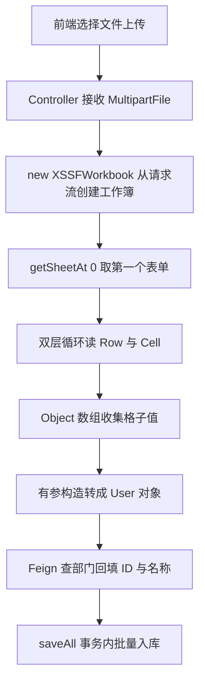

# Excel 导入员工数据全链路复盘：上传、解析、转换、保存的收束

> 🔒 安全提示：文中示例的口令/密钥均为课程教学环境演示口径，生产环境的安全要求见《安全与合规须知》。

零散环节都练过了：`MultipartFile` 接文件、POI 双层循环读格子、有参构造转对象、Feign 跨服务查部门。真拿到一条「导入员工 Excel」的需求从零写到入库，不少人还是会卡在「这些零件按什么顺序装、每一段到底要注意什么」。员工管理这一天的收尾就是把整条导入链路从头到尾串一遍，顺带把同一天讲过的员工业务表、注册中心、Feign 归回原位。

## 先给结论

- 导入链路固定四段：接收上传、POI 解析、构造并补全对象、批量保存，段与段之间靠一个 `List<User>` 传递。
- 上传场景没有文件路径，工作簿只能从请求流里创建：`new XSSFWorkbook(file.getInputStream())`。
- 解析有两处索引偏移：行从 1 起跳过表头，列从 1 起跳过模板预留的空列，错一处数据就整体错位。
- 类型转换集中在构造器里做，POI 数值格子一律给 double，工号带 `.0`、手机号变科学计数法都在这里修。
- 跨服务补全靠 Feign：编码换部门的查询放在保存循环里，登录态由 `RequestInterceptor` 把请求头原样透传给下游。

## 一、全链路全景图

把四段链路和每一环的关键动作画在一张图里，后面逐段复盘：



这张图讲的是从文件到数据库的完整流水线。关键路径在 G 与 H 之间：格子值只是原始材料，`new User(values)` 完成类型转换，Feign 查询补上部门真身，对象才有入库资格。

## 二、第一段：接收上传与解析工作簿

控制器方法用 `@RequestParam(name = "file") MultipartFile file` 接住文件，方法体按三段注释搭骨架：

```java
@RequestMapping(value = "/user/import", method = RequestMethod.POST)
public Result importUser(@RequestParam(name = "file") MultipartFile file) throws Exception {
    //1.解析Excel，创建工作簿
    Workbook wb = new XSSFWorkbook(file.getInputStream());
    Sheet sheet = wb.getSheetAt(0);
    //2.循环构造用户列表
    List<User> list = new ArrayList<>();
    //3.批量保存
    return new Result(ResultCode.SUCCESS);
}
```

之前写 POI 练习时构造 `XSSFWorkbook` 传的是磁盘路径，这里换成了 `file.getInputStream()`。`XSSFWorkbook` 有接收 `InputStream` 的重载构造器，上传的文件内容随请求体进了服务端，躺在流里，工作簿直接从流里构建。

## 三、第二段：双层循环与类型分支

解析是两个偏移量加一个取值工具。行循环从 1 开始，第 0 行是表头；列循环从 1 开始，模板 A 列是预留空列：

```java
Object[] values = null;
for (int rowNum = 1; rowNum < sheet.getLastRowNum(); rowNum++) {
    Row row = sheet.getRow(rowNum);
    values = new Object[row.getLastCellNum()];
    for (int cellNum = 1; cellNum < row.getLastCellNum(); cellNum++) {
        values[cellNum] = getCellValue(row.getCell(cellNum));
    }
    list.add(new User(values));
}
```

`getCellValue` 按 `CellType` 分支取值：`STRING` 走 `getStringCellValue()`，`NUMERIC` 走 `getNumericCellValue()`，布尔、公式、空格各自有对应分支。类型分支一个都不能省，对数值格子调 `getStringCellValue()` 会直接抛 `IllegalStateException`。

## 四、第三段：构造对象与跨服务补全

一行六个值按顺序躺在 `Object[]` 里，转换逻辑写进 `User` 的有参构造，循环体里一句 `new User(values)` 完成拼装：

```java
public User(Object[] values) {
    this.username = values[1].toString();          //用户名
    this.mobile = values[2].toString();            //手机号
    this.workNumber = values[3].toString();        //工号
    this.formOfEmployment = ((Double) values[4]).intValue() + "";  //聘用形式
    this.timeOfEntry = (Date) values[5];           //入职时间
    this.departmentId = values[6].toString();      //部门编码，先占位
}
```

部门编码不是部门 ID，Excel 里填的 `DEPT-DEV` 这类编码要在保存前跨服务换算。系统微服务通过 Feign 声明企业微服务的「按编码加企业 ID 查部门」接口，查到后回填 `departmentId` 与 `departmentName`。

跨服务调用还有一道认证门槛：请求头里的令牌不会自动跟着 Feign 走，下游服务的过滤器拿不到头就会把请求当未登录拦掉。解法是注册一个 `RequestInterceptor`，把当前请求的头逐个复制到 Feign 请求上：

```java
@Configuration
public class FeignConfiguration {
    @Bean
    public RequestInterceptor requestInterceptor() {
        return new RequestInterceptor() {
            @Override
            public void apply(RequestTemplate template) {
                ServletRequestAttributes attributes = (ServletRequestAttributes)
                        RequestContextHolder.getRequestAttributes();
                if (attributes != null) {
                    HttpServletRequest request = attributes.getRequest();
                    Enumeration<String> headerNames = request.getHeaderNames();
                    if (headerNames != null) {
                        while (headerNames.hasMoreElements()) {
                            String name = headerNames.nextElement();
                            String values = request.getHeader(name);
                            template.header(name, values);
                        }
                    }
                }
            }
        };
    }
}
```

这段代码从 `RequestContextHolder` 拿到当前 HTTP 请求，遍历全部请求头写进 `RequestTemplate`，令牌、企业信息等头部就原样到达了下游。

## 五、第四段：批量保存与记忆锚点

保存环节在 `saveAll` 里循环处理：`IdWorker` 生成主键，`Md5Hash` 以手机号为盐加密默认密码，再补企业信息、在职状态等默认值，最后逐条入库，方法上加 `@Transactional` 保证整批要么全进要么全回滚。

复盘到这里，把这一天的记忆锚点也收拢成两张表。Excel 两种格式与对应 API：

| 维度 | 2003 版 xls | 2007 版 xlsx |
|---|---|---|
| 底层结构 | 二进制复合文档 | XML 结构，压缩存储 |
| 单表容量 | 65535 行，256 列 | 1048576 行，16384 列 |
| 工作簿类 | `HSSFWorkbook` | `XSSFWorkbook` |

操作工具的选型结论：JXL 老旧且只支持 Excel 95 到 2000，早已停更；POI 是 Apache 项目，能操作 Word、Excel、PPT，覆盖 2003 与 2007 格式且持续更新，当前主流。POI 的对象模型与手工操作 Excel 一一对应，`Workbook` 是文档对象，`Sheet` 是表单，`Row` 是行，`Cell` 是格子，`Font` 与 `CellStyle` 管字体和样式，记住这套对应关系，API 就不用死背。

## 常见误区

- **行列循环从 0 开始。** 表头被当成数据读进来，或者预留空列挤进数组，所有属性整体错位一位。这种错误不抛异常，只会让数据悄悄变错。
- **数值格子直接 `toString()`。** 工号 2001 读出来是 `2001.0`，11 位手机号变成科学计数法。用 `DecimalFormat` 或 `BigDecimal.toPlainString()` 统一格式化。
- **Feign 调用不透传请求头。** 下游过滤器取不到令牌，内部接口被当成未登录请求拦截，导入在保存环节集体失败。`RequestInterceptor` 必须注册。
- **空行也 `new` 对象入库。** 模板末尾的空行会被读成一条全空记录。循环里跳过全空行，保存前再做一次字段校验。

## 面试可能被问到的问题

1. 面试官追问：「上传的 Excel 没有文件路径，工作簿怎么创建？」
   答：`MultipartFile` 封装了上传文件的全部字节流，调 `getInputStream()` 拿到输入流，`XSSFWorkbook` 有接收 `InputStream` 的构造器重载，直接传入即可。文件内容会整个读入内存，这也决定了 POI 用户模型不适合超大文件。

2. 面试官追问：「POI 读单元格为什么要先判断类型？」
   答：格子底层类型与业务想要的类型不一致，文本、数值、日期、公式各有专属读取方法，类型不匹配会抛 `IllegalStateException`。日期在 Excel 底层也是数值，需要用 `DateUtil.isCellDateFormatted` 识别后再转 `Date`。

3. 面试官追问：「手机号从 Excel 读出来变科学计数法，怎么处理？」
   答：Excel 数值格子统一按 double 存储，`Double.toString()` 对长数字采用科学计数法。用 `DecimalFormat` 按整数模式格式化，或用 `BigDecimal.toPlainString()` 输出完整数字，再去掉小数尾巴 `.0`。

4. 面试官追问：「Feign 调用时如何把登录态带给下游服务？」
   答：注册 `RequestInterceptor`，在 `apply` 里通过 `RequestContextHolder` 拿到当前请求，把请求头逐个复制到 `RequestTemplate`。这样令牌等头部随 Feign 请求到达下游，下游的过滤器才能完成认证与用户信息解析。

5. 面试官追问：「批量导入不加事务会有什么问题？」
   答：循环中途一条数据异常会留下半批脏数据，库存里多了一半用户，重导又产生重复。`@Transactional` 把整批放进一个事务，任何一条失败全部回滚；更大批量时应分批提交并记录失败明细，避免长事务。

## 配套资料

- 员工微服务控制器与三层结构成例：`materials/code/02/day07 员工管理及POI入门/员工管理及POI入门/资源/后端/ihrm_employee/src/main/java/com/ihrm/employee/controller/EmployeeController.java`（同目录 `dao`、`service` 下有 `UserCompanyPersonalDao` 等配套类）
- 注解驱动导入工具成例（`getValue` 是正文类型分支的成熟版）：`materials/code/02/day08 POI高级/POI高级/资源/代码/工具类/ExcelImportUtil.java`
- 员工业务表建表脚本（入职、转正、离职、调岗、归档）：`materials/code/02/day07 员工管理及POI入门/员工管理及POI入门/资源/Sql/员工管理.sql`
- 链路中的 `UserController.importUser`、`User` 有参构造与 `saveAll` 改造为课堂代码，资料包无独立目录，按课程视频画面还原，包名已改为 `com.example`
