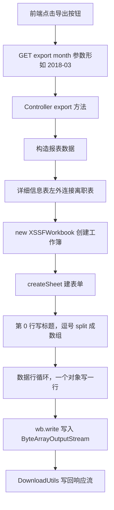

# POI 导出当月人事报表：从需求拆解到数据、表格、下载的完整实现

页面上「03月人事报表」旁边有个导出按钮，点击后浏览器下载一份 Excel，里面有当月入职员工的详细信息，也有当月离职员工的姓名、离职类型、离职原因。POI 的入门操作都学过，可真落到这个需求上，第一个卡点往往不是 API，而是数据：入职的在详情表里，离职的在申请表里，两张表怎么查成一份报表？数据有了，十三个列的标题和数据行怎么填？填完了文件怎么送到浏览器？

员工微服务这一天的新内容，就是把这条导出链路完整写通。本课后续还有三块安排：模板打印解决样式难写的问题，自定义注解加工具类简化重复代码，`SXSSFWorkbook` 处理百万数据导出，都会在导出链路的基础上展开。

## 先给结论

- 导出接口固定三步：构造报表数据、构造 Excel、完成下载，`Controller` 方法返回 `void`，文件直接写响应流。
- 报表数据是两个实体的合并视图：详细信息表左外连接离职申请表，当月入职或当月离职的人都查出来。
- 月份参数形如 `2018-03`，数据库存的日期带天，匹配用前缀模糊 `2018-03%`，条件之间用 `or` 连接。
- 报表实体 `EmployeeReportResult` 用 `BeanUtils.copyProperties` 把两个实体的同名属性一次拷进自己，`JPQL` 里 `select new` 直接在查询中完成组装。
- 下载借助 `ByteArrayOutputStream` 与 `DownloadUtils` 工具类：工作簿先写进内存缓冲，再整体写回响应流。

## 一、需求与步骤分析

人事报表的口径在课程开头就定过：统计当月入职人员与当月离职人员。两类人的信息来源不同，入职人员看 `em_user_company_personal` 详细信息表，有最高学历、国家地区、护照号、籍贯、生日、属相这些字段；离职人员除详细信息外，还要从离职申请表 `em_resignation` 里带出离职类型、离职原因、离职时间。

| 表 | 内容 | 报表里的角色 |
|---|---|---|
| `em_user_company_personal` | 员工全部详细信息 | 所有行的基础字段 |
| `em_resignation` | 离职时间、类型、原因 | 只给当月离职的人补离职字段 |

导出的执行步骤在课件里列得很直白：构造 Excel 表格数据、创建工作簿、创建 sheet、创建行对象、创建单元格对象、填充数据并设置样式，外加最后一步下载。放进代码流程里是这样的：



这张图讲的是导出链路的全貌。最容易出错的是 D 到 E 这一段：查询条件必须同时覆盖「入职在当月」和「离职在当月」两种人，漏了任何一边，报表就会少人。

## 二、Controller 骨架：void 返回值

导出属于员工微服务的职责，在 `EmployeeController` 里补一个方法。注意参数的语义：路径上的 `month` 实际是年月，前端会拼成 `2018-03` 这种形式传上来；方法返回值是 `void`，因为下载不走统一响应包装，文件直接以流的形式写给浏览器：

```java
/**
 * 导出当月人事报表
 * month 为年月字符串，形如 2018-03
 */
@RequestMapping(value = "/export/{month}", method = RequestMethod.GET)
public void export(@PathVariable(name = "month") String month) throws Exception {
    //1.构造报表数据
    List<EmployeeReportResult> list = userCompanyPersonalService.findByReport(companyId, month + "%");
    //2.构造Excel
    Workbook wb = new XSSFWorkbook();
    Sheet sheet = wb.createSheet();
    //3.绘制标题行与数据行
    //4.完成下载
}
```

`companyId` 来自父类 `BaseController`，由登录态解析得到，导出的永远是本企业的数据。这四行注释就是后面全部内容的目录。

## 三、报表数据：一条左外连接查两种人

先把想要的 SQL 写出来。详细信息表按入职时间查当月入职的人：

```sql
SELECT * FROM em_user_company_personal
WHERE time_of_entry LIKE '2018-03%';
```

只查这一张表会漏人：某人 11 月入职、2 月离职，当月报表要的是他的离职信息，按入职时间查不到他。离职申请表里确实有他，但离职表只有离职字段，没有姓名手机号这些详细信息。所以两张表要按 `user_id` 关联，用左外连接把详细信息全保留、离职信息能关联上的补上：

```sql
SELECT * FROM em_user_company_personal a
LEFT JOIN em_resignation b ON a.user_id = b.user_id
WHERE a.company_id = '1'
  AND (a.time_of_entry LIKE '2018-03%' OR b.resignation_time LIKE '2018-03%');
```

条件用 `or` 连接是这条 SQL 的灵魂：满足「入职在当月」或「离职在当月」任意一个就进报表。在职员工的离职字段是 `null`，报表里留空即可。

SQL 有了，落到代码里不用原生 SQL，改写成 `JPQL`，直接在查询里组装报表对象。`select new` 的写法会把每一行查询结果现场调一次构造方法，拼出 `EmployeeReportResult`：

```java
@Query("select new com.example.domain.employee.response.EmployeeReportResult(a,b) " +
        "from UserCompanyPersonal a left join EmployeeResignation b " +
        "on a.userId = b.userId " +
        "where a.companyId = ?1 and (a.timeOfEntry like ?2 or b.resignationTime like ?2)")
List<EmployeeReportResult> findByReport(String companyId, String month);
```

与 SQL 相比有两处语义转换：`from` 后面跟的是实体名而不是表名，`on` 与 `where` 里写的全是属性名 `userId`、`timeOfEntry` 而不是下划线字段。模糊匹配的百分号不写死在语句里，放在 Service 层拼，调用方传 `2018-03`，查询时变成 `2018-03%`：

```java
public List<EmployeeReportResult> findByReport(String companyId, String month) {
    return userCompanyPersonalDao.findByReport(companyId, month + "%");
}
```

## 四、报表实体：两个实体合成一个视图

查询要 `new` 的这个类是专门为报表建的，字段是两个实体的并集：上面一大片是详细信息的属性，与 `UserCompanyPersonal` 一一对应；底下是离职的属性，与 `EmployeeResignation` 一一对应。构造方法接收两个实体对象，用 `BeanUtils.copyProperties` 按同名属性拷贝：

```java
@Getter
@Setter
@NoArgsConstructor
@ToString
public class EmployeeReportResult {

    @ExcelAttribute(sort = 0)
    private String userId;
    @ExcelAttribute(sort = 1)
    private String username;
    //……详细信息字段：手机、最高学历、国家地区、护照号、籍贯、生日、属相等
    //……离职字段：离职时间 resignationTime、离职类型 typeOfTurnover、离职原因 reasonsForLeaving

    public EmployeeReportResult(UserCompanyPersonal personal, EmployeeResignation resignation) {
        BeanUtils.copyProperties(personal, this);
        if (resignation != null) {
            BeanUtils.copyProperties(resignation, this);
        }
    }
}
```

`BeanUtils.copyProperties` 按属性名匹配、逐个赋值，几十个字段一行代码拷完，这是它最典型的应用场景。在职员工没有离职记录，`resignation` 为 `null`，构造方法里判空后再拷，离职字段保持 `null`。字段上的 `@ExcelAttribute(sort = n)` 注解是给后续自定义导出工具准备的列序号标记，先埋在这里。

## 五、绘制表格：标题行与数据行

工作簿和表单就绪，先画标题。十三个标题先写成逗号分隔的字符串，`split` 成数组，循环写到第 0 行：

```java
String[] titles = "编号,姓名,手机,最高学历,国家地区,护照号,籍贯,生日,属相,入职时间,离职类型,离职原因,离职时间".split(",");
Row titleRow = sheet.createRow(0);
int titleIndex = 0;
for (String title : titles) {
    Cell cell = titleRow.createCell(titleIndex++);
    cell.setCellValue(title);
}
```

数据行从第 1 行开始，一个对象一行，一个属性一个格子，逐列创建单元格再赋值：

```java
int rowIndex = 1;
for (EmployeeReportResult report : list) {
    Row row = sheet.createRow(rowIndex++);
    Cell cell = null;
    //编号
    cell = row.createCell(0);
    cell.setCellValue(report.getUserId());
    //姓名
    cell = row.createCell(1);
    cell.setCellValue(report.getUsername());
    //手机
    cell = row.createCell(2);
    cell.setCellValue(report.getMobile());
    //……最高学历、国家地区、护照号、籍贯、生日、属相、入职时间，写法完全相同
    //离职类型：在职员工这里是 null，写入空白格子
    cell = row.createCell(10);
    cell.setCellValue(report.getTypeOfTurnover());
    //离职原因
    cell = row.createCell(11);
    cell.setCellValue(report.getReasonsForLeaving());
    //离职时间
    cell = row.createCell(12);
    cell.setCellValue(report.getResignationTime());
}
```

这段是纯体力活，但有两条纪律：格子编号必须与标题数组的顺序严格对齐，第 3 列写姓名、第 4 列写手机就全乱了；行索引用一个变量递增，标题占第 0 行，数据从 1 号行起连续往下排。`setCellValue` 传入 `null` 字符串时格子存成空白，正好符合在职员工离职字段留空的预期。

## 六、下载：内存缓冲加工具类

工作簿在内存里画好了，还差把它送出浏览器。课程资料里提供了 `DownloadUtils`，思路是先把工作簿写进一个 `ByteArrayOutputStream`，再由工具类写到响应流：

```java
ByteArrayOutputStream os = new ByteArrayOutputStream();
wb.write(os);
new DownloadUtils().download(os, response, month + "人事报表.xlsx");
```

`DownloadUtils` 的实现不长，值得读一遍：

```java
public class DownloadUtils {
    public void download(ByteArrayOutputStream byteArrayOutputStream,
                         HttpServletResponse response, String returnName) throws IOException {
        response.setContentType("application/octet-stream");
        returnName = response.encodeURL(new String(returnName.getBytes(), "iso8859-1"));
        response.addHeader("Content-Disposition", "attachment;filename=total.xls");
        response.setContentLength(byteArrayOutputStream.size());
        response.addHeader("Content-Length", "" + byteArrayOutputStream.size());
        ServletOutputStream outputstream = response.getOutputStream();
        byteArrayOutputStream.writeTo(outputstream);
        byteArrayOutputStream.close();
        outputstream.flush();
    }
}
```

下载能否弹出，取决于三个响应设置：`Content-Type` 声明为二进制流，`Content-Disposition` 标记 `attachment` 让浏览器走下载而不是打开，`Content-Length` 给出确切大小。文件名经过一次编码转换避免中文乱码，`wb.write(os)` 一行不能漏，缓冲区里没数据，下载下来的就是个空文件。

## 七、联调排错记：一次空指针

代码写完第一次点导出，页面报「系统繁忙」，后台 241 行抛了空指针。定位过去，出事的正是数据行那段：行创建了，格子却用了 `row.getCell(i)` 去取。新创建的行里一个格子都没有，`getCell` 返回 `null`，紧接着 `setCellValue` 就炸了。

正确写法是 `row.createCell(i)`：`get` 系方法读已经存在的东西，`create` 系方法造新的。数据行是凭空画出来的，格子必须创建。改成 `createCell` 后重新导出，浏览器弹出下载，打开报表，编号、姓名、手机、最高学历一列列齐整，三月的入职和离职数据全在里面，这条导出链路至此跑通。

## 常见误区

- **只查详细信息表。** 入职不在当月但离职在当月的人被漏掉，报表少人还不报错。左外连接加 `or` 条件才能覆盖两种人。
- **模糊匹配写成等值。** 数据库里入职时间存的是 `2018-03-01` 带天的完整日期，`time_of_entry = '2018-03'` 永远查不到，必须用前缀 `like '2018-03%'`。
- **`getCell` 当 `createCell` 用。** 对新建的行取格子返回 `null`，下一行赋值就是空指针。读已存在的格子用 `get`，画新格子用 `create`。
- **忘写 `wb.write(os)` 或文件名乱码。** 缓冲区没写入就下载，得到 0 字节文件；文件名不做编码处理，中文在部分浏览器下乱码。`Content-Disposition` 与文件名编码一起检查。

## 面试可能被问到的问题

1. 面试官追问：「报表数据为什么用左外连接，而不是分别查两张表再内存拼接？」
   答：左外连接让数据库一次完成关联，以详细信息表为主表保证在职员工不丢失，离职信息按 `user_id` 补齐；拆成两次查询再匹配，代码要自己处理集合关联、判重、字段合并，逻辑分散且多一次网络往返。`or` 条件保证当月离职但非当月入职的人也进入结果集。

2. 面试官追问：「JPQL 里 `select new` 是什么机制？」
   答：`select new 全限定类名(实体别名)` 会让 JPA 对查询结果的每一行调用指定类的对应构造方法，直接返回装配好的 DTO 列表，省去先查实体再手工转换的步骤。前提是这个类确实存在匹配参数的构造器，本例的构造器内部用 `BeanUtils.copyProperties` 完成属性拷贝。

3. 面试官追问：「按月份查询用 `like` 前缀匹配有什么隐患？」
   答：前缀匹配走不了普通索引，数据量大时是全表扫描。月份字符串本身有规律，更稳的做法是查询时圈定区间，`time_of_entry >= '2018-03-01' and time_of_entry < '2018-04-01'`，既走索引又语义清晰。字符串前缀匹配要保证存储格式统一为 `yyyy-MM-dd`，否则会漏配。

4. 面试官追问：「导出接口为什么返回 `void`，下载是怎么触发的？」
   答：下载不走 `Result` 统一响应包装，文件二进制直接写响应输出流。浏览器是否弹出保存框取决于响应头：`Content-Disposition: attachment` 触发下载行为，`Content-Type: application/octet-stream` 声明二进制流，`Content-Length` 校验完整性。返回 `Result` 反而会把 JSON 混进文件流。

5. 面试官追问：「这种 `XSSFWorkbook` 全内存导出，数据量大会怎样？」
   答：`XSSFWorkbook` 是用户模型，整个工作簿连同所有行都驻留内存，几十万行很容易内存溢出。大批量导出应改用 `SXSSFWorkbook`，只在内存保留滑动窗口内的行，其余刷到磁盘临时文件；这就是本课后续百万数据报表要展开的内容。

## 配套资料

- 报表实体成例（含 `BeanUtils.copyProperties` 构造器与 `@ExcelAttribute` 列序号注解）：`materials/code/02/day07 员工管理及POI入门/员工管理及POI入门/资源/后端/实体类/employee/response/EmployeeReportResult.java`
- 两个数据源实体：`materials/code/02/day07 员工管理及POI入门/员工管理及POI入门/资源/后端/实体类/employee/UserCompanyPersonal.java`、同目录 `EmployeeResignation.java`
- 下载工具类：`materials/code/02/day08 POI高级/POI高级/资源/工具类/DownloadUtils.java`
- 员工微服务工程（`EmployeeController` 与三层结构）：`materials/code/02/day07 员工管理及POI入门/员工管理及POI入门/资源/后端/ihrm_employee/`
- 表结构与测试数据脚本：`materials/code/02/day07 员工管理及POI入门/员工管理及POI入门/资源/Sql/员工管理.sql`
- Controller 的 `export` 方法、`findByReport` 的 `JPQL` 与 Service 改造为课堂代码，资料包工程中尚未包含，文中按课程视频画面还原，包名已改为 `com.example`
