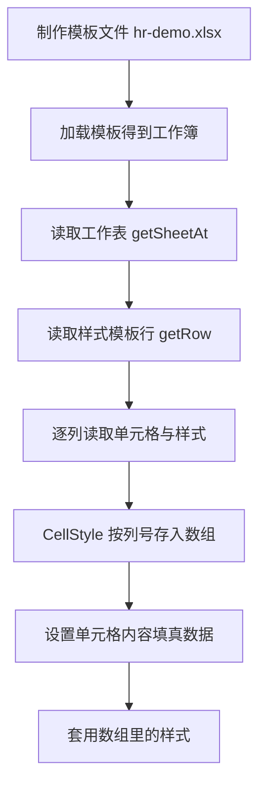

# 报表美化交给 Excel 模板：POI 模板打印的思路与八步操作

上一篇用纯代码导出了人事报表，数据一行不少，打开却不好看：没有大标题，没有边框底纹，列宽挤成一团，离能拿给领导看还差一层皮。要补样式，代码量会成倍增长：字号字体、边框、行高列宽、合并单元格，每一项都是几行 `CellStyle` 操作，改一版样式就要发一版代码。

模板打印就是冲着这个问题来的：把画样式这件事从代码里拿出去，交给一个手工做好的 Excel 模板文件，程序只负责加载模板和填数据。

## 先给结论

- 分工原则：表头、样式、列宽全部画在模板文件里，代码只做两件事，加载模板、填数据。
- 加载模板得到的不是空工作簿，标题、列头、格式都在里面，读出来直接用。
- 关键动作是把样式模板行的 `CellStyle` 逐列抽成数组，填数据行时按下标复用，样式与列永远对齐。
- 操作固定八步：制作模板、加载模板、读工作表、读行、读单元格、读样式、设置内容、复用样式。
- 样式越复杂、模板方案收益越大；样式调整只改模板文件，代码零改动。

## 一、代码画样式的真实成本

回顾一下不用模板时要写什么。标题行要设字体加粗、字号、居中，数据区要逐列设边框，列宽要按内容逐列调，多个格子还要合并：

```java
//无模板时的样式代码（示意，仅为感受工作量）
CellStyle titleStyle = wb.createCellStyle();
Font font = wb.createFont();
font.setBold(true);
font.setFontHeightInPoints((short) 16);
titleStyle.setFont(font);
titleStyle.setAlignment(HorizontalAlignment.CENTER);
sheet.addMergedRegion(new CellRangeAddress(0, 0, 0, 12));
for (int i = 0; i < 13; i++) {
    sheet.setColumnWidth(i, 15 * 256);
}
```

这还只是最粗的一层。真实的报表要微调列宽、行高、边框粗细、背景色，每一轮调整都落在代码上，调样式变成了改代码、重启、再导出、再看效果的循环。样式需求本该由业务或设计决定，却把工程师锁死在里面。

## 二、模板打印是什么

思路与公文套打一样：红头文件的版式早就印好了，填内容就行。对应到 Excel，先在 Excel 软件里手工做出模板文件，本课的 `hr-demo.xlsx` 长这样：第一行是跨列的大标题「2018年2月份人事报表」，第二行是十三个列头，编号、姓名、手机、最高学历、国家地区、护照号、籍贯、生日、属相、入职时间、离职类型、离职原因、离职时间，每个列头都调好了字体边框；第三行预置一条示例数据，作用是充当样式模板行，程序要从它身上把格式抄走。

程序侧只做一件事：从第三行把每列的 `CellStyle` 抽出来存好，之后填第 2 行、第 3 行、第 4 行的真数据时，把对应列的样式直接套上去。声音线里的总结很形象：读取工作表、读行、读单元格、读样式，这些读取说白了就是想方设法地抄，把人家做好的样式抄进内存，添加数据时再复制到后面的行。



这张图讲的是模板打印的八步闭环。前五步全是「读」，第六步把读到的样式集中保存，真正意义上的生成动作只有 G 和 H 两步：写内容、套样式。

## 三、与纯代码方案怎么选

| 对比项 | 纯代码绘制 | 模板打印 |
|---|---|---|
| 样式来源 | 代码里逐项设置 | 模板文件，设计人员可维护 |
| 改样式成本 | 改代码、重新发版 | 改模板文件，代码不动 |
| 表头复杂度 | 合并单元格、多级表头写起来痛苦 | Excel 里拖拽即可 |
| 动态列 | 天然擅长，列数运行时决定 | 不擅长，模板列是固定的 |
| 适用场景 | 数据导出、列不固定 | 固定格式的正式报表、套打 |

选型口径跟着列的稳定性走：报表格式固定、样式要求高，选模板；列在运行时才能确定、样式无所谓，用代码。两者不冲突，同一个系统里可以并存，工具类也可以统一封装（课程后续的自定义注解导出工具，底层走的就是模板加样式复用这条路）。

## 四、一个容易混淆的点

模板打印不等于占位符替换。市面上另一类方案是在模板里预埋 `{{name}}` 这类占位符，程序做字符串替换；本课的方案里没有占位符概念，模板第三行的示例数据不是给程序替换用的，它是纯粹的样式来源，程序抄完样式后这一行会被真数据覆盖或直接跳过。识别这一点，读代码时就不会到处找「变量在哪里定义」。

## 常见误区

- **以为模板能自动美化一切。** 模板只解决静态部分，数据行的行高、超长文本截断、条数不确定的合并，仍需要代码辅助处理。
- **模板格式与代码不匹配。** 模板存成 xls，代码却用 `XSSFWorkbook` 加载，直接抛异常。2007 格式对应 `XSSF`，2003 格式对应 `HSSF`，两边必须一致。
- **样式行位置写死在代码里。** 模板加一行说明文字，样式行从第三行变成第四行，代码就抽错样式。样式行下标应当作参数传入，工具成例里正是 `styleIndex` 参数。
- **忘了处理示例数据行。** 报表开头多出一条「张三 13800138000」，就是模板里的示例行被当成了数据。填数据要从样式行的位置开始覆盖，或明确跳过。

## 面试可能被问到的问题

1. 面试官追问：「模板打印相比纯代码生成报表，好处和代价分别是什么？」
   答：好处是样式与代码解耦，复杂表头、字体、边框、列宽在 Excel 里调整即可，改版不发版，代码量只剩加载与填数据。代价是多了一个需要版本管理的模板文件，模板列固定后动态列场景不适用，模板被误改会直接影响线上报表。

2. 面试官追问：「模板里的样式是怎么作用到新数据行的？」
   答：程序读取样式模板行，把每个单元格的 `CellStyle` 抽出来放进数组，数组下标与列号一一对应；新建数据行后逐列调 `setCellStyle(styles[i])` 复用同一个样式对象。样式对象是工作簿级共享资源，复用还能避免样式数量超限。

3. 面试官追问：「模板文件一般放在工程的什么位置，为什么？」
   答：放在 `src/main/resources` 下的专用目录，例如 `excel-template`。resources 下的文件会打进 classpath，运行时通过 `ClassPathResource` 定位，无论在 IDE 里还是打包成 jar 后都能按同一套路径加载。

4. 面试官追问：「什么场景不适合模板打印？」
   答：列数或列含义在运行时才能确定的动态导出，模板固定列装不下；超大数据量导出，模板加载与样式复制带来的开销要重新评估，重点转向 `SXSSFWorkbook` 的流式写出。这两类场景更适合代码动态构建。

## 配套资料

- 模板打印的工具成例（`getTemplateStyles` 正是样式抽取的沉淀版，`export` 里 `setCellStyle` 复用样式数组）：`materials/code/02/day08 POI高级/POI高级/资源/代码/工具类/ExcelExportUtil.java`
- 列序号注解（与模板列一一对应的元数据来源）：`materials/code/02/day08 POI高级/POI高级/资源/代码/工具类/ExcelAttribute.java`
- 模板文件 `hr-demo.xlsx` 与课堂 Controller 代码未随资料包提供，模板结构与加载写法按课程视频画面还原，示例为按本课写法补全
