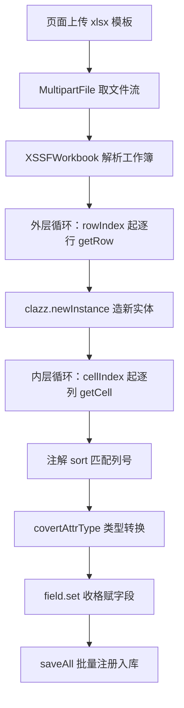

# 注解式导入工具类：一次 readExcel 调用，Excel 表格变对象列表

导出侧用 `@ExcelAttribute` 加反射完成了封装，导入侧还有一套同样的重复劳动：批量注册用户时手写两层循环解析表格，把格子值塞进 `Object` 数组，再靠构造器按位置对号入座。这套代码换个导入模板就得重写。`ExcelImportUtil` 与导出工具类共用同一枚注解，把解析也收敛成一次方法调用。

## 先给结论

- `ExcelImportUtil` 与 `ExcelExportUtil` 共用 `@ExcelAttribute`：字段的 `sort` 声明它对应模板第几列，导入方向是 `field.set`，导出方向是 `field.get`，互为镜像。
- 构造器收 `clazz` 并缓存全部字段；`readExcel(InputStream, rowIndex, cellIndex)` 返回 `List<T>`，`rowIndex` 是数据起始行，`cellIndex` 是数据起始列。
- 本课导入模板第一行是表头，数据从下标 1 行、下标 1 列开始：用户名 sort 1、手机号 2、工号 3、聘用形式 4、入职时间 5、部门编码 6。
- `covertAttrType` 按字段类型分 String、Date、int、double 四支转换；`getValue` 处理日期单元格、科学计数法和 `.0` 尾巴。
- 实测通过：清掉旧数据、上传模板，数据库里三条新用户各字段全部到位。

## 一、手写导入的旧账

批量注册接口当时的解析长这样：

```java
//1.根据Excel文件创建工作簿
Workbook wb = new XSSFWorkbook(file.getInputStream());
//2.获取sheet
Sheet sheet = wb.getSheetAt(0);
//3.逐行逐列读值，拼数组后靠构造器装对象
List<User> list = new ArrayList<>();
for (int rowNum = 1; rowNum < sheet.getLastRowNum(); rowNum++) {
    Row row = sheet.getRow(rowNum);
    Object[] values = new Object[row.getLastCellNum()];
    for (int cellNum = 0; cellNum < row.getLastCellNum(); cellNum++) {
        Cell cell = row.getCell(cellNum);
        values[cellNum] = getCellValue(cell);
    }
    User user = new User(values);
    list.add(user);
}
//4.批量保存
userService.saveAll(list, companyId, companyName);
```

能跑，但脆：`User` 的带参构造器把「第 0 个参数是用户名、第 1 个是手机号」硬编码在构造逻辑里，模板加一列、调一列顺序，构造器就得跟着改。这与导出手写版是同一种病：列号与属性的对应关系写死在代码里。导出已经用注解治好了，导入照方抓药。

## 二、ExcelImportUtil：导出的镜像

工具类成例的主体（包名已改为 `com.example`）：

```java
public class ExcelImportUtil<T> {

    private Class clazz;
    private Field fields[];

    public ExcelImportUtil(Class clazz) {
        this.clazz = clazz;
        fields = clazz.getDeclaredFields();
    }

    /**
     * 基于注解读取excel
     */
    public List<T> readExcel(InputStream is, int rowIndex, int cellIndex) {
        List<T> list = new ArrayList<T>();
        try {
            XSSFWorkbook workbook = new XSSFWorkbook(is);
            Sheet sheet = workbook.getSheetAt(0);
            for (int rowNum = rowIndex; rowNum <= sheet.getLastRowNum(); rowNum++) {
                Row row = sheet.getRow(rowNum);
                T entity = (T) clazz.newInstance();
                for (int j = cellIndex; j < row.getLastCellNum(); j++) {
                    Cell cell = row.getCell(j);
                    for (Field field : fields) {
                        if (field.isAnnotationPresent(ExcelAttribute.class)) {
                            field.setAccessible(true);
                            ExcelAttribute ea = field.getAnnotation(ExcelAttribute.class);
                            if (j == ea.sort()) {
                                field.set(entity, covertAttrType(field, cell));
                            }
                        }
                    }
                }
                list.add(entity);
            }
        } catch (Exception e) {
            e.printStackTrace();
        }
        return list;
    }
}
```

结构与导出工具类同源，三处差异值得读透：

**行循环边界是 `rowNum <= sheet.getLastRowNum()`。** `getLastRowNum()` 返回最后一行的下标，不是行数，用 `<=` 才能读到最后一行。列方向的 `getLastCellNum()` 返回的却是格子数量，循环条件用 `<`。一对名字相近的 API，方向恰好相反，导出、导入两个成例正好各演示了一半。

**每行都 `clazz.newInstance()` 造新对象。** 实体在内层循环里被逐列填充，造一次用一行；如果把实体提到循环外，所有行都往同一个对象上覆写，最终列表里全是最后一条数据的引用。

**注解匹配后是 `field.set` 而不是 `field.get`。** 内层循环与导出逐字同构：列号 j 等于注解 `sort` 才动笔，只是取值填格换成了收格赋字段。同一枚注解同时服务两个方向，这正是当初把它定义成独立注解的回报。

## 三、类型转换：单元格物理类型对齐字段类型

Excel 单元格只有文本、数值、布尔、公式几种物理类型，与业务字段类型不是一回事。转换由 `covertAttrType` 完成：

```java
/**
 * 类型转换 将cell 单元格格式转为 字段类型
 */
private Object covertAttrType(Field field, Cell cell) throws Exception {
    String fieldType = field.getType().getSimpleName();
    if ("String".equals(fieldType)) {
        return getValue(cell);
    } else if ("Date".equals(fieldType)) {
        return new SimpleDateFormat("yyyy-MM-dd hh:mm:ss").parse(getValue(cell));
    } else if ("int".equals(fieldType) || "Integer".equals(fieldType)) {
        return Integer.parseInt(getValue(cell));
    } else if ("double".equals(fieldType) || "Double".equals(fieldType)) {
        return Double.parseDouble(getValue(cell));
    } else {
        return null;
    }
}
```

所有分支都先经 `getValue` 拿到字符串再转目标类型，而 `getValue` 的数值分支是真正的排雷区：

```java
case NUMERIC:
    if (DateUtil.isCellDateFormatted(cell)) {
        Date dt = DateUtil.getJavaDate(cell.getNumericCellValue());
        return new SimpleDateFormat("yyyy-MM-dd hh:mm:ss").format(dt);
    } else {
        // 防止数值变成科学计数法
        Double num = cell.getNumericCellValue();
        BigDecimal bd = new BigDecimal(num.toString());
        String strCell = bd.toPlainString();
        // 去除 浮点型 自动加的 .0
        if (strCell.endsWith(".0")) {
            strCell = strCell.substring(0, strCell.indexOf("."));
        }
        return strCell;
    }
```

数值单元格先判断是不是日期格式，是就按日期取；不是才当普通数字处理。手机号 `13900000001` 在 Excel 里是数值，直接读会得到 `1.39E10` 这样的科学计数法，用 `BigDecimal.toPlainString()` 展开成完整数字，再砍掉浮点数自带的 `.0` 尾巴，得到干净的 `13900000001`。这三道工序省掉任何一道，导入的手机号、工号都是脏的。

## 四、实体标注解，Controller 三行收工

导入模板共六列数据，第 0 列是序号列不参与读取。`User` 实体按列序标注解（部门编码先暂存到 `departmentId`，批量注册时再映射成部门 ID）：

```java
@ExcelAttribute(sort = 1)
private String username;
@ExcelAttribute(sort = 2)
private String mobile;
@ExcelAttribute(sort = 3)
private String workNumber;
@ExcelAttribute(sort = 4)
private Integer formOfEmployment;
@ExcelAttribute(sort = 5)
private Date timeOfEntry;
@ExcelAttribute(sort = 6)
private String departmentId;
```

原来的两层解析循环整段退役，批量注册接口只剩三行：

```java
ExcelImportUtil<User> util = new ExcelImportUtil<>(User.class);
List<User> list = util.readExcel(file.getInputStream(), 1, 1);
userService.saveAll(list, companyId, companyName);
```

三个参数各就各位：文件流来自 `MultipartFile` 的 `getInputStream()`；`rowIndex` 传 1，因为下标 0 是表头行，数据从第二行开始；`cellIndex` 传 1，跳过第 0 列的序号列。整条链路如下：



图里 G 到 I 是导入的核心三步，与导出图的注解匹配、反射取值互为镜像。

## 五、导入测试全程

测试前先清场：把库里已有的三条测试用户删掉，防止旧数据干扰核对。页面上传 `导入测试模板.xlsx`，六列表头为用户名、手机号、工号、聘用形式、入职时间、部门编码，三行数据 test001 到 test003，手机号形如 `13900000001`，入职时间 `2018/1/1`。上传后提示导入成功，刷新数据库用户表核对：三条新记录全部落库，用户名、手机号、工号逐列对得上，入职时间也正确解析成了日期类型，说明数值分支与日期分支都工作正常。

至此导入、导出两侧对称闭环：实体打同一套 `@ExcelAttribute`，导出时 `field.get` 填格，导入时 `field.set` 赋字段，两张工具类覆盖系统里绝大多数中小批量的 Excel 场景。

## 常见误区

- **`getLastRowNum()` 与 `getLastCellNum()` 方向搞反。** 前者是最后一行下标，循环要 `<=`；后者是格子数量，循环要 `<`。成例恰好分别示范了两种写法，照抄时条件写错，要么丢最后一行，要么下标越界。
- **数字单元格直接当字符串读。** 手机号、工号是数值单元格，`getStringCellValue` 抛 `IllegalStateException`，读数值又得到科学计数法。必须走 `getValue` 的分支处理：日期判断、`toPlainString` 展开去 `.0`。
- **日期解析格式与模板不一致。** 模板里入职时间显示 `2018/1/1`，成例按 `yyyy-MM-dd hh:mm:ss` 解析，格式对不上会抛 `ParseException`。注解预留的 `format` 属性就是让每个日期字段自带格式，真实项目应把它接进转换逻辑。
- **空行与对象复用。** 表格中间有空行时 `sheet.getRow` 返回 null，直接取格子会 `NullPointerException`，成例未判空需要补；同理每行必须重新 `newInstance`，复用对象会让列表里所有元素指向最后一条数据。

## 面试可能被问到的问题

1. 面试官追问：「`getLastRowNum()` 和 `getLastCellNum()` 的区别？」
   答：前者返回最后一个有内容行的下标（0 起），遍历时用 `<=`；后者返回该行的格子总数，下标最大只到它减一，遍历用 `<`。一个给下标、一个给数量，是 POI 行列两个方向最容易混的 API。

2. 面试官追问：「从 Excel 读手机号为什么要做特殊处理？」
   答：手机号是长数字，Excel 按数值单元格存储，读出的是 double，直接转字符串会变成 `1.39E10` 或带 `.0` 的形式。成例用 `BigDecimal.toPlainString()` 展开完整数字再去掉小数尾巴；或者在模板里把该列设成文本格式，从源头避免。

3. 面试官追问：「反射的 `field.set` 能给基本类型赋值吗？」
   答：可以。`Field.set` 会做基本类型与包装类的自动适配，前提是传入的对象类型能转换成字段类型。工具类先用 `covertAttrType` 按字段类型把单元格字符串转成 `Integer`、`Double`、`Date` 等包装对象再 set，基本类型字段同样适用。

4. 面试官追问：「导入某一行格式错误，怎么定位并继续导入其余行？」
   答：成例把整表包在一个 try 里，任何一行出错全表失败且只剩堆栈。改进方向是逐行 try，把解析失败的行号和原因收集成错误清单返回给前端，成功行照常入库；列级错误可在 `covertAttrType` 里抛出带列名的异常，两层定位叠加。

5. 面试官追问：「这个注解式工具类和 EasyExcel 这类组件怎么选？」
   答：自研工具类全量加载工作簿，实现简单、零依赖，适合几百到几千行的中小批量导入；EasyExcel 基于 SAX 事件模型逐行读取，内存占用与总行数无关，适合大文件。本课工具类覆盖人事系统的日常导入足够，百万级数据要换思路，这正是下一篇百万数据报表要展开的方向。

## 配套资料

- 导入工具类成例（第二、三节代码出自此文件，包名已改为 `com.example`）：`materials/code/02/day08 POI高级/POI高级/资源/代码/工具类/ExcelImportUtil.java`
- 列映射注解成例：`materials/code/02/day08 POI高级/POI高级/资源/代码/工具类/ExcelAttribute.java`
- 同套注解的真实导入成例（考勤批量导入 VO，`format` 属性有实际取值可参考）：`materials/code/02/day15 考勤模块开发/day15/工具代码/实体类/atte/vo/AtteUploadVo.java`
- `User` 实体注解版与 `导入测试模板.xlsx` 为课堂演示文件，未随资料包提供，标注写法按课程视频画面还原，示例为按本课写法补全
