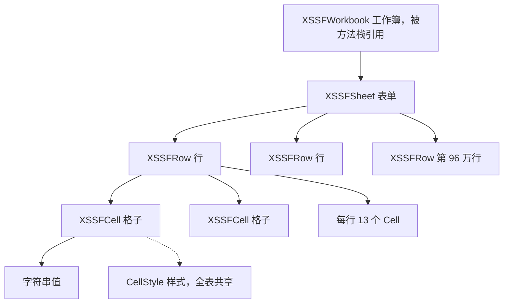

# OOM 复盘：不肯释放的对象树，与 POI 官方的三条出路

堆曲线上扬、GC 空转、最终内存溢出，现象已经记录在案。接下来把镜头从监视页切回代码：逐层数一数导出过程到底创建了哪些对象，解释垃圾回收为什么束手无策，再对照 POI 官方给出的三条路线，把海量数据的读写选型一次讲清。

## 先给结论

- 内存只涨不跌的直接原因：对象只增不减，GC 频繁介入却几乎收不到垃圾。
- 对象图一算吓一跳：96 万行乘 13 列约 1250 万个 Cell，外加 96 万个 Row 与各自的字符串值，写出文件前全部可达。
- POI 对 Excel 2007 大数据量操作给出三种模式：用户模式、事件模式、SXSSF。
- 选型口诀：导出（写）百万数据用 SXSSF，导入（读）百万数据用事件模式。
- 工程上还有 CSV、分页导出等替代路线，按业务是否必须单文件带样式的 xlsx 来取舍。

## 一、把曲线翻译成机制：GC 为什么在空转

监视页上 CPU 曲线的规律性波动，对应的是垃圾回收器的反复启动。JVM 堆回收的逻辑很朴素：对象分配到一定量，GC 介入，从 GC Roots 出发做可达性分析，不可达的收走，可达的留着。

导出方法执行期间，可达性分析每次都得出同样的结论：局部变量 `wb` 引用着工作簿，工作簿挂着表单，表单挂着全部行与单元格，整棵树从线程栈出发全部可达。GC 扫完整棵树，只收走循环里少量引用已被覆盖的临时对象，然后收工。下一次阈值触发又来一遍，依旧收获寥寥。CPU 被白白消耗，堆纹丝不动，这个状态持续到堆上限被击穿，抛出 `OutOfMemoryError`。

## 二、给对象图算一笔账

回到代码数对象，填充数据的循环体每转一圈都在产出：

```java
for (int i = 0; i < 10000; i++) {
    for (EmployeeReportResult report : list) {
        Row row = sheet.createRow(rowIndex++);   // 一个 XSSFRow 对象
        cell = row.createCell(0);                // 每个格子一个 XSSFCell 对象
        cell.setCellValue(report.getUserId());   // 格子里再挂一个字符串值
        cell.setCellStyle(styles[0]);            // 样式全表共享，但引用挂在每个 Cell 上
        // 第 1 到 12 列同理，每列一个 Cell
    }
}
```

一行 13 列，就是 1 个 Row 加 13 个 Cell；96 万行合计约 96 万个 Row、1250 万个 Cell，单元格里的字符串值再各占一份内存。样式对象本身只创建了一二十个，但每个 Cell 都持有对样式的引用，引用同样占空间。更别说 XSSF 的对象内部封装着与 XML 结构相关的字段，单个对象的字节数远不止一个对象头的开销。几个 GB 的堆就是被这么一层层吃掉的。

这棵对象树长这个样子，从工作簿到最末端层层引用，源头就是方法栈上的 `wb` 变量：



用户模式的运作方式由此看清：所有对象先全部生产出来放进内存，等全部就绪才以流的形式写出下载，写出之前一个都不释放。数据量决定对象总量，对象总量决定堆的生死。

## 三、POI 官方的三条路线

内存问题的根源明确后，出路在 POI 官方文档里写得明明白白。针对 Excel 2007 的大数据量操作，官方把模式分成三种，2003 的 HSSF 受 65536 行硬顶限制，不在讨论范围：

**第一种，用户模式（usermodel）。** 之前一直在用的写法：`XSSFWorkbook` 加一堆封装好的方法，建表建行建格子都替你包好了，用起来最顺手。代价是封装不透明、过程中产生大量对象，非常耗内存，数据量一大先倒下的就是它。

**第二种，事件模式（eventmodel）。** 基于 SAX 解析 XML。SAX 全称 Simple API for XML，不同于把文档一次性加载进内存的 DOM 式解析，它逐行扫描文档、一边扫描一边解析，扫完即弃。xlsx 的底层本来就是 XML，所以这条路天生适合读：解析海量报表做导入，CPU 与内存占用都低。

**第三种，SXSSF。** 名字看后四个字母就知道是 XSSF 的流式变体，专门用来生成海量 Excel 文件，核心手段是借助磁盘临时文件分担内存，写方向专供。

把三种模式的关键差异整理成表（整理自官方能力对比表与课程课件）：

| 维度 | 事件模式（SAX 流式） | 用户模式（内存对象树） | SXSSF（缓冲流式） |
|---|---|---|---|
| 实现思路 | 逐行扫描 XML，边扫边处理 | 全量对象树驻留堆 | 窗口内留内存，窗口外落盘 |
| CPU 与内存效率 | 好 | 视数据量，大数据量下差 | 好 |
| 仅向前访问 | 是 | 否，可随机访问 | 是 |
| 读文件 | 是 | 是 | 否 |
| 写文件 | 否 | 是 | 是 |
| 建行建格、设样式 | 否 | 是 | 是 |

表里最有价值的两行是读写分工：事件模式只读不写，SXSSF 只写不读，用户模式读写都行但内存代价随数据量恶化。百万级场景的选型由此直接推出：导出走 SXSSF，导入走事件模式。

## 四、跳出 POI 看路线：CSV 与分页

POI 三条路线之外，工程上还有两个常见选项，判断标准只有一条：业务是否必须交付单文件、带样式、多表单的 xlsx。

**CSV 路线。** 报表只是给人看数据、不挑格式的话，CSV 几十行代码就能写完，逐行输出到文件输出流，内存占用与单行数据成正比，和总量无关。代价是没有样式、没有多 sheet、用 Excel 打开长数字会变科学计数法。

**分页导出路线。** 把一次百万行拆成多次千行级导出，或者转成异步任务生成文件后给下载链接。单次请求内存压力小，体验从「点一下等十分钟」变成「稍后取件」，是对现有用户模式代码改动最小的过渡方案。

业务坚持要一个完整的 xlsx，SXSSF 就是正解，原理与实操在后面两节展开。

## 常见误区

- **想用事件模式做导出。** 事件模式是 SAX 流式读，官方对比表里 Write Files 一栏是 No，它根本没有写能力。写海量数据选 SXSSF，别选错方向。
- **把样式复用当成内存问题的解药。** 复用省下的样式对象量级是几十个，行与格子的量级是千万个，差着五个数量级，救不了场。
- **觉得 HSSF 的事件模式也能上百万级。** xls 格式本身 65536 行封顶，事件模式再省内存也突破不了格式上限，百万级只在 2007 的 xlsx 上讨论。
- **以为调大 `-Xmx` 就是解决方案。** 堆翻倍只是把崩溃点往后推，大堆还带来更长的 GC 停顿，模型不变，问题只是迟到。

## 面试可能被问到的问题

1. 面试官追问：「POI 的用户模式和事件模式有什么区别？」
   答：用户模式是高层封装，方法好用、代码量少，但把整个工作簿建成对象树放进堆，内存占用高；事件模式基于 SAX 逐行解析 XML，内存占用极低、速度快，但仅向前、只读、写代码繁琐。大数据量读取选事件模式，常规读写选用户模式。

2. 面试官追问：「xlsx 为什么可以用 SAX 来解析？」
   答：xlsx 本质是一个 ZIP 包，里面装着一组 XML，工作表数据就在 sheet 对应的 XML 里。SAX 按顺序扫描 XML，不需要把内容展开成对象树，所以能以很小的内存处理超大文件。

3. 面试官追问：「导出过程中 GC 为什么收不回内存？」
   答：写出文件之前，工作簿对象树从方法栈出发全部可达，行、格子、字符串、样式引用都活着，属于强可达对象，GC 只能回收极少量临时碎屑，堆因此只涨不跌。

4. 面试官追问：「百万数据导出，你的技术选型思路是什么？」
   答：先确认格式要求。只看数据不挑格式就 CSV 流式输出；必须 xlsx 就用 SXSSF 流式写，窗口控制在几百行以内；读取方向用事件模式。都不行再考虑分页拆分或异步任务兜底。

5. 面试官追问：「SXSSF 和 XSSF 是什么关系？」
   答：SXSSF 是 XSSF 的流式扩展，API 基本兼容，内部借助磁盘临时文件，只保留滑动窗口内的行在内存里。换来的是低内存写大文件，失去的是随机访问与部分功能，比如不支持模板级随机修改、窗口外的行不可再访问。

## 配套资料

- 用户模式的封装工具类（用户模式对象开销的真实代码样本）：`materials/code/02/day08 POI高级/POI高级/资源/代码/工具类/ExcelExportUtil.java`
- 配套的注解定义：`materials/code/02/day08 POI高级/POI高级/资源/代码/工具类/ExcelAttribute.java`
- 下载工具类：`materials/code/02/day08 POI高级/POI高级/资源/工具类/DownloadUtils.java`
- 百万数据练习实体：`materials/code/02/day08 POI高级/POI高级/资源/百万数据报表/PoiEntity.java`
- 三种模式的对比表整理自 Apache POI 官方能力对比表与课程课件转录
