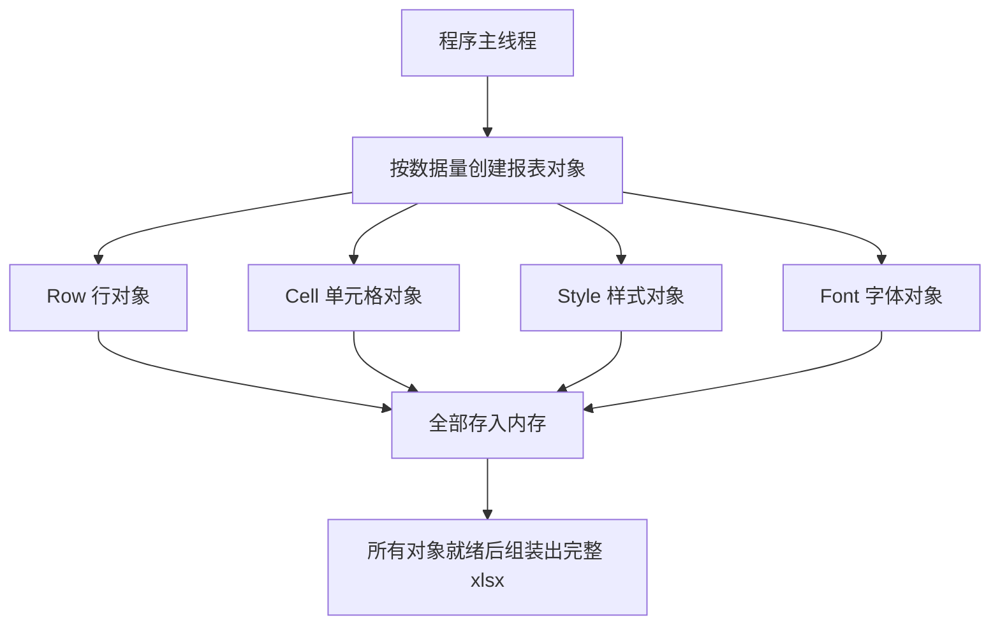
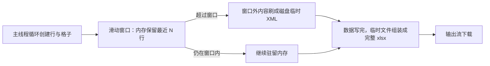

# 让磁盘替内存扛一半：SXSSF 的需求背景与思路推演

百万级导出的失败原因已经定位：XSSF 把所有单元格对象攒在内存里，数据越多堆越满，机器扛不住就溢出。要交付的需求却很朴素：点一下导出，拿到一个完整的 xlsx，服务活着。这一节顺着白板推演，把 SXSSF 为什么能同时满足这两条讲透。

## 先给结论

- 需求一句话：把百万级数据导成一个可下载的 xlsx，且导出过程中服务不崩。
- 白板推演的结论：生成 xlsx 所需的 Row、Cell、Style、Font 对象一个都少不了，全部就绪才能组装出完整报表。
- 减对象这条路走不通：行和格子由数据量决定，样式与字体只能省小头。
- 可行的方向是分工存储：内存里留一部分对象，超出的写到磁盘临时文件，数据一个不少。
- SXSSFWorkbook 就是这条思路的官方实现，阈值可配，默认保留最近 100 行在内存。

## 一、需求与现状的落差

需求描述简单到只有一句：通过 Apache POI 完成百万数据量级别的 Excel 报表导出。现实是上一节的实测画面：导出按钮点下去，浏览器转圈好几分钟，堆内存冲到几个 GB 还在涨，最后要么超时要么溢出。

落差不在功能，在量级。同样的代码，几百行秒下，百万行把服务拖死。要补的不是新业务逻辑，是一套新的内存策略：让导出过程的对象占用与总数据量脱钩，只与某一个固定参数相关。

## 二、老方案的对象账本：为什么一个都省不掉

白板推演从程序主线程画起。主线程按数据量创建报表对象，这些对象包括行对象 Row、单元格对象 Cell、样式对象 Style，样式里还嵌着字体对象 Font，全部塞进内存。只有当所有对象全部生成、全部揉合到一起，最终的 Excel 报表才能构造出来。少任何一个对象，报表就缺一块。

这张图暴露的问题在末端那一格：内存里的对象数量与数据量严格成正比，百万行就是百万行对象加千万级格子对象。堆是有上限的，涨过上限就是 OOM。想自救，只有两个方向可以推。

## 三、两条设想路线的推演

**路线一，减少对象的产生。** 听起来直接，逐项盘一下就知道走不通。行减不掉，一行对应一条数据，百万条数据就要百万行；格子减不掉，一个格子承载一个字段值，列数是需求定的；样式和字体倒是可以砍，它们只为美化服务，砍掉报表照样能用，但省下的量级是几十上百个对象，对千万级总量是杯水车薪。减法做到头，量级纹丝不动。

**路线二，内存与磁盘分工存储。** 换个问法：这些对象生成出来，不放内存、放到磁盘上行不行？比如设定一个阈值，内存占用到了临界值，就把它产生的对象内容写到磁盘文件里，内存继续接手后面的数据。数据一个都没少，只是一个在内存、一个在文件，最终两者拼在一起，同样能组装出完整的报表。内存占用从此被阈值封顶，不再随数据量增长。

两条路线只有第二条动了根本：它没有减少对象对应的数据，只是换了个存放的地方。磁盘比内存便宜得多也大得多，用它来兜底，量级问题就变成了速度问题，而速度是可接受的。

## 四、SXSSF：把路线二做成官方实现

POI 官网提供的 SXSSF 对象，实现的就是路线二的思想：往磁盘写临时文件，与内存共同存储数据。原理描述是这样的：创建 SXSSFWorkbook 时可以指定内存中产生的对象数量（默认 100），一旦内存中的对象个数达到这个指定值，就把这些对象的内容写入磁盘（XML 格式的临时文件），再把对象从内存中销毁；之后每达到一次阈值，就照同样方式处理一轮，直至 Excel 导出完成。

「默认 100」的意思是内存里只保留最近 100 行，更早的行已经被刷成磁盘上的临时 XML。这个参数通常叫滑动窗口，窗口大小就是那个把内存占用封顶的阈值。整个导出过程的数据流向如下：

临时文件机制能成立，靠的是 xlsx 格式本身的结构：它是一个 ZIP 包，里面装着若干 XML。SXSSF 把窗口外每一行的数据按顺序流式写进临时 XML，相当于提前干了最终写文件时才干的活，只是分段干、边干边卸货。数据全部写完后，POI 把临时文件与文档骨架组装成完整的 xlsx，内存里从头到尾只养着一个窗口的行。

代价也要认清：窗口外的行已经落盘，从内存里销毁了，之后再想回头改第 5 行的某个格子，或者随机读取任意行，都做不到；模板打印依赖对已有内容的随机修改，因此 SXSSF 不支持模板打印，只能手动建表写表头。这些限制换来的，是内存占用与总数据量彻底脱钩。

## 常见误区

- **以为窗口越大导出越快越好。** 窗口大小直接决定堆峰值，设成十万等于把老问题原样搬回来，一般几十到几百行足够。
- **把临时文件当成最终文件。** 磁盘上出现的是中间态的 XML 片段，直接拿去打开是无效的，必须等 POI 组装出完整的 xlsx。
- **以为 SXSSF 能配合模板打印。** 它不支持对已有内容的随机修改，模板方案走不通，只能手动创建工作表、写表头、逐格填充。
- **忽略临时文件的磁盘占用。** 临时 XML 体积可观，导出结束要及时清理（`dispose` 方法），否则多次导出后磁盘被垃圾文件占满。

## 面试可能被问到的问题

1. 面试官追问：「SXSSF 解决什么问题，核心思路是什么？」
   答：解决海量数据导出的内存溢出问题。核心思路是内存与磁盘分工：内存里只保留滑动窗口内的行，窗口外的行内容刷成磁盘临时文件并销毁对象，最终再组装成完整文件，内存占用被窗口大小封顶。

2. 面试官追问：「滑动窗口参数是什么含义，设多大合适？」
   答：即 `new SXSSFWorkbook(n)` 里的 n，表示内存中最多保留最近 n 行对象，默认 100。太大堆峰值高，太小刷盘频繁影响速度，常规几十到几百行，按单行列数与内存预算权衡。

3. 面试官追问：「SXSSF 导出过程中磁盘上发生了什么？」
   答：每超过一次窗口阈值，窗口外的行就被序列化成 XML 写入临时文件，导出完成时这些临时文件被组装、压缩成最终 xlsx。所以磁盘占用会先于最终文件出现，结束后要清理临时文件。

4. 面试官追问：「为什么减少对象产生这条路走不通？」
   答：行数与列数由业务数据量决定，一个格子一个值，对象数量有下限；样式字体虽可省，量级只占零头。省小头改变不了千万级对象的总量，必须换存放介质。

5. 面试官追问：「SXSSF 的主要限制有哪些？」
   答：窗口外的行不可随机访问、不可回头修改，因此不支持模板打印；Sheet 克隆不支持；已刷盘的行不能回读。适合一次性顺序写出的报表场景，不适合复杂编辑。

## 配套资料

- 百万数据练习实体（下一节导出代码的数据载体）：`materials/code/02/day08 POI高级/POI高级/资源/百万数据报表/PoiEntity.java`
- 下载工具类：`materials/code/02/day08 POI高级/POI高级/资源/工具类/DownloadUtils.java`
- 原理描述转录自课程课件 4.2 小节；示例代码与流程图按本课思路补全，完整改造代码在下一节
