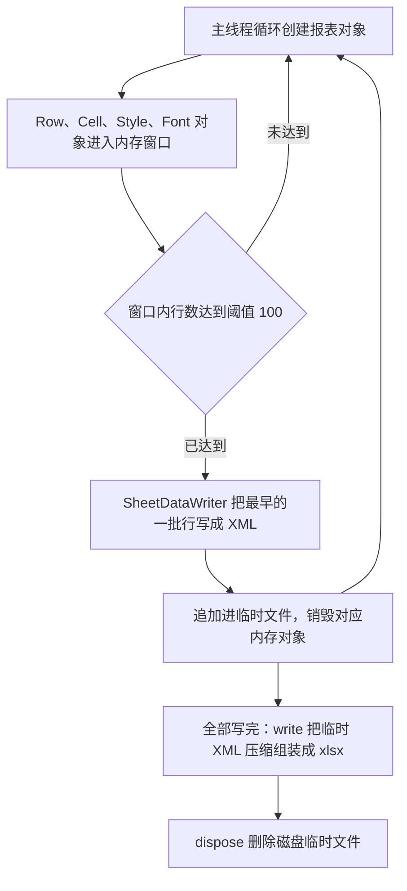

# SXSSF 原理拆解：临时 XML 文件与刷盘节奏，百万导出收束

换成 `SXSSFWorkbook(100)` 之后，96 万行的导出确实稳了。但盯着 JVisualVM 的人心里多半还有两个疑问：导出进行时磁盘上悄悄多出来的那个 XML 文件是什么？堆曲线整体为什么仍在缓慢爬高，窗口机制不是封了顶吗？把这层窗户纸捅破，POI 海量导出这条线才算真正画上句号。

## 先给结论

- SXSSF 刷盘落的是 XML：窗口外的行被追加写进临时文件 `poi-sxssf-sheet<随机数>.xml`，`write` 时再压缩组装成完整的 xlsx。
- 临时文件里的标签结构与 xlsx 内部的工作表 XML 同构：`row` 是行，`c` 是单元格，字符串以内联方式直接躺在格子里。
- 窗口只能封住「窗口内」的量，封不住速率差：对象创建远快于磁盘落盘，内存水位长期看仍在上涨，数据量到千万级依然有 OOM 风险。
- 工程上的兜底手段只有一个方向：减少对象产生，海量导出里样式、字体这类开销能省则省。
- 方案边界要记牢：SXSSF 只适合一次性顺序写出的大报表，不支持模板打印，也不支持回头修改已刷盘的行。

## 一、实验现场：清空临时目录再导一次

操作不难：`Win + R` 输入 `%temp%` 进入系统临时目录，把里面的文件清空，回到页面点一次导出。JVisualVM 上内存开始波动的同时，刷新临时目录，会多出一个类似 `poi-sxssf-sheet7039257060504777641.xml` 的文件，文件名里那一长串数字是随机数；反复刷新，它的体积一直在变大。

```bash
# 导出进行中，另开一个命令行窗口观察临时目录
cd %TEMP%
dir poi-sxssf-sheet*.xml
# 体积随导出进度持续增长，导出结束调用 dispose 后被清理
```

这个文件就是 SXSSF 的「内存替身」。导出期间它一直在长，直到数据全部写完，`write` 把它组装进最终的 xlsx，`dispose` 再把它删掉。

## 二、打开临时文件：就是 xlsx 的原生结构

用文本编辑器打开这份临时 XML（文件很大，挑开头看），内容长这样：

```xml
<row r="64">
  <c t="inlineStr"><is><v>B64</v></is></c>
  <c t="inlineStr"><is><v>test58</v></is></c>
  <c t="inlineStr"><is><v>B65</v></is></c>
  <c t="inlineStr"><is><v>test59</v></is></c>
</row>
```

`row` 的 `r` 属性是行号；`c` 是单元格；`t="inlineStr"` 表示这个格子的内容是内联字符串，值直接写在 `is`、`v` 标签里，不依赖共享字符串表。这份结构与 xlsx 解压后 `xl/worksheets/sheet1.xml` 的结构完全一致。

所以 SXSSF 并没有发明新格式。xlsx 本来就是一份 zip 压缩包，包里躺着描述工作表的 XML；传统 XSSF 是把全部对象在内存里攒完，最后一次性生成 XML 再压缩；SXSSF 则是边导边按同样的结构把行写进临时 XML，`write` 时把现成的内容压缩打包成 xlsx。POI 里干这件事的是流式包内部的 `SheetDataWriter`，那份临时文件正是由它创建的。

## 三、源码级流程：主线程、内存窗口与磁盘文件

把课堂那张原理图翻译成调用链，就是下面这张图：



关键路径在「已达到」这条分支上：`SXSSFSheet.createRow` 每次创建新行前都会检查窗口，达到 `rowAccessWindowSize`（构造函数里传的 100）就触发刷盘，最早的行经 `SheetDataWriter` 序列化成 XML 追加到临时文件，对应的 Java 对象随即销毁。堆曲线之所以是锯齿，就是「对象入窗、满窗落盘」这一对动作反复交替的结果。

## 四、内存为什么还是会涨：两个速度的差距

窗口讲清楚了，还得回答开头那个问题：整体水位为什么仍在上涨？

**第一，造对象和写磁盘是两个数量级的速度。** 课堂推演用了一组很直白的数字：主线程一秒能创建 100 个对象，刷盘受磁盘 I/O 限制，同样一秒可能只写得走一个对象量级的内容，中间差着上百倍。先进内存、再落磁盘的设计注定存在积压，窗口只是给积压留了个中转站，并没有改变收支不平衡，这就是「杯水车薪」。

**第二，堆里的对象不止窗口里那些。** 业务侧查出来的结果集、拼装的字符串、临时变量都常驻堆中，窗口只能封住 POI 行对象这一部分。锯齿的「齿」来自窗口刷盘，锯齿的整体基线却随数据量缓慢上移。

推到极限就能得出结论：SXSSF 能扛百万，不代表能无限扛。真到千万级，唯一的出路是减少对象的产生。这也是为什么海量导出里坚决不要样式、不要字体，那些全是额外的对象开销；确实需要样式，就手动建少量共享的 `CellStyle`，而不是一格一个。

## 五、导出这条线的收束

到这里，POI 写 Excel 的方案可以归拢成一张表：

| 方案 | 适用量级 | 模板 | 随机修改 | 典型场景 |
|---|---|---|---|---|
| XSSF（用户模式） | 小到中 | 支持 | 支持 | 常规报表、复杂样式 |
| SXSSF（流式写） | 百万级 | 不支持 | 仅窗口内 | 一次性顺序导出的大表 |
| CSV / 分页多文件 | 不设限 | 无 | 无 | 超大数据、下游可接文本 |

再配上四条实操要点：换 `SXSSFWorkbook` 之前先放弃模板思路；窗口参数按内存预算给；导出结束调 `dispose` 清临时文件；样式做减法。百万导出至此收束，反方向的难题紧跟着来：把这些大表读回来。

## 常见误区

- **把临时文件当成结果文件。** 导出中途去临时目录拷 `poi-sxssf-sheet*.xml`，拿到的是不完整的中间产物，正确的交付物只有 `write` 之后的那份 xlsx。
- **以为窗口调得越小越省。** 窗口越小刷盘越频繁，I/O 次数飙升，导出速度明显变慢；内存预算允许时给到默认 100 或更高，在内存与速度之间取平衡。
- **认为加大堆就能无限导。** 堆只推迟 OOM 的到来，数据量上不封顶时，速率失配决定了水位总会漫过上限。
- **给 SXSSF 套模板打印。** 它不支持对模板已有内容做随机修改，需要模板的报表要么放弃海量导出，要么放弃模板。

## 面试可能被问到的问题

1. 面试官追问：「SXSSFWorkbook 低内存导出的原理是什么？」
   答：内部维护一个滑动窗口，内存里只保留最近 N 行对象；窗口外的行由 `SheetDataWriter` 序列化成 XML 追加到磁盘临时文件，`write` 时再压缩组装成完整 xlsx。堆占用因此被窗口大小封顶，与总数据量脱钩。

2. 面试官追问：「导出过程中临时目录里的 XML 是什么？」
   答：刷盘产生的中间文件，文件名形如 `poi-sxssf-sheet<随机数>.xml`，内部就是 xlsx 工作表的原生 XML 结构。它参与了最终 xlsx 的组装，导出完成后由 `dispose` 负责删除。

3. 面试官追问：「用了 SXSSF 之后内存为什么还是会缓慢上涨？」
   答：一是对象创建速度远高于磁盘落盘速度，速率失配带来积压；二是窗口之外还有业务结果集等对象常驻堆里。所以 SXSSF 适合百万级，量级再大就要靠减少对象产生、分批导出等手段配合。

4. 面试官追问：「窗口参数怎么设置？」
   答：默认 100，含义是内存中保留最近 100 行。调小更省内存但刷盘 I/O 频繁、速度慢；调大速度快但堆占用高。按单行内存估算行宽，再结合 JVM 内存预算取值。

5. 面试官追问：「SXSSF 写过的行还能改吗？」
   答：窗口内的可以，窗口外的行已被序列化落盘并销毁，回头修改会抛出异常。它只支持向前写，需要随机修改的场景只能用 XSSF，或者把修改逻辑提前到进窗口之前。

## 配套资料

- 导出方法所在的控制器（资料包内为用户模式版本，流式改造版以课堂实录为准）：`materials/code/02/day07 员工管理及POI入门/员工管理及POI入门/资源/后端/ihrm_employee/src/main/java/com/ihrm/employee/controller/EmployeeController.java`
- 报表数据来源实体：`materials/code/02/day07 员工管理及POI入门/员工管理及POI入门/资源/后端/实体类/employee/response/EmployeeReportResult.java`
- 下载工具类：`materials/code/02/day08 POI高级/POI高级/资源/工具类/DownloadUtils.java`
- 临时 XML 结构为课堂实录观察所得，资料包内无流式导出改造版源码；`SheetDataWriter` 相关说明依据 POI 源码语义整理
