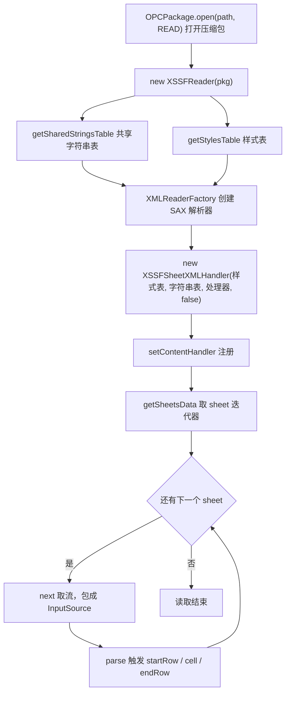

# 七步跑通百万行读取：事件模式驱动代码与内存实测

处理器 `SheetHandler` 已经就位，`startRow`、`cell`、`endRow` 三个回调能把一行数据拼成 `PoiEntity`。但处理器只是被动接活的一方，还缺一个驱动者：谁打开文件，谁把处理器注册上去，谁让解析器开始扫描。这一节把测试类补完整，从打开压缩包到逐 sheet 解析全流程跑通，再用性能监控工具看一眼百万行读取时的内存曲线，最后给 day08 收尾。

## 先给结论

- 驱动代码固定七步：打开 `OPCPackage`、创建 `XSSFReader`、取共享字符串表与样式表、创建 SAX 的 `XMLReader`、注册事件处理器、迭代 sheet 逐个 `parse`。
- 前四步拿到的对象大多不直接参与业务，它们是注册事件处理器时的必备参数。
- 注册只要一行：POI 的 `XSSFSheetXMLHandler` 实现了 SAX 的 `ContentHandler` 接口，直接 `setContentHandler` 塞给解析器；构造的第二个参数必须传共享字符串表，别和样式表搞混。
- 一个 xlsx 有几个 sheet 就迭代几次，每个 sheet 的流包成 `InputSource` 再 `parse`；共享字符串表和样式表与 sheet 个数无关，全程只取一次。
- 实测百万行报表读取，使用内存最高两三百兆、曲线平直不震荡；事件模式用代码啰嗦换来了内存可控。

## 一、测试类的七步骨架

在 test 包下新建 `PoITest06`，先把骨架和注释立起来，这份注释就是事件模式读取的全景图：

```java
package com.example.poi.test;

public class PoITest06 {
    public static void main(String[] args) throws Exception {
        // 要解析的百万数据报表
        String path = "C:\\Users\\ThinkPad\\Desktop\\lihrm\\day8\\资源\\百万数据报表\\demo.xlsx";
        //1. 根据excel路径获取OPCPackage
        //2. 创建XSSFReader对象
        //3. 获取SharedStringsTable对象
        //4. 获取StylesTable对象
        //5. 创建SAX的XMLReader对象
        //6. 注册事件处理器
        //7. 运行读取
    }
}
```

七步里前四步是备料，后三步才是解析本体。备料阶段拿到的对象看着「没用」，到注册事件处理器那一刻全都要交出去。

## 二、前四步：把注册要用的材料备齐

```java
//1. 根据 excel 路径获取 OPCPackage：以只读方式把 xlsx 当压缩包打开
OPCPackage opcPackage = OPCPackage.open(path, PackageAccess.READ);
//2. 创建 XSSFReader 对象：事件模式读取压缩包内容的入口
XSSFReader reader = new XSSFReader(opcPackage);
//3. 获取共享字符串表：把单元格里的字符串索引翻译成真实文本
SharedStringsTable table = reader.getSharedStringsTable();
//4. 获取样式表：翻译日期、货币这类带格式的值时要用
StylesTable stylesTable = reader.getStylesTable();
```

`OPCPackage.open` 的第二个参数 `PackageAccess.READ` 声明打开意图：这回是来读的，只读权限就够。`XSSFReader` 拿到包就等于拿到了整个压缩包的钥匙，字符串表和样式表由它直接提供。前四步全程还在 POI 的世界里，从第五步开始才跨进 JDK 的 SAX 世界。

## 三、后三步：建解析器、注册、开读

```java
//5. 创建基于 SAX 的 XMLReader 对象，注意导入 org.xml.sax 包
XMLReader xmlReader = XMLReaderFactory.createXMLReader();
//6. 注册事件处理器
xmlReader.setContentHandler(
        new XSSFSheetXMLHandler(stylesTable, table, new SheetHandler(), false));
```

**XMLReader 从工厂来，包名别导错。** `XMLReaderFactory.createXMLReader()` 是 JDK SAX 包里的工厂方法，`XMLReader` 这个接口必须取自 `org.xml.sax` 包，IDE 自动导包时带到别的 XML 实现类上，返回值直接赋不上去。

**注册是把两个世界的接口对上。** SAX 解析器认的是 `ContentHandler` 接口，要求调用方提供收到 XML 事件后的处理逻辑；POI 的 `XSSFSheetXMLHandler` 已经实现了这个接口，内部把工作表 XML 的底层事件翻译成 `startRow`、`cell`、`endRow` 这些业务友好的回调，所以注册一行搞定。构造参数四件套：样式表、共享字符串表、自定义的 `SheetHandler`、还有一个布尔值。录屏里第二个参数一度传成了样式表，随即被订正成共享字符串表 `table`，这两个表是不同类型，顺序写反编译都过不了，复制粘贴手快时容易踩。布尔参数 `formulasNotResults` 传 `false`，意思是公式单元格输出计算结果而不是公式本身；四参构造内部会自建一个默认的 `DataFormatter` 做格式翻译，需要定制时换用带 `DataFormatter` 的五参构造。

## 四、第七步：逐 sheet 读取

**直接把文件丢给 parse 走不通。** xlsx 是 zip 压缩包不是纯 XML，把文件输入流直接包成 `InputSource` 交给解析器，解析器面对的是一堆二进制。正确姿势是经由 `XSSFReader` 拿到压缩包内部每个 sheet 对应的 XML 流，那才是解析器能消化的东西。

**迭代器把每个 sheet 的流交出来。** `getSheetsData()` 返回的是 `InputStream` 的迭代器，强转成 `XSSFReader.SheetIterator` 之后，`hasNext` 判断还有没有下一页，`next` 取出当前 sheet 的流数据：

```java
//7. 运行读取：迭代所有 sheet，逐页解析
XSSFReader.SheetIterator sheetIterator =
        (XSSFReader.SheetIterator) reader.getSheetsData();
while (sheetIterator.hasNext()) {
    InputStream stream = sheetIterator.next();   // 当前 sheet 的 XML 输入流
    InputSource is = new InputSource(stream);    // 包装成 SAX 输入源
    xmlReader.parse(is);                         // 开始解析，触发处理器回调
}
```

`InputSource` 是 SAX 世界里的「输入源」抽象，一个 sheet 的全部内容都在这个源里。`parse` 一启动，解析器从头扫描这份 XML，碰到一行就回调一次 `startRow`，行内逐格回调 `cell`，行尾回调 `endRow`。百万行报表就是百万次这样的三段式回调，内存里永远只握着正在组装的那一行。

整条链路串起来是这样：



这张图在讲事件模式读取的完整流水线：左侧备料、中间注册、右侧循环消费。关键路径是 K 到 I 的回边，百万行数据全部从这一个循环里流出去，共享字符串表与样式表在进入循环前只准备一次。

## 五、跑起来看内存：VisualVM 实测

运行 `PoITest06`，控制台开始一行接一行输出 `PoiEntity`，全程不抛任何异常。执行期间打开 JDK 自带的性能监控工具 VisualVM（`jvisualvm` 命令即可启动，它源于 NetBeans 的 profile 子项目，能监控线程、内存、CPU 与垃圾回收），定位到 `PoITest06` 这个进程观察曲线：代表使用内存的蓝色线最高到两三百兆，整体平直没有波浪，CPU 占用也平缓，等肉眼反应过来的时候程序已经执行完了，速度相当快。

对照用户模式读同一个文件的表现：报表内容被整体映射进内存，使用曲线一路上扬。同一个文件、两种模式，差距全在加载策略上，事件模式自始至终只握着「当前一行 + 两张基础表」，文件再大曲线也不涨。

## 六、day08 收束：POI 的三种模式一张表记牢

day08 的内容到这里全部讲完，整天的知识归成三块。

**第一块，报表打印。** 传统方式逐格手写，模板打印靠现成模板带出样式；再往上抽了自定义注解加反射的工具类，把导出导入的样板代码收掉。注解和反射配合的这套写法值得单独消化。

**第二块，百万数据。** 导出与读取各有一条路：导出用 SXSSFWorkbook 借临时存储空间刷盘，读取用事件模式逐行回调，两条路共同点是都不把全量数据压在内存里。

**第三块，官方概念对齐。** POI 针对大数据量给出三种模式，一张表记牢：

| 模式 | API | 能力 | 内存表现 |
|---|---|---|---|
| 用户模式 | usermodel（`XSSFWorkbook`） | 读写全能，样式、公式、批注、行列位移全支持 | 全量加载，高 |
| 事件模式 | eventusermodel 加 SAX | 只读、只能向后走 | 只留当前行，低 |
| 流式写 | SXSSFWorkbook | 只写，窗口外的行刷到临时文件 | 低 |

官方对比表里还有一条隐含信息：事件模式与 SXSSF 的 CPU 与内存效率都是 Good，但功能上做了取舍，样式、公式求值这些高级操作只有用户模式全支持。功能与内存不可兼得，按数据量选型才是正解。

## 常见误区

- **XMLReader 导错包。** SAX 的 `XMLReader` 必须取自 `org.xml.sax` 包，IDE 自动导包时容易带到其他 XML 实现类上，工厂方法的返回值赋不过去。
- **把 xlsx 文件流直接丢给 parse。** 文件本体是 zip 二进制不是 XML，必须经 `XSSFReader` 拿到 sheet 的 XML 流再解析。
- **构造 handler 时两个表传反。** `StylesTable` 与 `SharedStringsTable` 类型不同，传反编译报错；记「先样式、后字符串」。
- **不关资源。** 演示代码省略了收尾，生产代码里 `OPCPackage` 用完要显式 `close()`，只读打开也占文件句柄。

## 面试可能被问到的问题

1. 面试官追问：「事件模式读取百万行 Excel 的完整链路是什么？」
   答：`OPCPackage.open` 以只读方式打开压缩包，构造 `XSSFReader` 作为读取入口，取 `SharedStringsTable` 与 `StylesTable` 备用；`XMLReaderFactory.createXMLReader` 创建 SAX 解析器，把包装了自定义处理器的 `XSSFSheetXMLHandler` 通过 `setContentHandler` 注册上去；`getSheetsData` 迭代每个 sheet，流包成 `InputSource` 逐个 `parse`，回调里逐行组装业务对象。

2. 面试官追问：「为什么注册处理器只要一行代码？」
   答：SAX 解析器认的是 `ContentHandler` 接口，而 POI 的 `XSSFSheetXMLHandler` 实现了这个接口，内部把工作表 XML 的底层事件翻译成 `startRow`、`cell`、`endRow` 这类业务回调。业务侧只需实现 `SheetContentsHandler` 接口写好三个方法，包进 `XSSFSheetXMLHandler` 注册即可。

3. 面试官追问：「一个 Excel 有多个 sheet 怎么处理？」
   答：`XSSFReader.getSheetsData()` 返回 sheet 流的迭代器，强转成 `XSSFReader.SheetIterator`，`hasNext` 判断、`next` 取当前 sheet 的输入流，每个流包成 `InputSource` 后调用 `parse`。共享字符串表与样式表和 sheet 无关，全程只取一次。

4. 面试官追问：「事件模式为什么省内存，代价是什么？」
   答：它基于 SAX 逐行扫描，一行解析完立刻回调给业务，用完即弃，内存里只有当前一行加两张基础表，占用不随文件体积增长。代价是单向不可回溯，读过的行回不去，也不能随机访问任意行，样式等高级特性的支持不如用户模式完整。

5. 面试官追问：「构造 XSSFSheetXMLHandler 最后那个布尔参数是什么意思？」
   答：`formulasNotResults`，决定公式单元格输出公式本身还是计算结果，业务上通常要看值，所以传 false 取计算结果。四参构造内部自建默认的 `DataFormatter`，需要定制格式翻译时改用带 `DataFormatter` 的五参构造。

## 配套资料

- 百万数据练习实体（`PoiEntity` 真实源码，包名已改写）：`materials/code/02/day08 POI高级/POI高级/资源/百万数据报表/PoiEntity.java`
- 用户模式导入工具类（两种模式写法对照）：`materials/code/02/day08 POI高级/POI高级/资源/代码/工具类/ExcelImportUtil.java`
- `PoITest06` 驱动代码与处理器类资料包内无对应文件，按课堂实录整理，包名已改写为 `com.example`
