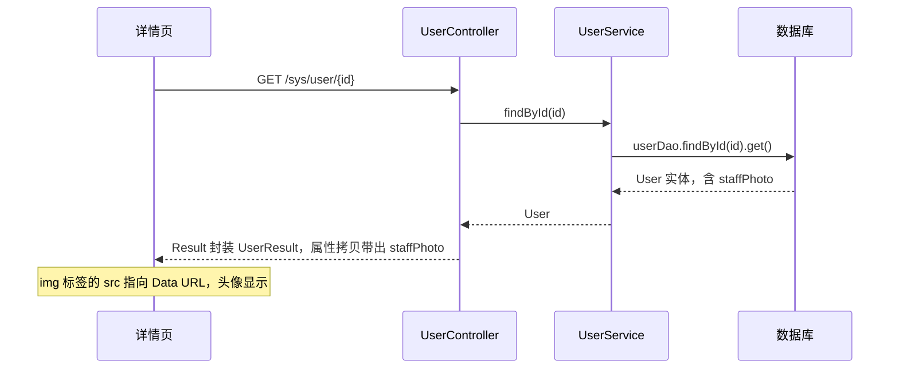

# 把头像直接写进数据库：Data URL 头像上传与回显的完整落地

员工详情页里摆着一个「员工照片」区域，提示请上传图片。点开选择器，图片要交给后端，后端要把它变成数据库里的一行数据。既然 Data URL 能把图片编码成一段字符串，那最省事的路线就摆在这：前端选图提交，后端把图片字节做 Base64 编码，拼好 Data URL 存进用户表的一个字段，回显时查出来直接塞给 `img` 标签。全程不需要磁盘目录，不需要文件服务器。

## 先给结论

- 整条链路四步：前端上传组件提交 → Controller 用 `MultipartFile` 接文件 → Service 把文件字节做 Base64 编码并拼上 `data:image/png;base64,` 前缀 → 更新用户实体的 `staffPhoto` 字段入库。
- 实体和表都要动：`User` 增加 `String staffPhoto` 属性，用户表增加长文本列，普通 `VARCHAR` 装不下十几万个字符。
- 保存完成后必须把图片访问地址返回给前端，Data URL 方案里地址就是那串编码结果本身。
- 回显的坑大概率不在上传接口，而在查询接口：详情接口返回的 `UserResult` 也要补上 `staffPhoto` 属性，否则库里有了数据、页面依旧空白。
- 方案有边界：一个头像编码后是十几万字符的长文本，只适合小图，大图要走对象存储，那是后面几节的主题。

## 一、先把链路定下来

需求拆开看只有两个动作：上传时把图片变成字符串存库，查看时把字符串从库里拿出来显示。串起来是这样：

```mermaid
flowchart LR
    A["员工详情页选择图片"] --> B["上传组件携带登录凭证提交"]
    B --> C["POST /sys/user/upload/用户ID"]
    C --> D["UserController 接收 MultipartFile"]
    D --> E["UserService 做 Base64 编码"]
    E --> F["拼 Data URL 前缀成完整字符串"]
    F --> G["更新 user.staffPhoto 入库"]
    G --> H["返回字符串作为访问地址"]
    H --> I["前端拿到地址直接预览"]
    I --> J["详情接口回查时随 UserResult 带回"]
```



图里最后两步是这一节最容易漏的地方：地址不仅要存，还要能被详情接口查出来带回页面。上传接口和回显接口各管一半，缺一不可。

前端不是重点，课堂资料里给了一个现成的上传组件 `imgUpload.vue`，把它复制进前端工程的 `components` 目录就能用。组件里真正值得关注的是上传地址：

```vue
<el-upload :action="'/api/sys/user/upload/' + uid" :data="fullUpType"
           :headers="myheader" :on-success="uploadSuccess"
           list-type="picture-card">
  <span>请上传图片</span>
</el-upload>
```

`action` 拼上了路由参数里的用户 ID，也就是「给哪个人传头像」；`myheader` 里带的是登录令牌，让上传请求能通过权限校验；文件字段名用组件默认的 `file`，这个名称马上要在后端用到。抓包看请求会很直观：接口是 `/sys/user/upload/{id}`，请求体里以流的形式带着图片字节。

## 二、数据层准备：实体加属性，表加列

头像要落到用户表，先改实体。系统微服务里的 `User` 类加一个属性：

```java
// 用户头像，Data URL 形式
private String staffPhoto;
```

数据库同步加列。下面这条 SQL 是示例，列类型用长文本：

```sql
ALTER TABLE base_user ADD COLUMN staff_photo LONGTEXT COMMENT '用户头像，Data URL 形式';
```

为什么必须用 `LONGTEXT` 这类长文本类型？一张普通照片按几百 KB 算，Base64 编码后长度膨胀三分之一，落到数据库里就是十几万甚至几十万个字符。`VARCHAR(255)` 这种常规列直接就报超出长度了，别在字段类型上省事。

## 三、Controller：两个注解把文件接进来

上传接口写在系统微服务的 `UserController` 里，类上有 `@RequestMapping("/sys")`，方法上一行完成路径声明：

```java
// 上传用户头像：路径里的 id 是用户 ID，file 是前端传来的文件
@RequestMapping("/user/upload/{id}")
public Result upload(@PathVariable String id,
                     @RequestParam(name = "file") MultipartFile file) {
    // 处理逻辑留在 Service，调用后拿到图片访问地址
    String imageUrl = userService.uploadImage(id, file);
    return new Result(ResultCode.SUCCESS, imageUrl);
}
```

三个参数注解各司其职：`@PathVariable` 从路径里取用户 ID；`@RequestParam(name = "file")` 里的 `file` 必须和前端表单的文件字段名完全一致，组件默认名就是 `file`，写错名字直接 400；`MultipartFile` 是 Spring 封装的文件对象，字节内容、原始文件名都能从它身上拿。

返回值设计有个讲究：`Result` 的 `data` 放的是图片访问地址。这个地址既可以是 Data URL，也可以是 HTTP 外链，前端拿到什么就显示什么。这个抽象留得很值：换成对象存储方案时，Controller 一行都不用改，改的只是 Service 里「地址怎么来」。

## 四、Service：Base64 编码与入库

Service 里的逻辑按顺序就五件事，下面的代码按本课写法补全为可运行示例（资料包未含系统微服务完整源码，编码部分使用 JDK 自带的 `java.util.Base64`）：

```java
// 上传用户头像：id 为用户 ID，file 为上传的文件
public String uploadImage(String id, MultipartFile file) {
    // 1.根据 ID 查询用户
    User user = userDao.findById(id).get();
    // 2.对图片字节做 Base64 编码（注意别导错包，用 java.util.Base64）
    String encode;
    try {
        encode = Base64.getEncoder().encodeToString(file.getBytes());
    } catch (IOException e) {
        e.printStackTrace();
        return null;
    }
    // 3.拼上 Data URL 前缀，前缀与编码结果之间用逗号分隔，逗号不能少
    String imageUrl = "data:image/png;base64," + encode;
    // 4.更新用户头像并入库
    user.setStaffPhoto(imageUrl);
    userDao.save(user);
    // 5.返回访问地址，前端回显要用
    return imageUrl;
}
```

三个细节值得停下来看。

**第一，前缀是 Data URL 的身份证。** 光有 Base64 字符串浏览器不知道这是什么数据，必须补上 `data:image/png;base64,` 这段头，格式是「协议 + 类型 + 编码方式 + 逗号」，逗号后面才是编码结果。漏了逗号和漏了前缀一样，图片都解析不出来。

**第二，`file.getBytes()` 会抛受检异常。** 文件读成字节数组这一步随时可能因为磁盘或流的问题失败，`IOException` 必须处理。

**第三，改完实体要记得落库。** 课堂演示时就在这里翻过车：`setStaffPhoto` 执行完直接返回，忘了 `userDao.save(user)`，页面上传显示成功，数据库刷新却什么都没有。对象只改在内存里，不调 `save`，JPA 根本不会发更新语句。遇到「上传成功但库里没数据」，先检查有没有这一行。

## 五、回显：问题常在查询接口那边

上传通了、库里也有数据了，重新刷新详情页，图片却还是没显示。原因藏在详情接口里：页面进入时按 ID 查询用户，落到 `UserController.findById`，返回值是一个 `UserResult`，这个返回对象上根本没有头像属性，数据在实体里却出不去。

```java
public class UserResult {
    // ……工号、手机、入职时间等其他员工属性
    private String staffPhoto;            // 用户头像
    private List<String> roleIds = new ArrayList<>();

    public UserResult(User user) {
        // 按属性名把实体属性拷贝到返回对象
        BeanUtils.copyProperties(user, this);
        for (Role role : user.getRoles()) {
            this.roleIds.add(role.getId());
        }
    }
}
```

`BeanUtils.copyProperties` 按属性名做拷贝，所以修复动作非常轻：实体 `User` 和返回对象 `UserResult` 各补一个 `staffPhoto`，拷贝自动完成，构造函数一行都不用改。重启服务再刷新页面，头像出现了。查询与回显的完整过程如下：



时序图里最值得注意的一跳是从 `User` 到 `UserResult`：实体有字段而返回对象没有，数据就在这一跳被掐断。排查「库里有了页面没有」，先看返回对象。

## 常见误区

- **只 set 不 save**：`user.setStaffPhoto(...)` 执行完直接返回，数据库纹丝不动。改完实体必须调 `userDao.save(user)` 让更新落到表里。
- **漏掉 Data URL 前缀或逗号**：只有 Base64 字符串没有 `data:image/png;base64,` 头，浏览器无法识别数据类型，图片显示不出来。
- **返回对象忘补字段**：`User` 加了 `staffPhoto`，`UserResult` 没加，详情接口永远不带头像，回显空白还以为上传没成功。
- **字段类型给了 `VARCHAR`**：编码后的字符串有十几万字符，常规长度列直接报错。用 `LONGTEXT` 这类长文本类型。
- **Base64 导错包**：老代码里常见的 `sun.misc.BASE64Encoder` 是 JDK 内部类，不同 JDK 还不一定存在，统一用 `java.util.Base64`。

## 面试可能被问到的问题

1. 面试官追问：「把头像以 Data URL 存进数据库，什么场景合适，什么场景不合适？」
   答：适合几 KB 到十几 KB 的小图，省一次文件存储和一次资源请求，数据跟着记录走，备份迁移都方便。不合适的是大图：Base64 体积膨胀三分之一，几百 KB 的图编码后是几十万个字符，表体积、查询内存、网络传输都被拖累，上兆的文件更应该交给对象存储。

2. 面试官追问：「Base64 编码后体积为什么变大？变多少？」
   答：Base64 以 3 个字节为一组映射成 4 个可打印字符，长度变成原来的 4/3，大约膨胀三分之一。它解决的是二进制数据在文本载体里安全传输的问题，不是压缩，也不是加密。

3. 面试官追问：「`@RequestParam(name = "file")` 的 name 属性能省吗？」
   答：请求参数名与形参名一致时可以省，但 multipart 请求里前后端约定字段名更容易出错，显式写 `name = "file"` 并与前端上传组件的字段名保持一致，排查 400 错误时能省很多时间。

4. 面试官追问：「上传接口为什么要返回图片地址，而不是只返回成功标志？」
   答：前端上传成功后要立刻预览回显，显示的正是保存后的访问地址。把「地址」抽象为返回值，Data URL 方案返回编码字符串，对象存储方案返回 HTTP 外链，Controller 层结构完全不用变，只替换 Service 的实现。

5. 面试官追问：「这个方案要演进成生产可用的图片存储，你会怎么改？」
   答：把 Service 里的 Base64 编码换成调用对象存储工具类，用户 ID 作为文件的 key 做覆盖上传，上传成功后把外链 URL 存入 `staffPhoto` 字段。数据库只存地址不存内容，页面直接从存储的 CDN 域名取图，数据库和后端带宽的负担一起卸掉。

## 配套资料

- 前端上传组件（`el-upload` 用法、请求地址、令牌请求头）：`materials/code/02/day09 图片上传及Jasper/图片上传及Jasper/资源/前端工具代码/module-employees/components/imgUpload.vue`
- 系统微服务 `UserController` 与 `UserService` 的同款模块骨架（路径风格、`Result` 与 `ResultCode`、`userDao.findById(id).get()` 写法）：`materials/code/02/day13-代码生成器实现/day13-代码生成器实现/资源/测试/生成代码路径/ihrm_company/src/main/java/com/ihrm/system/controller/UserController.java`，同目录 `service/UserService.java`
- 上传接口与 Base64 编码方法为课堂演示代码，day09 资料包未含系统微服务完整工程，文中按本课写法补全为可运行示例；`staff_photo` 建表 SQL 亦为示例
