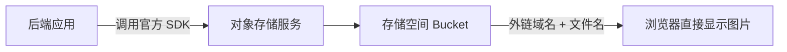

# 大图别再塞数据库：对象存储是什么，七牛云怎么开通

> 🔒 安全提示：文中示例的口令/密钥均为课程教学环境演示口径，生产环境的安全要求见《安全与合规须知》。

点开库里那条 `staff_photo` 字段，字符串拖了十几万字符还没到底。几 KB 的小图用 Data URL 存库还算轻盈，可头像这类照片动辄几百 KB 甚至上兆，编码后直接把长文本字段撑成「数据库里的文件堆」。查询变慢、备份变重、内存告急，这条路的尽头就该换方案了：把图片以文件形态交给专业的存储服务。这一节讲清对象存储的定位，并把七牛云账号从零开通，为后面写代码上传做好全部准备。

## 先给结论

- Data URL 只适合小数据，几 KB、十几 KB 的图标小图没问题；上兆的大图要换路线，以文件形式交给磁盘或对象存储。
- 自建分布式存储开发成本和硬件成本都高，中小团队直接用第三方对象存储更经济。
- 对象存储按「空间」管理文件，交互靠 REST API 和官方 SDK，按使用付费，流量小的时候基本不花钱。
- 开通三步：注册并完成实名认证 → 创建存储空间（选区域、选公开空间）→ 在个人中心拿到 AccessKey 与 SecretKey，连同空间名一起备好。
- AccessKey 与 SecretKey 是操作空间的钥匙，泄露等于空间失守，绝不能提交进代码仓库。

## 一、Data URL 的边界在哪里

把图片编码进数据库，本质是把「文件」变成了「字段」。小图这么做很划算，几 KB 的图标编码后不过几千个字符，跟记录一起查询、一起返回，省掉文件管理的一切麻烦。

照片就不是这么回事了。几百 KB 的一张头像，Base64 编码后十几万字符起步；要是上传原始相册图，几十兆的文件编码后是一个天文数字。长文本字段会让单行记录膨胀到数据库工具都打不开，每次查询这个字段，网络和应用内存都要陪跑一遍，备份文件的体积也跟着图片数量线性上涨。

**第一，文件就该用文件的方式存。** 大图合理去处有两条：自己的服务器磁盘，或者对象存储服务。存磁盘最直接，但单机容量、带宽、备份都得自己扛，服务一多图片的分发也成问题。

**第二，自建分布式存储对中小团队太重。** 分布式云存储技术上可行，要写不少代码，还要让整套服务稳定跑在多台服务器上，硬件加运维的成本不是小团队能轻松消化的。

**第三，第三方对象存储把成本摊薄了。** 借助现成的存储产品，注册账号、拿密钥、调 SDK，几行代码就能把图片存进去。这类产品不少，七牛云、阿里云的对象存储都属此列，选型时按价格、稳定性、生态综合比较即可。课程实战选的是七牛云，思路对其他家完全通用。

## 二、七牛云对象存储的定位

七牛云是国内的一家云服务提供商，产品线覆盖视频、播放器、在线教育等众多解决方案，这里只关心其中一个产品：对象存储。它提供可靠、安全、低成本且易于扩展的存储服务，几个特性直接对应开发体验：

| 特性 | 对开发者的意义 |
|---|---|
| Web 服务接口 | 提供 REST API，任何语言都能 HTTP 调用 |
| 官方 SDK | 常见语言都有封装好的 SDK，调用方法即完成上传 |
| 按使用付费 | 有基础免费额度，流量小基本零成本，项目冷启动友好 |
| 多协议支持 | HTTP、HTTPS 都支持，外链直接可访问 |
| 弹性扩展 | 容量与并发由服务商兜底，不用预估采购 |

调用关系长这样：



关键路径是从「后端应用」到「存储空间」这一段：代码只需要关心图片内容和 SDK 方法，网络、副本、扩容全部由服务端处理；「外链域名」那一段则是读路径，图片存进去之后会拿到一个可直接访问的 URL，这部分在下一节落地时能看到实物。

## 三、开通三步走

### 第一步：注册账号并完成实名认证

到七牛云官网注册，邮箱、密码、手机号按流程填写即可。注册完不能马上建空间，按国内法规要求必须先做实名认证，认证成个人或企业都可以，个人认证对学习场景完全够用。认证通过后，创建存储空间等功能才会解锁，跳过这一步会在控制台处处碰壁。

### 第二步：创建存储空间

空间（Bucket）是文件管理的顶层容器，可以理解为「网盘里的一个分区」，一个项目对应一个空间，A 项目的图片放空间一，B 项目的图片放空间二，互不干扰。在对象存储控制台新建空间，要做的选择只有三个：

- **空间名**：自定义且全局唯一，课程实战用的是 `ihrm-bucket`。
- **存储区域**：华东、华北、华南等机房。受众人群在哪里，就选离哪里近的区域，比如用户集中在华东就选华东，跨洋访问只会更慢。
- **访问控制**：公开空间还是私有空间。公开空间的外链 URL 拿到就能访问，私有空间的每次访问都要带签名。头像这类无敏感内容的图选公开空间即可。

### 第三步：拿到三样凭证

空间建好后，回到个人中心的密钥管理页，把当前账号的 AccessKey 和 SecretKey 复制保存下来，连同空间名一起，就是后续写代码要用的全部参数：

```text
access_key = example-ak        # 个人中心的 AccessKey，示例已打码
secret_key = example-sk        # 个人中心的 SecretKey，示例已打码
bucket     = ihrm-bucket       # 创建空间时的自定义名称
```

建议像课堂演示那样先把三个值放进一个配置类，后续工具类直接引用，密钥不用在代码里散落：

```java
// 示例：把准备好的三个参数集中管理，值替换为自己的，密钥切勿提交仓库
public class QiniuConfig {
    public static final String ACCESS_KEY = "example-ak";
    public static final String SECRET_KEY = "example-sk";
    public static final String BUCKET = "ihrm-bucket";
}
```

到这里，写代码上传图片的前置条件全部就绪：账号可用、空间在华东、公开访问、三个参数在手。

## 常见误区

- **没实名认证就建空间**：注册成功不代表功能可用，控制台创建空间的入口会一直提示受限，先完成个人或企业认证。
- **区域随手乱选**：空间建在离用户很远的区域，每次取图都多跑大半个地球的延迟。按受众所在地区选机房。
- **密钥提交进代码仓库**：AccessKey 与 SecretKey 一旦泄露，任何人都能往空间写文件、刷你的流量账单。用环境变量或独立配置管理，仓库里只保留占位符。
- **公开与私有想当然**：私有空间的 URL 不带签名直接访问会被拒绝，页面头像全挂。无敏感要求的图片选公开空间，确实私密的文件才选私有并配套签名逻辑。

## 面试可能被问到的问题

1. 面试官追问：「对象存储、数据库存文件、本地磁盘，三种方案怎么选？」
   答：几 KB 的小图可以走 Data URL 或数据库字段，跟记录一起读写最简单；本地磁盘适合单体应用，但要自己处理容量、备份和静态访问；生产环境的图片、视频这类大文件首选对象存储，容量和带宽由服务商兜底，数据库只存外链地址。

2. 面试官追问：「Bucket 是什么？为什么要按空间管理文件？」
   答：Bucket 是对象存储里文件的顶层容器，相当于独立命名空间。按项目或业务线划分空间，便于分别设置访问权限、生命周期和流量统计，一个空间配一个外链域名，管理粒度清晰。

3. 面试官追问：「AccessKey 和 SecretKey 分别是什么？怎么保管？」
   答：AccessKey 相当于账号标识，SecretKey 用于签名请求，两者配合向服务端证明操作者的身份。保管原则是最小暴露面：不写死在源码里、不提交版本库、定期轮换，生产环境放进配置中心或环境变量。

4. 面试官追问：「为什么国内云存储都强制实名认证？」
   答：存储服务可能被用于传播违法内容，实名认证让账号行为可追溯到真实主体，这是监管要求。认证分个人和企业两档，对开发者来说个人认证即可正常使用开发所需功能。

## 配套资料

- 七牛云对象存储使用指南（服务简介、入门流程）：`materials/docs/10/七牛云对象存储使用指南.md`
- 下一节用于落地的课程工具类（凭证、空间名与上传方法的真实写法）：`materials/code/02/day09 图片上传及Jasper/图片上传及Jasper/资源/后端工具代码/QiniuUploadUtil.java`
- 控制台操作截图无法随文附带，开通步骤按控制台当前页面指引操作即可；`QiniuConfig` 为按本课写法补全的示例
