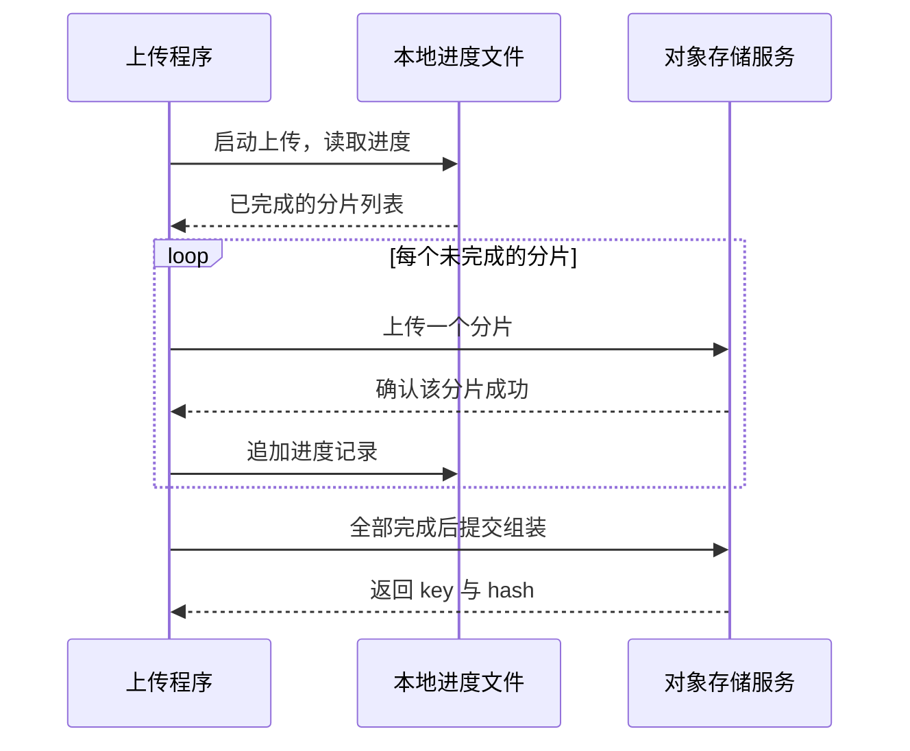

# 大文件上传中途断网怎么办：七牛云对象存储的断点续传

用对象存储的 SDK 上传一张几十 KB 的头像，一次 `put` 调用轻松搞定。可一旦要传的是 20 多 MB 的 Excel 附件、一部电影、一个安装包，问题就来了：传统方式把整个文件一次性推上去，传到一半网络波动，这次请求直接失败，重新上传又得从第一个字节开始。文件越大，失败重来的代价越高，这是一道越大的文件越难迈过去的坎。

对象存储服务对这个问题给出的答案是「断点续传」：上传到中途断网了、进程挂了、网络抖了，下次再传时，从上次失败的位置接着往后传，已经传过的部分不再重复。七牛云的 Java SDK 对此有直接支持，接入成本只有几行代码。

## 先给结论

- 普通上传是一次 HTTP 请求推完整个文件，中途失败只能从头再来；断点续传把文件切片、逐片上传，已传分片的进度持久化在本地。
- SDK 层面只多两个东西：`FileRecorder`（指定进度记录目录）和带记录器的 `UploadManager`。
- 进度记录是本地目录里一个以哈希值命名的文件，里面记着文件名、总大小、已经传到了哪个位置。
- 再次上传时 SDK 先读进度文件，跳过已完成的分片，沿上次的轨迹继续。
- 小图片用普通上传即可，大文件才需要断点续传，两种方式的凭证、解析代码完全一致。

## 一、分片与进度记录：断点续传的两个支点

断点续传建立在「分片上传」之上。SDK 把大文件切成固定大小的小块，一块一块往服务端推，每推完一块，服务端确认一块。这样「失败」的影响范围就从整个文件缩小到一个分片。

分片解决的是「失败的代价」，进度记录解决的则是「失败的恢复」。每完成一个分片，SDK 就把当前进度写到本地文件里；下次上传同一个文件时，先读这份记录，确定哪些分片已经成功，然后从第一个未完成的分片继续。整个过程对调用方透明，`put` 方法的签名没有任何变化。



图里最关键的一环是每次分片成功后立刻写进度文件：程序哪怕在这一刻被杀掉，下次启动也能从进度文件里恢复现场。没有这一步，分片只是缩小了失败范围，断网重传依然要从头开始。

## 二、代码：比普通上传多三行

以课程 demo 为基础，上传一个 20 多 MB 的 Excel 文件，完整代码如下（密钥已替换为占位示例，切勿提交真实密钥）：

```java
@Test
public void testUpload02() {
    //构造一个指定存储区域的配置类，zone0 代表华东机房
    Configuration cfg = new Configuration(Zone.zone0());

    //系统临时目录，用来存放断点进度文件
    String localTempDir = System.getProperty("java.io.tmpdir") + "/ihrm-bucket";
    //断点续传记录器：把上传进度持久化到本地目录
    FileRecorder fileRecorder = new FileRecorder(localTempDir);
    //上传管理器：第二个参数传入记录器，才具备断点续传能力
    UploadManager uploadManager = new UploadManager(cfg, fileRecorder);

    //生成上传凭证
    String accessKey = "your-access-key";
    String secretKey = "your-secret-key";
    String bucket = "ihrm-bucket";
    Auth auth = Auth.create(accessKey, secretKey);
    String upToken = auth.uploadToken(bucket);

    //要上传的大文件
    String localFilePath = "D:/data/test.xlsx";
    //不指定 key 时，服务端会用文件内容的哈希值做文件名
    String key = "test.xlsx";

    try {
        Response response = uploadManager.put(localFilePath, key, upToken);
        //解析上传结果
        DefaultPutRet putRet = new Gson().fromJson(response.bodyString(), DefaultPutRet.class);
        System.out.println(putRet.key);
        System.out.println(putRet.hash);
    } catch (QiniuException ex) {
        Response r = ex.response;
        System.err.println(r.bodyString());
    }
}
```

和上一节的普通上传对比，`Auth`、`uploadToken`、`put`、`Gson` 解析这一整套原封不动，真正的差异只有三处：

**第一，多了一个 `FileRecorder`。** 构造参数是一个目录路径，SDK 负责在这个目录里读写进度文件。示例里取的是系统临时目录 `System.getProperty("java.io.tmpdir")` 再拼一个子目录，这个位置可以随意指定，只要保证多次上传之间它还在就行。

**第二，`UploadManager` 多传了记录器。** 不传记录器的 `UploadManager` 走的是普通表单上传，整个文件一次推完；传了记录器，SDK 才会走分片加断点续传的通道。

**第三，上传对象从图片换成了大文件。** 上传 20 多 MB 的 Excel 才能明显观察到进度文件的出现和中途断开的效果，传一张几 KB 的图片，一个分片就装下了。

## 三、跑一次，看进度文件里有什么

运行上面的测试方法，上传进行到一半时强制停掉，再到临时目录里看，会多出一个形如 `7a4990f295ac085922f7c30830e9a6a710c1aad1f` 的文件，文件名是一串 40 位的哈希值。打开它的内容，记录的正是这次上传的元信息：目标空间名、目标文件名、文件总大小、当前已上传到的位置。

这个哈希文件名不是随机的，它根据上传目标计算得出，同一个目标对应同一份进度。所以重新运行程序再次上传时，SDK 用同样的方式算出文件名、找到进度记录、跳过已传分片继续推，控制台里的上传速度和已传位置的推进都印证了这一点。传完之后这份进度文件就完成了使命，删除它也不影响已上传成功的文件。

## 常见误区

- **把断点续传当成纯服务端能力。** 进度文件存在客户端本地目录里，换一台机器、清掉临时目录、换一个 `FileRecorder` 路径，进度就丢了，只能从头再传。进度目录要在多次重试之间保持稳定。
- **以为不配记录器也能自动续传。** 只 `new UploadManager(cfg)` 走普通上传，网络波动后整个文件重推。分片和续传的开关就是构造 `UploadManager` 时传不传 `FileRecorder`。
- **把进度文件当垃圾反复清理。** 上传中途的哈希文件不是垃圾，它是恢复现场的唯一依据，清理脚本要避开这类目录。
- **密钥硬编码进仓库。** demo 里直接写 `accessKey` 没问题，工程里应该放到配置文件或环境变量，避免密钥随代码泄漏。

## 面试可能被问到的问题

1. 面试官追问：「断点续传的实现原理是什么？」
   答：建立在分片上传之上。客户端把大文件切成固定大小的分片逐个上传，服务端逐片确认；每完成一片就把进度持久化到本地文件。上传中断后重试时，先读进度文件，跳过已成功的分片从断点继续，最后由服务端把全部分片组装成完整文件。

2. 面试官追问：「SDK 里的 FileRecorder 起什么作用？」
   答：它是进度记录器，构造时指定一个本地目录，负责把「当前传到哪个分片」这类进度信息写入目录下的哈希命名文件，并在重传时读出来恢复现场。没有它，`UploadManager` 只能做普通的一次性上传。

3. 面试官追问：「分片上传和断点续传是什么关系？」
   答：分片上传是断点续传的基础，没有分片就没有可记录的「进度单位」。分片只解决单次失败的代价问题，断点续传再加上进度的持久化与恢复，解决的是跨进程、跨网络波动的连续性问题，两者通常搭配出现。

4. 面试官追问：「为什么进度文件名是一串哈希值？」
   答：它根据上传目标（空间、文件名、文件内容指纹）计算得出，起到唯一定位一份进度记录的作用。不同文件互不干扰，同一文件反复重传都能命中同一份进度，程序读取时不需要额外的索引。

5. 面试官追问：「哪些业务场景应该用断点续传？」
   答：文件大到一次请求推完不可靠的时候，比如几十 MB 的附件、音视频、安装包。头像、图标这类几 KB 的小文件用普通上传即可，没必要为它们维护进度文件，两套 API 其余代码完全一样，按文件大小选择通道即可。

## 配套资料

- 上传工具封装：`materials/code/02/day09 图片上传及Jasper/图片上传及Jasper/资源/后端工具代码/QiniuUploadUtil.java`
  （文中 `testUpload02` 断点续传 demo 未收入资料包，为按本课写法补全的示例）
- 七牛云对象存储使用指南：`materials/docs/10/七牛云对象存储使用指南.md`
