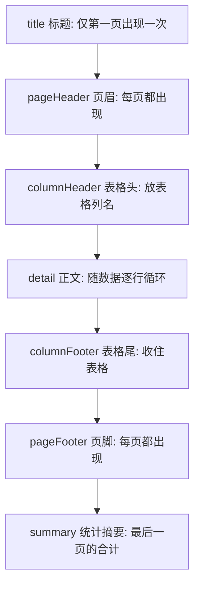
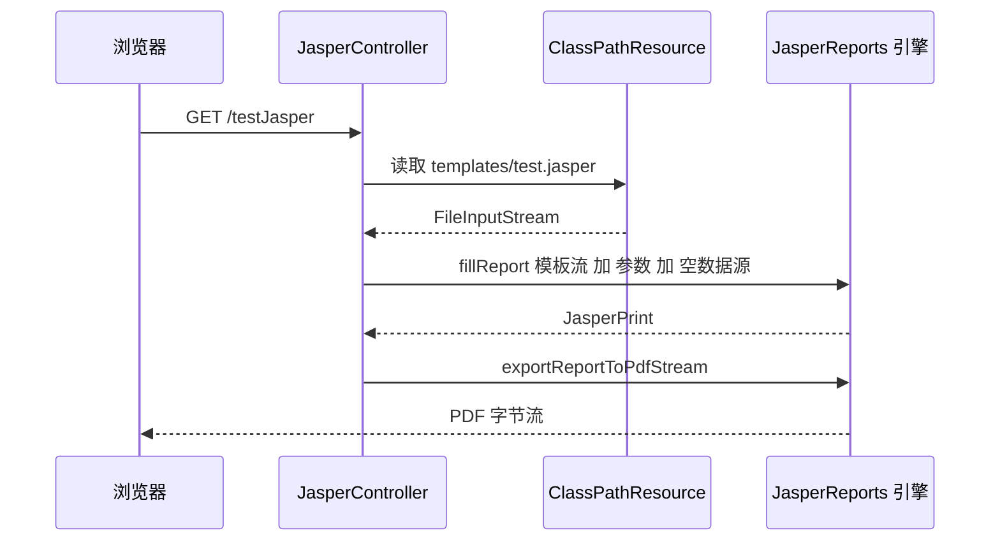
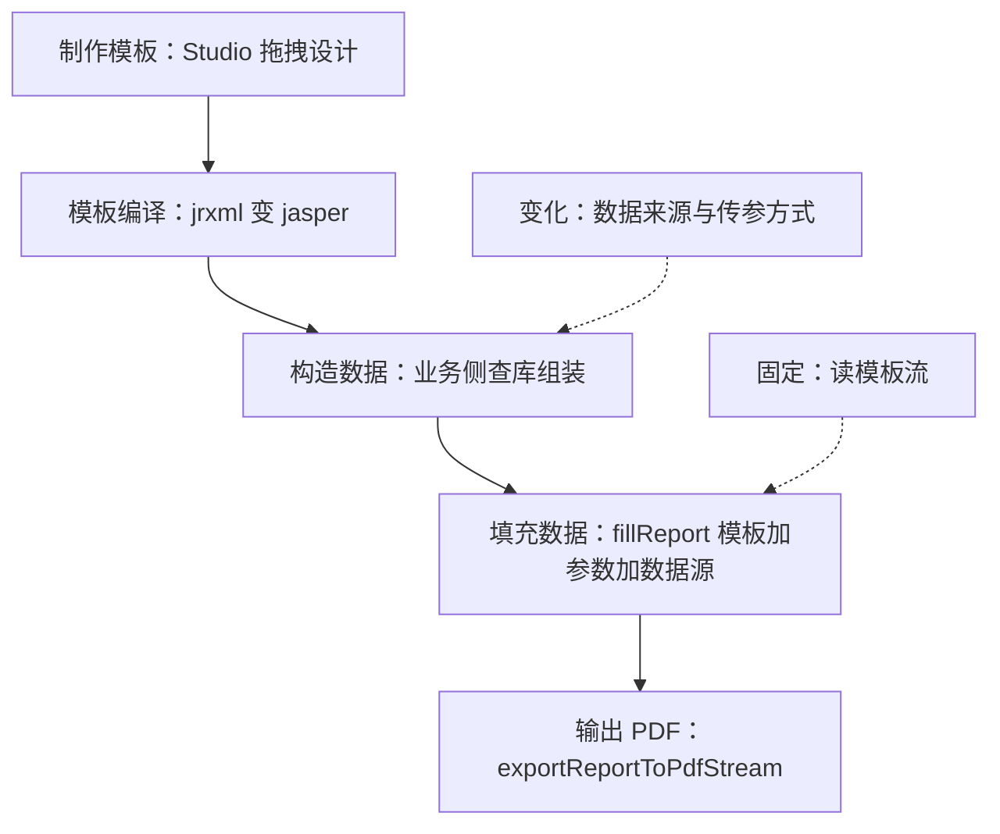

# Jaspersoft Studio 全流程：从模板设计到 Spring Boot 输出 PDF

## 先给结论

- JasperReports 的开发流程收敛成三步：制作模板、构造数据、填充数据，这个系列的主主角是第一步：用官方可视化设计器 Jaspersoft Studio 拖拽出模板，代替手写 jrxml 与背像素坐标。
- 分工要记牢：Studio 只负责设计模板，生成 jrxml、编译成 jasper、支持预览；往模板里填数据的活归 Java 侧的 jasperreports jar 包，一个画图纸，一个施工。
- 设计器基于 Eclipse 引擎，界面记五块就够：工程面板、大纲、编辑区三视图、组件面板、属性面板。
- 模板的心脏是七个带区：title 一份 PDF 只出现一次，pageHeader 与 pageFooter 每页重复，columnHeader 与 columnFooter 服务表格，detail 随数据逐行循环，summary 在末页做统计。
- 第一个模板实操走通 Image 组件放页头图、Static Text 写正文、设置中文字体、Compile Report 编译出 jasper 的全过程，Java 端最终消费的是编译后的 jasper，jrxml 只是设计稿。
- Spring Boot 侧集成四步：jasperreports 三件套依赖、模板放 resources/templates、JasperController 雏形、fillReport 三步输出：读模板流、填充出 JasperPrint、导出进响应流。
- 没有真实数据时用 JREmptyDataSource 占位，省掉它输出的 PDF 就是空白。
- 中文在 PDF 里留白不是编码问题是字体问题：模板元素显式指定中文字体，工程里加字体扩展文件，pdfEncoding 用 Identity-H 且 pdfEmbedded 设 true，把字形直接嵌进文件。

## 第1部分：Jaspersoft Studio_介绍和安装

JasperReports 的开发流程已经收敛成三步：制作模板、构造数据、填充数据。模板本身是一个结构相当严格的 XML 文件，纯手写意味着背下一堆标签、记牢每个元素的像素坐标，错一个闭合标签整份 PDF 就渲染不出来。这一节的主角 Jaspersoft Studio 就是官方为「制作模板」这一步准备的可视化设计器，拖拽组件出模板，编译和预览一键完成。

### 一、工具与 jar 包的分工

**第一，先分清两个名字相近的东西。** JasperReports 是一套 Java jar 包，引入工程后通过 API 在代码里生成 PDF，它是运行时的引擎；Jaspersoft Studio 是官方提供的模板制作工具，产出模板文件，它是设计期的画板。两个产品出自同一家公司，专为配套而生。

**第二，Studio 的三项能力正好覆盖做模板的全过程。** 生成 XML 形式的模板代码，也就是 jrxml 文件；把模板编译成 jasper 文件，供 Java 端消费；随时预览渲染效果，不用等业务代码跑起来才发现版式不对。对 JasperReports 来说，它是必不可少的一款辅助工具。


图里上半段全部发生在 Studio 里，下半段发生在业务工程里，两者的交接物只有一个：编译好的 jasper 文件。把这条边界记清楚，后面整合 Spring Boot 时就不会迷茫。

### 二、下载与安装

官方下载页的社区版列表里并排放着四个产品，别下错：

```text
JasperReports Server CE v7.1.0    # 报表服务器，不是设计器
JasperReports Library CE v6.7.0   # 核心 jar 库，走 Maven 坐标引入
Jaspersoft Studio CE v6.6.0       # 可视化设计器，下载这个
iReport Designer CE v5.6.0        # 上一代设计器，已停止维护
```

要下载的是 Jaspersoft Studio。资料包里也备好了 6.5 版的安装包，双击安装，一路 Next 点下去直到成功，没有任何需要动脑的配置项。装完第一次启动会慢一些，Eclipse 引擎要初始化工作区，耐心等主界面加载出来即可。

**版本对齐是个值得留意的点。** Studio 的版本尽量和工程里 jasperreports 的 jar 版本靠近：课程的 Spring Boot 工程引的是 jasperreports 6.5.0，设计器用 6.5 或 6.6 都能配合。跨大版本的模板兼容性没有保证，高版本 Studio 编出的 jasper 拿到低版本 jar 里填充可能直接报错。

### 三、面板地图：五个区域各管一摊

打开工具后界面看着密，实际按功能切成五块：

| 面板 | 位置 | 作用 |
|---|---|---|
| Project Explorer | 左侧 | 工程面板，模板以工程为单位组织管理 |
| Outline | 左下 | 树形结构展示模板里的所有元素，快速定位 |
| Report Editing Area | 中间 | 主编辑区，Design、Source、Preview 三个视图切换 |
| Designer Palette | 右侧 | 组件面板，需要什么组件拖拽过来一个 |
| Properties | 右下 | 选中元素的属性，改坐标、字体、颜色都在这里 |

**Palette 是最值得花时间的一块。** 上半部分是基本组件：静态文本、图片、文本域、线条、矩形，日常画模板主要靠它们；下半部分是高级组件，主要服务 PDF 的收尾类需求，比如分页相关元素、总页数 Total Pages、当前时间 Current Date、占比 Percentage 这类动态内容，拖进对应带区就能用。

**中间编辑区的三个视图是同一份文件的三种形态。** Design 视图所见即所得地拖拽；Source 视图直接看和改 XML 源码，两边实时同步；Preview 视图按当前数据源渲染出最终效果。日常动作就是三个视图来回切。

### 四、一个模板文件长什么样

Design 视图看着是画布，切到 Source 视图就能看到骨架。空白 A4 模板的 jrxml 骨架如下：

```xml
<?xml version="1.0" encoding="UTF-8"?>
<jasperReport xmlns="http://jasperreports.sourceforge.net/jasperreports"
              xmlns:xsi="http://www.w3.org/2001/XMLSchema-instance"
              xsi:schemaLocation="http://jasperreports.sourceforge.net/jasperreports
                                  http://jasperreports.sourceforge.net/jasperreports.xsd">
    <queryString>
        <![CDATA[]]>
    </queryString>
    <title>
        <band splitType="Stretch"/>
    </title>
    <pageHeader>
        <band height="70" splitType="Stretch"/>
    </pageHeader>
    <columnHeader>
        <band height="63" splitType="Stretch"/>
    </columnHeader>
    <detail>
        <band height="225" splitType="Stretch"/>
    </detail>
    <columnFooter>
        <band height="49" splitType="Stretch"/>
    </columnFooter>
    <pageFooter>
        <band height="54" splitType="Stretch"/>
    </pageFooter>
    <summary>
        <band height="42" splitType="Stretch"/>
    </summary>
</jasperReport>
```

骨架里已经能看到模板的核心概念：主体由一个个 band（带区）组成，title、pageHeader、detail 这些标签名就是带区，设计期拖进的组件最终都会落到某个 band 内部。比如往页头拖一个图片组件，Source 视图里 pageHeader 的 band 就会多出 image 元素：

```xml
<pageHeader>
    <band height="70" splitType="Stretch">
        <!-- 组件靠 reportElement 的 x y width height 定位，单位是像素 -->
        <image>
            <reportElement x="1" y="6" width="168" height="40"/>
            <imageExpression><![CDATA["https://www.example.com/images/logo.png"]]></imageExpression>
        </image>
    </band>
</pageHeader>
```

Design 与 Source 操作的是同一份数据：拖拽产生的坐标、尺寸、字体全部反映在 XML 里。所谓可视化，本质是工具替你写 XML，你对画布做的每个动作都能在源码里对上号。

## 第2部分：Jaspersoft Studio_创建工程以及模板结构介绍

装好设计器，第一次点开新建却被向导里的样式模板、数据适配器绕晕；模板建出来又满屏浅灰色的英文区域名，不知道哪个管哪块。这些区域叫 band（带区），是 JasperReports 模板的心脏。这一节把建工程、建模板的操作和七个带区的职责一次讲透，后面画模板全靠这套认知。

### 一、工程是模板的家

**Studio 里没有单打独斗的模板文件，一切从工程开始。** 点击 File，找到 New，选择 Project，在向导里定位到 JasperReports 分类下的 JasperReports Project，下一步给工程起名，比如 TestReports，点 Finish 就建好了。有 Eclipse 基础的话这一步毫无门槛，操作路径和建 Java 工程一模一样。

**工程建好，模板在工程上右键创建。** 右键 New 一个 Jasper Report，进入模板向导。向导第一页是样式模板选择，工具自带大量现成样式，Cherry 分类下有一整套配色精美的模板，想要好看的样式直接挑一个即可。课程选的是 Blank A4，一张标准 A4 打印纸的空白样式，适合从零学结构。

**向导第二页给模板起名。** 比如叫 test，这个名字就是最终生成的文件名 test.jrxml，之后在工程里双击它进入设计界面。

### 二、数据适配器：向导里最容易被点过去的一页

**向导接着让你选数据填充方式，这一页决定预览时用什么数据。** 选项里有数据库 JDBC 连接等真实数据源，本课选 One Empty Record，也就是一条空记录：模板里不填任何业务数据，先把工具用熟。选完 Finish，设计界面就打开了。

这次选择会写进模板文件，成为默认数据适配器的声明：

```xml
<!-- 模板文件里记录默认数据适配器，预览时按它取数 -->
<property name="com.jaspersoft.studio.data.defaultDataAdapter"
          value="One Empty Record"/>
```

**适配器只管设计期的预览，不影响运行期。** 真实项目里数据是 Java 代码在填充阶段传进去的，可以是数据库连接，也可以是 JavaBean 集合或 Map。向导里选什么，只决定此刻点 Preview 时渲染出什么。

### 三、七个带区，一份 PDF 的骨架

打开 test.jrxml，设计区里那些浅色英文就是带区名。把一份 PDF 想成从上往下铺的一条条区域，每条出现的时机不同：



对照手边任何一份排版规整的 PDF 讲义，七个带区的分工就都活了起来：

**title 是整份文档的标题。** 一份 PDF 的标题只出现在第一页，所以 title 带区渲染一次就完事，类似讲义封面的那行大字。

**pageHeader 和 pageFooter 是每页的头和尾。** 每页顶部重复出现的标识、底部重复出现的页码，分别放这两个带区。它们与 title 的区别就是重复粒度：一个每页都要，一个只要一次，两个正好成对。

**columnHeader 和 columnFooter 服务表格型内容。** PDF 里用表格展示数据时，列名那一行放 columnHeader，表格收尾放 columnFooter，中间的数据行归 detail，三段拼出一张完整表格。

**detail 是正文主体，也是数据循环的地方。** 填充数据时 detail 带区被逐条数据反复渲染，一百条记录就出一百行。把它理解成「表格数据」不够准确，不放表格时它就是普通正文区。

**summary 是统计摘要。** 合计、汇总这类内容放在整份文档最后一页的最后，类似讲义末尾的总结部分，比如表格的总计金额行。

带区结构不是铁板一块：不想要哪个，设计视图里选中按 Delete 删掉；高度不合适，直接拖边缘调整。

### 四、骨架 XML：带区就是一串标签

切到 Source 视图，七个带区对应七个标签，一目了然：

```xml
<queryString>
    <![CDATA[]]>
</queryString>
<title>
    <band splitType="Stretch"/>
</title>
<pageHeader>
    <band height="70" splitType="Stretch"/>
</pageHeader>
<columnHeader>
    <band height="63" splitType="Stretch"/>
</columnHeader>
<detail>
    <band height="225" splitType="Stretch"/>
</detail>
<columnFooter>
    <band height="49" splitType="Stretch"/>
</columnFooter>
<pageFooter>
    <band height="54" splitType="Stretch"/>
</pageFooter>
<summary>
    <band height="42" splitType="Stretch"/>
</summary>
```

三个细节值得留意：**band 的 height 单位是像素**，设计视图里拖拽带区高度，改的就是这个数字；**splitType 为 Stretch 表示内容超高时允许带区拉伸**，避免内容被硬裁掉；**queryString 是放查询语句的位置**，靠模板内置 SQL 直接取数的写法会用上它，留空则完全由 Java 侧喂数据。

骨架里每个 band 现在都是空的，下一节往里拖组件，就会看到 band 内部长出 image、staticText 这类元素标签。

## 第3部分：Jaspersoft Studio_创建第一个案例模板

带区的职责清楚了，这一节把模板真正画出来：页头放一张网络图片，正文放一句静态文字，页脚补一行小字，然后保存、预览、编译，拿到一个能被 Java 工程直接消费的 jasper 文件。全程不手写一行 XML，但每一步都能在 Source 视图里找到对应的代码，两边对照着看，模板是怎么回事就彻底透了。

### 一、按需裁剪：先删掉用不到的带区

默认模板的七个带区不必全留。选中用不到的区域按 Delete 删掉，比如 columnHeader、columnFooter、summary，页头嫌窄就往下拖高。模板不是七件套全家桶，是按需取用的画布，删得只剩 title、pageHeader、detail、pageFooter 也完全合法。

### 二、页头放图：Image 组件与图片来源

从右侧 Palette 拖一个 Image 组件到页头带区，会弹出 Create new image element 对话框，图片来源有好几种：当前工程里的图片、电脑磁盘上的本地文件、一个远程 URL、从服务器选择，还可以自定义表达式。本课选 URL 方式，填一个图片的网络地址，对话框自带预览，点 OK 图片就落进带区了，拖动边缘调整到合适大小。

这套拖拽落到 Source 视图，就是 pageHeader 带区里的一个 image 元素：

```xml
<pageHeader>
    <band height="125" splitType="Stretch">
        <image>
            <reportElement x="1" y="6" width="168" height="40"/>
            <!-- URL 方式的图片，地址写在 imageExpression 里 -->
            <imageExpression><![CDATA["https://www.example.com/images/logo.png"]]></imageExpression>
        </image>
    </band>
</pageHeader>
```

**URL 方式意味着渲染时才去网络上取图。** 设计器里预览没什么问题，但生产环境要掂量：渲染 PDF 的服务器必须能访问这个地址，取不到图就是一块空白。更稳妥的做法是把图片放进工程资源里随包部署，再用相对路径引用。

### 三、正文与页脚：Static Text 加字体设置

**正文放一句话，用 Static Text 而不是 Text Field。** 两个组件名字接近，用途不同：Static Text 是静态文本，内容写死在模板里；Text Field 绑定数据字段，填充时按记录动态出值。本课正文就是一句固定文案，Static Text 足够，选错组件后面填数据时会对不上号。

从 Palette 拖一个 Static Text 到 detail 带区，双击组件输入文字，比如「Jasper 很强大！」，然后在属性面板把字体设为华文宋体、字号 18。页脚同理再拖一个 Static Text，写一行收尾小字，字号调到 10，风格就压住了。

这段操作对应的 XML 是这样的：

```xml
<detail>
    <band height="44" splitType="Stretch">
        <staticText>
            <reportElement x="247" y="23" width="180" height="30"/>
            <textElement>
                <font fontName="华文宋体" size="18"/>
            </textElement>
            <text><![CDATA[Jasper 很强大！]]></text>
        </staticText>
    </band>
</detail>
```

结构上三层各管一件事：reportElement 管位置和尺寸，textElement 里的 font 管字体字号，真正的文字内容放在 text 标签的 CDATA 里。改字体不再靠拖，直接改 font 标签的属性也一样生效。

### 四、保存、预览、编译，拿到 jasper

**Ctrl+S 保存后切到 Preview 视图。** 设计器按当前数据适配器渲染出 PDF 效果：页头图片、中间那句大字、页脚小字，所见即所得。想核对源码切 Source，想改版式切回 Design，三个视图来回切就是设计期的日常。


**编译是收尾的关键一步。** 在 test.jrxml 上右键，菜单里找 Compile Report，点击后弹出进度提示，显示 Compiling: test.jrxml，完成后当前目录多出一个 test.jasper 文件。它就是整条设计流水线的交付物：下一节把它拷进 Spring Boot 工程，由 Java 代码填充数据并输出 PDF。设计期以预览收尾，交付期以 jasper 收尾，这条流水线走通了，JasperReports 三步流程里的第一步「制作模板」就算完成了。

## 第4部分：Jaspersoft Studio_整合springboot搭建环境

Studio 的使命到「生成 jasper 文件」为止，剩下的事全在 Java 侧：把 jasper 放进工程、搭好 Web 环境、写一个接口，浏览器访问直接返回 PDF。这一节把这套环境完整搭起来，重点是 pom 坐标、模板目录约定和 JasperController 的雏形，跑通之后往里填真实数据就是下一课的事。

### 一、建模块与依赖：jasperreports 三件套

在已有工程里新建一个 module，名字叫 jasper-springboot，它必须是 Web 工程，因为最终要通过 URL 访问 PDF。Spring Boot 版本用 2.0.5，pom 的关键部分如下：

```xml
<parent>
    <groupId>org.springframework.boot</groupId>
    <artifactId>spring-boot-starter-parent</artifactId>
    <version>2.0.5.RELEASE</version>
</parent>

<dependencies>
    <!-- Web 环境，内嵌 Tomcat -->
    <dependency>
        <groupId>org.springframework.boot</groupId>
        <artifactId>spring-boot-starter-web</artifactId>
    </dependency>
    <!-- jasperreports 主包，PDF 报表引擎 -->
    <dependency>
        <groupId>net.sf.jasperreports</groupId>
        <artifactId>jasperreports</artifactId>
        <version>6.5.0</version>
    </dependency>
    <!-- 配套包，缺了会在启动或导出时踩坑 -->
    <dependency>
        <groupId>org.olap4j</groupId>
        <artifactId>olap4j</artifactId>
        <version>1.2.0</version>
    </dependency>
    <dependency>
        <groupId>com.lowagie</groupId>
        <artifactId>itext</artifactId>
        <version>2.1.7</version>
    </dependency>
    <!-- 后面按数据库数据填充时要用的驱动 -->
    <dependency>
        <groupId>mysql</groupId>
        <artifactId>mysql-connector-java</artifactId>
    </dependency>
</dependencies>
```

**jasperreports 6.5.0 的 PDF 输出底层是 iText 2.1.7**，这是它要在 pom 里显式声明的原因；**olap4j 是 jasperreports 的可选传递依赖**，6.x 的部分代码路径会碰到它，不显式引入容易在运行期报类找不到。这两个坐标加上主包，就是常说的依赖三件套。课程完整工程里还引了 thymeleaf 与 poi 一组坐标，前者与本节链路无关，poi 是后续 Excel 导出要用的，按需精简即可。依赖精简后第一次启动若报字体相关异常，多半出在含中文的模板导出时，6.5.0 对字体的处理依赖运行环境提供字体文件，这也是后面中文乱码一课要专门处理的问题，环境搭建阶段先把链路跑通即可。版本要一次选稳：jasperreports 6.x 各小版本对 iText 的依赖坐标并不相同，随意升级主版本号会让三件套组合失效，工程能跑就不再动它。

### 二、配置文件与启动类

application.yml 从旧工程拷一份做删减，只保留服务名、端口和数据库连接，数据库配置本节暂不使用，为下一课按库填充做准备：

```yaml
server:
  port: 8181
spring:
  application:
    name: jasper-springboot # 指定服务名
  datasource:
    driver-class-name: com.mysql.jdbc.Driver
    url: jdbc:mysql://localhost:3306/ihrm?useUnicode=true&characterEncoding=utf8
    username: root
    password: 111111
```

启动类同样是从旧工程拷一个改个名，没有任何特殊之处：

```java
package com.example;

import org.springframework.boot.SpringApplication;
import org.springframework.boot.autoconfigure.SpringBootApplication;

@SpringBootApplication(scanBasePackages = "com.example")
public class JasperApplication {
    /**
     * 启动方法
     */
    public static void main(String[] args) {
        SpringApplication.run(JasperApplication.class, args);
    }
}
```

`scanBasePackages` 显式声明扫描根包，保证后面写的 Controller 放在 `com.example` 下任何一层都能被扫到。端口挑 8181 是为了避开常见服务占用，启动后控制台看到 Tomcat started on port 8181 就绪；若端口被占，改 yml 里的 port 换一个再启动。到这里，Web 环境、数据库连接、组件扫描全部就位，就差模板和接口。

### 三、模板就位与 JasperController 雏形

**把 Studio 编译出的 test.jasper 拷进工程。** 在 `src/main/resources` 下建一个 templates 目录，文件放进去。目录名本身随意，和代码里读取的路径一致就行，约定成 templates 便于管理。只拷 jasper 不拷 jrxml：运行期只消费编译产物，jrxml 留在 Studio 工程里维护，两边职责干净，也避免误把源码当资源打进部署包。

**接口写法是固定三板斧：读模板流、填充、导出。** 

```java
package com.example.controller;

import net.sf.jasperreports.engine.*;
import org.springframework.core.io.ClassPathResource;
import org.springframework.core.io.Resource;
import org.springframework.web.bind.annotation.GetMapping;
import org.springframework.web.bind.annotation.RestController;

import javax.servlet.ServletOutputStream;
import javax.servlet.http.HttpServletRequest;
import javax.servlet.http.HttpServletResponse;
import java.io.FileInputStream;
import java.io.IOException;
import java.util.HashMap;

@RestController
public class JasperController {

    @GetMapping("/testJasper")
    public void createPdf(HttpServletRequest request, HttpServletResponse response) throws IOException {
        //1.读取 jasper 模板文件
        Resource resource = new ClassPathResource("templates/test.jasper");
        FileInputStream fis = new FileInputStream(resource.getFile());
        //2.创建 JasperPrint，向 jasper 模板中填充数据
        ServletOutputStream os = response.getOutputStream();
        try {
            /**
             * fis: jasper 文件输入流
             * new HashMap: 向模板中输入的参数
             * 数据源（和数据库连接池那种数据源不同）: 填充模板的数据来源（connection、javaBean、Map）
             * 填充空数据来源: JREmptyDataSource
             */
            JasperPrint print = JasperFillManager.fillReport(fis, new HashMap<>(), new JREmptyDataSource());
            //3.将 JasperPrint 以 PDF 的形式输出
            JasperExportManager.exportReportToPdfStream(print, os);
        } catch (JRException e) {
            e.printStackTrace();
        } finally {
            os.flush();
        }
    }
}
```

fillReport 的三个参数各有分工：模板输入流对应设计稿，参数 Map 对应模板里定义的 Parameter，数据源对应模板里的 Field。`JREmptyDataSource` 表示一条数据都没有，正好配合前两节设计的纯静态模板，先跑通链路。还有一个工程习惯值得养成：模板流要在请求结束时关闭，本例的 fis 声明在外层，严谨的写法是 try-with-resources 把它纳入自动关闭；模板文件是只读资源，不关闭短期看不出问题，高并发下文件句柄堆积就会放大成故障。

整条请求链路如下：



启动工程，浏览器访问 `http://localhost:8181/testJasper`，返回的就是一份完整 PDF，页头图片、正文文字都在。想确认字节层面的正确性，可以用 curl 把响应落成文件，文件以 `%PDF` 开头且大小非零，基本就能断定输出没问题。至此模板制作、环境搭建两条线汇合，下一课开始给模板构造并填充真实数据。

## 第5部分：Jaspersoft Studio_配置controller输出PDF文件

模板文件已经拷进工程，接口怎么把它变成浏览器里能预览、能下载的 PDF？答案集中在一个 Controller 方法里：读模板流、填充数据、导出响应，三步走完，`http://localhost:8181/testJasper` 直接出文件。这一课把最后一块拼图补上，也让模板、环境、输出三条线真正汇合。

### 一、接口骨架：void 方法加两个 Servlet 参数

在 controller 包下新建 `JasperController`，类上标 `@RestController`。方法取名 `createPdf`，返回 `void`，因为结果不通过返回值传递，而是直接写响应流；参数固定是 `HttpServletRequest` 与 `HttpServletResponse`，前者本例用不上但保留惯例，后者是输出文件的必经之路。请求方式用 `@GetMapping`，路径定为 `/testJasper`，完整代码如下：

```java
package com.example.controller;

import net.sf.jasperreports.engine.*;
import org.springframework.core.io.ClassPathResource;
import org.springframework.core.io.Resource;
import org.springframework.web.bind.annotation.GetMapping;
import org.springframework.web.bind.annotation.RestController;

import javax.servlet.ServletOutputStream;
import javax.servlet.http.HttpServletRequest;
import javax.servlet.http.HttpServletResponse;
import java.io.FileInputStream;
import java.io.IOException;
import java.util.HashMap;

@RestController
public class JasperController {

    @GetMapping("/testJasper")
    public void createPdf(HttpServletRequest request, HttpServletResponse response) throws IOException {
        // 1. 引入 jasper 文件
        Resource resource = new ClassPathResource("templates/test.jasper");
        FileInputStream fis = new FileInputStream(resource.getFile());
        // 2. 创建 JasperPrint，向 jasper 文件中填充数据
        ServletOutputStream os = response.getOutputStream();
        try {
            /**
             * fis：jasper 文件输入流
             * new HashMap：向模板中输入的参数
             * 数据源：填充模板的数据来源，可以是 Connection、JavaBean、Map
             *        没有数据时传空数据源 JREmptyDataSource
             */
            JasperPrint print = JasperFillManager.fillReport(fis, new HashMap<>(), new JREmptyDataSource());
            // 3. 将 JasperPrint 以 PDF 的形式输出
            JasperExportManager.exportReportToPdfStream(print, os);
        } catch (JRException e) {
            e.printStackTrace();
        } finally {
            os.flush();
        }
    }
}
```

骨架里唯一要留心的是返回 `void`。如果方法返回 `String`，Spring MVC 会把它当视图名或响应体处理，与手工写字节流的思路拧在一起。专门输出文件的接口就返回 `void`，职责单一。

### 二、第一步：把 jasper 文件读成输入流

jasper 文件位于 `src/main/resources/templates` 下，属于 classpath 资源，统一用 Spring 的 `Resource` 体系获取。Spring 提供的 `Resource` 是一个接口，实现类有一摞，classpath 场景选 `ClassPathResource`，构造参数写相对 classpath 的路径。拿到对象后调 `getFile()` 得到 `File`，再包一层 `FileInputStream`，模板就以字节流的形式交给了填充环节。

`Resource` 本身只是资源的抽象，真正有用的是它背后的文件流信息，所以代码里立即转成 `FileInputStream`。`getFile()` 依赖文件系统真实路径，开发期解压目录下没问题；打成 jar 部署后要换成 `resource.getInputStream()` 直接取流，这个差异到部署时才会暴露。

### 三、第二步：fillReport 填充出 JasperPrint

jasper 文件本质是模板的二进制形式，里面只有版式没有数据。填充这一步就是把数据灌进去，产出 `JasperPrint`，也就是「模板加数据渲染出的完整文档对象」。工具类 `JasperFillManager` 的 `fillReport` 方法负责这件事，三个参数各司其职：

**第一，模板输入流。** 就是第一步读出的 `fis`，指明往哪个模板里灌数据。

**第二，参数 Map。** 对应模板里定义的 Parameter，键是参数名，值是要展示的数据。本例模板还是纯静态的，先传一个空 `HashMap` 占位。

**第三，数据源。** 它与数据库连接池里说的那个「数据源」完全不是一回事，这里指填充模板的数据来源，可以是数据库的 `Connection`，可以是 JavaBean，也可以是 Map 集合。暂时没有数据就传 `JREmptyDataSource`，表示零条记录。

这里藏着一个官方文档里不显眼的坑：数据源参数看起来可传可不传，省略了也不报编译错误，但输出的 PDF 永远是空白的。工程里的写法因此固定为三参数版本，没有数据就显式给一个空数据源，宁可多传一个对象，不留一个看不见的坑。

### 四、第三步：exportReportToPdfStream 写进响应流

`JasperPrint` 里已经是完整的 PDF 内容，剩下的事是把它以流的形式写给浏览器。`JasperExportManager` 的 `exportReportToPdfStream` 接收两个参数，前一个是填充好的 `JasperPrint`，后一个是输出流。输出流取自 `response.getOutputStream()`，写进去的内容就是 HTTP 响应体，浏览器收到字节流后直接渲染出文档。`finally` 里的 `os.flush()` 负责把缓冲区里的尾巴推干净，保证响应完整。

三步的完整链路如下：


从入口到出口只有一个分支点：填充。参数 Map 与数据源都在这一步进入模板，之后的环节只是搬运字节。看懂这张图，以后所有 PDF 接口的变化都只发生在填充那一个框里。

### 五、启动验证

启动类是普通的 `@SpringBootApplication`，直接运行 `main` 方法，控制台没有报错后访问：

```bash
curl -OJ http://localhost:8181/testJasper
# 浏览器地址栏直接打开 http://localhost:8181/testJasper 也可以
```

浏览器里出现 PDF 雏形，说明模板、环境、输出三条线全部接通，还能利用浏览器自带的下载与打印能力。接下来所有的进化都只发生在第二步：数据从哪里来、怎么灌进模板。

## 第6部分：Jaspersoft Studio_中文乱码处理以及总结

接口已经能把 jasper 模板渲染成 PDF，可浏览器打开一看，凡是中文的位置全部留白，英文和数字倒是好好的。回到 Studio 里预览，同一个模板中文却显示正常。这一课解决这个 JasperReports 的经典问题，顺带把 day09 两条技术线收个尾。

### 一、现象与根因：字形从哪里来

同一份模板，Studio 预览正常，浏览器里的 PDF 却没有中文。原因在导出链路：jasper 模板导出 PDF 靠的是底层 iText 类库，英文默认字体自带英文字形，遇到中文却找不到能画字的字体对象，于是一个字都画不出来，位置直接留白。叫它「乱码」其实是客气，多数时候表现为整段消失。

PDF 格式本身支持把字体嵌入文件，只要导出时告诉引擎三件事：用哪个字体、按什么编码取字形、要不要把字形嵌进文件。这三件事分别由模板的字体设置和工程的字体扩展配置来回答。

补丁生效后的查找链路是这样的：


链路里任何一环断了，中文就会消失：模板字体名与 `fontFamily` 名字对不上、TTF 文件不在声明路径、`pdfEncoding` 不是 `Identity-H`，表现都一样。

### 二、补丁第一段：模板里指定中文字体

回到 Studio，把模板里所有涉及中文的元素选中，在字体属性里统一指定中文字体，比如华文宋体，顺带设置字号、水平垂直居中。这一步不是随手挑的：字体名可以换成宋体等其他中文字体，但必须与第三步 `fonts.xml` 里声明的字体族名字一字不差，两边靠名字对上号。

只要元素里出现了中文，就要指定中文字体，一个都不能漏。漏掉的那一个元素，导出后就是一块空白。

### 三、补丁第二段：工程里加两个字体扩展文件

**第一个文件是 `jasperreports_extension.properties`**，放在 `src/main/resources` 下，内容只有两行，作用是以扩展注册的方式明确告诉引擎：工程可能用到自定义字体，字体在哪声明也写清楚。

```properties
net.sf.jasperreports.extension.registry.factory.simple.font.families=net.sf.jasperreports.engine.fonts.SimpleFontExtensionsRegistryFactory
net.sf.jasperreports.extension.simple.font.families.lobstertwo=stsong/fonts.xml
```

第一行声明字体扩展注册工厂，固定写法；第二行末尾的 `lobstertwo` 只是配置键的后缀，可以随意取名，关键是值 `stsong/fonts.xml` 指向第二个文件。

**第二个文件是字体族声明 `stsong/fonts.xml`**，把 `stsong` 目录整个拷进 `resources`，里面除了 `fonts.xml` 还有真正的字体文件 TTF。这个 TTF 不是随手造的，来自 JasperReports 官方的字体资源，里面描述了字体的全部字形。

```xml
<?xml version="1.0" encoding="UTF-8"?>
<fontFamilies>
    <fontFamily name="华文宋体">
        <normal>stsong/stsong.TTF</normal>
        <bold>stsong/stsong.TTF</bold>
        <italic>stsong/stsong.TTF</italic>
        <boldItalic>stsong/stsong.TTF</boldItalic>
        <pdfEncoding>Identity-H</pdfEncoding>
        <pdfEmbedded>true</pdfEmbedded>
        <exportFonts>
            <export key="net.sf.jasperreports.html">'华文宋体', Arial, Helvetica, sans-serif</export>
            <export key="net.sf.jasperreports.xhtml">'华文宋体', Arial, Helvetica, sans-serif</export>
        </exportFonts>
    </fontFamily>
</fontFamilies>
```

逐行拆开看：`name` 是字体族名，必须与模板里选的字体名完全一致；`normal`、`bold`、`italic`、`boldItalic` 四种样式暂时都指向同一个 TTF，需要真正的粗体斜体时再换对应的字体文件；`pdfEncoding` 写 `Identity-H`，这是支持全部中日韩字符的 PDF 编码；`pdfEmbedded` 设 `true`，把字形嵌进 PDF，拿到文件的机器即使没装这个字体也能正常显示；`exportFonts` 管 HTML 导出时的字体回退，与本课的 PDF 链路无关但一起配好。

重启工程，刷新浏览器，中文回来了。这就是「打补丁」的全部内容：模板侧指定字体名，工程侧把名字解析到真实字体文件。

### 四、day09 收束：两条线一张图

day09 的内容分成两大块，一块图片上传，一块报表打印。

图片上传这条线讲了两个方案：Data URL 把图片以字符串形式内嵌进页面，思路巧妙，适合小图；容量大的图片交给七牛云这类对象存储，用官方 SDK 完成上传与访问，省去自建存储的成本。

报表打印这条线围绕 JasperReports 展开，重点是开发流程与生命周期：制作模板、模板编译、构造数据、填充数据、输出 PDF。落到写代码上，固定的部分与变化的部分要分清：



读 jasper 文件、以 PDF 形式输出，这两段代码基本是模板句式，照抄即可；真正要动脑的是构造什么样的数据、以 Parameter 还是数据源的形式传给模板，这正是 day10 要展开的内容。Studio 工具的操作有 Eclipse 基础就能上手，入门案例完成了静态文字与静态图片的排版，分组报表、Chart 图形、父子报表等高级用法留到下一篇。

## 常见误区

- **把 Studio 当运行时库**：指望在工程里引 Studio 相关坐标来生成 PDF 是行不通的。设计归 Studio，运行时生成 PDF 靠 jasperreports 的 jar 包，两者别混。
- **下错产品**：下载页四个产品里，Server 是企业级报表服务器，iReport 是已停更的老设计器，要下的是 Jaspersoft Studio。
- **版本不匹配**：6.x Studio 编出的 jasper 在 5.x 或 7.x 的 jar 里填充可能抛版本不兼容异常，两边大版本保持一致最稳。
- **首次启动以为卡死**：Eclipse 引擎第一次启动要建工作区，等待时间偏长，不是假死。
- **把 title 当成每页标题**：title 只在第一页出现一次，每页都要的头部内容应该放 pageHeader。
- **在 detail 里放只该出现一次的内容**：detail 会按数据条数循环渲染，把大标题放进去，几条数据就重复几次。
- **以为样式模板决定结构**：Cherry、Blank A4 只影响初始样式与布局，七个带区该有都有，选哪个都不影响功能。
- **跳过数据适配器导致预览报错**：预览也要有数据来源，没有真实库就选 One Empty Record，不选或选错会让 Preview 渲染失败。
- **把动态内容画成 Static Text**：静态文本内容是写死的，需要按数据出值的位置要用 Text Field 并绑定字段，否则填充多少条数据都只有模板里那一句。
- **中文不设字体**：模板里不显式指定中文字体，生成的 PDF 中文可能缺失或乱码。设计期选好字体只是第一步，运行期还要给工程配字体扩展包，工程里的 `jasperreports_extension.properties` 就是干这个的。
- **改完 Design 不编译就拿去用**：Java 端读的是 jasper 文件，jrxml 改动后不重新 Compile Report，程序里跑的永远是旧模板。
- **手工拖拽尺寸不精确**：需要像素级对齐时，直接在属性面板改 reportElement 的 x、y、width、height 数值，比拖鼠标可靠。
- **打成 jar 后 `resource.getFile()` 会失效**：`getFile()` 依赖文件系统真实路径，工程打成 jar 后模板在压缩包内部，没有文件路径可拿。部署环境要改用 `resource.getInputStream()` 直接取流，这个坑开发期不暴露，一上线就炸。
- **漏掉 olap4j 或 itext**：只引 jasperreports 主包，可能在启动或导出 PDF 时报 `ClassNotFoundException`，两个配套坐标要一起上。
- **没设响应类型**：雏形里省略了 `response.setContentType`，浏览器可能把 PDF 当字节流处理，生产代码应补上 `application/pdf`。
- **改了模板没同步**：jrxml 重新编译后要把新的 jasper 拷回 resources，否则接口输出的还是旧版式，这类「改了不生效」的问题十有八九出在这里。
- **省略数据源参数或传 null**：编译不报错，但 PDF 永远空白。没有数据就传 `JREmptyDataSource`，它是显式声明的「零条记录」。
- **忘记 flush 输出流**：响应可能缺尾巴，部分浏览器直接打不开文件。在 `finally` 里执行 `os.flush()`。
- **把模板路径写死成本机绝对路径**：换台机器就崩。classpath 资源一律 `ClassPathResource` 加相对路径。
- **改了 jrxml 没有重新编译同步**：工程里还是旧 jasper，接口输出的永远是老版式。Studio 里重新编译后要把新 jasper 拷回 `resources/templates`。
- **只在模板里设了中文字体，不加扩展文件**：Studio 预览正常，因为预览走的是本地环境；工程导出走 iText，没有扩展声明就找不到字体，中文照样消失。两个文件缺一不可。
- **`fontFamily` 名字与模板字体名对不上**：两边靠名字匹配，差一个字都匹配不到，中文继续留白。复制粘贴名字最稳妥。
- **`pdfEmbedded` 不设 true**：本机装了该字体所以看得见，发给没装字体的同事就是一片空白。嵌入字形才能保证任何机器显示一致。
- **以为扩展文件放哪都行**：`jasperreports_extension.properties` 必须在 classpath 根下，`fonts.xml` 的路径要与 properties 里写的相对路径一致。

## 面试可能被问到的问题

1. 面试官追问：「JasperReports 和 Jaspersoft Studio 是什么关系？」
   答：JasperReports 是 Java 生态做报表的核心 jar 包，负责在代码里填充数据并输出 PDF；Jaspersoft Studio 是官方配套的可视化设计器，负责设计、编译和预览模板。前者是运行时引擎，后者是设计期工具，交接物是编译后的 jasper 文件。

2. 面试官追问：「jrxml 和 jasper 文件有什么区别？」
   答：jrxml 是 XML 形式的模板源码，人可读可改；jasper 是 jrxml 编译后的二进制模板，Java 端填充数据时加载的是它。可以类比 Java 源文件和 class 文件的关系。

3. 面试官追问：「报表模板为什么不直接手写 XML，而要用设计器？」
   答：jrxml 里每个元素都要写 x、y、width、height 像素坐标，手写效率低且极易出错。设计器用拖拽生成这些坐标，还提供即时编译和预览，把版式调整的成本降到最低。

4. 面试官追问：「Jaspersoft Studio 的界面为什么和 Eclipse 一样？」
   答：它就是基于 Eclipse 引擎开发的，视图体系和工程模型沿用 Eclipse 习惯。好处是有 Eclipse 经验的开发者可以直接上手，工程化管理模板也顺理成章。

5. 面试官追问：「JasperReports 除了 PDF 还能输出什么格式？」
   答：PDF 之外还支持 HTML、XML、Excel、CSV 等多种导出格式，由导出 API 决定输出通道。本项目的员工档案场景主要用 PDF。
6. 面试官追问：「jrxml 里的 band 是什么概念？」
   答：band 是模板里横向的带状区域，是组成报表的基本单位。每个 band 有自己的渲染时机和重复策略，比如 title 只渲染一次、detail 随数据循环、pageFooter 每页渲染。所有元素都必须放在某个 band 里。

7. 面试官追问：「title 和 pageHeader 有什么区别？」
   答：title 只在整份文档的第一页渲染一次，适合放文档大标题；pageHeader 每一页都渲染，适合放每页都出现的页眉信息。区别的本质是重复粒度不同。

8. 面试官追问：「detail band 为什么能自动循环输出数据行？」
   答：填充引擎在 fill 阶段遍历数据源，每有一条记录就按 detail band 的定义渲染一次，数据源有多少条就渲染多少次。这是 JasperReports 填充机制的核心行为，表格行、明细列表都靠它实现。

9. 面试官追问：「summary 一般用来做什么？」
   答：放统计摘要，比如表格的合计行、总金额。它出现在文档最后一页的末尾，独立于 detail 的循环之外，不会混进数据行里。

10. 面试官追问：「新建模板向导里的数据适配器是干什么的？」
   答：它决定设计期预览时的数据来源，可选 JDBC 连接、CSV 等多种类型，One Empty Record 表示空数据。它只影响设计器里的预览效果，运行时的数据由 Java 代码填充时传入，两者互不相干。
11. 面试官追问：「Static Text 和 Text Field 的区别是什么？」
   答：Static Text 是静态文本，内容固定写在模板里，适合文案、表头；Text Field 绑定数据字段，填充阶段按数据源的记录动态渲染值。固定内容用前者，数据库字段用后者。

12. 面试官追问：「jrxml 怎么变成 jasper 文件？」
   答：通过编译完成。设计器里右键 Compile Report，或代码里用 JasperCompileManager 编译 jrxml 流，产物就是 jasper。jasper 是序列化后的模板对象，填充时加载更快，也避免运行期暴露模板源码。

13. 面试官追问：「设计好的模板 PDF 中文显示不出来，可能是什么原因？」
   答：常见原因是模板元素没有显式指定中文字体，或运行时缺少字体扩展配置。模板里给元素设置中文字体，工程里再通过 jasperreports_extension.properties 注册字体族，两边都到位中文才能正常渲染。

14. 面试官追问：「图片组件支持哪些图片来源？」
   答：工程内资源、本地磁盘路径、远程 URL、服务器资源和自定义表达式等。选 URL 时地址写在 imageExpression 里，渲染时再去取图；生产环境更推荐图片随工程打包的方式，避免外链不可达导致图片空白。

15. 面试官追问：「设计期的预览数据从哪来？」
   答：来自模板向导里选的数据适配器，One Empty Record 表示空数据，也可以配 JDBC 连接按查询语句出真实数据。适配器只服务设计器预览，与运行期 Java 侧填充互不影响。
16. 面试官追问：「fillReport 方法的三个参数分别是什么？」
   答：第一个是模板输入流或编译后的 JasperReport 对象；第二个是参数 Map，对应模板里定义的 Parameter；第三个是数据源，对应模板里的 Field，可以是数据库连接、JavaBean 集合，调试时常用空数据源 JREmptyDataSource。

17. 面试官追问：「JasperPrint 是什么角色？」
   答：它是填充完成后的文档对象，可以理解为「模板加数据渲染出的那一叠页面」的内存表示。填充与导出两个阶段靠它衔接，导出 PDF、HTML 都是拿它做输入。

18. 面试官追问：「怎么把 PDF 返回给浏览器，要注意什么？」
   答：拿到 response 的输出流，调 JasperExportManager.exportReportToPdfStream 把 JasperPrint 写进去，同时设置 Content-Type 为 application/pdf，写完记得 flush，避免响应不完整。

19. 面试官追问：「JREmptyDataSource 是干什么的？」
   答：一个不返回任何记录的空数据源，模板里的 detail 不会循环渲染。调试纯静态模板或数据还没接好时用它占位，比传 null 安全，传 null 会直接抛异常。

20. 面试官追问：「项目打成 jar 后读不到 jasper 模板，怎么排查？」
   答：多半是用了 ClassPathResource 的 getFile()，jar 内资源没有文件系统路径。改用 getInputStream() 获取字节流传给 fillReport。本地解压目录开发时两种写法都能跑，所以这类问题往往部署后才暴露。
21. 面试官追问：「用 Spring Boot 输出一个 PDF 报表，核心步骤是什么？」
   答：三步。用 `ClassPathResource` 读出 classpath 下 jasper 模板的输入流；调 `JasperFillManager.fillReport` 传入模板流、参数 Map 和数据源，得到 `JasperPrint`；调 `JasperExportManager.exportReportToPdfStream` 把它写进 `response` 的输出流，浏览器收到的就是 PDF。

22. 面试官追问：「fillReport 的第三个参数为什么传 JREmptyDataSource 而不是 null？」
   答：`JREmptyDataSource` 表示一个零条记录的数据源，语义明确。传 null 或省略时引擎拿不到数据来源，模板无法完成填充，输出的 PDF 是空白的，而且不抛任何异常，属于典型的静默失败。

23. 面试官追问：「JasperPrint 和 jasper 文件是什么关系？」
   答：jasper 文件是编译后的模板，只有版式没有数据；`JasperPrint` 是模板填充数据之后的文档对象，内容已经完整。填充与导出两个阶段靠它衔接，导出 PDF、HTML 都拿它当输入。

24. 面试官追问：「为什么 Controller 方法返回 void？」
   答：输出文件的场景里，结果直接写进 `HttpServletResponse` 的输出流，不经过返回值的视图解析或消息转换。返回 `void` 可以避免 Spring MVC 再对返回值做处理，接口职责更清晰。

25. 面试官追问：「jar 部署后读不到模板文件，怎么处理？」
   答：`ClassPathResource.getFile()` 依赖文件系统路径，jar 内资源没有真实文件路径。改用 `getInputStream()` 拿字节流传给 `fillReport`。两种写法在开发期表现一致，问题往往到部署才暴露。
26. 面试官追问：「JasperReports 导出 PDF 中文不显示，怎么排查？」
   答：按链路查三处：模板里中文元素是否指定了中文字体；classpath 下是否有 `jasperreports_extension.properties` 声明字体扩展，且指向的 `fonts.xml` 里 `fontFamily` 名字与模板字体名一致；TTF 文件是否在声明路径上，`pdfEncoding` 是否为 `Identity-H`、`pdfEmbedded` 是否为 `true`。

27. 面试官追问：「pdfEncoding 的 Identity-H 起什么作用？」
   答：它是 PDF 的双字节 Unicode 编码，覆盖全部中日韩字符。中文场景必须用它，普通单字节编码装不下汉字字形，导出后中文无法正常取字形。

28. 面试官追问：「为什么要把字体嵌入 PDF？」
   答：PDF 的显示依赖字形数据。`pdfEmbedded` 设 true 后，导出时把 TTF 里的字形写进 PDF 文件，接收方不需要安装该字体也能看到一样的效果；不嵌入则依赖阅读机器上的字体环境，缺字体就显示异常。

29. 面试官追问：「jasperreports_extension.properties 这个文件名能改吗？」
   答：不能。它是 JasperReports 约定的扩展配置入口，引擎启动时按固定名字从 classpath 根加载。里面的字体族配置键后缀可以自定义，指向的 `fonts.xml` 路径也可以自定义，但文件名本身是约定。

30. 面试官追问：「Data URL 和对象存储两种图片方案怎么选？」
   答：小图、低频访问的场景用 Data URL，图片随页面一起传输，实现简单；大图、高并发访问用对象存储，比如七牛云，上传走 SDK，访问走 CDN 地址，避免把大体积字符串塞进数据库和页面。

## 配套资料

- 代码：`materials/code/02/day10-用户档案PDF报表/day10-用户档案PDF报表/代码/jasper-springboot/`
（设计器产出的模板最终被这个 Spring Boot 工程消费，`pom.xml` 里能看到 jasperreports 6.5.0 的版本选型；文中 Java 侧包名已统一改为 `com.example`）
- 文中 jrxml 片段为按本课设计器操作补全的示例，uuid 等工具生成的属性已省略。
（本课设计的模板最终放进该 Spring Boot 工程的 `src/main/resources/templates` 目录使用，可在 `JasperController.java` 里看到消费方式；Java 包名已统一改为 `com.example`）
- 文中 jrxml 片段为按本课向导操作补全的示例，uuid 等工具生成的属性已省略。
（本课编译出的模板文件最终放进该工程 `src/main/resources/templates` 目录；工程里的 `jasperreports_extension.properties` 与 `stsong/fonts.xml` 是中文字体扩展的运行期配置，正好对应本课中文渲染的坑；Java 包名已统一改为 `com.example`）
（含 `pom.xml`、`JasperApplication.java`、`JasperController.java`、`src/main/resources/application.yml`，模板目录约定为 resources 下的 templates；文中 Java 包名已统一改为 `com.example`）
（含 `pom.xml`、controller 包下的 `JasperController.java`、`JasperApplication.java`、`src/main/resources/application.yml`；文中包名已统一改为 `com.example`）
- 生命周期对照：`materials/code/02/day09 图片上传及Jasper/图片上传及Jasper/资源/资源/生命周期测试/PDFTest.java`
（模板编译、填充、预览三步的纯 Java 版本，与 Controller 写法互为印证）
- 字体扩展补丁源文件：`materials/code/02/day09 图片上传及Jasper/图片上传及Jasper/资源/资源/乱码问题/`
（含 `jasperreports_extension.properties` 与 `stsong/fonts(1).xml`，即文中两个配置文件的原始版本）
- 工程内最终形态：`materials/code/02/day10-用户档案PDF报表/day10-用户档案PDF报表/代码/jasper-springboot/src/main/resources/`
（`jasperreports_extension.properties` 与 `stsong/fonts.xml` 已就位，TTF 字体文件按资源包随工程放置）
