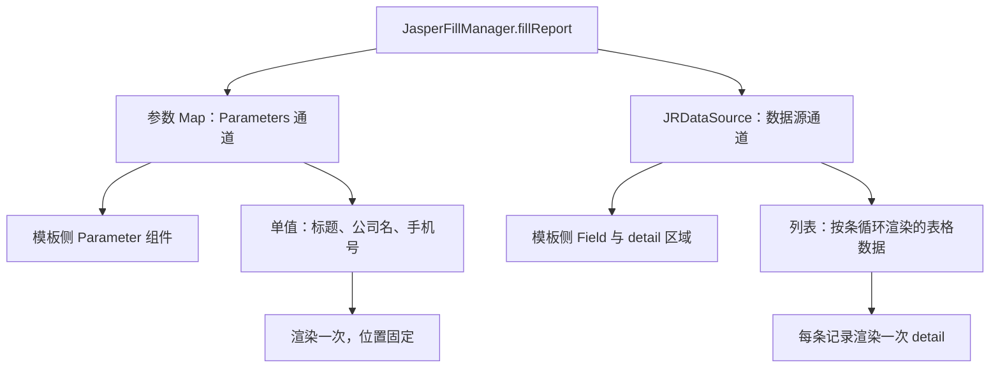

# 给 PDF 灌数据的两条通道：Parameters 单值填充与 DataSource 列表填充

模板会做、环境能跑、静态 PDF 能出，下一步自然是把真实数据灌进去：用户名、手机号、所属企业，这些值不能靠 Studio 手敲。往模板里传数据的入口其实早已写在 `fillReport` 的方法签名里，一条通道走 Map，一条通道走数据源，day10 的分组报表、Chart 图形、父子报表、用户档案打印，全都建立在这两条通道上。

## 先给结论

- `JasperFillManager.fillReport` 的签名决定了填充只有两种方式：第二个参数 `Map` 走 Parameters 通道，第三个参数 `JRDataSource` 走数据源通道。
- Parameters 适合单值：标题、公司名、手机号这类一次传一个的值；DataSource 适合列表：detail 区域按条循环渲染的表格数据。
- 两条通道与 Studio 工具里的组件一一对应：Map 对应 Outline 里的 Parameters 面板，`JRDataSource` 里的记录对应模板里的 Field。
- 没有数据时用 `JREmptyDataSource` 占位，两条通道的位子都不能空着。

## 一、方法签名里藏着的答案

静态 PDF 的填充代码里，数据的位置全是占位符。把占位符换成类型看，`fillReport` 的完整签名是：

```java
public JasperPrint fillReport(InputStream is,
                              Map<String, Object> parameters,
                              JRDataSource dataSource) throws JRException
```

三个参数，一个管模板，两个管数据。引擎没有给第三种选择，所以往 PDF 里塞数据的方式往大了说就两个方向：要么构造一个 Map 集合，要么构造一个 `JRDataSource` 数据源。之前写的空填充代码里，这两个位子分别用空 Map 和 `JREmptyDataSource` 占着：

```java
JasperPrint print = JasperFillManager.fillReport(fis, new HashMap<>(), new JREmptyDataSource());
```

这不是引擎设计者随手定的接口，而是刻意留出的两个数据入口，Studio 工具里的组件就是照着它们设计的：Outline 面板里的 Parameters 节点对应 Map 里的键，模板里的 Field 对应数据源里的记录。Java 侧传什么形式的数据，模板侧就用什么组件接，两边严丝合缝。

## 二、Parameters 通道：一次一个值的散装数据

Parameters 填充的本质是键值对。Java 侧往 Map 里放 `username` 对应张三、`mobile` 对应手机号，模板侧定义同名 Parameter，用 `$P{username}` 这样的表达式引用。一条 Parameter 就是一个独立的值，渲染时替换到固定位置。

它的适用场景是单值：报表标题、公司名称、查询条件、汇总数字。这类数据在 PDF 里只出现一次，位置固定，用 Map 传最直接。代价是数量受人力限制：三十个字段就要在模板里建三十个 Parameter、在 Java 里放三十个键，数据一多就不可维护。

## 三、DataSource 通道：按条循环的列表数据

数据源填充走的是另一套机制。`JRDataSource` 是一个接口，实现类决定数据从哪来：可以是数据库的 `Connection` 直接喂查询结果，可以是 JavaBean 集合包装成的数据源，也可以是 Map 集合列表。模板侧不用为每条记录建组件，只定义 Field，写在 detail 区域。

detail 区域是模板里专门用来「循环」的 band：数据源里有十条记录，detail 就渲染十次，每次取当前记录的 Field 值填进去。列表、表格类数据全靠它，这也是报表工具区别于普通文档生成的核心能力。

两条通道摆在一起看：



图的分叉点就是 `fillReport` 这一个方法：上面的分支走散装单值，下面的分支走循环列表，两边最终汇进同一个 `JasperPrint`。

## 四、两种方式在代码里的样子

单值通道的调用在真实工程里长这样（取自 jasper-springboot 工程的 Parameters 填充控制器，包名已改为 `com.example`）：

```java
Map<String, Object> parameters = new HashMap<>();
// 参数的 key 必须等于模板中 Parameter 的 name
parameters.put("username", "张三");
parameters.put("mobile", "120");
parameters.put("dept", "讲师");
parameters.put("company", "云帆科技");

JasperPrint print = JasperFillManager.fillReport(fis, parameters, new JREmptyDataSource());
```

列表通道的调用按本课写法补一份示例，用 JavaBean 集合包装数据源：

```java
// 示例：按本课写法补全，展示 JRBeanCollectionDataSource 的用法
List<User> users = userService.findAll();
JRBeanCollectionDataSource dataSource = new JRBeanCollectionDataSource(users);
// 模板里定义 Field：username、mobile、company、dept
// detail 区域每条记录渲染一次
JasperPrint print = JasperFillManager.fillReport(fis, new HashMap<>(), dataSource);
```

两段代码放到一起，`fillReport` 后两个参数的分工一目了然：单值进 Map，列表进数据源。真实的业务报表几乎都是两种方式同时用，标题与汇总走 Parameter，明细表格走 DataSource，互不冲突。

## 常见误区

- **把列表数据塞进 Parameters**：一个 Parameter 只能承载一个值，detail 区域只渲染一次，传一个集合进去也只显示第一条。列表数据必须走数据源通道。
- **以为两种方式二选一**：它们是两个独立的入口，同一份报表可以同时传 Map 和数据源，标题用 Parameter、明细用 Field 是最常见的组合。
- **Map 的 key 与模板参数名对不上**：键名大小写敏感，`UserName` 和 `username` 是两个东西，匹配不到就渲染空白，引擎不报错。
- **把数据源当成数据库连接池**：`fillReport` 的第三个参数是「模板数据的来源」，与 `DataSource` 连接池配置毫无关系，能传 Connection、JavaBean 集合、Map 集合多种形态。

## 面试可能被问到的问题

1. 面试官追问：「JasperReports 填充数据有哪几种方式，分别适用什么场景？」
   答：两种。Parameters 方式通过 `Map<String, Object>` 传单值，适合标题、公司名、查询条件这类出现一次的数据；DataSource 方式通过 `JRDataSource` 传列表，配合模板的 Field 和 detail 区域按条循环渲染，适合表格类数据。实际报表常两种同时用。

2. 面试官追问：「JRDataSource 和 Spring 里的 DataSource 是一个东西吗？」
   答：不是。`JRDataSource` 是 JasperReports 的接口，抽象的是「报表数据的来源」，实现可以是数据库连接、JavaBean 集合、Map 集合；Spring 的 DataSource 是数据库连接池，管理的是数据库连接。两者名字像，职责完全不同。

3. 面试官追问：「detail 区域为什么会循环渲染？」
   答：detail 是模板里与数据源绑定的 band，填充引擎遍历数据源，每读到一条记录就把 detail 渲染一次，Field 表达式取当前记录的字段值。数据源有一条渲染一次，有十条渲染十次，这是列表数据的实现基础。

4. 面试官追问：「模板还没有真实数据时，填充代码怎么写？」
   答：参数位传空 `HashMap`，数据源位传 `JREmptyDataSource`。空数据源表示零条记录，detail 不渲染，静态内容正常输出。两个位子都不能省略或传 null，否则导出的 PDF 是空白的。

5. 面试官追问：「为什么 Studio 工具里会有 Parameters 和 Fields 两套组件？」
   答：因为填充引擎在接口层就认这两个入口，`fillReport` 的后两个参数分别是 Map 和 JRDataSource。Studio 把它们可视化为 Parameters 面板与 Field 列表，拖拽即用，工具组件与 Java 数据形态是一一对应的关系。

## 配套资料

- 代码：`materials/code/02/day10-用户档案PDF报表/day10-用户档案PDF报表/代码/jasper-springboot/src/main/java/`
  （controller 包下，`JasperController.java` 为空填充版本，`JasperController02.java` 为 Parameters 填充版本；文中包名已统一改为 `com.example`）
- 同工程 `domain/User.java`、`domain/UserCount.java`：后续按 JavaBean 集合构造数据源时对应的实体类
