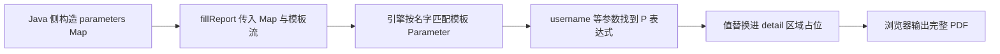

# Parameters 填充实操：模板里建参数，Map 里传值

静态模板里写死的「张三」谁都能做，麻烦的是 Java 侧传来的值怎么在模板里占好位置。Parameters 填充就是解决这件事的第一种方式：模板里定义参数并写出占位表达式，Java 侧往 Map 里放同名键，两边一对接，PDF 里的内容就活了。这一课走完从模板到接口的完整闭环。

## 先给结论

- 模板侧四步：删掉不需要的 band、用静态文本摆标签、在 Outline 的 Parameters 里创建参数、把参数拖进 detail 生成 `$P{参数名}` 表达式。
- Parameter 有三要素：name 是 Java 侧 Map 的键名，class 是 Java 类型，description 是给人看的说明。
- Studio 预览时会弹出参数输入框要求模拟值，模拟通过说明模板没有问题。
- Java 侧 `parameters.put` 的 key 与模板参数名一字不差，Map 作为 `fillReport` 的第二个参数传入。

## 一、模板改造：只留 title 和 detail

打开 Studio，新建工程与报表，模板命名为 testParam。新建的模板自带全套 band，本例用不上这么多，把 Page Header、Column Header、Column Footer、Page Footer、Summary 都删掉，只留 Title 和 Detail 两个。band 是模板的分区概念，每个 band 承担一种版式职责：Title 只在开头渲染一次，Detail 跟随数据循环，做参数填充的简单表格，这两个够了。

业务背景沿用人力资源管理系统的用户表，四个字段：用户名 `username`、手机号 `mobile`、所属企业 `company`、所属部门 `dept`。最终效果是一张两列小表，左列静态标签，右列参数占位：

| 静态标签 | 参数位 |
|---|---|
| 用户名称 | `$P{username}` |
| 手机号 | `$P{mobile}` |
| 所属企业 | `$P{company}` |
| 所属部门 | `$P{dept}` |

先把静态部分搭出来：Title 区放一个 Static Text 写「用户信息报表」，Detail 区放四个 Static Text，分别写用户名称、手机号、所属企业、所属部门，摆成两列对齐。

## 二、创建 Parameter：三要素定好

参数在 Outline 面板里创建。Outline 列出了模板的所有组件，其中 Parameters 节点代表「Java 代码传进模板的所有参数」，在它上面右键选 Create Parameter，然后改三处属性：

- **name**：参数名，定为 `username`，这个名字就是 Java 侧 Map 的键。
- **Class**：参数类型，选 `java.lang.String`，即这个值按字符串处理。
- **Description**：描述信息，写「用户名称」，给人看的备注，引擎不使用。

同样的方式把 `mobile`、`company`、`dept` 三个参数也建出来，类型都是 `java.lang.String`。完成后模板的 XML 里会多出这样的声明：

```xml
<parameter name="dept" class="java.lang.String">
    <parameterDescription><![CDATA[所属部门]]></parameterDescription>
</parameter>
```

声明只负责「定义有这么一个参数」，参数的值永远来自 Java 侧，模板里不会有任何写死的数据。

## 三、把参数拖进 detail：$P 表达式

从 Outline 里把 `username` 参数直接拖到 Detail 区域「用户名称」右边的格子里，跟拼图一样。拖进去的元素自带引用表达式，双击可以看到它的语法：

```text
$P{username}
```

`$P` 表示使用 Parameter 里的数据，大括号里写参数名，与 Outline 里定义的名字对应。把 `mobile`、`company`、`dept` 也依次拖到各自的格子里对齐，四个占位就都埋好了。

外观上再补两刀：全选所有含中文的元素，批量设置字体为华文宋体、字号 12、水平垂直居中，这是上一课字体补丁的模板侧要求；边框在右侧属性面板的 Borders 里设置，四周都加，粗细可调。保存后 Studio 会重新编译，得到带参数的 testParam.jasper。

## 四、预览：模拟参数值

点预览时 Studio 会拦一下：参数的值本来该由 Java 代码传入，工具里没有 Java，于是弹出一个输入框，要求把每个参数的值模拟出来。填入模拟数据，`username` 填张三、`mobile` 填 110、`company` 填云帆科技、`dept` 填讲师，运行后 PDF 正常显示，样式与设计视图画的基本一致。

这一步的价值在于把模板问题与代码问题隔离：预览通过，说明模板侧的参数定义、表达式、字体、边框都没问题；之后接口输出不对，只需要查 Java 侧。

## 五、Java 侧传值：Map 的 key 就是参数名

Java 侧的改动只在填充那一行之前：构造 Map，往里放参数。真实工程的写法如下（包名已改为 `com.example`）：

```java
package com.example.controller;

import net.sf.jasperreports.engine.*;
import org.springframework.core.io.ClassPathResource;
import org.springframework.core.io.Resource;
import org.springframework.web.bind.annotation.GetMapping;
import org.springframework.web.bind.annotation.RestController;

import javax.servlet.ServletOutputStream;
import javax.servlet.http.HttpServletRequest;
import javax.servlet.http.HttpServletResponse;
import java.io.FileInputStream;
import java.io.IOException;
import java.util.HashMap;
import java.util.Map;

@RestController
public class JasperController02 {

    /**
     * 基于 parameters 以 Map 的形式填充数据
     */
    @GetMapping("/testJasper2")
    public void createPdf(HttpServletRequest request, HttpServletResponse response) throws IOException {
        // 1. 引入 jasper 文件
        Resource resource = new ClassPathResource("templates/testParam.jasper");
        FileInputStream fis = new FileInputStream(resource.getFile());

        // 2. 创建 JasperPrint，向 jasper 文件中填充数据
        ServletOutputStream os = response.getOutputStream();
        try {
            Map<String, Object> parameters = new HashMap<>();
            // 设置参数，参数的 key = 模板中使用的 parameters 参数的 name
            parameters.put("username", "张三");
            parameters.put("mobile", "120");
            parameters.put("dept", "讲师");
            parameters.put("company", "云帆科技");

            JasperPrint print = JasperFillManager.fillReport(fis, parameters, new JREmptyDataSource());
            // 3. 将 JasperPrint 以 PDF 的形式输出
            JasperExportManager.exportReportToPdfStream(print, os);
        } catch (JRException e) {
            e.printStackTrace();
        } finally {
            os.flush();
        }
    }
}
```

与空填充版本相比只有两处变化：模板换成 `testParam.jasper`，`fillReport` 的第二个参数从空 Map 换成装了四个键值对的 Map。数据源依旧传 `JREmptyDataSource`，因为 detail 里没有 Field，只有 Parameter 占位。启动后访问 `http://localhost:8181/testJasper2`，浏览器里就是一份填好真实值的用户信息报表。

整条数据流如下：



名字匹配是整条链路的枢纽：Map 的 key、Outline 里的 Parameter name、`$P` 大括号里的名字，三处必须写同一个词。

## 常见误区

- **Map 的 key 与参数名拼写对不上**：`username` 写成 `userName`，引擎匹配不到参数，该位置渲染空白且不报错。三处名字对照检查，或干脆复制粘贴。
- **手机号参数选了数字类型**：`java.lang.Integer` 会丢前导零，座机带横杠直接类型不匹配。手机号、编号这类「长得像数字的文本」一律用 `java.lang.String`。
- **改了模板没有重新编译同步**：jrxml 保存后要重新编译，把新的 jasper 拷回工程 `resources/templates`，否则接口输出的还是旧版式。
- **新加的中文元素没设字体**：上一课的字体补丁只覆盖已设置的元素，新拖进来的静态文本或参数元素要单独指定中文字体，否则导出后又是空白。

## 面试可能被问到的问题

1. 面试官追问：「模板里的 Parameter 和 Java 侧的 Map 是怎么关联的？」
   答：靠名字。`fillReport` 的第二个参数是 `Map<String, Object>`，键名与模板里 Parameter 的 name 完全一致时，引擎填充阶段把值替换到对应的 `$P{参数名}` 表达式位置。名字对不上就渲染空白，不会报错。

2. 面试官追问：「$P{username} 这个表达式是什么含义？」
   答：`$P` 是 JasperReports 模板表达式语法，表示引用一个 Parameter，大括号里写参数名。填充时引擎按名字从参数 Map 里取值替换进去，属于模板侧的数据占位符。

3. 面试官追问：「Parameter 适合传什么数据，不适合传什么？」
   答：适合单值，比如标题、公司名、查询条件、汇总数字，一次一个、位置固定。不适合列表数据，一个 Parameter 只承载一个值，传集合也只会显示一次，列表要走 Field 加数据源的通道。

4. 面试官追问：「预览时 Studio 为什么要你手动输入参数值？」
   答：Parameter 的值设计上来自 Java 侧，工具预览没有 Java 环境，所以弹框要求模拟值。这正好把模板问题与代码问题隔离开：预览通过说明模板定义与表达式正确，接口输出异常时只需排查 Java 侧的键名与取值。

5. 面试官追问：「Parameters 填充时代码里为什么还传 JREmptyDataSource？」
   答：`fillReport` 的第三个参数不能省略也不能传 null，否则 PDF 空白。纯 Parameter 模板没有列表数据，给一个零条记录的空数据源既满足引擎要求，也明确表达了「本报表无明细循环」的语义。

## 配套资料

- 代码：`materials/code/02/day10-用户档案PDF报表/day10-用户档案PDF报表/代码/jasper-springboot/src/main/java/`
  （controller 包下的 `JasperController02.java`，Parameters 填充的真实控制器，路径 `/testJasper2`；文中包名已统一改为 `com.example`，示例值已替换为中性表述）
- 同工程 `JasperController.java`：空填充版本，与本课的 Map 填充版本对照阅读，差异只在第二个参数
