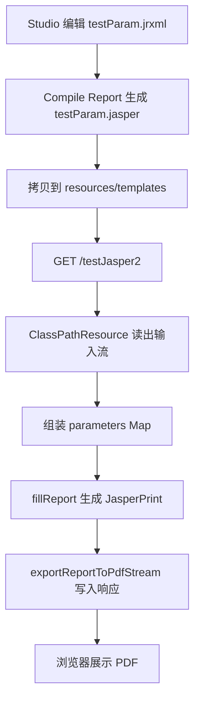

# 用 Map 给 JasperReports 模板传参，浏览器直接预览 PDF

模板里画好了四个 parameter 占位，Studio 里预览时值是写死的，改一个字就得重新编辑模板。真实业务里报表内容要跟着请求走：谁来下载、下载哪条数据，都是运行时才知道的事。接下来要做的，就是在 Java 代码里把值装进 Map，交给填充器，再把生成的 PDF 写回响应流。

## 先给结论

- 模板必须先编译成 `.jasper` 二进制文件，Java 侧填充只认它，`jrxml` 源文件不参与运行。
- 填充入口是 `JasperFillManager.fillReport()`，第二个参数就是要传的 Map。
- Map 的 key 必须与模板中 parameter 的 name 完全一致，拼错不报错，只是对应位置输出空白。
- 参数与数据源是两套体系：只传参数时，第三个参数照旧给 `JREmptyDataSource()`。
- 输出用 `JasperExportManager.exportReportToPdfStream()` 把 `JasperPrint` 写进响应输出流。

## Parameters 与 DataSource：填充数据的两条路

JasperReports 对模板的数据填充方式，官方资料归纳为两类：Parameters（参数）填充与 DataSource（数据源）填充。

Parameters 用来在打印的时候从程序里传值到报表，起参数传递的作用。它适合个数固定、单值的场景：应用中 SQL 查询的条件、报表里任何一个需要从外部传入的变量，比如一个 Image 对象的路径、报表超链接的字符串等。parameter 在创建时就要定义数据类型，类型是标准的 Java 对象，比如 `java.lang.String`。

DataSource 解决的则是「一批数据」的填充，典型的是列表。两者经常配合使用：数据源负责明细行，参数负责标题与查询条件这类全局值。这一节先把 Parameter 这条路走通，数据源从下一节展开。

## 把模板编译成 .jasper 并放进工程

填充的前提是拿到二进制的 `.jasper` 文件。做法很直接：在 Studio 里右键当前模板，选择 Compile Report，同目录会生成 `testParam.jasper`。`.jrxml` 是给人看的 XML 源码，`.jasper` 才是给填充器用的序列化产物，运行期不需要再回头编译。

把 `testParam.jasper` 复制到 Spring Boot 工程的 `src/main/resources/templates/` 目录下，classpath 就能按相对路径定位它。拷贝时注意 Studio 的编译输出目录可能与工程目录不在同一位置，右键模板选 Show in Explorer 能直接定位刚生成的 jasper 文件，省得全盘搜索。

## Controller：组装 Map 填充并输出

资料包工程的 `JasperController02` 就是这个案例的完整实现（包名已改为 `com.example`，数据值做了中性化替换）：

```java
@RestController
public class JasperController02 {

    /** 基于parameters以Map的形式填充数据 */
    @GetMapping("/testJasper2")
    public void createPdf(HttpServletRequest request, HttpServletResponse response) throws IOException {
        //1.引入jasper文件
        Resource resource = new ClassPathResource("templates/testParam.jasper");
        FileInputStream fis = new FileInputStream(resource.getFile());

        //2.创建JasperPrint,向jasper文件中填充数据
        ServletOutputStream os = response.getOutputStream();
        try {
            Map parameters = new HashMap<>();
            //设置参数 参数的key = 模板中使用的parameters参数的name
            parameters.put("username", "张三");
            parameters.put("mobile", "120");
            parameters.put("dept", "讲师");
            parameters.put("company", "云图科技");

            JasperPrint print = JasperFillManager.fillReport(fis, parameters, new JREmptyDataSource());
            //3.jasperPrint以PDF的形式输出
            JasperExportManager.exportReportToPdfStream(print, os);
        } catch (JRException e) {
            e.printStackTrace();
        } finally {
            os.flush();
        }
    }
}
```

三个要点值得逐个拆开。

**第一，模板加载走 classpath。** `ClassPathResource("templates/testParam.jasper")` 定位到资源文件，再包一层 `FileInputStream` 交给填充器。路径以 `templates/` 开头，因为资源根是 `resources`，模板放在它的子目录里。

**第二，Map 的 key 与模板 parameter 的 name 一一对应。** 模板里定义了 `username`、`mobile`、`dept`、`company` 四个参数，代码里就 put 这四个 key。这一步没有任何编译期校验，全靠人工对齐，是此类案例最容易翻车的地方。

**第三，空数据源不等于不传。** `fillReport(InputStream, Map, JRDataSource)` 的第三个参数必须给，本例没有列表数据，传 `new JREmptyDataSource()` 即可。参数和数据源各管各的，互不替代。四个参数在模板里都定义为 `java.lang.String`，代码里 put 的值也全是字符串，类型对得上填充期才不会报转换错误；若模板里把某个参数定成 Integer，put 进去一个字符串，运行到该参数的填充点就会抛异常。

## 启动验证

工程端口是 8181（见 `application.yml` 的 `server.port`），启动引导类之后浏览器访问：

```bash
curl -o user.pdf http://localhost:8181/testJasper2
```

打开生成的 PDF，四个占位处分别显示张三、120、讲师、云图科技。改一下 Map 里的值再刷新接口，PDF 内容跟着变，这就印证了参数的价值：模板一份，值随时换，报表不再需要为每条数据重新编辑。整条链路如下图：



图里 `JasperPrint` 是关键中间产物：填充完成后内存里一页一页的报表对象，后续导出 PDF、HTML 还是 Excel，都是在它之上换一个 exporter 而已。

## 常见误区

- **key 拼写与模板不一致**：模板里叫 `username`，代码里 put 了 `userName`，不会抛异常，PDF 对应位置直接空白。排查方法是两边逐字符比对 name。
- **只改模板不重新编译**：改了 `jrxml` 却拷贝了旧的 `.jasper`，或者忘了重新 Compile Report，看到的永远是旧版式。
- **把参数当数据源用**：试图往 Map 里塞 List 输出列表。Parameter 只能承载单值，列表必须走数据源，两种方式解决两类问题。
- **忽略 `os.flush()`**：输出流没有刷干净，浏览器拿到的 PDF 可能截断或损坏，`finally` 里的 flush 不是可有可无。

## 面试可能被问到的问题

1. 面试官追问：「`fillReport` 方法的三个参数分别是什么？」
   答：第一个是报表二进制数据的输入流，即 `.jasper` 文件；第二个是 `Map` 类型的参数集，对应模板里的 parameter；第三个是 `JRDataSource` 数据源，没有列表数据时给 `JREmptyDataSource`。返回值 `JasperPrint` 是填充完成的报表内存对象。

2. 面试官追问：「Map 的 key 写错了会怎样？」
   答：不会报错。填充器按 name 取值，取不到就按模板里的默认值或 null 处理，对应文本框输出空白。这类错误只能靠比对模板定义和代码 key 来排查。

3. 面试官追问：「`jrxml` 和 `jasper` 文件是什么关系？」
   答：`jrxml` 是 XML 形式的模板源码，供设计器编辑；`jasper` 是它编译后的二进制序列化文件，供运行期填充使用。工程里只放 `jasper`，修改模板必须重新编译再拷贝。

4. 面试官追问：「`JREmptyDataSource` 是什么，为什么不能传 null？」
   答：它是一个内部没有任何记录的空数据源实现。`fillReport` 会无条件遍历数据源，传 null 会直接空指针；空数据源保证填充流程正常走完，只是没有明细行。

5. 面试官追问：「PDF 是怎么写到响应里的？」
   答：取 `response.getOutputStream()` 得到 `ServletOutputStream`，`JasperExportManager.exportReportToPdfStream(print, os)` 把 `JasperPrint` 按 PDF 格式序列化进该流，浏览器收到的就是文件内容，内嵌阅读器负责展示或触发下载。

## 配套资料

- Map 参数填充的完整 Controller（包名已改为 `com.example`）：`materials/code/02/day10-用户档案PDF报表/day10-用户档案PDF报表/代码/jasper-springboot/src/main/java/` 下 controller 包内 `JasperController02.java`
- 工程依赖（JasperReports 6.5.0、itext、poi 等）：`materials/code/02/day10-用户档案PDF报表/day10-用户档案PDF报表/代码/jasper-springboot/pom.xml`
- 端口与数据库配置：同工程 `src/main/resources/application.yml`
- `testParam.jrxml` 模板未随资料包提供，模板结构与 parameter 定义按课程视频画面还原，示例为按本课写法补全
